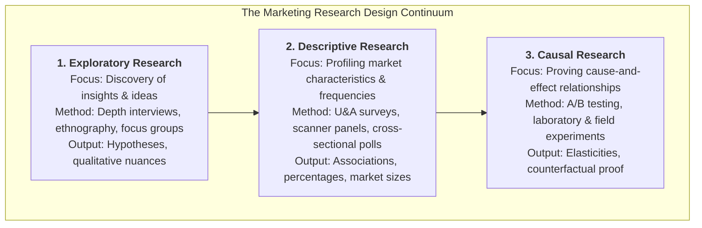

## 📐 Universal Definition & Conceptual Core

**Marketing Research** is the systematic design, collection, analysis, and reporting of empirical data and findings relevant to a specific commercial decision facing an organization. Popularized by academic authorities (Churchill; Malhotra; Kotler), marketing research functions as the intelligence engine of the enterprise, bridging the gap between managerial intuition and verifiable marketplace reality.

Scientific marketing research is organized across a tripartite methodological continuum:

---

## 🔬 Diagnostic Toolkits & Empirical Methodologies

In consumer goods and technology commercialization, decision-makers deploy four primary diagnostic instruments:

| Methodology                              | Primary Mechanism & Design                                                                                                    | Managerial Purpose                                                        | Critical Limitation                                                   |
| :--------------------------------------- | :---------------------------------------------------------------------------------------------------------------------------- | :------------------------------------------------------------------------ | :-------------------------------------------------------------------- |
| **Usage & Attitude (U&A)**               | Large-scale cross-sectional quantitative survey profiling brand awareness, penetration, usage frequency, and perceptual gaps. | Sizing market segments; diagnosing brand funnels.                         | Stated claims reflect self-report bias; cannot prove causal behavior. |
| **In-Home Usage Testing (IHUT)**         | Placing unbranded / prototype products into consumer homes for blind testing over 1–4 weeks under real-world conditions.      | Testing sensory performance, ergonomics, and repurchase intent.           | High logistics cost; respondent Hawthorne effect.                     |
| **Concept / Product Use Testing (CPUT)** | Structured lab tests exposing respondents to concept statements and sample usage to measure trial vs adoption.                | Screening product variants before tooling investment.                     | Artificial evaluation setting lacking trade/price friction.           |
| **Retail Scanner Panel Data**            | Automated point-of-sale (POS) barcode scans coupled with consumer household tracking cards (Nielsen/Circana).                 | Measuring actual price elasticities, promotion lift, and brand switching. | Measures _what_ happened, but cannot explain _why_ it happened.       |

### The Causality vs. Correlation Trap

A lethal error in corporate decision-making is conflating **correlation** (statistical association observed in descriptive research) with **causality** (proving that factor $X$ caused outcome $Y$). Establishing true causality requires satisfying three empirical conditions:

1. **Concomitant Variation**: $X$ and $Y$ move together in a statistically predictable pattern.
2. **Time Order of Occurrence**: Cause $X$ strictly precedes effect $Y$ in temporal sequence.
3. **Absence of Other Possible Causal Factors (Non-Spuriousness)**: Ruling out confounding omitted variables ($Z$) through randomized control trials (RCTs) or experimental isolation.

$$\mathbf{\text{True Causal Lift} = \mathbb{E}[Y_{1} - Y_{0} \mid \text{Treatment} = 1] = \bar{Y}_{\text{Treatment}} - \bar{Y}_{\text{Control}}}$$

---

## 🏛️ Multi-Disciplinary Lenses Across the MBA Curriculum

### 1. Marketing Management (MK3)

In [[courses/mk3-marketing-management/week-05/index|MK3 Week 05]] and the **Pillsbury Cookie Challenge Case (General Mills Canada)**, executive teams evaluate whether to launch refrigerated cookie dough based on four conflicting evidence streams. The case exposes why Canadian consumers' stated positive attitudes toward freshness in descriptive surveys did not automatically translate to trial at retail checkout without promotional catalysts. In [[courses/mk3-marketing-management/week-03/index|MK3 Week 03]], in-depth qualitative interviews uncover subconscious hedonic drivers that structured surveys miss.

### 2. Business Analytics & Empirical Econometrics (MK6)

In business analytics and decision science, marketing research methodologies form the empirical basis for regression modeling, customer churn analysis, and marketing mix modeling (MMM). Distinguishing observational data from experimental A/B testing protects firms from misallocating millions in digital marketing budgets.

---

## ⚠️ Strategic Pitfalls & Boundary Conditions

1. **The Focus Group Fallacy**: Relying on 8-person focus groups to make go/no-go manufacturing decisions. Focus groups generate qualitative hypotheses; they never validate market demand.
2. **Leading the Witness**: Designing survey questionnaires with loaded prompts (e.g., _"How much do you love our new eco-friendly formula?"_) that produce false positive consumer enthusiasm.
3. **Ignoring Non-Response Bias**: Failing to audit survey dropout rates, leading to skewed samples dominated by extreme brand enthusiasts or dissatisfied outliers.

---

## 🔗 Related Knowledge Hubs

- [[courses/mk3-marketing-management/week-05/index|MK3 Week 05: Marketing Research & Diagnostic Methodologies]]
- [[courses/mk3-marketing-management/week-03/index|MK3 Week 03: Consumer Behavior & Customer Decision Stripe]]
- [[entities/general-mills|General Mills, Inc.]]
