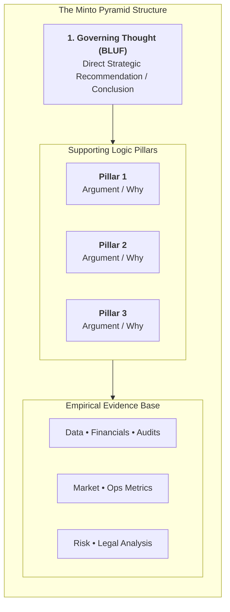
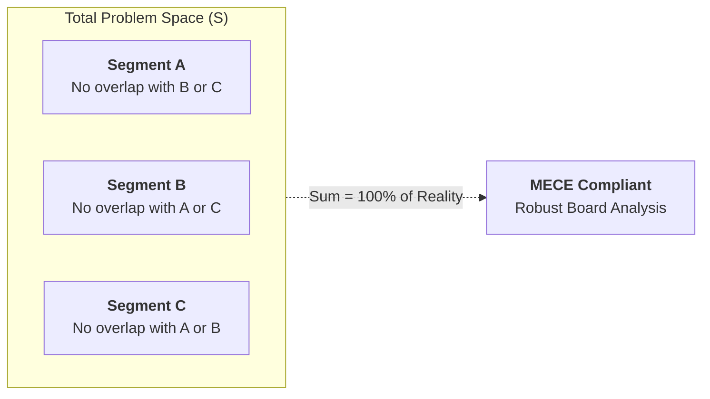
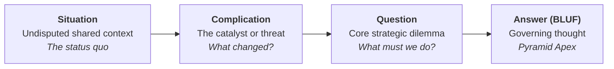
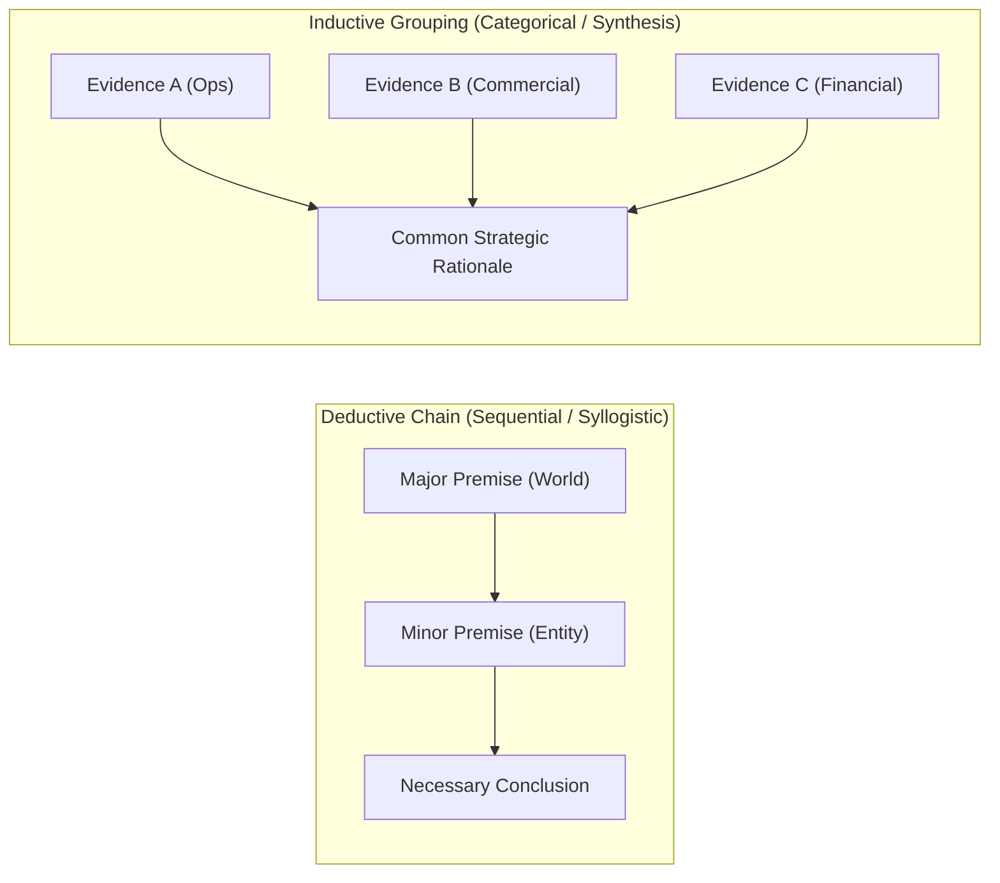

## 💡 First-Principles Intuition & Conceptual Core

Every senior corporate executive operates under severe cognitive load and attention scarcity. When a divisional director enters a boardroom, the executive committee does not possess the luxury of time to trace the presenter's multi-month intellectual journey in chronological order. When forced to listen through 40 slides of raw operational data before learning what action is being requested, board members experience cognitive fatigue, lose patience, and mentally formulate their own conflicting conclusions.

Developed by Barbara Minto during her tenure at McKinsey & Company and championed globally by strategic management educators including [[entities/edward-buckingham|Prof. Edward Buckingham]] at Monash University, the **Minto Pyramid Principle** is a structural communication and analytical discipline designed to mirror how the human mind naturally processes complex information:

$$\mathbf{TOP\text{-}DOWN \quad \boldsymbol{\longrightarrow} \quad DEDUCTIVE/INDUCTIVE \quad \boldsymbol{\longrightarrow} \quad MECE}$$

The core thesis is simple: **Start with the Answer First (Bottom Line Up Front / BLUF)**. Present the governing thought or core recommendation immediately at the apex of the pyramid, then systematically unpack supporting logic downward through a pyramid of logically grouped arguments grounded in verified empirical evidence.

---

## 🏛️ Foundational Logic: The Pyramid Architecture

The Minto Pyramid operates on three ironclad structural rules:

1. **Ideas at Any Level Must Summarize Ideas Below Them**:
   Every statement on a superior tier must serve as the direct conceptual synthesizer of the grouped points directly subordinate to it. A slide title cannot merely describe a category (e.g., _"Financial Review"_); it must state an assertive takeaway (e.g., _"EBITDA margins expanded by 340 bps due to automated procurement"_).
2. **Ideas in Each Grouping Must Be the Same Category**:
   If an executive outlines three reasons to exit a foreign joint venture, all three elements must belong to the same logical category (e.g., all strategic risks, or all structural financial losses). Mixing an operational metric with a regulatory sanction and a personal complaint violates categorical integrity.
3. **Ideas in Each Grouping Must Be in Logical Order**:
   The supporting points within any cluster must follow an explicit, demonstrable sequence:
   - **Chronological / Process**: First do X, then do Y, then do Z.
   - **Structural / Spatial**: Segmented by geography, business unit, or value chain component.
   - **Comparative / Degree of Importance**: Most critical strategic driver to least critical.

---

## 🧱 The MECE Rule: Mutually Exclusive, Collectively Exhaustive {#mece-rule}

The mathematical and conceptual backbone of pyramid grouping is the **MECE Rule**:

$$\mathbf{MECE} = \mathbf{Mutually \ Exclusive} \quad \boldsymbol{\&} \quad \mathbf{Collectively \ Exhaustive}$$

In formal set notation, if a problem space $S$ is decomposed into sub-components $\{A_1, A_2, \dots, A_n\}$:

$$A_i \cap A_j = \emptyset \quad \forall \ i \neq j \quad (\text{Mutually Exclusive: Zero Overlap})$$

$$\bigcup_{i=1}^{n} A_i = S \quad (\text{Collectively Exhaustive: Zero Blind Spots})$$

### Failure Modes of Non-MECE Grouping

| Structural Defect                                    | Manifestation in Executive Decks                                                                                            | Executive Consequence                                                                                                 |
| :--------------------------------------------------- | :-------------------------------------------------------------------------------------------------------------------------- | :-------------------------------------------------------------------------------------------------------------------- |
| **Overlapping Categories** (Not Mutually Exclusive)  | Presenting _"High Logistics Costs"_ and _"Inefficient Truck Fleet Utilization"_ as two separate pillars.                    | Double-counting drivers; executive committee debates semantic redundancy instead of making a capital decision.        |
| **Gaps & Blind Spots** (Not Collectively Exhaustive) | Analyzing revenue growth solely through _"Domestic B2C"_ and _"Institutional B2B"_, forgetting _"Digital Export Channels"_. | Critical risks remain unexamined; strategy collapses when external blindspots trigger unmitigated operational shocks. |

---

## 🧭 The SCQA Storytelling Framework {#scqa-framework}

Before delivering the pyramid's apex recommendation, an executive must establish cognitive alignment with the audience. The **SCQA Framework** serves as the narrative onboarding ramp:

1. **Situation (S)**:
   - Grounded in uncontroversial facts that the audience already accepts as true.
   - _Example_: _"PT Jasa Marga currently operates 1,260 km of toll road concessions across Java and Sumatra with steady cash flow generation."_
2. **Complication (C)**:
   - The triggering event, operational bottleneck, or external disruption that destabilizes the situation.
   - _Example_: _"Rising debt service costs from recent expansions combined with scheduled capital overhaul mandates threaten covenant liquidity within 18 months."_
3. **Question (Q)**:
   - The framing dilemma that the decision-makers are forced to answer.
   - _Example_: _"How can the enterprise refinance its debt maturities while funding mandatory preservation without diluting state equity?"_
4. **Answer (A)**:
   - The pyramid's governing recommendation delivered with crisp clarity.
   - _Example_: _"Execute a targeted asset recycling program through Danantara infrastructure fund tranches, monetizing mature mature toll segments to retire expensive short-term liabilities."_

---

## ⚖️ Deductive Chains vs. Inductive Groupings {#deductive-vs-inductive}

Every logical grouping beneath the governing thought must follow either a **deductive** or an **inductive** structure:

### 1. Deductive Logic (Syllogistic Chain)

- **Structure**:
  - Premise 1 (General Truth): All entities operating with debt-to-EBITDA exceeding $5.0\times$ face sovereign credit downgrade risks under Danantara oversight.
  - Premise 2 (Specific Fact): Division X's current leverage profile stands at $6.8\times$ due to unhedged foreign EPC contracts.
  - Conclusion: Division X must immediately halt non-critical capital expenditures and restructure foreign procurement.
- **When to Use**: Ideal for hostile or skeptical audiences, regulatory compliance reviews, legal arguments, and safety audits where each step must indisputably necessitate the next.

### 2. Inductive Logic (Categorical Synthesis)

- **Structure**:
  - Independent Points:
    1. Modernized ticketing kiosks reduced station passenger dwell time by 42%.
    2. Real-time fleet telematics cut fuel consumption variance by 18%.
    3. Automated track inspection drones lowered maintenance overtime by 25%.
  - Synthesis: Digital railway asset automation is generating verifiable operational margin expansion across all three pilot divisions.
- **When to Use**: Strongly preferred for senior board presentations, executive pitches, and strategic memoranda because inductive points are mutually reinforcing; even if one pillar is questioned, the remaining pillars maintain structural integrity.

---

## 🏢 Enterprise & BUMN Governance Applications {#bumn-applications}

In Indonesian state-owned enterprises (BUMN) operating under the **Danantara** investment authority, communication often suffers from cultural barriers that degrade decision velocity:

### 1. Dismantling the "Sungkan" Reflex

In traditional bureaucratic hierarchy, subordinates often feel uncomfortable delivering direct recommendations to elders or senior directors (_sungkan_). Consequently, presenters construct elaborate historical preambles, hoping the board will deduce the conclusion on its own.

- **The Minto Remedy**: The Minto Pyramid reframes directness as an act of **institutional respect**. Delivering the recommendation upfront respects the minister's or director's limited calendar, allowing them to allocate precious discussion time to stress-testing assumptions rather than deciphering the slide deck.

### 2. The Candi Borobudur Metaphor

As emphasized by [[entities/edward-buckingham|Prof. Edward Buckingham]], the Minto Pyramid is not an imported, sterile Western abstraction; it mirrors the timeless architectural discipline of **Candi Borobudur**:

- **The Apex Stupa (_Arupadhatu_)**: The singular, clear governing thought, visible from afar.
- **The Structured Terraces (_Rupadhatu_)**: The MECE pillars of strategic and financial rationale.
- **The Massive Stone Base (_Kamadhatu_)**: The unshakeable foundation of empirical data, audited financials, and operational truths. A stupa without a bedrock foundation collapses; a data bedrock without an apex is merely a pile of quarry stones.

---

## ⚠️ Common Pitfalls & Anti-Patterns

1. **The Murder Mystery Slide Deck**: Presenting 25 slides of background, history, and statistical charts, saving the big reveal for the final slide. In executive settings, the board will interrupt on slide 4 to ask, _"What are you proposing?"_
2. **The Grocery List Failure**: Grouping 8 or 9 unrelated bullet points without hierarchical clustering. Executive working memory degrades sharply beyond $3\text{ to }5$ chunks.
3. **The Circular Conclusion**: An apex statement that merely restates the data without adding synthesizing judgment (e.g., _"We studied three options and each has pros and cons"_ is not an answer; _"Option B generates the highest risk-adjusted NPV under Danantara hurdle rates"_ is an answer).

---

## 🔗 Cross-Curricular Bridges & Knowledge Matrix

- **Keynote Masterclass**:
  - [[rabuan/2026-09-30-buckingham-minto-method|Rabuan 05: The Minto Pyramid Principle & Structured Executive Communication]] (Prof. Edward Buckingham)
- **Foundational Thinkers**:
  - [[entities/edward-buckingham|Prof. Edward Buckingham]] (Monash University)
  - Barbara Minto (McKinsey & Company)
- **Interlocking Strategic & Analytical Concepts**:
  - [[concepts/professional-image-framework|Professional Image & Leadership 5C Framework]] (The communication interface)
  - [[concepts/kepner-tregoe-problem-analysis|Kepner-Tregoe Problem Analysis]] (Root-cause empirical diagnostics)
  - [[concepts/value-focused-thinking|Value-Focused Thinking]] (Structuring decision objectives before evaluating alternatives)
  - [[concepts/analytic-hierarchy-process|Analytic Hierarchy Process (AHP)]] (Mathematical priority weighting across multi-criteria pillars)
- **Core Academic Courses**:
  - [[courses/mk1-organizational-behavior-managing-people/index|MK 1: Organizational Behavior & Managing People]] (Psychological safety and hierarchical communication)
  - [[courses/mk5-decision-making-negotiation/index|MK 5: Problem Solving, Decision Making and Negotiation]] (Executive persuasion, cognitive biases, and board deliberations)
