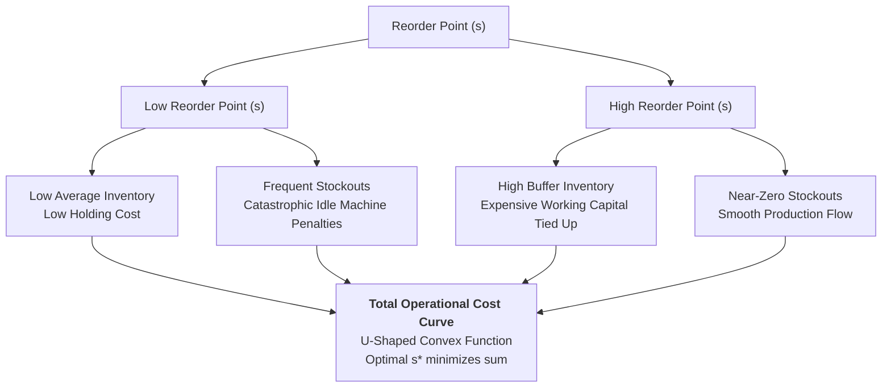

**Operations Lead-Time Simulation** is a computational modeling technique in Prescriptive Analytics that evaluates supply chain decisions under conditions of simultaneous demand and lead-time uncertainty. Rather than relying on rigid deterministic formulas—such as the classical Economic Order Quantity (EOQ)—which assume constant delivery times and stable demand, lead-time simulation uses **Monte Carlo empirical resampling** to model the non-linear financial trade-off between **holding excess safety stock** and **incurring severe stockout downtime penalties**.

---

## 💡 1. Intuition & Everyday Analogy

Imagine managing a high-volume commercial bakery:

- Flour arrives by the truckload. Your current trusted supplier charges $\$100/\text{bag}$ and reliably delivers in exactly 2 days.
- A new low-cost supplier arrives, offering a $\$5/\text{bag}$ discount—promising to save your bakery thousands of dollars every month.
- **The catch**: Their delivery times are unpredictable. Sometimes they arrive in 1 day; other times their trucks break down and take 7 days.

If you switch suppliers without changing your ordering behavior, you will run out of flour mid-week, shutting down ovens and paying bakers to sit idle while turning away wedding cake orders. To survive, you must hold more inventory as a buffer.

**Does the $\$5$ purchase discount exceed the extra warehouse holding cost plus the risk of costly oven downtime?** Only stochastic simulation can answer that question.

---

## 🔍 2. Prerequisite & Jargon Decoder

| Term                                      | Operational & Mathematical Meaning                                                                                                                                                                      | Real-World Failure Mode                                                                                                  |
| :---------------------------------------- | :------------------------------------------------------------------------------------------------------------------------------------------------------------------------------------------------------ | :----------------------------------------------------------------------------------------------------------------------- |
| **Deterministic vs. Stochastic Modeling** | **Deterministic models** assume fixed parameters (e.g. constant 3-day lead time). **Stochastic models** treat demand and lead times as random variables drawn from empirical probability distributions. | Building safety stock formulas using average lead time, leaving the firm defenseless against lead-time variance spikes.  |
| **Reorder Point ($s$)**                   | The inventory level that triggers the placement of a new purchase replenishment order: $s = \bar{d} \times \bar{L} + \text{Safety Stock}$.                                                              | Setting $s$ too low, triggering production halts; or setting $s$ too high, tying up liquid working capital.              |
| **Stockout / Running-Out Penalty**        | The severe operational cost incurred per unit of unmet demand, including idle machine time, worker downtime, expedited freight, or lost customer goodwill.                                              | Treating stockout costs merely as "lost revenue," ignoring massive factory idle overhead and overtime restart penalties. |
| **Empirical Resampling (Bootstrapping)**  | Drawing random observations directly from historical datasets with replacement, preserving authentic tail-risk and skewness without forcing assumptions of normality.                                   | Forcing a Gaussian normal bell curve onto supplier delivery times that exhibit severe fat-tailed delays.                 |

---

## 🏛️ 3. Structural Mechanics: The Total Cost Convex Curve

For any chosen Reorder Point $s$, the enterprise faces two opposing economic forces:

### The Total Monthly Cost Objective Function

Let:

- $Q$ be the fixed order quantity (e.g., $100\text{ tonnes}$ per order).
- $C_h$ be the monthly inventory holding cost per unit (e.g., $\text{Rp } 180{,}000/\text{tonne/month}$).
- $C_s$ be the stockout penalty per unit short (e.g., $\text{Rp } 3{,}000{,}000/\text{tonne short}$).
- $N_{\text{orders}}$ be the expected number of replenishment orders per month.
- $I_{\text{left}}(s)$ be the expected ending buffer inventory when the shipment arrives at reorder point $s$.
- $S(s)$ be the expected shortage (tonnes short) per order cycle at reorder point $s$.

$$
\text{Total Monthly Cost}(s) = C_h \times \left( \frac{Q}{2} + I_{\text{left}}(s) \right) + C_s \times S(s) \times N_{\text{orders}}
$$

As $s$ increases:

- $I_{\text{left}}(s)$ increases monotonically $\implies$ **Holding Cost rises linearly**.
- $S(s)$ collapses toward zero exponentially $\implies$ **Stockout Cost drops precipitously**.
- The sum of both costs forms a convex (U-shaped) curve with a distinct global minimum: **$s^* = \arg\min \text{Total Cost}(s)$**.

---

## 🔢 4. Micro-Numerical Toy Example & Supplier Trade-Off Logic

Consider choosing between Supplier A (Reliable) and Supplier B (Cheap but Variable):

| Operational Parameter                             | Supplier A (Current Benchmark)                 | Supplier B (New Low-Cost Challenger)                           |
| :------------------------------------------------ | :--------------------------------------------- | :------------------------------------------------------------- |
| **Material Purchase Price**                       | $\text{Rp } 9{,}000{,}000/\text{tonne}$        | $\text{Rp } 8{,}980{,}000/\text{tonne}$                        |
| **Monthly Purchase Savings (200t)**               | Benchmark ($\text{Rp } 0$)                     | **$\text{Rp } 4{,}000{,}000\text{ savings/month}$**            |
| **Lead-Time Distribution**                        | Tightly clustered: $2\text{ to }3\text{ days}$ | Dispersed: $1\text{ to }7\text{ days}$ (High variance)         |
| **Optimal Reorder Point ($s^*$)**                 | $64\text{ tonnes}$                             | $96\text{ tonnes}$ (Must order much earlier)                   |
| **Average Buffer Stock Left ($I_{\text{left}}$)** | $8\text{ tonnes}$                              | $24\text{ tonnes}$                                             |
| **Monthly Holding Cost**                          | $\text{Rp } 10.44\text{ Million}$              | $\text{Rp } 13.32\text{ Million}$ ($+\text{Rp } 2.88\text{M}$) |
| **Monthly Expected Stockout Cost**                | $\text{Rp } 0.36\text{ Million}$               | $\text{Rp } 2.16\text{ Million}$ ($+\text{Rp } 1.80\text{M}$)  |
| **Total Optimal Operational Cost**                | **$\text{Rp } 10.80\text{ Million}$**          | **$\text{Rp } 15.48\text{ Million}$**                          |

### The Executive Trade-Off Decision Rule

1. **Calculate the Operational Cost Penalty**:
   $$
   \Delta\text{Operational Cost} = \text{Cost}(B) - \text{Cost}(A) = 15.48\text{M} - 10.80\text{M} = \mathbf{+\text{Rp } 4.68\text{ Million/month}}
   $$
2. **Weigh Against the Purchase Price Discount**:
   $$
   \text{Net Economic Benefit} = \text{Price Discount} - \Delta\text{Operational Cost} = 4.00\text{M} - 4.68\text{M} = \mathbf{-\text{Rp } 0.68\text{ Million/month}}
   $$
3. **Executive Conclusion**: **DO NOT SWITCH**. The cheap supplier appears to save Rp 4 Million on the procurement invoice, but lead-time variance increases inventory holding and stockout downtime costs by Rp 4.68 Million, resulting in a net monthly loss of Rp 680,000.

---

## 🔗 Related Knowledge Bridges

- Master Curricular Hub: [[courses/mk6-business-analytics/week-09/index|MK6 Week 09: Operations Analytics & Supply Chain Lead-Time Simulation]]
- Cohort Pre-Class Guide: [[courses/mk6-business-analytics/week-09/assignment-flour-supplier-simulation|Cohort Pre-Class Brief: Flour Supplier Simulation Analysis]]
- Queuing Theory: [[concepts/queuing-theory|Queuing Theory & Waiting Line Analysis]]
- Return to [[concepts/index|Knowledge Matrix (Concepts Hub)]]
