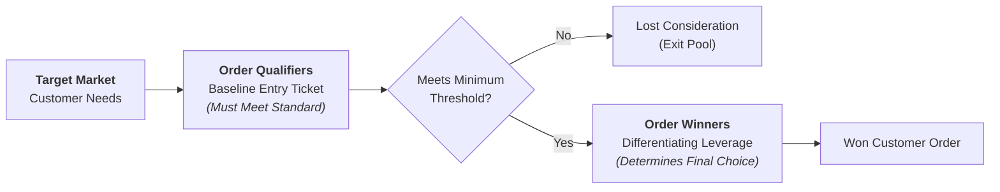
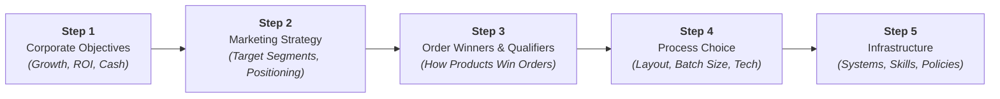

The **Order Winners and Order Qualifiers** framework, developed by Professor Terry Hill (London Business School), provides a structured methodology for aligning an enterprise's operations strategy and manufacturing infrastructure with its corporate marketing objectives.

Rather than pursuing operational excellence in the abstract, the framework forces leadership to identify the exact competitive criteria required to enter a market and the distinct criteria that secure customer purchase orders.

---

## 🏛️ Definitional Mechanics: Qualifiers vs. Winners

| Dimension              | Order Qualifiers (OQ)                                                                                                                             | Order Winners (OW)                                                                                                                    |
| :--------------------- | :------------------------------------------------------------------------------------------------------------------------------------------------ | :------------------------------------------------------------------------------------------------------------------------------------ |
| **Operational Role**   | The baseline criteria a company must demonstrate to even be considered as a viable candidate or supplier.                                         | The specific competitive dimension that directly clinches the deal and wins the customer's business over rival offerings.             |
| **Performance Curve**  | **Threshold / Non-linear**: Below the acceptable baseline, market share drops to zero; performing far above the baseline yields zero extra sales. | **Linear / Monotonic**: Higher performance directly correlates with increased market share, margin premium, and customer acquisition. |
| **Failure Penalty**    | Severe and immediate disqualification from the customer's consideration set.                                                                      | Loss of the specific deal to a competitor offering superior differentiation on the winning attribute.                                 |
| **Managerial Pitfall** | Over-investing capex/opex to achieve gold-plated performance on an attribute that is merely a qualifier.                                          | Under-resourcing the true order winner by dispersing resources equally across all operational capabilities.                           |

---

## 🧭 Terry Hill's 5-Step Strategy Alignment Process

Hill formulated a 5-step sequential process to bridge corporate goals with physical factory and service infrastructure:

1. **Corporate Objectives**: Clarify target return on capital, market share, profit margin, and sustainable growth rate.
2. **Marketing Strategy**: Define product lines, customer segments, price bands, and geographic footprint.
3. **Assess Order Winners & Qualifiers**: Group criteria by product/market family: Price/Cost, Quality (Conformance vs. Performance), Delivery Speed, Delivery Reliability, Demand Flexibility, and Product Customization.
4. **Process Choice (Operations Strategy)**: Select the appropriate layout along Hayes & Wheelwright’s Product-Process Matrix (Project, Jobbing/Workcenter, Batch/Cell, Line Flow, Continuous).
5. **Infrastructure Support**: Align quality systems (SPC, Six Sigma), planning mechanisms (ERP, MRP, Kanban), remuneration incentives, and organizational hierarchy to support the chosen process.

---

## ⚡ Dynamic Criteria Migration: The Competitive Escalation

Order criteria are never static; competitive rivalry and technology diffusion cause criteria to migrate over time:

$$\mathbf{\text{Order Winner}}_{t_0} \xrightarrow{\quad\text{Industry Diffusion}\quad} \mathbf{\text{Order Qualifier}}_{t_1} \xrightarrow{\quad\text{Commoditization}\quad} \mathbf{\text{Table Stakes}}_{t_2}$$

- **Case Example in Rail Transportation ([[entities/pt-kereta-api-indonesia|PT Kereta Api Indonesia]])**:
  - In 2011, air-conditioned passenger coaches and 99% on-time departure punctuality were decisive **Order Winners** that captured passengers from highways and air travel.
  - By 2026, air conditioning and punctuality have migrated into non-negotiable **Order Qualifiers**; the modern **Order Winners** are seamless digital multimodal booking via _Access by KAI_, sub-second biometric boarding, and onboard working connectivity.
- **Commodity Bulk Logistics (KAI Coal / Babaranjang)**:
  - For South Sumatra state electricity producers (PLN), environmental compliance is a strict **Order Qualifier**, while delivered freight cost per metric ton-kilometer and round-trip fleet turnaround reliability are the primary **Order Winners**.

---

## 🔗 Cross-Curricular Connections

- **Marketing Integration**: Directly intersects with [[concepts/customer-perceived-value|Customer Perceived Value]] and Value Propositions in MK3.
- **Operations Architecture**: Aligns with [[concepts/service-system-design-matrix|Service-System Design Matrix]] and [[concepts/customer-order-decoupling-point|Customer Order Decoupling Point]].
- **Course Anchor**: Applied in [[courses/mk4-operations-supply-chain-management/week-02/index|MK4 Week 02: Operations Strategy]] and the [[courses/mk4-operations-supply-chain-management/week-02/case-kai-coal-dilemma|KAI Coal Logistics Case Dossier]].
