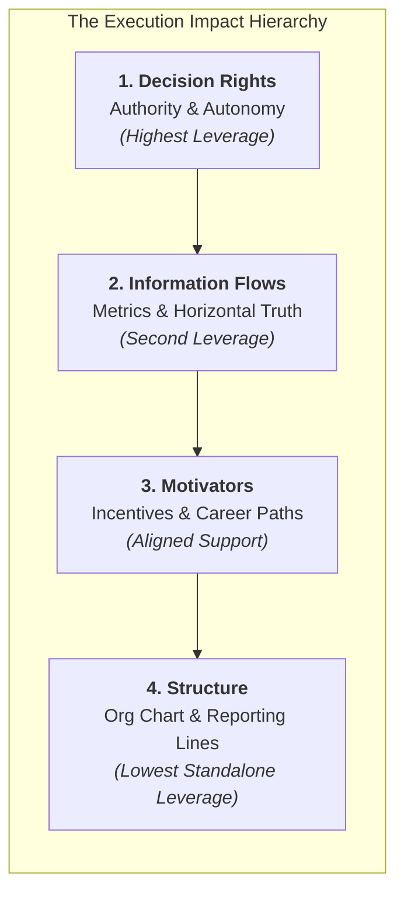

The **Organizational DNA Framework**, developed by Gary L. Neilson, Karla L. Martin, and Elizabeth Powers (Booz & Company / Strategy&) in their foundational 2008 Harvard Business Review study _"The Secrets to Successful Strategy Execution"_, provides a diagnostic model for why well-crafted corporate strategies fail in execution. Based on empirical surveys of more than 250,000 executives across 1,000+ companies in 50 countries, the authors demonstrated that **reorganizing the structure (drawing new org charts) is the least effective way to improve execution**. Sustainable execution requires altering an enterprise's organizational DNA across four interdependent traits, led by **decision rights** and **information flows**.

---

## 💡 1. Intuition & Everyday Analogy

Imagine a high-traffic airport traffic control system during stormy weather.

- If planes are circling, running low on fuel, and missing landing slots, a naive bureaucrat might redraw the staff hierarchy: creating a new "Vice President of Runway Coordination" and adding three administrative reporting tiers (**Restructuring**).
- The airplanes will still crash or divert. Why? Because the pilots and ground controllers still lack clear authority on who clears a flight for emergency landing (**Decision Rights**), runway visibility sensors do not transmit telemetry in real-time to the cockpit (**Information Flows**), and air traffic controllers are penalized for minor schedule delays rather than rewarded for runway safety (**Motivators**).

Just as biological DNA dictates how organic cells build living tissue, an enterprise's organizational DNA dictates how frontline employees and managers coordinate, allocate capital, and execute corporate commitments when the CEO is not in the room.

---

## 🔍 2. Prerequisite & Jargon Decoder

| Term                  | Definitional Meaning in Enterprise Architecture                                                                                                              | Real-World Failure Mode                                                                                                                        |
| :-------------------- | :----------------------------------------------------------------------------------------------------------------------------------------------------------- | :--------------------------------------------------------------------------------------------------------------------------------------------- |
| **Decision Rights**   | Explicit, non-ambiguous rules defining which role has the authority to make, approve, veto, or execute a decision without committee escalation.              | Decisions endlessly debated across cross-functional committees; second-guessing by senior executives after sign-off.                           |
| **Information Flows** | The horizontal and vertical velocity and transparency with which operational metrics, competitor signals, and performance truths move across the enterprise. | Bad news buried; frontline operational failures hidden from the board until catastrophic earnings misses occur.                                |
| **Motivators**        | The full spectrum of financial rewards, peer recognition, promotions, and accountability consequences aligned with strategic goals.                          | Sales executives rewarded on top-line revenue volume while the corporate mandate is gross margin and cash collection.                          |
| **Structure**         | The formal organizational hierarchy, lines of reporting, functional silos, and spans of control depicted on the corporate org chart.                         | Constant cyclical restructuring (centralizing $\leftrightarrow$ decentralizing) that disrupts operations without fixing execution bottlenecks. |

---

## 🏛️ 3. Structural Anatomy: The 4 Building Blocks & The 7 Archetypes

### The 7 Organizational DNA Archetypes

Neilson et al. classified organizations into seven operational profiles across an execution spectrum:

| Execution Tier                  | Organizational Archetype  | Core Diagnostic Symptom                                                                      | Primary Failure / Success Mechanism                                                        |
| :------------------------------ | :------------------------ | :------------------------------------------------------------------------------------------- | :----------------------------------------------------------------------------------------- |
| **Execution-Strong** (Top 31%)  | **1. Resilient**          | Nimble, forward-looking, rapidly absorbs market shocks, empowers frontline.                  | Clear decision rights; unvarnished information flow; high trust and shared accountability. |
| **Execution-Strong** (Top 31%)  | **2. Just-in-Time**       | Thrives on creative heroics; succeeds under pressure but lacks institutional scale.          | Reliant on individual star performers rather than codified standard operating routines.    |
| **Execution-Strong** (Top 31%)  | **3. Military Precision** | Top-down command and control; highly efficient in stable markets.                            | Struggles when market disruption demands decentralized innovation and local initiative.    |
| **Execution-Weak** (Bottom 69%) | **4. Outgrown**           | Too big for its legacy boots; founders or small top team still try to make all decisions.    | Centralized bottleneck; management span exceeds capability; slow response time.            |
| **Execution-Weak** (Bottom 69%) | **5. Fits-and-Starts**    | Multiple smart initiatives launched simultaneously; lack of corporate discipline.            | High entrepreneurial energy but zero prioritization; initiatives stall midway.             |
| **Execution-Weak** (Bottom 69%) | **6. Overmanaged**        | "Paralysis by analysis"; excessive layers of middle management and checking.                 | Multiple veto gates; managers spend more time managing each other than customers.          |
| **Execution-Weak** (Bottom 69%) | **7. Passive-Aggressive** | "Everyone nods in the room, but nothing happens afterward." Most common execution-weak type. | Polite consensus culture masks deep resistance; second-guessing; ambiguous accountability. |

---

## 🔢 4. Micro-Numerical Toy Example & Strategic Leverage

### The Diagnostic Leverage Disparity

In Neilson et al.'s global dataset, when companies were asked to assess the impact of organizational interventions on execution effectiveness:

- Fixing **Structure alone** improved execution in only **12%** of companies surveyed.
- Fixing **Information flows + Decision rights** improved execution in **73%** of companies surveyed.

Consider an enterprise project approval process:
Let $N_{\text{layers}}$ be the number of management approval layers, and $P(\text{veto})$ be the probability of a middle-tier veto or delay at each layer:

$$
P(\text{uninterrupted passage}) = (1 - P(\text{veto}))^{N_{\text{layers}}}
$$

If an enterprise has $N_{\text{layers}} = 5$ and each layer has a $20\%$ chance of raising a query ($P(\text{veto}) = 0.20$):

$$
P(\text{uninterrupted passage}) = (0.80)^5 \approx 0.3277 \quad (32.8\%)
$$

Two-thirds of strategic initiatives stall in transit.

By **clarifying decision rights** and delegating authority to the frontline project owner ($N_{\text{layers}} = 1$), while establishing real-time operational telemetry (**Information Flows**):

$$
P(\text{uninterrupted passage}) = (0.80)^1 = 80.0\%
$$

Execution velocity increases by **$144\%$** without changing a single job title on the corporate directory.

---

## 🔗 Related Knowledge Bridges

- Master Curricular Hub: [[courses/mk1-organizational-behavior-managing-people/week-09/index|MK1 Week 09: Organization Design & Strategic Workforce Planning]]
- Strategic HR Architecture: [[concepts/ulrich-hr-model|Dave Ulrich HR Business Partner Model]]
- Corporate Case Dossier: [[courses/mk1-organizational-behavior-managing-people/week-08/case-general-motors-mary-barra-ev|General Motors: Mary Barra's Leadership in the EV Era]]
- Return to [[concepts/index|Knowledge Matrix (Concepts Hub)]]
