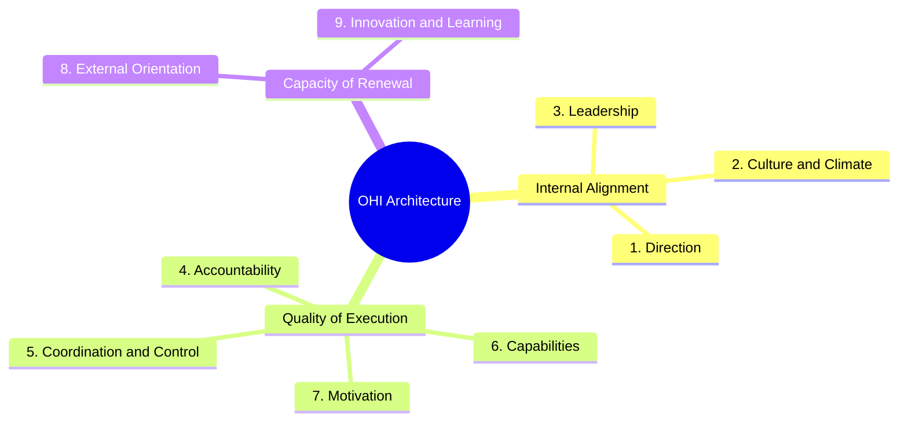

## 💡 First-Principles Intuition & Conceptual Core

Imagine two marathon runners who cross the finish line in the exact same time. One finishes with steady vitals and strong recovery; the other collapses from dehydration and torn tendons. Looking only at the scoreboard (**performance**), both look identical. Only a medical checkup (**health**) reveals who can run again tomorrow.

In corporate management, quarterly financial results measure **performance** (how fast the enterprise ran last quarter), whereas the **Organizational Health Index (OHI)**—developed by Scott Keller and Colin Price (_Beyond Performance_, McKinsey & Company, 2011)—measures an organization's underlying capacity to align, execute, and renew itself faster than competitors over decades.

### 🔑 Prerequisite Concepts & Jargon Decoder

- **Organizational Health**: An enterprise's ability to align around a clear strategy, execute with discipline, and continuously adapt to external disruption—captured empirically across four observable outcomes: **Productivity**, **Engagement**, **Retention**, and **Profitability**.
- **Organizational Archetype**: A proven "winning recipe" of management practices (e.g., _Execution Edge_ vs. _Market Focus_) that fits a company's strategic mandate rather than chasing generic "best-in-class" scores on everything at once.

---

## 📐 Universal Mechanism & Mathematical Architecture

Long-term enterprise value depends on pairing short-term financial performance with structural health rather than trading one for the other:

$$\text{Sustainable Value} = \text{Short-Term Performance} \times \left(\frac{\text{Internal Alignment} + \text{Quality of Execution} + \text{Capacity of Renewal}}{3}\right)$$

### ⚙️ Mechanics & Structural Anatomy

- **Driving Component (Numerator — Three Health Clusters)**:
  1. **Internal Alignment**: Shared vision, culture, and leadership ensure everyone rows in the same direction.
  2. **Quality of Execution**: Accountability, coordination, capabilities, and motivation turn strategy into reliable delivery.
  3. **Capacity of Renewal**: External orientation and innovation/learning prevent the firm from being blindsided by technological or market shifts.
- **Multiplicative Coupling**: If any cluster collapses toward zero (e.g., high execution discipline with zero capacity of renewal), short-term profits erode as the industry shifts—known in **[[concepts/leadership-ambidexterity|Leadership Ambidexterity]]** as the _Success Trap_.
- **10-Second Micro-Example**: Suppose Division A scores `0.90` on Alignment and `0.90` on Execution, but `0.30` on Renewal (average health = `0.70`). Even if it posts $\text{Rp } 100\text{B}$ profit today, its sustainable value multiplier (`0.70`) lags a balanced competitor scoring `0.85` across all three clusters (`0.85`), because Division A cannot adapt when customer demand shifts.

---

## 🏛️ Multi-Disciplinary Lenses Across the MBA Curriculum

### 1. Organizational Behavior & Design (MK 1 & Rabuan)

- **Primary Source**: [[entities/aurik-gustomo|Prof. Dr. Aurik Gustomo]] (SBM ITB Rabuan Plenary, 09 Sep 2026); Keller & Price (2011).
- **Core Mechanism**: OHI decomposes the **9 organizational outcomes** into **33 specific management practices** and maps them to four archetypes: **Leadership Driven**, **Execution Edge**, **Market Focus**, and **Knowledge Core**. Organizations do not need to excel at all 33 practices; they must spike on the top 10 practices matching their chosen archetype.
- _Discussed in_: [[rabuan/2026-09-09-aurik-gustomo-ambidextrous|Rabuan: Leading an Ambidextrous Organization]] and [[courses/mk1-organizational-behavior-managing-people/week-09/index|MK 1 Week 09: Organizational Design]].

### 2. Operations & Continuous Improvement (MK 4)

- **Primary Mechanism**: The _Execution Edge_ archetype pairs **[[concepts/toyota-production-system|Toyota Production System (Lean)]]** discipline (Operational Management, Process-Based Capabilities, Consequence Management) with Bottom-Up Innovation so frontline operators continuously eliminate waste.
- _Discussed in_: [[courses/mk4-operations-supply-chain-management/week-09/index|MK 4 Week 09: Lean Six Sigma & DMAIC]].

---

## ⚖️ Cross-Functional Boardroom Tensions

- **Exploitation vs. Exploration Imbalance**: Finance and Operations naturally reinforce _Coordination and Control_ (financial KPIs, risk management, compliance), whereas R&D and Marketing require _Innovation and Learning_ and _External Orientation_. Over-indexing on control suffocates renewal.
- **Restructuring Before Diagnosis**: Executives frequently redraw reporting charts (boxes and lines) without running an OHI health check first, leaving underlying accountability or capability gaps intact.

---

## 🚀 Action Learning Project (ALP) Application

> [!TIP] Diagnosing BUMN Transformation Readiness
> When advising a partner BUMN in the **[[program/alp/index|Action Learning Project]]**, syndicate teams can use the 3 OHI clusters to diagnose _why_ a technically sound strategy stalls:
>
> - **Stalled at Vision?** Check _Internal Alignment_ (Strategic Clarity, Shared Vision).
> - **Stalled at Delivery?** Check _Quality of Execution_ (Role Clarity, Consequence Management, Operational Management).
> - **Stalled at Innovation?** Check _Capacity of Renewal_ (Bottom-Up Innovation, Capturing External Ideas, Customer Focus).

---

## 🔗 Contributing Sessions & References

- **Rabuan Keynote**: [[rabuan/2026-09-09-aurik-gustomo-ambidextrous|Rabuan: Driving Sustainable Business Growth through Organizational Ambidexterity]]
- **Featured Theorist / Faculty**: [[entities/aurik-gustomo|Prof. Dr. Aurik Gustomo]]
- **Related Concepts**:
  - [[concepts/leadership-ambidexterity|Leadership Ambidexterity]]
  - [[concepts/employee-value-proposition|Employee Value Proposition]]
- **Hub**: [[concepts/index|Knowledge Matrix]]
