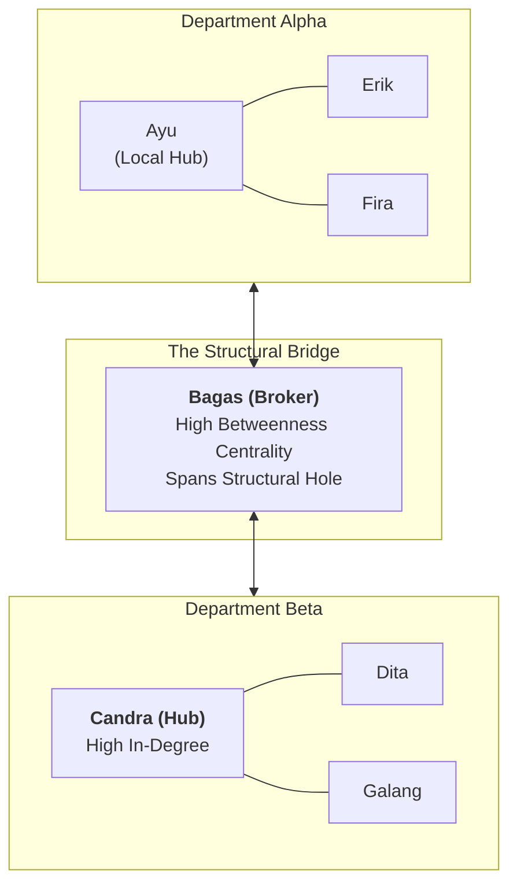

**Organizational Network Analysis (ONA)** is a quantitative data-driven methodology within People Analytics that visualizes and mathematically models the informal relationships, collaboration patterns, and information flows among employees across an enterprise. While traditional corporate organization charts illustrate formal lines of authority and reporting hierarchies, ONA exposes the **invisible informal networks** where actual collaboration, peer problem-solving, and emotional trust occur.

---

## 💡 1. Intuition & Everyday Analogy

Imagine a busy hospital emergency department during an influenza surge.

- The **formal organization chart** dictates that junior nurses report to nursing supervisors, who report to department heads, who report to the medical director.
- In reality, when a critically ill patient arrives, frontline doctors and nurses do not consult the hierarchical org chart. Instead, they seek out a specific veteran senior triage nurse whom everyone trusts for rapid diagnosis (**High In-Degree Centrality**), coordinate through a ward clerk who bridges the ICU and the laboratory (**Structural Hole / Betweenness Centrality**), and bypass certain detached supervisors entirely (**Peripheral / Isolated Nodes**).

If leadership restructures the department based solely on formal job descriptions while ignoring the informal ONA topology, they risk firing or relocating the invisible linchpins holding the enterprise together.

---

## 🔍 2. Prerequisite & Jargon Decoder

| Term                                                             | Mathematical & Operational Definition                                                                                                                                                                           | Organizational Failure Mode                                                                                                          |
| :--------------------------------------------------------------- | :-------------------------------------------------------------------------------------------------------------------------------------------------------------------------------------------------------------- | :----------------------------------------------------------------------------------------------------------------------------------- |
| **Directed vs. Undirected Network**                              | In a **directed network**, ties have orientation (A nominates B: $A \rightarrow B$). In an **undirected network**, edges represent reciprocal or co-present ties between pairs ($A - B$).                       | Assuming a unilateral nomination implies reciprocal collaboration.                                                                   |
| **In-Degree ($k_{\text{in}}$) vs Out-Degree ($k_{\text{out}}$)** | **In-Degree** is the number of incoming ties received (measure of prestige, popularity, or expertise). **Out-Degree** is the number of outgoing ties initiated (measure of sociability or information seeking). | Promoting employees who seek lots of feedback ($k_{\text{out}}$) while ignoring those sought out by everyone else ($k_{\text{in}}$). |
| **Network Density ($D$)**                                        | The ratio of actual observed edges ($E$) to the total possible edges in a network of $N$ nodes: $D = \frac{2E}{N(N-1)}$ (undirected).                                                                           | Assuming higher density is always better; excessively dense networks suffer from groupthink and redundant communication overload.    |
| **Structural Hole & Betweenness**                                | Burt's theory: a gap between two unconnected clusters. A node spanning this gap possesses high **Betweenness Centrality**, acting as an essential broker or gatekeeper.                                         | If the broker resigns, the two departmental clusters become completely cut off from one another.                                     |
| **Peripheral / Isolated Nodes**                                  | Nodes with near-zero degrees who are disconnected from informal networks.                                                                                                                                       | Unnoticed employee disengagement, flight risk, or onboarding failure.                                                                |

---

## 🏛️ 3. Structural Topology & Centrality Mechanics

### Mathematical Formulations of Key Network Metrics

For an undirected graph $G = (V, E)$ with $N = |V|$ nodes and $E = |E|$ edges:

#### 1. Maximum Possible Edges

In an undirected network of $N$ nodes, every node can link to $N-1$ other nodes. Dividing by $2$ to avoid double-counting gives:

$$
E_{\max} = \frac{N(N-1)}{2}
$$

#### 2. Network Density ($D$)

$$
D = \frac{E}{E_{\max}} = \frac{2E}{N(N-1)}, \quad \text{where } 0 \le D \le 1
$$

- $D = 1.0$: Complete network (every single employee collaborates with every other employee).
- $D \approx 0.1\text{--}0.3$: Typical sparse enterprise network organized into functional clusters.

#### 3. Betweenness Centrality ($C_B(v)$)

Quantifies how often a node $v$ falls on the shortest path ($\sigma_{st}$) between all other pairs of nodes $(s, t)$:

$$
C_B(v) = \sum_{s \neq v \neq t} \frac{\sigma_{st}(v)}{\sigma_{st}}
$$

---

## 🔢 4. Micro-Numerical Toy Example: 8-Employee Branch Trial

Consider an 8-employee branch office ($N = 8$) conducting a 360-degree feedback trial. Maximum possible edges:

$$
E_{\max} = \frac{8 \times 7}{2} = 28\text{ possible ties}
$$

Auditors identify $E = 9$ unique undirected collaboration pairs.

### Calculating Network Density

$$
D = \frac{9}{28} \approx 0.3214 \quad (32.14\%)
$$

### Node Degree Breakdown

| Employee Node           | In-Degree ($k_{\text{in}}$) | Out-Degree ($k_{\text{out}}$) | Undirected Degree ($k$) | Organizational Role Classification                                             |
| :---------------------- | :-------------------------: | :---------------------------: | :---------------------: | :----------------------------------------------------------------------------- |
| **Ayu**                 |            **4**            |               2               |          **4**          | **Central Hub / Opinion Leader**: Highest in-degree; critical go-to mentor.    |
| **Bagas**               |              3              |               2               |            3            | **Boundary Spanner / Broker**: Bridges Ayu's group with Candra's group.        |
| **Candra**              |              3              |               1               |            3            | **Sub-Hub Leader**: Central authority for Dita and Galang.                     |
| **Dita**                |              0              |               1               |            1            | **Peripheral Specialist**: Connected only via Candra; zero incoming requests.  |
| **Erik**                |              0              |               2               |            2            | **Information Seeker**: Reaches out to Ayu and Bagas; disconnected inbound.    |
| **Fira**                |              2              |               1               |            2            | **Core Team Member**: Mutual reciprocal trust tie with Ayu.                    |
| **Galang**              |              0              |               1               |            1            | **Peripheral Specialist**: Relies solely on Candra for organizational context. |
| **Hana**                |              0              |               2               |            2            | **Information Seeker**: Connected to Ayu and Fira.                             |
| **Sum / Network Total** |           **12**            |            **12**             |         **18**          | **Total Edges $E = 9$** ($2E = 18$).                                           |

### Managerial Diagnostic Insights

1. **Single Point of Failure**: If Bagas resigns or burns out, communication between Candra's cluster (Dita, Galang) and the rest of the branch drops to zero.
2. **Onboarding / Isolation Risk**: Dita and Galang exhibit zero in-degree, receiving no feedback requests. Management must intervene to integrate peripheral nodes into cross-functional projects.

---

## 🔗 Related Knowledge Bridges

- Master Curricular Hub: [[courses/mk6-business-analytics/week-08/index|MK6 Week 08: People Analytics & Organizational Network Modeling]]
- Post-Class Worked Model: [[courses/mk6-business-analytics/week-08/assignment-people-analytics-ona|Week 08 ONA Assignment Debrief]]
- Organization Design Architecture: [[concepts/organizational-dna-framework|Organizational DNA Framework]]
- HR Architecture: [[concepts/ulrich-hr-model|Dave Ulrich HR Business Partner Model]]
- Return to [[concepts/index|Knowledge Matrix (Concepts Hub)]]
