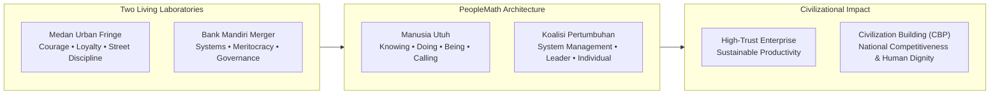
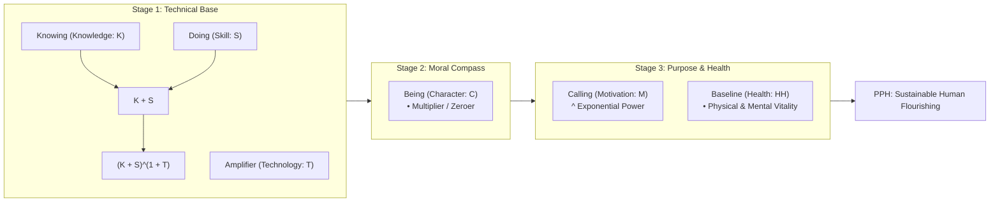
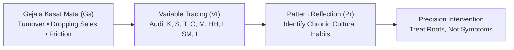

## 💡 First-Principles Intuition & Conceptual Core

Traditional corporate management evaluates workforce productivity as a simple output-per-hour equation. When target numbers stumble, organizations instinctively raise pressure, conduct punitive performance reviews, or purchase generic training modules. Conversely, when dashboards show green metrics, leadership assumes organizational health, ignoring underlying exhaustion, cynicism, and moral degradation.

Delivered by [[entities/agus-dwi-handaya|Agus Dwi Handaya]] (Managing Director Human Capital, PT Danantara Asset Management) in his foundational treatise _PeopleMath: Produktivitas Berkualitas, Kebahagiaan Tanpa Batas_, the **PeopleMath Framework** redefines human productivity through mathematical architecture. PeopleMath asserts that human output is never a single linear variable. Output is the compound synthesis of foundational technical competence, moral direction, motivational drive, and biological sustainability:

$$\mathbf{\text{High Sustainable Performance} = f(\text{Competence}, \text{Character}, \text{Motivation}, \text{Health})}$$

### 🔑 Prerequisite Concepts & Jargon Decoder

- **The Two Productivity Paradoxes**:
  1. _Angka Naik, Manusia Menurun_: Dashboards show rising financial targets while human vitality, trust, and psychological energy decay.
  2. _Tuntutan Naik, Daya Hidup Tergerus_: Demands for agility and innovation escalate while workforce burnout, turnover, and disengagement surge.
- **The Two Living Laboratories**: ADH synthesized PeopleMath from two disparate environments:
  1. _Medan Urban Fringe_: Where loyalty, courage, discipline, and peer solidarity formed collective resilience without formal management jargon.
  2. _Post-Merger Bank Mandiri Transformation_: Where corporate strategy, systemic meritocracy, culture, and disciplined leadership engineered state-enterprise excellence and turned the bank into a national talent supplier.
- **Three Uncompromising Philosophies**:
  1. _Manusia sebagai Makhluk Utuh_: Human beings possess four interconnected dimensions—**Knowing** ($K$), **Doing** ($S$), **Being** ($C$), and **Calling** ($M$), sustained by **Human Health** ($HH$).
  2. _No Element Left Behind (Not One Size Fits All)_: Every variable serves an architectural role. Two employees with identical drop in performance may suffer from completely different root causes ($K$ deficit vs. $C$ breakdown vs. toxic leadership treatment).
  3. _No Free-Rider Role (Koalisi Pertumbuhan)_: Workforce development is a joint multiplicative responsibility between the System ($SM$), the Leader ($L$), and the Individual ($I$).

---

## 📐 Universal Mechanism & Mathematical Architecture

### 1. The Generic Three-Variable Formula Logic

Every equation across the PeopleMath catalog follows a generic mathematical interaction:

$$\mathbf{\text{Output} = \left[ (A + B) \times C \right]^{(1 + D)}}$$

### ⚙️ Mechanics & Structural Anatomy

- **Additive Foundations ($A + B$)**: Complementary technical or cognitive components (e.g., $K + S$). Ketiadaan satu variabel tidak menihilkan total, melainkan menghasilkan kapasitas sub-optimal.
- **Multiplicative Multiplier & Zeroer ($\times C$)**: Variables acting as ethical or directional filters (e.g., Character $C$, Integrity $In$, Relevance $Rk$). When $C > 1$, output multiplies; when $C \to 0$ (such as fraud or corruption), the entire product collapses to zero regardless of technical brilliance.
- **Exponential Accelerator ($^{(1 + D)}$)**: Variables acting as psychological, reflective, or developmental power multipliers (e.g., Motivation $M$, Reflection $R$, Nuntun $N3$). If $D = 0$, base value remains intact ($Base^1 = Base$); if $D > 0$, output scales exponentially.
- **Mental-Math Micro-Example**:
  In a corporate breach scenario where character collapses to zero, no amount of technical competence can rescue the outcome:
  $$\text{Scenario A (Zero Character)}: [(10 + 10) \times 0]^{(1 + 2)} = [20 \times 0]^3 = 0$$
  Conversely, moderate baseline skills backed by uncompromising ethical integrity, transparent communication, and strong purpose-driven motivation compound exponentially over multi-year operational cycles:
  $$\text{Scenario B (Moderate Skill, Strong Multipliers)}: [(6 + 6) \times 1.5]^{(1 + 1)} = [18]^2 = 324$$

---

### 2. Rumus Utama 1: People Productivity & Happiness (PPH)

The master equation unifies economic productivity with human flourishing:

$$\mathbf{PPH = \left[ \left( (K + S)^{(1 + T)} \right) \times C \right]^{(1 + M)} \times HH}$$

#### Variable Specifications

| Variable                | Human Dimension | Functional Role in Architecture                             | Failure Mode if Compromised                                       |
| :---------------------- | :-------------- | :---------------------------------------------------------- | :---------------------------------------------------------------- |
| **$K$ (Knowledge)**     | **Knowing**     | Contextual depth, cognitive models, industry principles     | Superficial action without understanding causality                |
| **$S$ (Skill)**         | **Doing**       | Executable muscle memory and operational dexterity          | Theoretical paralysis; unable to deliver tangible results         |
| **$T$ (Technology)**    | _Amplifier_     | Digital tooling, workflow automation, analytical platforms  | Exponential scaling of flawed, manual mistakes                    |
| **$C$ (Character)**     | **Being**       | Moral compass, ethics, values, and uncompromising integrity | Catastrophic enterprise damage through fraud or arrogance         |
| **$M$ (Motivation)**    | **Calling**     | Purpose-driven resilience fueled by giving factors ($Gr$)   | Transactional mercenaries who exit at the first obstacle          |
| **$HH$ (Human Health)** | _Sustainer_     | Physical stamina ($Ph^*$) and emotional stability ($Mh$)    | Severe executive burnout, cognitive fatigue, and health breakdown |

---

### 3. Rumus Utama 2: People Development Role (PDR)

Workforce development is governed by the Growth Coalition equation:

$$\mathbf{PDR = (SM)^{(1 + L + I)}}$$

- **System Management ($SM$)**: Institutional meritocracy, transparent KPIs, career pathways, and learning infrastructure.
- **Leader ($L$)**: The 3N leadership cadence ($LDR = (N1 + N2)^{(1 + N3)}$: _Nagih, Nata, Nuntun_).
- **Individual ($I$)**: Proactive self-development ($IDR = (N4 + N5)^{(1 + N6)}$: _Nyerap, Ngulang, Ngerefleksi_).

---

### 4. PeopleMath Diagnostic Methodology (PMD) & The 7 Corporate Mistakes

To prevent knee-jerk administrative interventions, PeopleMath deploys precision root-cause tracing:

$$\mathbf{PMD = (Gs + Vt)^{(1 + Pr)}}$$

Where visible symptoms ($Gs$) trigger variable tracing ($Vt$) across the 20 parameters, amplified by deep systemic pattern reflection ($Pr$).

#### The Seven Common Human Capital Distortions

1. **Equating Productivity with Gross Output**: Celebrating short-term numbers while human vitality and collaborative trust disintegrate.
2. **Treating Symptoms Instead of Root Causes**: Increasing KPI pressure when the actual shortfall stems from absent psychological safety or outdated skills.
3. **Assuming Training Automatically Creates Competence**: Piling up certifications without deliberate practice, coaching, or workplace application.
4. **Tolerating Toxic Character for High Revenue**: Protecting high-performing rogue producers whose ethical deficit destroys institutional meritocracy.
5. **Restricting Motivation to Financial Incentives**: Over-relying on cash bonuses (_receiving factors_) while starving employees of purpose and contribution (_giving factors_).
6. **Operating Incoherent Sub-Systems**: Siloed HR systems where learning teaches agility, KPIs measure compliance, bonuses reward individualism, and bosses practice micromanagement.
7. **Demanding Results Without Reflecting on Treatment**: Leaders barking orders (_Nagih_) while destroying employee dignity through abusive management (_Tr_).

---

## 🏛️ Multi-Disciplinary Lenses Across the MBA Curriculum

### 1. Organizational Behavior & Leadership (MK 1)

- **Primary Mechanism**: Connects directly to leadership styles, psychological safety, and organizational culture.
- **Core Insight**: Leaders who practice 3N (_Nagih, Nata, Nuntun_) achieve higher team retention and psychological safety than authoritarian managers.
- _Discussed in_: [[courses/mk1-organizational-behavior-managing-people/week-01/index|MK 1 Week 01]] and [[courses/mk1-organizational-behavior-managing-people/week-07/index|MK 1 Week 07]].

### 2. Capital Strategy & Corporate Finance (MK 2)

- **Primary Mechanism**: Human capital expenditures as capital budgeting investments rather than operating expenses.
- **Core Insight**: Character failures ($C \to 0$) destroy enterprise equity valuation and multiply risk premiums faster than financial leverage.
- _Discussed in_: [[courses/mk2-financial-management-strategy/week-08/index|MK 2 Week 08]].

### 3. Business Analytics & People Analytics (MK 6)

- **Primary Mechanism**: Quantitative workforce diagnostic modeling.
- **Core Insight**: Feature engineering for turnover prediction must incorporate variables beyond tenure—including manager treatment scores and skill practice frequencies.
- _Discussed in_: [[courses/mk6-business-analytics/week-08/index|MK 6 Week 08]].

---

## 🚀 Action Learning Project (ALP) Application

> [!TIP] BUMN Diagnostic Application
> During **ALP Stage 2 (Diagnostic Fact Pack)**, apply the PeopleMath PMD formula to your partner state-owned enterprise:
>
> 1. Audit whether operational delays stem from a **Knowledge/Skill deficit** ($K+S$) or **System Management Incoherence** ($SMR$).
> 2. Evaluate whether project teams suffer from **Transactional Fatigue** (low Giving Factors $Gr$) or **Leadership Friction** (excessive _Nagih_ without _Nata_ or _Nuntun_).

---

## 🔗 Contributing Sessions & References

- **Rabuan Plenary Session**: [[rabuan/2026-09-02-adh-peoplemath|Rabuan 01: PeopleMath — Produktivitas Berkualitas, Kebahagiaan Tanpa Batas & Strategi Tough & Agile Learner]]
- **Featured Executive Profile**: [[entities/agus-dwi-handaya|Agus Dwi Handaya]]
- **Parent Institution**: [[entities/danantara|PT Danantara Asset Management]]
- **Sister Concept Umbrella**: [[concepts/tough-and-agile-learner|Tough & Agile Learner (TAL)]]
- **Knowledge Matrix Hub**: [[concepts/index|Knowledge Matrix]]
