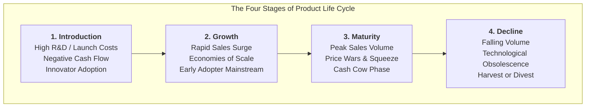
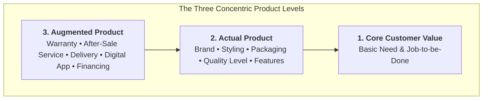

## 📐 Universal Definition & Conceptual Core

The **Product Life Cycle (PLC)** describes the empirical progression of a product category, form, or brand through four distinct commercial stages: **Introduction, Growth, Maturity, and Decline**. Originally articulated in post-war industrial economics and formalized by Philip Kotler and Theodore Levitt, the PLC framework links market demand dynamics to strategic resource allocation, competitive intensity, cost structures, and cash flow profiles.

---

## 🔬 Product Levels & Portfolio Mechanics

To manage a product through its life cycle, strategic marketing decomposes the offering into **Three Conceptual Product Levels** (Kotler & Armstrong):

1. **Core Customer Value**: The fundamental problem-solving benefit or job-to-be-done that the consumer is truly buying (e.g., in cosmetics, hope, self-expression, and clean skin; in transportation, reliable on-time mobility).
2. **Actual Product**: The physical and commercial manifestation built around the core benefit: brand name, formulation, packaging aesthetics, quality level, and sensory features.
3. **Augmented Product**: The additional non-physical services, customer warranties, post-purchase support, digital applications, and delivery convenience that build an experiential moat.

### Strategic Portfolio Expansion: Stretching vs. Filling

When managing multi-product lines across the life cycle, corporate leadership executes two distinct structural expansions:

- **Line Stretching**: Lengthening a product line beyond its current price-quality tier:
  - _Downward Stretch_: Moving into budget or mass-market tiers to block low-end disruptors (e.g., Unilever introducing Breeze/Ala sachets, L'Oréal expanding Garnier in Indonesian traditional trade).
  - _Upward Stretch_: Adding premium prestige formulations to capture high margins and elevate brand prestige.
  - _Two-Way Stretch_: Simultaneously launching economy and luxury variants.
- **Line Filling**: Adding items within the existing range to plug competitive gaps, utilize excess manufacturing capacity, and satisfy varied customer tastes (e.g., adding a 15 ml mini-serum alongside the standard 30 ml bottle).

$$\mathbf{\text{Product Contribution Margin} = (\text{Price} - \text{Variable Cost}) \times \text{Sales Volume} - \text{Direct Marketing Spend}}$$

---

## 🏛️ Multi-Disciplinary Lenses Across the MBA Curriculum

### 1. Marketing Management (MK3)

In [[courses/mk3-marketing-management/week-07/index|MK3 Week 07]] and the **L'Oréal in Indonesia Case**, portfolio management is framed through PLC and product levels. When basic brightening serums enter mature saturation, beauty conglomerates must decide whether to stretch downward with sachet packaging or pivot capital to fast-growing barrier-repair skincare (e.g., CeraVe, Skintific). In [[courses/mk3-marketing-management/week-01/index|MK3 Week 01]], Unilever's detergent portfolio relied on line stretching to reach low-income Northeast Brazilian and Indonesian rural households.

### 2. Financial Management & Strategy (MK2)

In financial strategy, the PLC mirrors the corporate cash flow waterfall:

- _Introduction_: Heavy negative free cash flow ($\text{FCF} < 0$), funded by external equity or cross-subsidies.
- _Growth_: Break-even $\text{FCF}$; massive working capital required to fund inventory and receivables.
- _Maturity_: Peak positive $\text{FCF}$; "Cash Cow" generation that fuels new R&D.
- _Decline_: Harvest mode; maximizing dividend extraction while terminating unprofitable SKUs to protect return on capital.

### 3. Operations & Capacity Planning (MK4)

In operations, PLC stage dictates capacity planning and supply chain strategy. Introduction requires agile, low-volume job shops or pilot lines; growth requires rapid capacity expansion and dedicated assembly; maturity requires strict Lean manufacturing and Little's Law throughput optimization; decline requires phased line decommissioning.

---

## ⚠️ Strategic Pitfalls & Boundary Conditions

1. **Self-Fulfilling Prophecy Trap**: Diagnosing a temporarily plateauing brand as "in decline" and prematurely cutting marketing spend, which causes the very death management feared.
2. **Cannibalization Blindness**: Line filling too densely with identical price-point variants, confusing consumers and fragmenting distributor shelf space without expanding total category revenue.
3. **Downward Stretch Brand Dilution**: Releasing cheap economy extensions that tarnish the premium cachet of the core brand name.

---

## 🔗 Related Knowledge Hubs

- [[courses/mk3-marketing-management/week-07/index|MK3 Week 07: Product Strategy & Brand Portfolios]]
- [[concepts/customer-perceived-value|Customer Perceived Value (CPV)]]
- [[entities/loreal|L'Oréal S.A.]]
- [[entities/unilever|Unilever PLC]]
