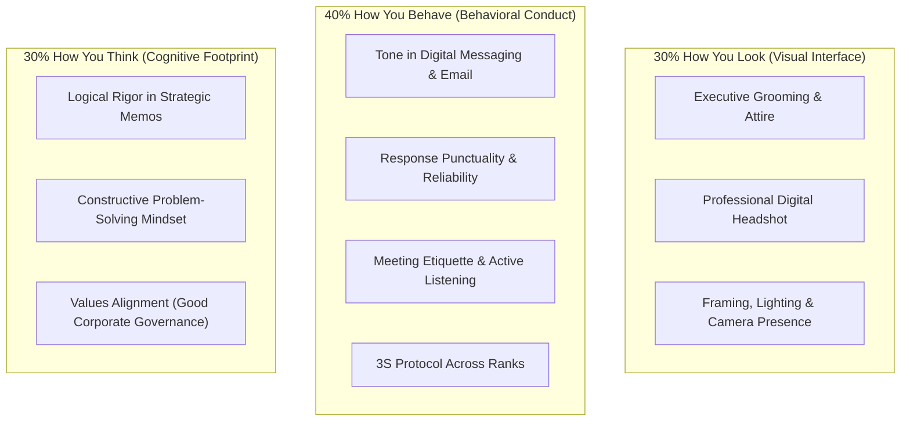

## 💡 First-Principles Intuition & Conceptual Core

Every day, business executives evaluate ambiguous, high-stakes decisions under extreme time constraints: approving multi-billion rupiah capital budgets, selecting enterprise partners, or promoting division heads. In an ideal world, leaders would be judged solely on the pure, unadorned quality of their raw data or spreadsheet models. In the real world, human decision-making relies heavily on **heuristics** and **perceptual signaling**.

Consider an everyday product analogy: Imagine a pharmaceutical company manufacturing a life-saving medication of pure clinical efficacy, but packaging it in an unlabeled, damaged, unsealed container. Regardless of the internal chemical perfection, hospital directors will refuse to administer it because the external signal degrades institutional trust.

The **Professional Image & Leadership 5C Framework** posits that executive credibility is a deliberate equilibrium between **internal execution capacity** and **external perceptual signaling**:

$$\mathbf{\text{\ldquo Look As Good As You Can Deliver\rdquo}}$$

Professional image is emphatically **not superficial cosmetic styling** (_bukan pencitraan_). Rather, it represents the outward manifestation of internal character, operational discipline, and emotional maturity. When an executive presents with disorganized slides, evasive eye contact, defensive vocal tone, or unkempt attire, the perceived quality of their strategic recommendation suffers immediate signal attenuation.

```mermaid
flowchart LR
    subgraph InternalCore ["Internal Mastery (Substance)"]
        direction TB
        C1["<b>Character</b><br/>Integrity & Moral Compass"]
        C2["<b>Competence</b><br/>Technical & Strategic Rigor"]
        C4["<b>Conviction</b><br/>Courage & Strategic Resolve"]
    end

    subgraph TransmissionGateway ["Signaling Architecture (Interface)"]
        direction TB
        C3["<b>Communication</b><br/>Articulate, Empathetic, BLUF"]
        C5["<b>Charisma</b><br/>Gravitas & Inspirational Warmth"]
        ET["<b>Executive Etiquette</b><br/>3S • Grooming • Composure"]
    end

    subgraph ExternalImpact ["Institutional Result (Value)"]
        direction TB
        TR["<b>Boardroom Trust</b><br/>Stakeholder Alignment"]
        EX["<b>Frictionless Execution</b><br/>Capital & Mandate Approval"]
    end

    InternalCore --> TransmissionGateway --> ExternalImpact
```

---

### 🔑 Prerequisite Concepts & Jargon Decoder

- **Triangle of Success**: The classical tripartite competency model comprising **Attitude** (mindset, humility, emotional resilience), **Knowledge** (domain expertise, industry facts), and **Skills** (verbal articulation, negotiation, digital literacy). Competence without attitude yields arrogance; attitude without competence yields well-meaning incompetence.
- **5C Leadership Vectors**:
  1. **Character**: Ethical consistency, honesty, and alignment with institutional values (e.g. Danantara GCG principles).
  2. **Competence**: Demonstrated analytical rigor, functional mastery, and operational delivery.
  3. **Communication**: Clear, structured, two-way dialogue leading with the conclusion (Bottom-Line-Up-Front / BLUF).
  4. **Conviction**: Authentic belief in the organizational mission and the courage to take accountability for risks.
  5. **Charisma**: The magnetic combination of warmth, attentive presence, and executive gravitas that inspires discretionary effort.
- **The 3S Etiquette**: A cultural baseline in Indonesian enterprise relations—**Senyum** (warm, open facial micro-expression), **Sapa** (proactive acknowledgment of others across hierarchical boundaries), and **Salam** (respectful greeting establishing psychological safety).
- **Asymmetric Perception Ratio (1 : 67 Rule)**: A behavioral principle demonstrating that a single severe breach of professional conduct or interpersonal disrespect requires up to **67 subsequent positive interactions** to fully restore damaged trust, while a standard positive touchpoint generates approximately **10 units of goodwill**.

---

## 📐 Universal Mechanism & Mathematical Architecture

In organizational settings, an executive's perceived credibility ($C_{\text{perceived}}$) can be formalized as a multiplicative composite of character, competence, and communication, dampened by self-centered or defensive behavioral friction:

$$\mathbf{C_{\text{perceived}} = \frac{\text{Character} \times \text{Competence} \times \text{Communication}}{\text{Self-Interest Drag} + \text{Defensive Friction}}}$$

### ⚙️ Mechanics & Structural Anatomy:

- **Numerator ($\text{Character} \times \text{Competence} \times \text{Communication}$)**:
  - Multiplicative relationship: If any single term approaches zero, total perceived credibility collapses. High competence combined with zero communication yields an isolated specialist. High communication combined with zero character yields a manipulative demagogue.
- **Denominator ($\text{Self-Interest Drag} + \text{Defensive Friction}$)**:
  - Represents perceived personal ambition over collective mission, defensive excuses when challenged, or arrogance in team interactions. High denominator values instantly discount high numerator inputs.
- **Mental-Math Micro-Example**:
  Suppose Leader A has Character = $9/10$, Competence = $8/10$, Communication = $8/10$, with low Self-Interest Drag = $2$.
  $$\text{Credibility}_A = \frac{9 \times 8 \times 8}{2} = \frac{576}{2} = 288$$
  Leader B has identical technical competence ($8/10$) and character ($9/10$), but poor communication ($3/10$) and defensive reactions when questioned ($6$):
  $$\text{Credibility}_B = \frac{9 \times 8 \times 3}{6} = \frac{216}{6} = 36$$
  Despite identical underlying integrity and analytical skill, Leader A exercises **8 times greater perceived influence** in executive decision-making.

---

### 🌐 Digital Personal Branding Architecture (30–40–30 Rule)

In an omnichannel enterprise environment where hybrid meetings, executive messaging channels, and digital dossiers precede face-to-face contact, professional reputation decomposes into three measurable domains:

$$\mathbf{\text{Reputation}_{\text{Digital}} = 0.30 \cdot (\text{How You Look}) + 0.40 \cdot (\text{How You Behave}) + 0.30 \cdot (\text{How You Think})}$$

---

## 🏛️ Multi-Disciplinary Lenses Across the MBA Curriculum

### 1. Organizational Behaviour & Managing People (MK 1)

- **Primary Mechanism**: [[concepts/self-awareness|Self-Awareness & Blindspot Discovery]], Impression Management, and [[concepts/french-and-raven-power-bases|French and Raven's Power Bases]].
- **Core Insight**: While legitimate and coercive power reside in official titles, executive presence cultivates **Referent Power** (admiration, identification) and **Expert Power** (perceived credibility), unlocking voluntary follow-through from cross-functional peers who do not report to the executive.
- _Discussed in_: [[courses/mk1-organizational-behavior-managing-people/week-01/index|MK 1 Week 01 Lecture Hub]].

### 2. Problem Solving, Decision Making & Negotiation (MK 5)

- **Primary Mechanism**: Non-verbal signaling, cognitive anchoring, and emotional de-escalation in negotiation.
- **Core Insight**: In high-stakes bargaining, vocal composure, deliberate pauses, and steady eye contact prevent the counterparty from perceiving desperation, preserving the negotiator's [[concepts/batna-and-zopa|BATNA and ZOPA boundaries]].
- _Discussed in_: [[courses/mk5-decision-making-negotiation/index|MK 5 Course Hub]].

### 3. Rabuan Executive Plenary Series

- **Primary Mechanism**: Boardroom credibility and state enterprise stewardship.
- **Core Insight**: In large state-owned enterprises (BUMN) navigating complex political and public scrutiny, leaders represent the sovereign state. A professional image governed by good governance, transparency, and prudence (_prudent approach_) is essential to secure public trust.
- _Discussed in_: [[rabuan/2026-09-04-indayati-professional-image|Special Masterclass: Building Professional Image]].

---

## ⚖️ Cross-Functional Boardroom Tensions

| Domain                                            | Tactical Tension                                                                                                                             | Resolution Architecture                                                                                                                                                                                   |
| :------------------------------------------------ | :------------------------------------------------------------------------------------------------------------------------------------------- | :-------------------------------------------------------------------------------------------------------------------------------------------------------------------------------------------------------- |
| **Authenticity vs. Image Crafting**               | Executives fear that conscious attention to image is artificial "pencitraan" or political maneuvering.                                       | Reframe image as **courtesy and respect for the audience**: clear articulation and professional grooming remove cognitive friction so peers can focus entirely on the substance of the business proposal. |
| **Technical Depth vs. Executive Brevity**         | Senior engineers and quantitative analysts pride themselves on exhaustive detail, overwhelming board members with raw equations.             | Adopt **BLUF (Bottom-Line-Up-Front)**: state the strategic recommendation and EBITDA impact in the first 60 seconds, withholding underlying mechanics for appendix validation.                            |
| **Hierarchical Deference vs. Executive Presence** | Junior managers in traditional Indonesian enterprises default to passive silence out of respect (_sungkan_), appearing devoid of conviction. | Anchor communication in **substantiated data and objective facts** rather than subjective opinion; speak with respectful assertiveness (_asertif beretika_).                                              |

---

## 🚀 Action Learning Project (ALP) Application

> [!TIP] ALP Capstone Alignment: Stakeholder Engagement
> In the 16-week Action Learning Project across BUMN sponsor enterprises, participant syndicates interface directly with Board of Directors (BOD) sponsors, VP-level project owners, and union leaders:
>
> - **The Initial Diagnostic Interview**: Apply the **"Remember Me"** methodology—treating client managers with authentic respect and empathetic listening rather than arriving as external inquisitors.
> - **The Milestone Gate Defenses (M1–M3)**: Synchronize team grooming, visual presentation consistency, vocal pacing, and crisp Q&A turn-taking to project cohort-wide institutional readiness.

---

## 🔗 Contributing Sessions & References

- **Masterclass Source**: [[rabuan/2026-09-04-indayati-professional-image|Special Masterclass: Building Professional Image & Executive Communication Skills]]
- **Lead Facilitator**: [[entities/indayati-oetomo|Indayati Oetomo]] (John Robert Powers Indonesia)
- **Curriculum Connections**:
  - [[courses/mk1-organizational-behavior-managing-people/week-01/index|MK 1 Week 01: Foundations of Management & Self-Leadership]]
  - [[rabuan/2026-09-02-adh-peoplemath|Rabuan 01: PeopleMath & Human Capital]]
  - [[rabuan/2026-10-14-ric-roi-impact-career|Rabuan 02: Making an Impact & 5 Levels of Career Trajectory]]
- **Directory**: Return to **[[concepts/index|Knowledge Matrix (Core Concepts)]]**
