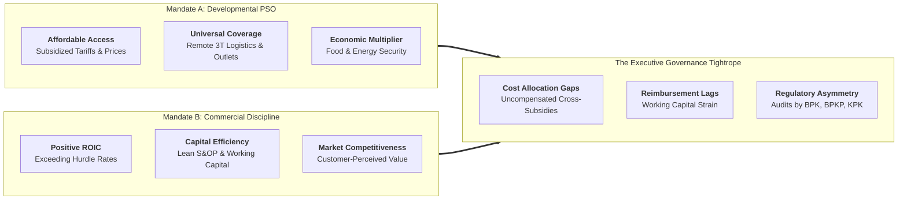
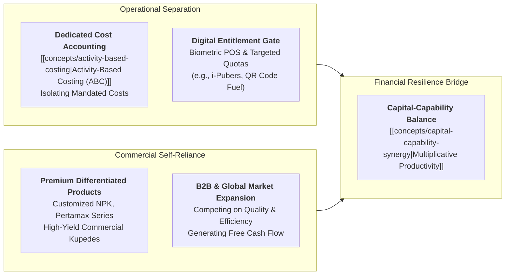
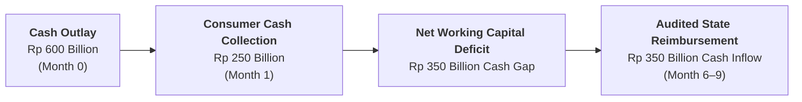

## 💡 First-Principles Intuition & The Dual-Mandate Dilemma

Every commercial enterprise in the private sector operates under a singular governing mandate: maximize long-term shareholder value by delivering returns that exceed the [[concepts/weighted-average-cost-of-capital|cost of capital (WACC)]]. When a product line is unprofitable, management terminates it; when a remote territory yields negative operating margins, management exits.

In contrast, **state-owned enterprises (BUMN)** operate under a permanent structural paradox known as the **Public Service Obligation (PSO) vs. Commercial Viability Duality**:

$$\mathbf{\text{BUMN Objective Function} = \alpha \cdot \text{Social Welfare (PSO)} + (1 - \alpha) \cdot \text{Commercial Return (ROIC)}}$$

State enterprises must act simultaneously as **agents of national development** (providing subsidized fertilizer, rural micro-banking, universal electricity access, basic energy distribution, and affordable port logistics) and **self-sustaining commercial corporations** (generating positive free cash flow, paying taxes and dividends, maintaining investment-grade credit ratings, and raising market debt without relying on continuous state budget bailouts).

---

## 🔍 Jargon & Mechanism Decoder

- **Public Service Obligation (PSO)**: A statutory mandate imposed by the government requiring an enterprise to provide essential goods or services to the general public regardless of commercial profitability, typically at regulated ceiling prices below full economic cost.
- **Subsidy Compensation Lag**: The temporal gap between when a BUMN incurs cash outlays for delivering subsidized goods (e.g. procurement of natural gas and logistics for subsidized fertilizer by [[entities/pt-pupuk-indonesia|PT Pupuk Indonesia]], or fuel distribution by [[entities/pt-pertamina|PT Pertamina]]) and when the state treasury formally audits, verifies, and disburses the reimbursement.
- **Cross-Subsidization Engine**: The deliberate operational strategy of using excess cash margins generated from deregulated commercial business units to absorb structural operating losses in mandated PSO segments.
- **Agency Theory in State Ownership**: The agency dilemma where managers must satisfy multiple, often conflicting principals: technical ministries (mandating maximum production volume and low consumer prices), the Ministry of Finance (mandating dividend yields and fiscal prudence), and the supreme audit agency (scrutinizing every operational variance as potential state financial loss).

---

## ⚙️ Structural Anatomy of the Mechanism: The Separation Matrix

To prevent the PSO mandate from destroying commercial competitiveness—or conversely, to prevent commercial profit motives from abandoning public duties—world-class state enterprises construct a strict operational separation architecture:

### The 4 Core Operating Rules for Managing Duality

1. **Strict Accounting Ring-Fencing**: Mandated PSO costs must never be lumped together with commercial operating expenditures. Using [[concepts/activity-based-costing|Activity-Based Costing]], fixed plant overhead and variable transport costs must be rigorously separated to allow audited reimbursement without disputes.
2. **Targeted Digital Rationing**: Eliminating leakage from open-ended price subsidies through closed digital verification systems (such as _i-Pubers_ in fertilizer or _MyPertamina_ in fuel), ensuring that only eligible beneficiaries receive subsidized allocations.
3. **Margin Harvesting in Commercial Segments**: Maximizing [[concepts/customer-perceived-value|customer-perceived value]] in competitive retail lines (commercial fertilizers, corporate treasury, specialized port terminals) to fund innovation and working capital buffers.
4. **Transparent Contractual Governance**: Structuring PSO assignments as transparent service-level agreements (SLAs) with the state, defining exact volume parameters, delivery benchmarks, and interest compensation for fiscal payment delays.

### Statutory Governance Separation: 1% Seri A Dwiwarna (BP BUMN) vs. 99% Seri B (BPI Danantara)

Indonesia's 2025 state-enterprise legislative overhaul codified this dual-mandate boundary directly into corporate share structure:

- **BP BUMN (Law No. 16 of 2025) — 1% Seri A Dwiwarna Golden Share**: Retains statutory veto authority over corporate charters, mergers, dissolutions, and public-service mandates—enforcing PSO delivery, parliamentary accountability (DPR RI), and state budget compensation contracts.
- **[[entities/danantara|BPI Danantara]] (Law No. 1 of 2025) — 99% Seri B Commercial Equity**: Exercises commercial shareholder governance, M&A rationalization, capital reallocation, and dividend reinvestment—enforcing market $\text{ROIC}$ hurdle rates across commercial business lines without cross-subsidy distortion.

As synthesized in **[[rabuan/2026-06-09-oskaria-bumn-transformation-danantara|Rabuan 2026-06-09: Dony Oskaria]]** _(reconstructed plenary dossier)_, this statutory split prevents commercial underperformance from hiding behind social mandates while ensuring public-service obligations remain explicitly contracted and transparently audited by **BPK**.

---

## 🔢 Micro-Numerical Toy Example: The Working Capital Squeeze

Consider a state enterprise distributing essential goods with the following monthly profile:

$$\text{Mandated Delivery Volume} = 100{,}000 \text{ metric tons}$$
$$\text{Production \& Distribution Cost} = \text{Rp } 6{,}000 \text{ per kg}$$
$$\text{Regulated Consumer Price} = \text{Rp } 2{,}500 \text{ per kg}$$
$$\text{State Subsidy Commitment} = \text{Rp } 3{,}500 \text{ per kg}$$

1. **Immediate Monthly Cash Shortfall**:
   $$\Delta \text{Cash} = (\text{Rp } 2{,}500 - \text{Rp } 6{,}000) \times 100{,}000{,}000 \text{ kg} = -\text{Rp } 350 \text{ Billion}$$
2. **The 6-Month Working Capital Bridge**:
   If the government verification and audit cycle takes 6 months, the enterprise must finance an accumulated working capital deficit of:
   $$\text{Financing Requirement} = 6 \times \text{Rp } 350 \text{ Billion} = \text{Rp } 2.1 \text{ Trillion}$$
3. **The Strategic Implication**:
   If the enterprise borrows at an 8% annual working capital facility rate, the uncompensated financing interest costs:
   $$\text{Annual Financing Drag} = \text{Rp } 2.1 \text{ Trillion} \times 8\% = \text{Rp } 168 \text{ Billion}$$
   This financial drag directly reduces the enterprise's ability to fund capital expenditure (Capex), unless management aggressively expands high-margin commercial business lines to generate offsetting operating cash flow.

---

## 🔗 Cross-Curricular Synapses & Entity Bridges

- **Core Academic Synergies**:
  - [[courses/mk2-financial-management-strategy/index|MK 2: Financial Management & Strategy]] — Working capital financing, [[concepts/dupont-analysis|DuPont Analysis]], and [[concepts/weighted-average-cost-of-capital|WACC]] management under state ownership.
  - [[courses/mk4-operations-supply-chain-management/index|MK 4: Operations & Supply Chain Management]] — S&OP trade-offs, [[concepts/capacity-cushion|capacity cushion design]], and [[concepts/order-winners-and-qualifiers|order qualifiers vs winners]].
  - [[courses/mk5-decision-making-negotiation/index|MK 5: Decision Making & Negotiation]] — Managing multi-stakeholder negotiations and trade-offs under regulatory constraints.
- **BUMN Enterprise Demonstrations**:
  - [[entities/pt-pupuk-indonesia|PT Pupuk Indonesia]] & [[entities/pt-pertamina|PT Pertamina]] — Navigating agricultural and energy price subsidies under tight fiscal audits.
  - [[entities/pt-bank-rakyat-indonesia|PT Bank Rakyat Indonesia]] & [[entities/pt-bank-syariah-indonesia|PT Bank Syariah Indonesia]] — Ultra-micro financial inclusion vs commercial corporate banking.
  - [[entities/pt-pln-persero|PT PLN (Persero)]] & [[entities/pt-pelabuhan-indonesia|PT Pelabuhan Indonesia]] — Universal service electrification and pioneer shipping routes vs national competitiveness.
- **Parent Program Blueprint**:
  - [[program/action-learning-project|Action Learning Project (ALP) Blueprint]]
  - [[program/alp/business-immersion-1/index|Business Immersion 1 Cohort Synthesis]]
