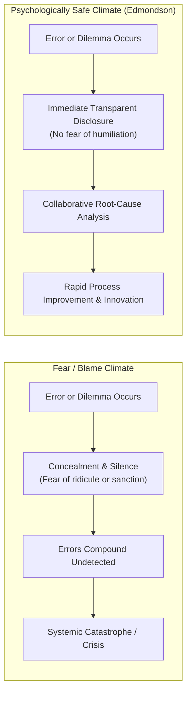
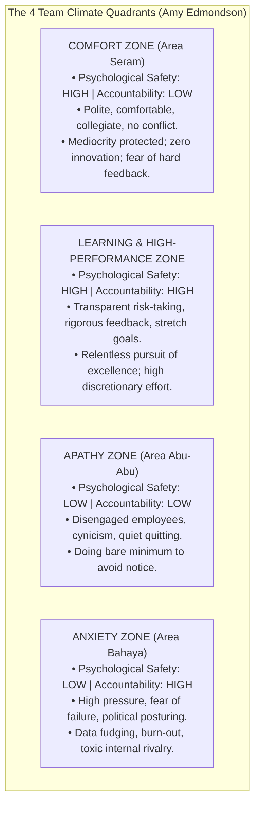

## 📐 Universal Definition & Conceptual Core

Pioneered by Harvard Business School professor **Amy C. Edmondson** (1999, _Administrative Science Quarterly_), **Psychological Safety** is defined as:

> _"A shared belief held by members of a team that the team is safe for interpersonal risk-taking."_

In a psychologically safe workplace, individuals trust that no one will be humiliated, ridiculed, marginalized, or penalized for asking a question, admitting an error, voicing a dissenting opinion, or proposing a radical experimental idea.

---

## ⚖️ The 2x2 Team Learning Matrix: Safety vs. Accountability

A pervasive corporate misconception is that psychological safety means being overly "nice," relaxing performance standards, or accepting mediocrity. Edmondson demonstrates that psychological safety and **performance accountability** are independent, orthogonal dimensions:

### The Executive Takeaway:

Leadership does not lower standards to make employees feel safe. Leaders **elevate psychological safety precisely so teams can survive the intense pressure of demanding performance accountability**.

---

## 🏥 The Medical Error Paradox & Project Aristotle

1. **The Medical Error Paradox (Edmondson, 1996)**:
   In rigorous studies of hospital nursing units, the highest-performing medical teams initially appeared to commit **more medication errors** than low-performing units. Longitudinal investigation revealed they did not commit more errors; rather, their high psychological safety enabled staff to report near-misses and mistakes immediately, whereas low-safety units hid their mistakes until patients suffered catastrophic harm.
2. **Google's Project Aristotle (2012–2015)**:
   Google launched a multi-year empirical study of 180 teams to identify the secret recipe for team success. They discovered that who was on the team (IQ, coding prowess, senior titles) mattered far less than **how the team interacted**. **Psychological safety was the single most decisive factor**, followed by dependability, structure/clarity, meaning, and impact.

---

## 🏛️ Multi-Disciplinary Lenses Across the MBA Curriculum

### 1. High-Performing Teams & Group Dynamics (MK 1 Week 05)

- In [[courses/mk1-organizational-behavior-managing-people/week-05/index|MK 1 Week 05]], psychological safety serves as the bridge between Tuckman's Storming stage and the Performing stage, counteracting the Indonesian cultural hazard of **Area Seram** (_ewuh pakewuh_ and _asal bapak senang_).

### 2. Leadership & Growth Mindset (MK 1 Week 04)

- Paired with **[[concepts/growth-mindset|Growth Mindset]]** and **[[concepts/emotional-intelligence|Emotional Intelligence]]**, psychological safety allows executives like Satya Nadella to dismantle destructive stack ranking systems.

### 3. Operations & Service Quality (MK 4 Week 06)

- In operations management and [[concepts/service-blueprinting|Service Blueprinting]], frontline operators must feel safe reporting process bottlenecks and defect fail-points before they reach paying customers.

---

## 🔗 Contributing Sessions & References

- Master Lecture: [[courses/mk1-organizational-behavior-managing-people/week-05/index|MK 1 Week 05: High-Performing Teams, Group Dynamics & Transactional Analysis]]
- Foundational Reading: [[courses/mk1-organizational-behavior-managing-people/week-05/reading-5-things-high-performing-teams-do-differently|Reading: 5 Things High-Performing Teams Do Differently]]
- Related Concepts:
  - [[concepts/transactional-analysis|Transactional Analysis & Ego States]]
  - [[concepts/growth-mindset|Growth Mindset & Adaptive Enterprise Culture]]
  - [[concepts/emotional-intelligence|Emotional Intelligence in Executive Leadership]]
  - [[concepts/big-five-personality|The Big Five Personality Model]]
- Directory: [[concepts/index|Knowledge Matrix]]
