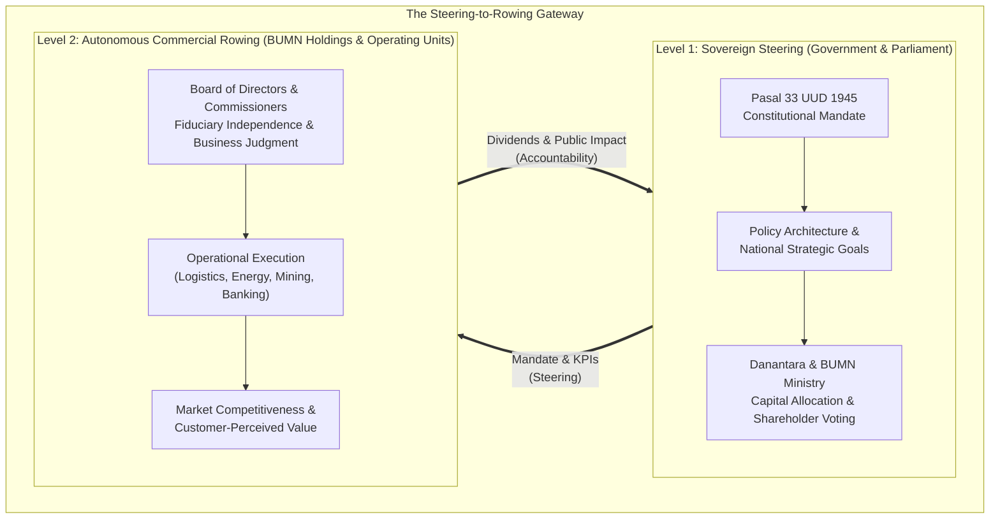

## 💡 First-Principles Intuition & Everyday Analogy

Imagine a large passenger vessel navigating treacherous ocean waters. If the ship's captain leaves the bridge to personally pull an oar in the rowing galley, two disasters immediately occur:

1. Nobody is watching the nautical charts, monitoring incoming storm systems, or plotting course corrections.
2. The rowing itself is executed poorly because the captain lacks the muscular rhythm and specialized stamina of experienced deck crew.

This maritime metaphor forms the cornerstone of David Osborne and Ted Gaebler’s classic public administration thesis: **"Steering rather than rowing."**

In public state governance:

- **Steering** represents setting strategic vision, framing regulatory policy, defining ethical boundaries, allocating sovereign capital, and demanding measurable public accountability. This is the exclusive constitutional duty of sovereign political leadership and state ministries.
- **Rowing** represents operational day-to-day execution: delivering train rides, pumping oil, generating electricity, evaluating microloans, and running manufacturing facilities.

When governments try to _row_, state apparatuses devolve into lethargic bureaucracies bloated by red tape, political patronage, and operational inefficiency. Conversely, when governments abandon _steering_, commercial entities prioritize short-term profit extraction at the expense of national development, social equity, and vital public infrastructure.

The central evolution of **Public Administration Paradigms** over the past 140 years represents society's continuous search for the optimal balance between bureaucratic control, entrepreneurial efficiency, and democratic citizen service.

---

## 🔑 Prerequisite Concepts & Jargon Decoder

To navigate the 140-year evolution of state management theory without prior political science or public administration training, master these foundational definitions:

- **Politics-Administration Dichotomy (1887)**: The doctrine proposed by Woodrow Wilson that political will-formation (lawmaking, elections, political compromise) must be strictly insulated from civil service administration (neutral, technical, efficient execution of policy).
- **POSDCORB (1937)**: Luther Gulick and Henri Fayol’s mnemonic for the seven essential functions of executive administration: _Planning, Organizing, Staffing, Directing, Coordinating, Reporting, and Budgeting_.
- **Rational-Legal Bureaucracy (Max Weber)**: An organization governed by written, impersonal rules, rigid hierarchical authority, jurisdiction of competence, and merit-based promotion, designed to eradicate nepotism and feudal favoritism.
- **Administrative Proverbs & Decision Theory (Herbert Simon)**: Simon's refutation of classical management "principles" as contradictory folk sayings, establishing that real administrative behavior is bounded by incomplete information, cognitive processing limits (_bounded rationality_), and pragmatic satisficing rather than pure optimization.
- **Social Equity (New Public Administration / NPA, 1968)**: The insistence that public administrators are not morally neutral technicians; they bear an ethical obligation to champion fairness, social justice, and protection for economically disadvantaged populations.
- **Entrepreneurial Government (New Public Management / NPM, 1992)**: The introduction of market mechanisms into government: customer choice, competition, performance contracting, cost-accounting decentralization, and privatization.
- **New Public Service (NPS, 2000)**: Janet and Robert Denhardt’s counterweight to NPM, arguing that governments should _"serve citizens, not steer customers"_ through participatory democratic dialogue, shared public interest, and institutional humility.
- **Digital Era Governance (DEG, 2010s)**: Reintegration of fragmented public services via cloud infrastructure, enterprise APIs, big-data analytics, and AI-enabled agile delivery platforms.

---

## 🏛️ The 12 Paradigms of Public Administration (1887 – Present)

Presented by Marsda TNI Dr. Budhi Achmadi in his P3MD plenary lecture, the 140-year historical trajectory of public administration unfolds across twelve decisive intellectual movements:

| Period           | Paradigm / Movement                               | Pioneer Theorists                                       | Core Epistemic Proposition & Structural Focus                                                                                                        |
| :--------------- | :------------------------------------------------ | :------------------------------------------------------ | :--------------------------------------------------------------------------------------------------------------------------------------------------- |
| **1887–1926**    | **Politics-Administration Dichotomy**             | Woodrow Wilson, Frank Goodnow                           | Civil administration must be strictly decoupled from party politics to establish professional competence and objective civil efficiency.             |
| **1900–1930**    | **Scientific Management (_Administrasi Ilmiah_)** | Frederick Winslow Taylor                                | Optimization of task routines through time-and-motion studies, standardized work methods, clear division of labor, and output productivity.          |
| **1927–1937**    | **Administrative Principles**                     | Henri Fayol, Luther Gulick                              | Universalization of managerial architecture and executive coordination formalized through the POSDCORB taxonomy.                                     |
| **1920–1940**    | **Bureaucracy Theory**                            | Max Weber                                               | Rational-legal domination, formalized merit systems, rigid hierarchy, written documentation, and impersonal application of legal rules.              |
| **1940–1950**    | **Critique of Administrative Principles**         | Herbert A. Simon                                        | Demolished classical maxims as contradictory proverbs; replaced mechanical models with behavioral Decision Making Theory and bounded rationality.    |
| **1950–1970**    | **Public Administration as Political Science**    | Dwight Waldo                                            | Reasserted that public bureaucracy cannot be decoupled from democratic values, policy conflicts, ethics, and political power structures.             |
| **1968–1970**    | **New Public Administration (NPA)**               | Dwight Waldo, H. George Frederickson                    | Minnowbrook movement: infused public service with affirmative social equity, responsiveness, and anti-technocratic citizen advocacy.                 |
| **1980–1990**    | **New Public Management (NPM)**                   | David Osborne, Ted Gaebler                              | Entrepreneurial statecraft: _"Steering rather than rowing"_, performance-based budgeting, market competition, corporatization, and customer service. |
| **1990–2000**    | **Governance & Good Governance**                  | World Bank, United Nations Development Programme (UNDP) | Multi-actor governance: rule of law, institutional transparency, stakeholder participation, accountability, and anti-corruption.                     |
| **2000–Present** | **New Public Service (NPS)**                      | Janet V. Denhardt, Robert B. Denhardt                   | _"Serving rather than steering"_: citizen empowerment, collaborative democracy, building public interest, and ethical stewardship.                   |
| **2010–Present** | **Collaborative Governance**                      | Chris Ansell, Alison Gash                               | Cross-sector problem solving convening public ministries, private industry, and civil society in structured consensus-building forums.               |
| **2010–Present** | **Digital Era Governance (DEG)**                  | Patrick Dunleavy                                        | Re-integration of disaggregated agencies via digital platforms, shared enterprise data, automation, and citizen self-service ecosystems.             |

---

## ⚙️ Mechanics: The State Enterprise Governance Index

In state-owned corporate governance, the transition from traditional bureaucratic administration to New Public Management directly determines whether a state enterprise functions as a wealth generator or a fiscal drain.

We can formalize the **State Enterprise Governance Index ($SEGI$)** as:

$$\mathbf{SEGI = \frac{\text{Steering Clarity} \times \text{Operational Autonomy}}{\text{Bureaucratic Red Tape} + \text{Political Patronage Capture}}}$$

### The Analytical Mechanics:

- **Numerator Factors (Multiplicative)**:
  - _Steering Clarity_: Clear national strategic roadmaps (food security, green transition, industrial downstreaming) without conflicting operational micro-management from ministries.
  - _Operational Autonomy_: Professional management freedom to hire top talent, negotiate procurement at commercial speed, and retire legacy non-performing assets under the Business Judgment Rule.
- **Denominator Factors (Additive Drag)**:
  - _Bureaucratic Red Tape_: Excessive overlapping audit layers, sluggish ministerial approval cycles for routine capital expenditure, and risk-averse paper-pushing.
  - _Political Patronage Capture_: Rent-seeking intermediaries, unvetted board appointments, and forced non-commercial cross-subsidies without state budget compensation.

---

## 📊 10-Second Micro-Example: Autonomy vs. Interference

Consider two state energy companies, each evaluating a \$500M green infrastructure capital project:

- **Enterprise A (Old Bureaucratic Model — Rowing Government)**:
  - Ministerial committees demand sign-offs on vendor lists, causing an 18-month delay.
  - Political actors mandate regional sub-contractors regardless of technical qualifications.
  - _Steering Clarity_ = 4, _Autonomy_ = 2, _Red Tape_ = 8, _Patronage_ = 8.
    $$SEGI_A = \frac{4 \times 2}{8 + 8} = \frac{8}{16} = 0.50 \quad \text{(Severe Execution Paralysis)}$$

- **Enterprise B (NPM Decoupled Model — Steering Government, Autonomous Board)**:
  - Ministry specifies the required renewable capacity and financial hurdle rate ($WACC + 3\%$).
  - Professional management tenders contracts transparently using global engineering benchmarks.
  - _Steering Clarity_ = 9, _Autonomy_ = 8, _Red Tape_ = 2, _Patronage_ = 1.
    $$SEGI_B = \frac{9 \times 8}{2 + 1} = \frac{72}{3} = 24.00 \quad \text{(High Velocity Execution)}$$

Enterprise B delivers the power grid on time and within budget while generating dividends for the state treasury, proving that state enterprises flourish only when the state perfects **steering** while granting management uncompromised authority to **row**.

---

## 🔗 Related Resources & Curriculum Bridges

- **Featured Keynote Lecture**: [[rabuan/2026-07-03-budhi-achmadi-kepemimpinan-bumn|Foundation Plenary: Kepemimpinan BUMN Abad XXI]]
- **Speaker Profile**: [[entities/budhi-achmadi|Marsda TNI Dr. Budhi Achmadi, M.Sc.]]
- **Coupled Governance Frameworks**:
  - [[concepts/pso-commercial-duality|Public Service Obligation (PSO) vs Commercial Viability Duality]]
  - [[concepts/growth-mindset|Growth Mindset & Adaptive Capacity]]
  - [[concepts/identity-based-living|Identity-Based Living & Strategy]]
  - [[concepts/best-mind-best-heart|Best Mind & Best Heart Doctrine]]
- **Academic Course Alignment**:
  - [[courses/mk1-organizational-behavior-managing-people/index|MK 1: Organizational Behavior & Managing People]]
  - [[courses/mk5-decision-making-negotiation/index|MK 5: Decision Making & Negotiation]]
- **Return to**: [[concepts/index|Master Concept Directory]] | [[rabuan/index|Rabuan Executive Archive]]
