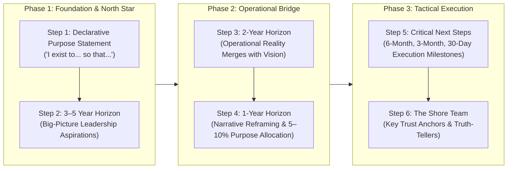

## 📐 Universal Mechanism: Operationalizing Executive Purpose

Developed by **Nick Craig** (Authentic Leadership Institute) and **Scott Snook** (Harvard Business School), **Purpose-to-Impact Planning** is a backward-chaining strategic architecture that translates abstract personal purpose into concrete, time-phased enterprise milestones.

While standard strategic planning operates _present-forward_ (extrapolating existing operational constraints into the future), Purpose-to-Impact operates **future-backward**: defining a vivid 3–5 year vision of leadership impact and backward-chaining it into near-term execution sprints.

---

## 📊 Comparative Framework Exhibits

### Exhibit 1: Traditional Development Planning vs. Purpose-to-Impact Planning

| Dimension            | Traditional Development Planning                  | Purpose-to-Impact Planning                                 |
| :------------------- | :------------------------------------------------ | :--------------------------------------------------------- |
| **Language**         | Generic corporate HR jargon                       | Uniquely meaningful, purpose-infused language              |
| **Primary Focus**    | Fixing operational weaknesses                     | Mobilizing signature strengths to achieve bold aspirations |
| **Orientation**      | Present-forward (extrapolating today's tasks)     | **Future-backward (starting from 5-year impact vision)**   |
| **Target Statement** | States a business- or career-driven goal          | Elicits an individual leadership purpose statement         |
| **Metrics**          | Tied exclusively to corporate KPIs and firm goals | Incremental milestones tied to living your purpose         |
| **Scope**            | Confined strictly to corporate office tasks       | **Holistic (integrates career, family, and shore team)**   |

---

### Exhibit 2: Purpose Statements — From Bad to Good

| Conventional / Ineffective Purpose (Bad)                                                                   | Clarified / Actionable Purpose (Good)                                  | Why It Works                                                                    |
| :--------------------------------------------------------------------------------------------------------- | :--------------------------------------------------------------------- | :------------------------------------------------------------------------------ |
| _"Lead new markets department to achieve exceptional business results"_                                    | **"Eliminate 'chaos'"**                                                | Replaces generic corporate objectives with personal instinctive drive.          |
| _"Be a driver in the infrastructure business that allows each person to achieve outcomes..."_              | **"Bring water and power to the 2 billion people who do not have it"** | Replaces bureaucratic run-on text with profound moral urgency and clarity.      |
| _"Continually and consistently develop and facilitate the growth and development of myself and others..."_ | **"With tenacity, create brilliance"**                                 | Transforms safe HR checklist phrasing into a sharp, declarative call to action. |

---

## 🏛️ Implementation Blueprint: The 7-Stage Architecture

The complete architecture is illustrated by Craig and Snook's composite executive case: **"Richard"**, a senior procurement leader whose lifelong passion is competitive skiff sailing:

1. **Create Purpose Statement**:
   - Concise, declarative statement capturing individual essence: _"To harness all the elements to win the race."_
2. **Write Explanation**:
   - Grounding the statement in personal flow: reading unpredictable wind shears, trusting crew intuition, and synchronizing under high-stress conditions.
3. **Three- to Five-Year Goals**:
   - Big-picture aspiration: Be known for training elite procurement crews that outmaneuver competitors in major global bids.
4. **Two-Year Goals**:
   - Tangible milestone: Redesign supplier partnership model delivering a sustainable **10% cost savings** for the enterprise; teach his sons to sail.
5. **One-Year Goals**:
   - Near-term targets: Deliver the high-priority **Sympix project**; _"build a seaworthy boat"_ by keeping the foundational TFLS process within cash forecasts; take a 2-week unplugged family vacation.
6. **Map Out Critical Next Steps (The Execution Waterfall)**:
   - _Six Months_: Finalize succession plans and lock in the Sympix delivery timeline.
   - _Three Months_: Recruit a world-class replacement for key manager Jim; schedule email-free focus windows.
   - _30 Days_: Onboard Alex in Shanghai; agree on TFLS operational metrics; conduct 1-day Sympix alignment offsite; reconnect with family.
7. **Examine Key Relationships ("The Shore Team")**:
   - Identify 2 to 3 critical navigators (e.g. Sarah the HR business partner, Jill the shore team manager).

---

## 🏢 Executive Case Crucibles

- **Dolf van den Brink (CEO, Heineken USA)**: Clarified his purpose as _"To be the wuxia master who saves the kingdom,"_ drawing upon his martial-arts inspiration and his crucible experience defending a brewery in the Congo to lead turnaround initiatives.
- **Kathi Snook (West Point Colonel)**: Leveraged her purpose (_"To be the gentle, behind-the-scenes, kick-in-the-ass reason for success"_) to transition from stay-at-home mother to elected school board leader driving institutional change.
- **Jostein Solheim (CEO, Ben & Jerry's / Unilever)**: Chose purpose (_"To be part of a global movement that makes changing the world seem fun and achievable"_) over conventional corporate ladder climbing.

---

## 🚀 Action Learning Project (ALP) Application

> [!TIP] ALP Execution Rhythm
> Use the **Purpose-to-Impact backward-chaining method** for your BUMN consulting deliverables: Start from the final Stage 6 Board Presentation impact state and work backward into 30-day data-gathering sprints and 60-day diagnostic prototypes.

---

## 🔗 Contributing Sessions & References

- **Master Lecture Note**: [[courses/mk1-organizational-behavior-managing-people/week-01/index|MK 1 Week 01: Strategizing Your Life]]
- **Exhaustive Reading Deep-Dive**: [[courses/mk1-organizational-behavior-managing-people/week-01/reading-from-purpose-to-impact|Craig & Snook: From Purpose to Impact Study Note]]
- **Related Mechanism**: [[concepts/ikigai|Ikigai Framework]]
- **Theorist Profiles**: [[entities/nick-craig-scott-snook|Nick Craig & Scott Snook]]
- **Hub**: [[concepts/index|Knowledge Matrix]]
