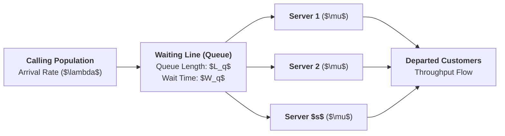

**Queuing Theory** is the mathematical study of waiting lines, congestion, and server utilization. In modern operations management, waiting lines arise whenever short-term demand for a service exceeds the instantaneous capacity of the service facility.

Because customer arrivals and service processing times are stochastic (variable), queues form even when the average service capacity exceeds average customer demand ($\mu > \lambda$).

---

## 🏛️ Kendall's Standard Notation

Queuing systems are classified internationally using **Kendall's Notation**:

$$\mathbf{A \;/\; B \;/\; s \;/\; K \;/\; N \;/\; D}$$

| Symbol | Parameter                  | Standard Value Codes                                                                                                         |
| :----: | :------------------------- | :--------------------------------------------------------------------------------------------------------------------------- |
| **A**  | Arrival Distribution       | $M = \text{Markovian / Poisson (Exponential interarrivals)}$, $D = \text{Deterministic}$, $G = \text{General distribution}$. |
| **B**  | Service Time Distribution  | $M = \text{Exponential service times}$, $D = \text{Deterministic}$, $G = \text{General distribution}$.                       |
| **s**  | Number of Parallel Servers | $1, 2, \dots, s$ identical servers in parallel fed by a single or multiple queues.                                           |
| **K**  | System Capacity Limit      | Maximum queue + in-service buffer allowed (Default: $\infty$ if omitted).                                                    |
| **N**  | Population Calling Size    | Size of customer source pool (Default: $\infty$ if omitted).                                                                 |
| **D**  | Queue Discipline           | FCFS (First-Come, First-Served), LCFS (Last-Come), SIRO (Random), Priority.                                                  |

---

## 📐 Core Operating Mathematics: Single-Server Model ($M/M/1$)

For an $M/M/1$ system with Poisson arrival rate $\lambda$ and exponential service rate $\mu$ ($\mu > \lambda$ for steady-state stability):

### 1. Server Utilization ($\rho$) & Idleness ($P_0$)

$$\mathbf{\rho = \frac{\lambda}{\mu}} \qquad\qquad \mathbf{P_0 = 1 - \rho = 1 - \frac{\lambda}{\mu}}$$

### 2. Expected System Units ($L$) and Queue Units ($L_q$)

$$\mathbf{L = \frac{\lambda}{\mu - \lambda}} \qquad\qquad \mathbf{L_q = \frac{\lambda^2}{\mu(\mu - \lambda)} = L \cdot \rho}$$

### 3. Expected Time in System ($W$) and Time in Queue ($W_q$)

$$\mathbf{W = \frac{1}{\mu - \lambda} = \frac{L}{\lambda}} \qquad\qquad \mathbf{W_q = \frac{\lambda}{\mu(\mu - \lambda)} = \frac{L_q}{\lambda}}$$

> [!NOTE] Reconciliation via Little's Law
> The fundamental relationships adhere strictly to [[concepts/littles-law|Little's Law: $L = \lambda W$]]:
> $$\mathbf{L = \lambda W} \qquad\text{and}\qquad \mathbf{L_q = \lambda W_q} \qquad\text{where}\qquad \mathbf{W = W_q + \frac{1}{\mu}}$$

---

## 📐 Multi-Server Parallel Model ($M/M/s$)

When $s$ identical parallel servers process arrivals at individual service rate $\mu$:

$$\mathbf{\text{System Utilization:}\quad \rho = \frac{\lambda}{s\mu} < 1}$$

$$\mathbf{P_0 = \left[ \sum_{n=0}^{s-1} \frac{(\lambda / \mu)^n}{n!} + \frac{(\lambda / \mu)^s}{s! (1 - \rho)} \right]^{-1}}$$

$$\mathbf{L_q = \frac{P_0 (\lambda / \mu)^s \rho}{s! (1 - \rho)^2}} \qquad\qquad \mathbf{W_q = \frac{L_q}{\lambda}} \qquad\qquad \mathbf{W = W_q + \frac{1}{\mu}} \qquad\qquad \mathbf{L = L_q + \frac{\lambda}{\mu}}$$

---

## 🧠 David Maister's Psychology of Waiting Lines

Quantitative calculations must be matched with human perception engineering. David Maister formulated the eight core axioms governing how customers experience waiting:

| Axiom                                                        | Behavioral Phenomenon                                                     | Operational / Design Countermeasure                                             |
| :----------------------------------------------------------- | :------------------------------------------------------------------------ | :------------------------------------------------------------------------------ |
| **1. Unoccupied time feels longer than occupied time**       | Passive waiting amplifies boredom and perceived elapsed time.             | Visual entertainment, news displays, promotional screens in station concourses. |
| **2. Pre-process waits feel longer than in-process waits**   | Waiting to start service induces anxiety of abandonment.                  | Early intake ticketing, warm greetings, fast preliminary forms.                 |
| **3. Anxiety makes waiting feel longer**                     | Uncertainty over missing departures creates acute psychological friction. | Real-time arrival countdowns, platform destination announcements.               |
| **4. Uncertain waits feel longer than finite waits**         | Lack of an estimated wait time triggers frustration.                      | Dynamic queue time displays ("Estimated wait: 4 minutes").                      |
| **5. Unexplained waits feel longer than explained waits**    | Silence breeds suspicion of operational negligence or failure.            | Transparent announcements explaining signal delays or emergency halts.          |
| **6. Unfair waits feel longer than equitable waits**         | Line cutting or perceived queue favoritism sparks outrage.                | Single serpentine queue feeding multiple checkout turnstiles.                   |
| **7. The more valuable the service, the longer people wait** | Customers tolerate long queues for exclusive or high-stakes services.     | Dedicated priority lanes for premium ticket tiers.                              |
| **8. Solo waiting feels longer than group waiting**          | Social isolation heightens boredom and acute attention to time.           | Welcoming station seating layouts and shared social hubs.                       |

---

## 🔗 Cross-Curricular Connections

- **Process Foundations**: Directly operationalizes [[concepts/littles-law|Little's Law]] and [[concepts/service-system-design-matrix|Service-System Design Matrix]].
- **Capacity Alignment**: Links to [[concepts/capacity-cushion|Capacity Cushion]] to prevent non-linear queue collapses.
- **Course Anchor**: Applied in [[courses/mk4-operations-supply-chain-management/week-07/index|MK4 Week 07: Waiting Line Analysis]] and the [[courses/mk4-operations-supply-chain-management/week-07/case-kai-commuter-manggarai|KAI Commuter Manggarai Station Case Dossier]].
