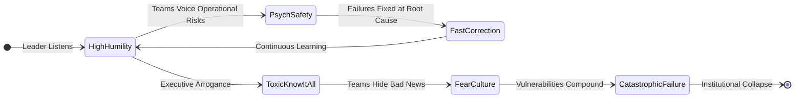
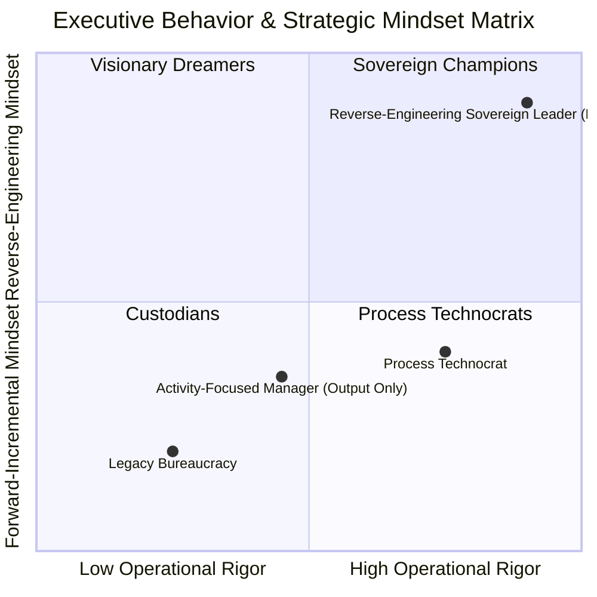

## 1. Executive Summary & Plain-English Intuition

Most organizations plan forward from current constraints. When executives initiate annual budgeting or corporate planning, they typically inspect last year’s operational performance, add an incremental $5\%$ to $10\%$ growth target, and negotiate resources based on what current systems can comfortably absorb. While this forward-incrementalism feels prudent, it fundamentally locks state enterprises and national institutions into mediocrity. Incremental planning merely optimizes existing inefficiencies; it never produces breakthrough institutional transformation.

Codified by [[entities/febriany-eddy|Febriany Eddy, S.E., M.B.A., CPA]] (Managing Director Business 3, [[entities/danantara|Danantara Asset Management]]) and demonstrated in national scale deployments by [[entities/sudaryono|Dr. Sudaryono]] (Wamentan RI), **Reverse-Engineering Leadership** (or _Backward-Chaining Execution_) fundamentally reverses the cognitive sequence of strategic planning:

1. **Anchor on the Audacious End-State**: Begin by defining an uncompromising, world-class benchmark ($E^*$) without negotiating with existing internal limitations.
2. **Deconstruct Downward**: Backward-chain the exact technical, cultural, financial, and organizational capabilities required to make that benchmark inevitable.
3. **Impose Zero Tolerance on Core Enablers**: Treat integrity, intellectual humility, and psychological safety as non-negotiable operational requirements rather than polite aspirations.

### Everyday Analogy: Building a Formula 1 Championship Car vs. Modifying a Family Sedan

Consider vehicle development:

- **Forward-Incremental Planning**: An engineering team takes a standard family sedan, upgrades the air filter, stiffens the shock absorbers by $10\%$, and hopes it can compete in the Grand Prix. Inevitably, the car is lapped within three circuits because the underlying chassis was never engineered for extreme racing tolerances.
- **Reverse-Engineering Leadership**: The chief engineer begins at the finish line: _"To win the championship, this vehicle must lap Silverstone in 1 minute 24 seconds, corner at $4.5g$, and execute pitstops in 2.0 seconds."_ From this fixed end-state, the team backward-chains the aerodynamic downforce, hybrid powertrain wattage, tire degradation curves, and pit-crew drills. Any component that cannot meet the reverse-engineered tolerance is re-engineered or replaced.

In corporate leadership, you do not build a global-standard sovereign enterprise by incrementally polishing bureaucratic legacy habits; you fix the world-class outcome first and systematically backward-engineer the organizational capabilities.

---

## 2. Prerequisite & Jargon Decoder

| Strategic Term                              | Conventional Managerial Interpretation                                                  | Reverse-Engineering Leadership Definition                                                                                                                                                  |
| :------------------------------------------ | :-------------------------------------------------------------------------------------- | :----------------------------------------------------------------------------------------------------------------------------------------------------------------------------------------- |
| **Backward-Chaining (Reverse Engineering)** | Reverse-engineering hardware or competitor software code.                               | Beginning strategic design from the desired end-state outcome and backward-mapping the prerequisite capabilities, milestones, and governance boundaries.                                   |
| **Output vs. Outcome**                      | Treating activities completed (e.g., reports published, meetings conducted) as success. | Strict distinction: **Output** is the activity executed; **Outcome** is the enduring structural change and societal/enterprise value created.                                              |
| **World-Class Benchmark ($E^*$)**           | A glossy aspirational mission statement framed in the lobby.                            | An empirical, non-negotiable operational standard equal to the top global quartile of performance (e.g., lowest quartile cash costs, zero safety fatalities, 100% automated traceability). |
| **Zero-Tolerance Integrity ($ZTI$)**        | Standard compliance lip-service where high performers receive leniency for misconduct.  | An absolute operational rule: any violation of moral integrity, safety compliance, or financial honesty results in immediate expulsion, regardless of commercial pedigree.                 |
| **Toxic "Know-It-All" Syndrome**            | Senior leaders projecting total certainty to appear commanding.                         | An organizational pathology where executive arrogance suppresses critical feedback, masks emergent risks, and destroys psychological safety.                                               |
| **Delegation with Accountability**          | Hands-off task delegation without follow-up, or micromanagement.                        | Delegating operational execution authority to single-point owners (PICs) while maintaining strict milestone checkpoints and risk-based quality control.                                    |
| **Executive Legacy**                        | Personal wealth accumulated, titles held, or honors received.                           | The durability of institutional systems and talent that continue to flourish and compound long after the leader departs.                                                                   |

---

## 3. Structural Anatomy of the Mechanism

### 3.1 The 4-Stage Backward-Chaining Execution Loop

The architecture of Reverse-Engineering Leadership operates through four sequential phases:

```mermaid
flowchart LR
    subgraph Stage1 ["Phase 1: Audacious Benchmark"]
        direction TB
        E["<b>Define End-State ($E^*$)</b><br/>Global Top-Decile Performance Standard"]
    end

    subgraph Stage2 ["Phase 2: Capability Deconstruction"]
        direction TB
        D1["<b>Talent Thresholds:</b> Skills &amp; Autonomy Required"]
        D2["<b>Systems &amp; Architecture:</b> Digital Infrastructure"]
        D3["<b>Capital Allocation:</b> Ringfenced Capex &amp; Hurdle Rates"]
    end

    subgraph Stage3 ["Phase 3: Ethical Boundaries"]
        direction TB
        B1["<b>Zero-Tolerance Integrity:</b> Non-negotiable red lines"]
        B2["<b>Intellectual Humility:</b> Eradicate toxic arrogance"]
        B3["<b>Delegation with Accountability:</b> Single PIC + Checkpoints"]
    end

    subgraph Stage4 ["Phase 4: Self-Sustaining Legacy"]
        direction TB
        L["<b>Enduring Systemic Legacy</b><br/>Enterprise runs without executive presence"]
    end

    Stage1 --> Stage2
    Stage2 --> Stage3
    Stage3 --> Stage4
```

### 3.2 The Outcome-to-Capability Differential Equation

The capability gap ($\Delta C$) that leadership must resolve over planning horizon $T$ is governed by:

$$\Delta C(t) = E^* - C(t)$$

Where $E^*$ is the world-class end-state standard, and $C(t)$ is current organizational capability. Under forward-incrementalism, capability evolves as:

$$C_{\text{inc}}(t) = C_0 \cdot (1 + g)^t \quad \text{where } g \approx 0.05$$

Under Reverse-Engineering Leadership, the target execution velocity ($V^*$) required per unit of cycle time is explicitly solved:

$$V^* = \frac{E^* - C_0}{T_{\text{target}}}$$

If $V^* > V_{\text{internal}}$, leadership does not lower $E^*$. Instead, the leader aggressively:

1. Re-architects organizational structure (eliminates bureaucratic approval layers).
2. Deploys global joint-venture technology or external talent density.
3. Imposes **Delegation with Accountability** to compress decision turnaround times.

### 3.3 The Integrity and Psychological Safety Governor

High performance without integrity generates systemic catastrophe (e.g., Enron, Wirecard, or collapsed BUMN balance sheets). The framework establishes that **Operational Capability ($C$) is multiplied by the Integrity Governor ($I_G$)**:

$$\text{Enterprise Value Realized} = C \times I_G \quad \text{where } I_G \in \{0, 1\}$$

If integrity is compromised ($I_G = 0$), the entire enterprise value immediately zeroes out. Intellectual humility ensures that $I_G$ remains functional:

---

## 4. Micro-Numerical Toy Example: National Nutrition Logistics (MBG 2.0)

Suppose the government establishes an audacious target under **Makan Bergizi Gratis (MBG 2.0)**:

- Target End-State ($E^*$): Deliver **3,000 hot, nutritious lunches daily** to 10 schools in a remote regency by **11:30 AM** at an absolute budget limit of **IDR 15,000 / meal**, with zero instances of food poisoning ($ZTI = 1$).

### Forward-Incremental Attempt:

- A local vendor cooks food at a single kitchen, dispatches vans in traffic without insulated packaging, and delivers meals cold at 1:15 PM. When students fall ill, the vendor blames the meat supplier, and the school head blames traffic. $E^*$ fails completely.

### Reverse-Engineered Execution (Backward-Chaining):

1. **Target Arrival**: 11:30 AM at school gate.
2. **Backward Transit Calculation**: Maximum delivery radius: 20 minutes (dispatch deadline: 11:10 AM).
3. **Packaging & Temperature Requirement**: Insulated food-grade stainless containers maintaining temperature above $60^\circ\text{C}$ to prevent bacterial bloom ($Bacillus\ cereus$).
4. **Kitchen Packing Completion**: 10:45 AM (allows 25 minutes for inspection and loading).
5. **Cooking Completion**: 10:15 AM (allows 30 minutes portioning).
6. **Supply Intake & Quality Check**: Fresh vegetables and poultry received by 05:00 AM from local contracted smallholders, verified by digital thermometer and digital scale ($CI = 100\%$).
7. **Delegation with Accountability**:
   - Single PIC: Satuan Pelayanan Gizi Unit Head.
   - Milestone: If cooking is not underway by 07:30 AM, an automated trigger reroutes backup hot soup from a sister hub.
   - Result: 3,000 meals delivered on time, perfectly hot, within budget, stimulating local agrarian trade with zero safety infractions.

---

## 5. Enterprise & Institutional Integration

### Institutional Deployment Across BUMN & Danantara:

- **[[entities/danantara|Danantara Asset Management]]**: Establishing world-class corporate governance requires benchmarking state asset returns against sovereign peers (Temasek, GIC, ADIA) rather than historical domestic inflation. Reverse-engineering portfolio value creation dictates divestment of non-core assets and radical capital reallocation.
- **[[entities/pt-pertamina|PT Pertamina Patra Niaga]]**: In downstream fuel distribution, moving from reactive fire-fighting to world-class reliability requires reverse-engineering terminal automation from the end-customer SPBU perspective, eliminating dispatch queues and single-point server vulnerabilities.
- **MIND ID & PT Vale Indonesia**: Achieving green nickel certification requires backward-chaining renewable power supply, mine reclamation guarantees, and zero-fatality contractor training from the initial exploration phase.

---

## 🔗 Cross-Curricular & Knowledge Graph Bridges

- **Originating Plenary Sessions**:
  - [[rabuan/2026-11-11-febriany-eddy-global-leadership|Rabuan: Kepemimpinan Kelas Dunia untuk Membangun Negeri]] (Febriany Eddy)
  - [[rabuan/2026-11-11-sudaryono-mbg-ketahanan-pangan|Rabuan: Membangun Fondasi Bangsa — MBG 2.0 & Ketahanan Pangan]] (Dr. Sudaryono)
- **Key Architect & Theorist**:
  - [[entities/febriany-eddy|Febriany Eddy, S.E., M.B.A., CPA]]
  - [[entities/sudaryono|Dr. Sudaryono, B.Eng., M.M., M.B.A.]]
- **Related Foundational Concepts**:
  - [[concepts/the-integrity-triangle|The Integrity Triangle]]
  - [[concepts/psychological-safety|Psychological Safety & High-Performance Teaming]]
  - [[concepts/pso-commercial-duality|Public Service Obligation (PSO) vs Commercial Duality]]
  - [[concepts/supply-chain-operations-reference|Supply Chain Operations Reference (SCOR)]]
- **Curriculum Courses**:
  - [[courses/mk1-organizational-behavior-managing-people/index|MK 1: Organizational Behavior]] (Culture, Integrity, and Humility)
  - [[courses/mk5-decision-making-negotiation/index|MK 5: Decision Making & Negotiation]] (Audacious Strategic Framing)
- Return to **[[concepts/index|Core Concepts Matrix]]**
