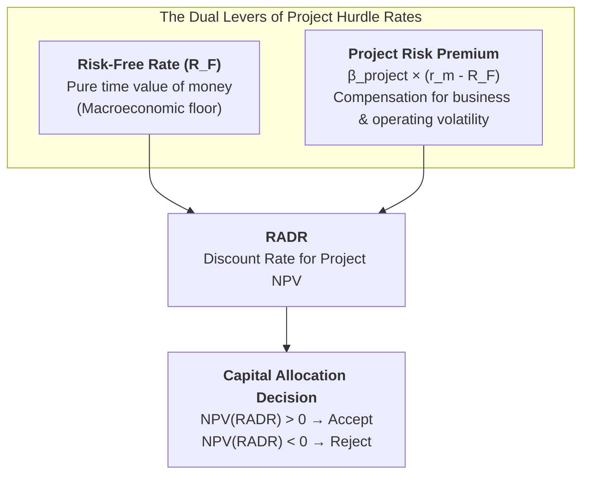

The **Risk-Adjusted Discount Rate (RADR)** is the required rate of return used to discount cash flows on a capital budgeting project, calibrated to reflect the specific operational and financial risk profile of that project rather than the overall corporate cost of capital.

---

## 1. Plain-English Intuition & Everyday Analogy

Imagine an individual lending money to two different borrowers:

1. A sovereign government with AAA credit that has never missed a debt payment.
2. A startup friend launching a food truck in an unproven tourist town.

Nobody would charge both borrowers the same 5% interest rate. For the government, 5% is acceptable because default risk is essentially zero. For the food truck, you demand 15% or 20% to compensate for the very real probability that you might lose your capital.

In corporate finance, **a single corporate hurdle rate (e.g., standard WACC of 10%) commits the exact same error**. If an executive team evaluates every proposal at 10%:

- Safe, routine equipment maintenance projects are unfairly penalized.
- Highly speculative, unhedged market expansions are artificially subsidized and accepted despite catastrophic downside risk.

**RADR corrects this bias**: Safer projects get discounted at lower rates, while risky gambles must clear a much steeper hurdle rate to justify their capital allocation.

---

## 2. Prerequisite & Jargon Decoder

Before applying RADR in financial valuation, executives must master five core prerequisites:

| Financial Jargon                            | Plain-English Executive Meaning                                                                                                                                                                          |
| :------------------------------------------ | :------------------------------------------------------------------------------------------------------------------------------------------------------------------------------------------------------- |
| **Weighted Average Cost of Capital (WACC)** | The overall blended return a company must pay to its debt and equity investors for its _average_ existing operations.                                                                                    |
| **Project Risk vs. Firm Risk**              | The realization that an individual capital expenditure may be substantially more volatile (or less volatile) than the firm's historical baseline portfolio.                                              |
| **Capital Asset Pricing Model (CAPM)**      | An equilibrium pricing model showing that required return equals the risk-free rate plus a risk premium scaled by market covariance ($\beta$).                                                           |
| **Certainty Equivalent (CE)**               | The alternative risk adjustment method: rather than raising the discount rate, managers mathematically downscale uncertain future cash flows to guaranteed equivalents ($CF_t^* = \alpha_t \cdot CF_t$). |
| **Risk Index / Risk Classes**               | Practical corporate tiering grids that assign standardized discount rates (e.g., Class I: 8%, Class II: 10%, Class III: 14%, Class IV: 20%) based on project archetypes.                                 |

---

## 3. Structural Anatomy of the Mechanism

The mathematical formulation for Net Present Value using a Risk-Adjusted Discount Rate is:

$$NPV = \sum_{t=1}^{n} \frac{CF_t}{(1 + RADR)^t} - CF_0$$

Where $CF_t$ represents the expected incremental cash flow in period $t$, $CF_0$ is the initial capital expenditure, and $RADR$ is the risk-adjusted discount rate.

### Structural Decomposition of RADR

Under the Capital Asset Pricing Model (CAPM) framework:

$$RADR = R_F + \beta_{\text{project}} \times (r_m - R_F)$$

Where:

- $R_F$ is the risk-free rate of return (e.g., 10-year sovereign government bond yield).
- $r_m$ is the expected return on the aggregate market portfolio.
- $(r_m - R_F)$ is the market risk premium.
- $\beta_{\text{project}}$ measures the systematic, non-diversifiable risk of the specific investment asset.

### The Compounding Risk Penalty Over Time

A subtle mathematical feature of RADR is that because $(1 + RADR)^t$ appears in the denominator, the risk adjustment compounds exponentially over time. Distant cash flows in Year 10 or 15 are punished far more severely than cash flows in Year 1 or 2, reflecting the compounding uncertainty of long-range business forecasts.

---

## 4. Micro-Numerical Toy Example

Consider two mutually exclusive projects, each requiring an initial capital outlay of $CF_0 = \$100,000$ and producing a single cash inflow of $\$140,000$ at $t = 2$ years:

- **Project A (Routine Factory Overhaul):** Safe cash flow. Rated Class I ($RADR_A = 8\%$).
- **Project B (Unproven Crypto-Logistics Venture):** Volatile cash flow. Rated Class IV ($RADR_B = 18\%$).

### Case 1: The Fatal Flaw of a Uniform 10% Hurdle Rate

If the CFO blindly discounts both projects at the firm's standard cost of capital ($r = 10\%$):

$$NPV_A = \frac{\$140,000}{(1 + 0.10)^2} - \$100,000 = \frac{\$140,000}{1.21} - \$100,000 = \$115,702 - \$100,000 = +\$15,702$$

$$NPV_B = \frac{\$140,000}{(1 + 0.10)^2} - \$100,000 = +\$15,702$$

Both appear equally attractive ($+\$15,702$). The firm is blind to the fact that Project B has an enormous probability of total failure.

### Case 2: Valuation Using Risk-Adjusted Discount Rates (RADR)

Applying project-specific RADRs:

$$NPV_A = \frac{\$140,000}{(1 + 0.08)^2} - \$100,000 = \frac{\$140,000}{1.1664} - \$100,000 = \$120,027 - \$100,000 = +\$20,027$$

$$NPV_B = \frac{\$140,000}{(1 + 0.18)^2} - \$100,000 = \frac{\$140,000}{1.3924} - \$100,000 = \$100,546 - \$100,000 = +\$546$$

### Executive Takeaway:

At its proper risk rate of 18%, Project B's NPV collapses from $\$15,702$ down to barely break-even ($+\$546$), while safe Project A surges to $+\$20,027$. RADR prevents the destruction of shareholder capital by rejecting reckless ventures disguised by flat hurdle rates.

---

## 5. Practical Implementation: Corporate Risk Grids

Because pure project betas ($\beta_{\text{project}}$) are rarely observable for unlisted internal capital assets, corporations adopt standardized **Risk Class Grids**:

|  Risk Class   | Project Archetype                                               |  Typical RADR Range  | Strategic Purpose                                             |
| :-----------: | :-------------------------------------------------------------- | :------------------: | :------------------------------------------------------------ |
|  **Class I**  | Routine replacement of worn assets, cost-reduction retrofits    | **WACC − 2% to 3%**  | Low risk; protects baseline operating efficiency.             |
| **Class II**  | Expansion of existing product lines in established markets      |   **WACC (Base)**    | Average risk matching corporate baseline.                     |
| **Class III** | New product launches in existing markets, adjacent acquisitions | **WACC + 3% to 4%**  | Above-average market and execution risk.                      |
| **Class IV**  | R&D moonshots, unfamiliar international geography, deep tech    | **WACC + 6% to 10%** | Extreme uncertainty; requires massive payoff to clear hurdle. |

---

## 🔗 Related Portals

- Core Lecture: [[courses/mk2-financial-management-strategy/week-10/index|Week 10: Risk and Refinements in Capital Budgeting]]
- Case Dossier: [[courses/mk2-financial-management-strategy/week-10/case-lasting-impressions-capital-budgeting|Lasting Impressions Company Case]]
- Return to [[concepts/index|Concept Lattice Index]]
