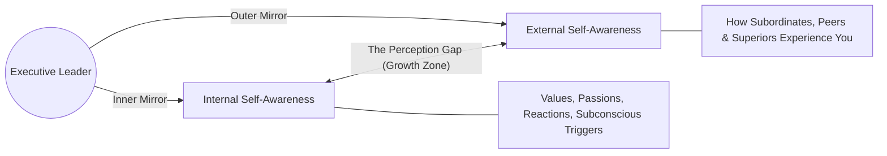

## 📐 Universal Mechanism & The 10–15% Paradox

**Self-Awareness** is the meta-cognitive capability to understand one's own internal motivations, emotional triggers, values, and blind spots, as well as accurately comprehending how one is experienced by others.

> [!IMPORTANT] The Empirical Reality
> While organizational surveys indicate that **95% of managers believe they possess high self-awareness**, empirical psychological research (Tasha Eurich, Harvard Business Review) establishes that **only 10% to 15% are genuinely self-aware**. Up to 90% of leaders navigate organizational environments with substantial perceptual distortions.

---

## 🪞 The Two Mirrors of Self-Awareness

Effective executive functioning requires synchronizing two distinct perceptual dimensions:

1. **Internal Self-Awareness (The Inner Mirror)**:
   - Clarity regarding your authentic core values, aspirations, behavioral reactions, and limiting stories.
   - Low internal awareness produces reactive volatility, emotional hijacking, and career drift.
2. **External Self-Awareness (The Outer Mirror)**:
   - Accurately reading the social landscape and recognizing your direct behavioral impact on team morale and psychological safety.
   - Low external awareness produces oblivious arrogance, micromanagement, and communication failure.
3. **Closing the Gap**:
   - Both dimensions matter deeply, and they rarely align perfectly. Closing the gap between these two mirrors is where real executive growth lives.

### 🛠️ The Active Toolkit for Deepening Self-Awareness

1. **Discovery Journaling**: Write to _discover what you think_—not merely to log a chronological record of what happened.
2. **Proactive Feedback Loops**: Ask trusted colleagues and mentors the catalytic question: _"What do you see in me that I might not see?"_
3. **Personality Frameworks as Mirrors**: Utilize instruments like MBTI, Enneagram, or CliftonStrengths as _mirrors for qualitative reflection_, never as rigid, fatalistic labels.
4. **Mindfulness & The Stimulus-Response Gap**: Practice pausing before reacting. Train your executive nervous system to observe and expand the brief gap between an external stimulus and your managerial response.

---

## 🏛️ Multi-Disciplinary Lenses Across the MBA Curriculum

### 1. Organizational Behaviour & Team Dynamics Lens (MK 1)

- **Primary Source**: SBM ITB Module 1 & [[entities/annie-mckee|Annie McKee]].
- **Core Insight**: Leaders infect organizations with their emotional state. In high power-distance cultures (such as Indonesian BUMNs), un-self-aware executives mistake deferential silence for enthusiastic agreement.
- _Discussed in_: [[courses/mk1-organizational-behavior-managing-people/week-01/index|MK 1 Week 01 (Strategizing Your Life)]].

### 2. Negotiation & Decision Science Lens (MK 5)

- **Primary Mechanism**: Mitigating Cognitive Biases & Ego Depletion.
- **Core Insight**: In high-stakes bargaining, lack of self-awareness triggers overconfidence, reactive devaluation, and escalation of commitment (sunk cost fallacy). Self-aware negotiators create an intentional pause between emotional stimulus and tactical response.

### 3. Executive Presence in BUMN Governance (Rabuan Plenary)

- **Practitioner View**: As state-owned enterprises undergo digital and commercial modernization, executive self-awareness enables leaders to bridge legacy civil-service mindsets with agile private-sector talent.

---

## 🚀 Action Learning Project (ALP) Application

> [!TIP] ALP Team Dynamics Callout
> During **ALP Milestone 1**, conduct a team self-awareness audit across your student consulting pod: Identify individual working style triggers, feedback preferences, and perception gaps before entering client BUMN boardrooms.

---

## 🔗 Contributing Sessions & References

- **MK 1 Lecture**: [[courses/mk1-organizational-behavior-managing-people/week-01/index|MK 1 Week 01: Strategizing Your Life]]
- **Related Mechanism**: [[concepts/values-congruence|Values Congruence]]
- **Theorist Profile**: [[entities/annie-mckee|Annie McKee]]
- **Hub**: [[concepts/index|Knowledge Matrix]]
