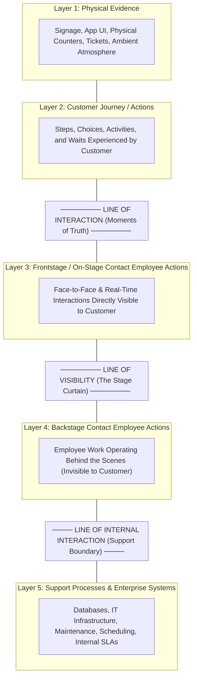
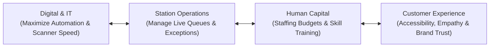

## 📐 Universal Definition & Conceptual Core

**Service Blueprinting** is an operational and design framework that visually maps an entire service delivery system by depicting the simultaneous relationships between customer actions, customer-facing employee touchpoints, behind-the-scenes activities, and internal support systems.

Originally conceptualized by **G. Lynn Shostack** (Harvard Business Review, 1982, 1984) and expanded by **Mary Jo Bitner, Amy L. Ostrom, and Felicia N. Morgan** (2008), service blueprinting extends traditional process mapping by explicitly incorporating the **customer's perspective and emotional journey** into the operational architecture.

### The Five Horizontal Layers

A complete service blueprint is organized into five distinct horizontal swimlanes:

1. **Physical Evidence**: The tangible and digital artifacts that customers encounter at each touchpoint (e.g., station signage, e-KTP reader hardware, smartphone app interface, error prompts, platform lighting).
2. **Customer Journey / Actions**: The chronological sequence of actions, decisions, and waiting intervals undertaken by the customer (e.g., purchasing tickets, arriving at station, queuing at customer service, presenting face).
3. **Frontstage (On-Stage) Contact Employee Actions**: Activities performed by front-line personnel in direct, visible contact with the customer (e.g., customer service officers guiding registration, gate officers verifying exceptions).
4. **Backstage Contact Employee Actions**: Tasks executed by service staff that occur out of the customer's direct sight but are directly tied to the service encounter (e.g., ticket data synchronization, identity record retrieval, baggage routing).
5. **Support Processes**: Internal procedures, enterprise software, third-party vendor interfaces, and hardware maintenance protocols that sustain contact employees and automated channels (e.g., national biometric database integration, ISO 27001 security protocols, workforce staffing rules).

### The Three Critical Separation Lines

The layers are demarcated by three structural boundaries:

1. **Line of Interaction**: Separates customer actions from frontstage enterprise actions. Every crossing of this line represents a **Moment of Truth** where customer expectations directly collide with service execution.
2. **Line of Visibility**: Separates visible frontstage activities from invisible backstage operations. Work executed above the line of visibility must prioritize empathy, customer guidance, and perceptual psychology; work executed below the line of visibility can be engineered with factory-like efficiency and standardized task pacing.
3. **Line of Internal Interaction**: Separates contact employees from internal support functions, infrastructure teams, and database administrators. Handoffs across this line dictate whether front-line staff possess the system speed and data accuracy needed to serve customers.

> [!IMPORTANT] The Blueprint Failure Paradox: Causal Layer vs. Experienced Layer
> A foundational law of service blueprinting is that **a failure is rarely experienced on the layer where it originated**:
>
> - **The Causal Layer**: The root cause of a service breakdown almost always resides below the line of visibility—in faulty support processes (e.g., an uncalibrated e-KTP reader, inadequate staffing schedules, or an absent software fallback path).
> - **The Experienced Layer**: The customer experiences the pain above the line of visibility—at the line of interaction (e.g., standing in a 40-minute queue, facing a gate error buzzer, or being turned away from boarding).
>
> When organizations lack blueprint discipline, executives reflexively attempt to fix the problem where the pain shows (e.g., deploying cheerier front-line staff or installing faster automated turnstiles) rather than where the constraint originated (e.g., expanding upstream registration capacity or upgrading hardware readers).

---

## 🏛️ Multi-Disciplinary Lenses Across the MBA Curriculum

### 1. Operations & Supply Chain Management (MK 4)

- **Primary Mechanism**: Diagnostic identification of service bottlenecks, fail points, and capacity mismatches across sequential stages.
- **Core Insight**: Automated downstream technology (e.g., a 1-second biometric scanner) cannot compensate for a constrained upstream support activity (e.g., an 80-passenger/hour registration desk). Blueprinting exposes where work accumulates across the entire service pipeline.
- _Discussed in_: [[courses/mk4-operations-supply-chain-management/week-06/index|MK 4 Week 06 (Process Design & Analysis)]].

### 2. Marketing Management & Customer Experience (MK 3)

- **Primary Mechanism**: Moment-of-truth optimization and customer journey mapping.
- **Core Insight**: Customer perception of service quality is disproportionately governed by edge cases, service recovery, and peak-end experiences rather than average operational metrics. Blueprinting aligns brand promises with operational delivery.

### 3. Organizational Behaviour & Managing People (MK 1)

- **Primary Mechanism**: Emotional labor allocation and frontstage role definition.
- **Core Insight**: Frontstage employees must absorb customer-introduced emotional and capability variability. Without robust backstage support, frontstage staff experience severe burnout, leading to high turnover and degraded customer interactions.

---

## ⚖️ Cross-Functional Boardroom Tensions

1. **Automation Speed vs. End-to-End Throughput**:
   Digital teams celebrate local optimizations (e.g., "The scanner takes only one second!"), while Operations teams must absorb the upstream queues and downstream fallbacks that the technology ignores.
2. **Headcount Reduction vs. Exception Resilience**:
   Finance and Digital Transformation roadmaps often justify capital expenditure on automation by projecting sharp cuts in frontstage headcount. However, because automated systems cannot resolve non-standard exceptions, reducing manual officers hollows out the system's resilience during peak disruptions.
3. **Factory Efficiency vs. Public Service Equity**:
   Designing below-the-line activities for pure cost minimization often pushes complex data entry or registration tasks onto the customer. For state-owned enterprises (BUMN), this can exclude elderly or digitally marginalized citizens.

---

## 🚀 Action Learning Project (ALP) Application

> [!TIP] ALP Capstone Alignment: Auditing BUMN Service Delivery
> When executing Action Learning Projects across partner BUMNs (such as **PT Kereta Api Indonesia**, **Bank Mandiri**, **Pelindo**, or **Telkom Indonesia**), consulting teams should use service blueprinting to audit digital transformation initiatives:
>
> 1. **Identify the True Decoupling Point**: Does the digital process force high-contact registration into the live service queue, or does it decouple preparation into an off-site, self-service window?
> 2. **Map the Failure Paths**: Does the blueprint contain explicit exception and recovery pathways, or does a system failure leave the customer stranded with no visible fallback?
> 3. **Audit Poka-Yoke Safeguards**: Where do physical and digital fail-safes prevent customer errors (e.g., missing data, unreadable identity documents) from triggering frontstage operational blockages?

---

## 🔗 Contributing Sessions & References

- Master Lecture Note: [[courses/mk4-operations-supply-chain-management/week-06/index|MK 4 Week 06: Process Design, Analysis & Little's Law]]
- Case Study: [[courses/mk4-operations-supply-chain-management/week-06/case-kai-gambir-gate|PT Kereta Api Indonesia (Persero): One Second at the Gambir Gate]]
- Related Concepts:
  - [[concepts/service-system-design-matrix|Service-System Design Matrix]]
  - [[concepts/customer-order-decoupling-point|Customer Order Decoupling Point]]
  - [[concepts/customer-introduced-variability|Customer-Introduced Variability]]
- Master Hub: [[concepts/index|Knowledge Matrix]]
