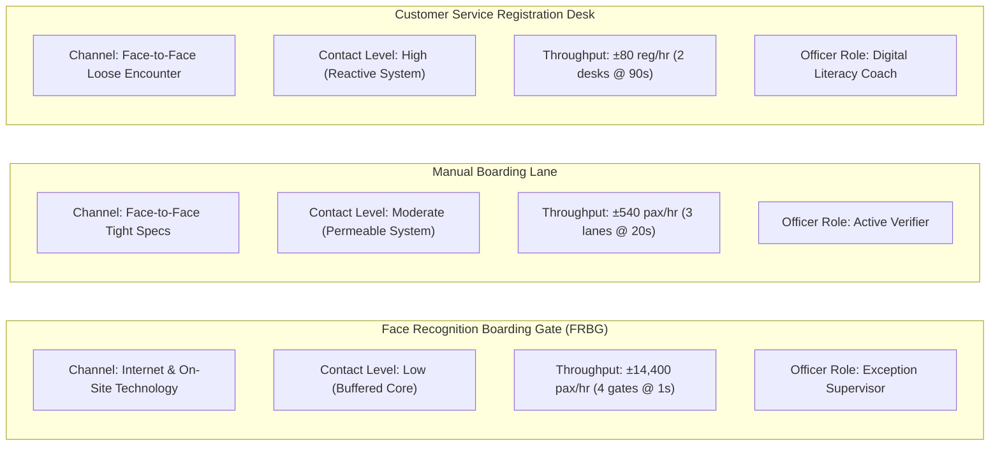
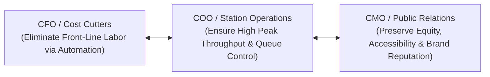

## 📐 Universal Definition & Conceptual Core

The **Service-System Design Matrix**, formulated by **Richard B. Chase** (Harvard Business Review, 1978; Jacobs & Chase, Chapter 9), is a strategic operations framework that categorizes service delivery systems along a continuum of **customer contact** and identifies the resulting trade-offs in **operational efficiency**, **sales and customization opportunities**, and **workforce skill requirements**.

The fundamental premise of the matrix is that **the customer's physical or virtual presence inside the production system creates operational friction**: as customer contact increases, customer-introduced variability rises, process control becomes harder, and process efficiency inevitably declines.

```
       HIGH SALES OPPORTUNITY  ▲
                               │
               [Reactive]      │                                      Face-to-Face
             (High Contact)    │                                      Customized
                               │                                     ┌─────────────┐
                               │                     Face-to-Face    │ Health Care │
                               │                      Loose Specs    │ Consulting  │
                               │                     ┌─────────────┐ └─────────────┘
                               │                     │ Full-Service│
               [Permeable]     │      Phone Contact  │ Restaurant  │
             (Medium Contact)  │     ┌─────────────┐ └─────────────┘
                               │     │ Call Center │
                               │     └─────────────┘
                               │  Internet &
                               │  On-Site Tech
                               │ ┌─────────────┐
               [Buffered]      │ │ ATM / Kiosk │
              (Low Contact)    │ └─────────────┘
                               │ Mail Contact
                               │┌─────────────┐
                               ││ Billing/Post│
                               │└─────────────┘
                               └─────────────────────────────────────────────────────►
                                LOW                                               HIGH
                                           DEGREE OF CUSTOMER CONTACT
                                HIGH ◄──────────────────────────────────────────── LOW
                                           PROCESS OPERATING EFFICIENCY
```

### The Six Service Encounter Configurations

Chase groups service delivery systems into three broad operational environments across six encounter formats:

| System Environment   | Encounter Channel                 | Extent of Contact | Operational Characteristics                                                                                        | Workforce Skill Profile                                     |
| :------------------- | :-------------------------------- | :---------------: | :----------------------------------------------------------------------------------------------------------------- | :---------------------------------------------------------- |
| **Buffered Core**    | **Mail / Postal Contact**         |  None / Minimal   | Customer is physically separated from system; work performed on surrogates; high batch efficiency.                 | Clerical skills; paper and digital processing.              |
| **Buffered Core**    | **Internet & On-Site Technology** |        Low        | Customer self-serves using digital interfaces (ATMs, web portals, automated gates); standardized execution.        | Technical maintenance; automated system monitoring.         |
| **Permeable System** | **Phone Contact**                 |     Moderate      | Direct audio interaction; structured scripting; moderate capability to handle customer inquiries.                  | Verbal agility; procedural adherence; call scripting.       |
| **Permeable System** | **Face-to-Face Tight Specs**      |   Moderate-High   | Physical encounter governed by rigid operating rules (e.g., McDonald's, manual boarding gate check).               | Procedural compliance; rapid document inspection.           |
| **Reactive System**  | **Face-to-Face Loose Specs**      |       High        | Direct personal encounter with room for discretion (e.g., bank personal banker, car dealership).                   | Diagnostic problem-solving; customer relationship building. |
| **Reactive System**  | **Face-to-Face Customized**       |      Maximum      | Completely bespoke service encounter designed around customer needs (e.g., oncology clinic, strategic consulting). | High professional expertise; deep diagnostic judgment.      |

### The Core Operational Trade-Offs

The matrix establishes two inverse dynamics:

1. **Efficiency vs. Customization/Sales Opportunity**:
   - Systems with low contact (Buffered Core) maximize throughput efficiency because customers cannot disrupt standard work rhythms. However, sales opportunities are minimal.
   - Systems with high contact (Reactive System) create rich opportunities for cross-selling and tailored client experiences, but forfeit high-volume throughput efficiency.
2. **Workforce Evolution Along the Continuum**:
   - **Clerical Work** (Buffered Core): Routine data entry, filing, automated system administration.
   - **Procedural Work** (Permeable System): Scripted customer guidance, rule enforcement, document checks.
   - **Diagnostic & Trade Work** (Reactive System): Complex problem diagnosis, exception resolution, empathy, and active listening.

---

## 🚉 Application: Analyzing Parallel Service Paths in Public Transport

In the operational analysis of **PT Kereta Api Indonesia (Persero)**, the two boarding paths occupy fundamentally incompatible positions on the Service-System Design Matrix:



> [!CAUTION] The Staffing Fallacy in Dual-Path Service Redesign
> Management often assumes that as customers adopt automated self-service, the manual path can be staffed by a residual, low-skilled headcount.
>
> **The reality is the exact opposite**:
>
> - The automated gate filters out all easy, clean, standard transactions.
> - **The passengers remaining in the manual lane are disproportionately complex edge cases**: unreadable identity cards, damaged barcodes, unaccompanied elderly passengers, or frustrated travelers with ticketing anomalies.
> - Therefore, the manual path requires **higher diagnostic and interpersonal skills** than the automated gate. Starving the manual path of capacity causes queue times to explode during peak travel.

---

## 🏛️ Multi-Disciplinary Lenses Across the MBA Curriculum

### 1. Operations & Supply Chain Management (MK 4)

- **Primary Mechanism**: Matching operating capacity, facility layout, and process standardization to the degree of customer interaction.
- **Core Insight**: Designing high-contact processes with manufacturing-line assumptions inevitably creates massive bottleneck variance.
- _Discussed in_: [[courses/mk4-operations-supply-chain-management/week-06/index|MK 4 Week 06 (Process Design & Analysis)]].

### 2. Organizational Behaviour & Human Capital (MK 1)

- **Primary Mechanism**: Worker capability alignment and job design.
- **Core Insight**: Service workers in reactive systems face high cognitive load and emotional exhaustion. Hiring, training, and KPI metrics must reward empathy and diagnostic problem resolution rather than transaction speed.

### 3. Marketing Management (MK 3)

- **Primary Mechanism**: Service touchpoint portfolio design.
- **Core Insight**: Customer satisfaction is shaped by multi-channel harmony. Forcing all customer segments onto digital self-service destroys customer lifetime value if the human fallback is degraded.

---

## ⚖️ Cross-Functional Boardroom Tensions



1. **Digital Cost Cutting vs. Public Service Mandate**:
   Executive committees frequently approve automated boarding investments expecting immediate labor savings. However, public enterprise mandates require equitable access for citizens lacking digital credentials.
2. **Standardization vs. Human Discretion**:
   Process engineers push for tight procedural scripting to maintain cycle times; frontline supervisors demand discretion to resolve ambiguous passenger emergencies without rigid bureaucratic penalties.

---

## 🚀 Action Learning Project (ALP) Application

> [!TIP] ALP Capstone Alignment: Service Architecture Review
> Consulting teams analyzing customer encounters across BUMN institutions should map every customer channel onto the matrix:
>
> 1. **Audit Channel Alignment**: Are highly standardized, repetitive transactions (e.g., basic balance inquiries, simple ticket checks) still consuming expensive face-to-face personnel hours?
> 2. **Audit Exception Fallbacks**: When automated self-service fails, does the customer fall back into an adequately staffed permeable system with skilled diagnostic officers, or are they abandoned in an unmanaged queue?
> 3. **Evaluate Worker Skill Sets**: Are frontline officers trained and evaluated using metrics that match their matrix position (e.g., error recovery quality vs. transaction time)?

---

## 🔗 Contributing Sessions & References

- Master Lecture Note: [[courses/mk4-operations-supply-chain-management/week-06/index|MK 4 Week 06: Process Design, Analysis & Little's Law]]
- Case Study: [[courses/mk4-operations-supply-chain-management/week-06/case-kai-gambir-gate|PT Kereta Api Indonesia (Persero): One Second at the Gambir Gate]]
- Theorist Profile: [[entities/richard-b-chase|Richard B. Chase]]
- Related Concepts:
  - [[concepts/service-blueprinting|Service Blueprinting]]
  - [[concepts/customer-order-decoupling-point|Customer Order Decoupling Point]]
  - [[concepts/customer-introduced-variability|Customer-Introduced Variability]]
- Master Hub: [[concepts/index|Knowledge Matrix]]
