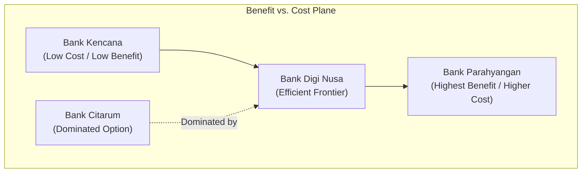

## 🧭 Executive Overview

The **Simple Multi-Attribute Rating Technique (SMART)** is a multi-criteria decision analysis (MCDA) methodology formulated by decision psychologist **Ward Edwards** (1971, 1977) and refined by Goodwin & Wright (2000). SMART evaluates discrete alternative courses of action across multiple competing, qualitative, and quantitative attributes.

SMART operationalizes an **additive linear utility model**: the total value of an alternative is calculated as the sum of its performance scores across all attributes, each multiplied by the normalized importance weight of that attribute. Its defining analytical innovation is **swing weighting**, which forces decision makers to evaluate attribute importance based on the actual spread between the worst and best possible performance levels, eliminating the pervasive bias of abstract importance ratings.

```mermaid
flowchart LR
    S1["Stage 1: Identify Decision Maker"] --> S2["Stage 2: Define Alternatives"]
    S2 --> S3["Stage 3: Structure Value Tree"]
    S3 --> S4["Stage 4: Assign Single-Attribute Utilities"]
    S4 --> S5["Stage 5: Determine Swing Weights"]
    S5 --> S6["Stage 6: Calculate Aggregate Utility"]
    S6 --> S7["Stage 7: Trade-off Benefit vs Cost"]
    S7 --> S8["Stage 8: Sensitivity Analysis"]
```

---

## 📐 Mathematical Formulation: Additive Utility Model

The aggregate utility $U(A_j)$ for alternative $A_j$ is given by the weighted sum:

$$U(A_j) = \sum_{i=1}^{n} w_i \cdot u_i(x_{ij})$$

Subject to the normalization constraint:

$$\sum_{i=1}^{n} w_i = 1 \quad \text{where } w_i \ge 0 \quad \forall i \in \{1, 2, \dots, n\}$$

Where:

- $n$: Total number of evaluation attributes.
- $w_i$: Normalized swing weight assigned to attribute $i$.
- $x_{ij}$: Raw performance score or physical measurement of alternative $A_j$ on attribute $i$.
- $u_i(x_{ij})$: Single-attribute utility score of alternative $A_j$ on attribute $i$, normalized to a standard interval $[0, 100]$.

### Single-Attribute Utility Function Normalization

For linear utility metrics across continuous natural scales (e.g., speed, efficiency, customer satisfaction):

$$\text{For More-is-Better (Benefit Attributes):} \quad u_i(x_{ij}) = \frac{x_{ij} - \min_k(x_{ik})}{\max_k(x_{ik}) - \min_k(x_{ik})} \times 100$$

$$\text{For Less-is-Better (Cost Attributes):} \quad u_i(x_{ij}) = \frac{\max_k(x_{ik}) - x_{ij}}{\max_k(x_{ik}) - \min_k(x_{ik})} \times 100$$

---

## ⚖️ The Swing Weighting Protocol

Abstract weighting (asking _"How important is safety vs. cost?"_) produces invalid models because importance depends entirely on the **range of variation** under consideration. Swing weighting anchors subjective judgment in empirical reality through an explicit thought experiment:

1. **Construct Hypothetical Benchmark Alternative**: Imagine a hypothetical alternative that performs at the **worst possible level** across all $n$ attributes.
2. **First Swing (Rank 1)**: If you could swing exactly one attribute from its worst state to its best state, which attribute would deliver the greatest incremental value? Assign this most critical swing an unnormalized score of $100$ points.
3. **Subsequent Swings (Ranks 2 to $n$)**: Compare swinging each remaining attribute from worst to best relative to the 100-point benchmark. Assign proportionate integer ratings (e.g., $70, 50, 20$).
4. **Normalization**: Divide each raw swing score $s_i$ by the sum of all swing scores:

$$w_i = \frac{s_i}{\sum_{k=1}^{n} s_k}$$

### Worked Swing Weighting Ledger

| Attribute Dimension            | Worst State (Anchor)        | Best State (Target)              | Raw Swing Rating ($s_i$) | Normalized Weight ($w_i$)  | Priority Rank |
| :----------------------------- | :-------------------------- | :------------------------------- | :----------------------: | :------------------------: | :-----------: |
| **Automatic Credit Facility**  | No working capital line     | Pre-approved Rp500M facility     |           100            | $100 / 235 \approx 0.4255$ |       1       |
| **Cash Management System**     | Manual branch banking       | Real-time API corporate portal   |            70            | $70 / 235 \approx 0.2979$  |       2       |
| **Dedicated Relationship Mgr** | Call center support only    | Dedicated senior officer on-site |            45            | $45 / 235 \approx 0.1915$  |       3       |
| **Branch Proximity**           | 45 km (Bandung City Center) | 3 km (Lembang Sub-district)      |            20            | $20 / 235 \approx 0.0851$  |       4       |
| **Sum**                        | —                           | —                                |         **235**          |         **1.0000**         |       —       |

---

## 📊 Benefit vs. Cost Frontier & Sensitivity Analysis

In institutional procurement and capital budgeting, financial cost is excluded from the benefit utility calculation. Instead, alternatives are plotted on a two-dimensional **Benefit vs. Cost Frontier**:

### Sensitivity Analysis & Weight Thresholds

Sensitivity analysis tests the robustness of the provisional decision by varying attribute weights across the range $[0, 1]$. The critical switching weight $w_i^*$ where Alternative $A$ overtakes Alternative $B$ is derived by solving:

$$\sum_{k \ne i} w_k' \cdot u_k(A) + w_i \cdot u_i(A) = \sum_{k \ne i} w_k' \cdot u_k(B) + w_i \cdot u_i(B)$$

If the switching threshold $w_i^*$ falls comfortably outside plausible stakeholder preferences, the recommended alternative is **robust**.

---

## 💼 Cross-Curricular Application & Real-World Synthesis

- **[[courses/mk5-decision-making-negotiation/week-05/index|MK5 Week 05 (SMART Decision Analysis)]]**: Applied to **BUMDes Bumi Lestari** selecting a new corporate operating bank among five commercial banking candidates in West Java.
- **[[concepts/value-focused-thinking|Value-Focused Thinking (VFT)]]**: VFT objective hierarchies directly populate SMART attribute trees.
- **[[concepts/analytic-hierarchy-process|Analytic Hierarchy Process (AHP)]]**: Serves as an alternative multi-criteria technique when attribute interactions require ratio-scale pairwise comparisons rather than linear swing rating.
- **[[courses/mk2-financial-management-strategy/week-08/index|MK2 Capital Budgeting & Risk]]**: Evaluating non-financial strategic synergies alongside Net Present Value (NPV).
