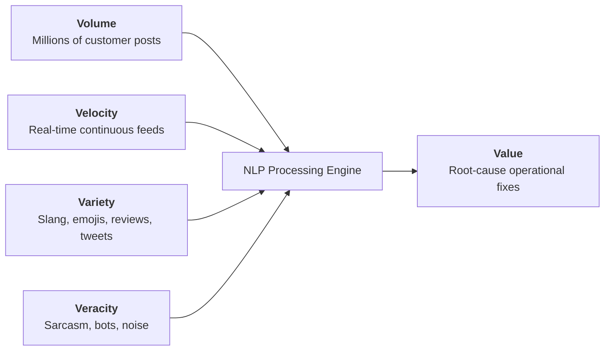
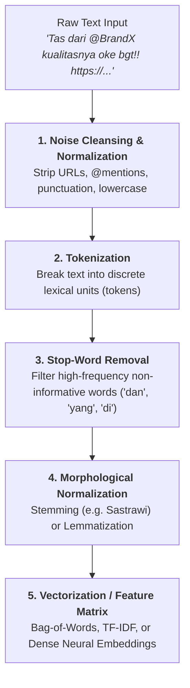
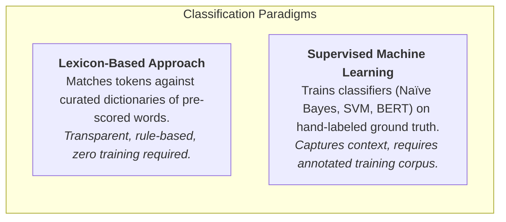

**Social Media Text Analytics** is the computational process of extracting, cleaning, transforming, and interpreting unstructured natural language data generated across social networks, digital forums, and consumer review platforms to identify topics, sentiment polarities, emerging trends, and actionable strategic insights.

---

## 1. Plain-English Intuition & Everyday Analogy

Imagine a busy coffee shop manager. If 20 customers walk in daily, the manager can personally ask each one: _"How was your espresso?"_ and listen to their nuanced verbal responses.

Now imagine a national coffee chain with 500 locations serving 200,000 customers daily. Thousands of customers post brief impressions online:

- _"Kopinya enak banget, tapi baristanya jutek abis di cabang Senopati"_ (Instagram)
- _"Antre 30 menit cuma buat cold brew yang tumpah, zonk parah"_ (X/Twitter)
- _"Tempat bersih, colokan banyak, cocok buat kerja"_ (Google Maps)

No human management team can read 50,000 fragmented posts across four platforms every week. **Text analytics** acts as a tireless digital assistant: it strips away the conversational noise, recognizes that _"zonk parah"_ means negative sentiment about wait time, tallies complaints about service speed, and delivers a clean executive dashboard showing which branch and operational touchpoint requires immediate intervention.

---

## 2. Theoretical Architecture & Technical Foundations

Unstructured textual data represents over 80% of enterprise information generated in modern digital economies, embodying the **5Vs of Big Data**:

### The NLP Text Preprocessing Pipeline

Before computational models or statistical algorithms can evaluate sentiment or topic clusters, raw text must pass through a standardized transformation pipeline:

### Feature Weighting: Term Frequency-Inverse Document Frequency (TF-IDF)

To measure how informative a word $t$ is to a specific document $d$ within a collection of documents $D$:

$$
\text{TF-IDF}(t, d, D) = \text{TF}(t, d) \times \text{IDF}(t, D)
$$

Where:

- $\text{TF}(t, d) = \frac{f_{t,d}}{\sum_{t' \in d} f_{t',d}}$ (frequency of term $t$ in document $d$).
- $\text{IDF}(t, D) = \log\left(\frac{|D|}{|\{d \in D : t \in d\}|}\right)$ (logarithmically scaled inverse fraction of documents containing term $t$).

Words that appear everywhere (e.g., _"produk"_, _"beli"_) receive low IDF weights, whereas words specific to rare operational failures (e.g., _"jebol"_, _"basi"_, _"bocor"_) receive high weights.

---

### Sentiment Polarity Classification

Sentiment analysis maps unstructured text into discrete valence categories (typically **Positive**, **Neutral**, or **Negative**) or continuous polarity scores:

#### Normalized Polarity Metric

In lexicon-based scoring, net sentiment polarity $S$ across positive tokens ($Pos$) and negative tokens ($Neg$) is computed as:

$$
S = \frac{Pos - Neg}{Pos + Neg + \epsilon} \quad \in [-1.0, +1.0]
$$

Where $\epsilon > 0$ is a small smoothing constant preventing division by zero for neutral or non-opinionated statements.

---

### Contingency Cross-Tabulation & Independence Testing

In brand listening and business analytics, evaluating sentiment in isolation is of limited value. Analysts construct **Contingency Tables (Cross-Tabulations)** crossing operational topics with sentiment polarities:

| Topic ($i$) \ Sentiment ($j$)  | Positive ($O_{i,\text{pos}}$) | Neutral ($O_{i,\text{neu}}$) | Negative ($O_{i,\text{neg}}$) | Row Total ($R_i$) |
| :----------------------------- | :---------------------------: | :--------------------------: | :---------------------------: | :---------------: |
| **Product Quality**            |           $n_{11}$            |           $n_{12}$           |           $n_{13}$            |  $\sum_j n_{1j}$  |
| **Customer Service / Support** |           $n_{21}$            |           $n_{22}$           |           $n_{23}$            |  $\sum_j n_{2j}$  |
| **Shipping & Delivery**        |           $n_{31}$            |           $n_{32}$           |           $n_{33}$            |  $\sum_j n_{3j}$  |
| **Price & Promotions**         |           $n_{41}$            |           $n_{42}$           |           $n_{43}$            |  $\sum_j n_{4j}$  |
| **Column Total ($C_j$)**       |        $\sum_i n_{i1}$        |       $\sum_i n_{i2}$        |        $\sum_i n_{i3}$        |        $N$        |

To test whether customer sentiment is statistically dependent on the operational topic, we apply Pearson's Chi-Square Test of Independence:

$$
\chi^2 = \sum_{i=1}^r \sum_{j=1}^c \frac{(O_{ij} - E_{ij})^2}{E_{ij}}, \quad E_{ij} = \frac{R_i \times C_j}{N}
$$

If $\chi^2$ exceeds the critical value at degrees of freedom $(r - 1)(c - 1)$, we reject the null hypothesis of independence, proving that negative sentiment is concentrated in specific operational bottlenecks.

---

## 3. Linguistic Challenges & Managerial Pitfalls

Automated text analytics faces severe linguistic distortions in conversational digital channels, particularly within multilingual or colloquial contexts such as Indonesian social media:

### 1. Sarcasm and Irony Inversion

Users frequently deploy positive lexical terms to express intense dissatisfaction:

- _"Beli celana di BrandX, sekali pakai langsung jebol. Bagus banget kualitasnya 🙃"_
- _"Mantap @BrandX, paketnya cuma telat seminggu 👏"_

A naïve dictionary classifier flags _"bagus banget"_ and _"mantap"_ as strongly positive (+2). In reality, inverted punctuation, context, and emojis (🙃, 👏) denote critical service failure.

### 2. Negation Handling

Negation operators invert the polarity of downstream adjectives:

- _"Pelayanannya tidak ramah sama sekali"_
- _"Pengiriman gak cepat"_

If a parser evaluates words independently as unigrams (Bag-of-Words), _"ramah"_ and _"cepat"_ contribute positive points. Proper pipelines utilize bigram windows ($n=2$) or dependency parsing to link `tidak + ramah` $\rightarrow$ Negative.

### 3. Slang, Non-Standard Spelling, and Indonesian Shorthand

Social media posts feature heavy informal truncations:

- `bgt` / `beneran` $\rightarrow$ _banget_ (intensifier)
- `gak` / `nggak` / `g` $\rightarrow$ _tidak_ (negation)
- `thx` / `makasih` $\rightarrow$ _terima kasih_ (courtesy)
- `min` $\rightarrow$ _admin_ (entity target)

Robust analytics engines require pre-compiled Indonesian slang normalization dictionaries before feature extraction.

---

## 4. Strategic & BUMN Governance Applications

Text analytics transforms raw social listening into strategic organizational value:

1. **Brand Health & Real-Time Crisis Sensing:** Early detection of viral consumer grievances before they escalate into regulatory investigations or reputation boycotts.
2. **Operations & Reverse Logistics Root-Cause Mapping:** Isolating whether customer churn is driven by manufacturing defects (Product Quality) or courier partner delays (Delivery).
3. **Public Sector & BUMN Service Monitoring:** State-owned enterprises (e.g., KAI Commuter, PLN, Telkom) process thousands of public tweets and app store reviews daily to allocate maintenance crews, improve station safety, and optimize call center capacity.

---

## 5. Curricular Cross-References & Satellites

- **MK6 Master Hub:** `[[courses/mk6-business-analytics/week-10/index|Week 10: Big Data Analytics & Social Media Text Mining]]`
- **Hands-on Problem Set:** `[[courses/mk6-business-analytics/week-10/assignment-social-media-text-analytics|Cohort Pre-Class Brief: BrandX Social Media Text Analytics & Hand-Labeling Protocol]]`
- **Marketing Strategy Connection:** `[[concepts/freemium-pricing-model|Freemium Pricing & Value Metric Design]]` (MK3 — Voice of customer driving pricing and tiering decisions).
- **Operations Control Connection:** `[[concepts/statistical-process-control|Statistical Process Control & Quality Engineering]]` (MK4 — Using text defect categories as attribute metrics in Pareto analysis).
