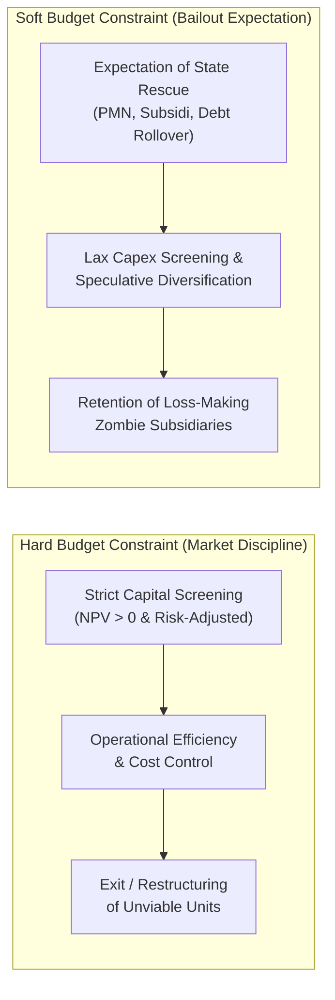

## 💡 First-Principles Intuition & Conceptual Core

In a competitive market, an ordinary private enterprise operates under a rigid mathematical boundary: if its cumulative expenses permanently exceed its revenues and capital reserves, the company goes bankrupt and exits the market. This unyielding boundary is a **Hard Budget Constraint**.

By contrast, what happens when a manager believes—based on historical precedent or political importance—that if their company loses money, a powerful external patron (such as the national government, parent holding, or state treasury) will automatically step in to cover the deficit?

$$\mathbf{\text{\ldquo When failure carries no existential penalty, financial discipline erodes before the investment decision is even made.\rdquo}}$$

Consider an everyday household analogy: Imagine two young entrepreneurs each opening a café with Rp 500 million in seed capital.

- **Entrepreneur A (Hard Budget Constraint)** has no fallback wealth. Every rupiah spent on espresso machines, rent, and marketing must generate positive cash flow, or the café closes permanently.
- **Entrepreneur B (Soft Budget Constraint)** has a billionaire parent who has repeatedly promised, _"Don't worry, if the café runs out of cash, I will wire more money to keep the lights on."_

Entrepreneur B will almost certainly over-spend on luxury interior design, hesitate to fire underperforming staff, and expand into an unproven second branch without rigorous financial modeling—because the downside risk is **externalized**.

Introduced by Hungarian economist **János Kornai (1986)** and formalized with **Eric Maskin and Gérard Roland (2003)**, the **Soft Budget Constraint (SBC)** explains why state-owned enterprises (BUMN) frequently suffer from over-expansion, weak capital allocation discipline, and chronic "zombie" subsidiaries. As emphasized by Minister of Industry [[entities/agus-gumiwang-kartasasmita|Dr. Agus Gumiwang Kartasasmita]] in his P3MD monograph, SBC is not merely a financing mechanism—it is a **behavioral distortion** that cripples corporate competitiveness.

---

## 🔍 Prerequisite & Jargon Decoder

| Terminology                        | Plain-English Meaning                                                                                                                             | Institutional / Economic Mechanism                                                                  |
| :--------------------------------- | :------------------------------------------------------------------------------------------------------------------------------------------------ | :-------------------------------------------------------------------------------------------------- |
| **Hard Budget Constraint**         | A strict financial ceiling where an entity can spend only what it earns or borrows on commercial creditworthiness.                                | Bankruptcy and market exit are credible threats.                                                    |
| **Soft Budget Constraint (SBC)**   | A relaxed financial boundary where losses are systematically absorbed _ex-post_ by an external supporting organization (usually the state).       | Subsidies, tax arrears forgiveness, state equity injections (PMN), or directed bank debt rollovers. |
| **Ex-Ante vs. Ex-Post Distortion** | _Ex-ante_ = decisions before investing; _Ex-post_ = rescue after losses occur.                                                                    | Knowing an _ex-post_ bailout exists corrupts _ex-ante_ project screening.                           |
| **Dynamic Commitment Problem**     | The state's inability to credibly promise _"no more bailouts"_ because shutting down a strategic BUMN carries high political or employment costs. | Classic time-inconsistency trap identified by Kornai, Maskin, and Roland (2003).                    |
| **Too Big / Strategic to Fail**    | Enterprises whose systemic footprint makes liquidation socially or politically unacceptable.                                                      | Reinforces management's belief that losses will always be socialized.                               |

---

## ⚙️ Structural Anatomy of the Mechanism

In corporate finance, a project's expected Net Present Value ($\text{NPV}$) under a **Hard Budget Constraint** is evaluated purely on standalone cash flows:

$$\text{NPV}_{\text{hard}} = -I_0 + \sum_{t=1}^{T} \frac{E[\text{CF}_t]}{(1 + r)^t}$$

Under a **Soft Budget Constraint**, management implicitly adds an **expected bailout option value** ($E[B_t]$) whenever operating cash flows turn negative ($\text{CF}_t < 0$):

$$\text{NPV}_{\text{perceived}} = -I_0 + \sum_{t=1}^{T} \frac{E[\text{CF}_t] + p_{\text{rescue}} \cdot E[B_t \mid \text{CF}_t < 0]}{(1 + r)^t}$$

Where:

- $I_0$ = Initial capital expenditure (_Capex_).
- $E[\text{CF}_t]$ = Expected standalone net cash flow in period $t$.
- $p_{\text{rescue}} \in [0, 1]$ = Management's perceived probability that the state or parent holding will bail out the project if it fails.
- $E[B_t \mid \text{CF}_t < 0]$ = Expected fiscal injection, subsidized credit, or debt restructuring.

**The Behavioral Trap**: Even when $\text{NPV}_{\text{hard}} < 0$ (the project destroys economic value), a high $p_{\text{rescue}}$ makes $\text{NPV}_{\text{perceived}} > 0$ from the manager's perspective—especially when executive prestige or empire-building correlates with asset size rather than return on invested capital (ROIC).

---

## 🧮 Micro-Numerical Toy Example: Non-Core Expansion

Suppose a state-owned logistics enterprise evaluates a speculative **Rp 100 billion** expansion into an unfamiliar retail e-commerce platform:

1. **Standalone Commercial Scenarios**:
   - **Success (30% probability)**: Generates cumulative present value of **Rp 130 billion** ($\text{NPV} = +30\text{B}$).
   - **Failure (70% probability)**: Generates cumulative present value of only **Rp 40 billion** ($\text{NPV} = -60\text{B}$).
2. **True Expected Value under Hard Budget Constraint**:
   $$E[\text{NPV}_{\text{hard}}] = 0.30(+30) + 0.70(-60) = 9 - 42 = \mathbf{-\text{Rp } 33 \text{ billion}}$$
   A disciplined commercial board **rejects** this project immediately.
3. **Distortion under Soft Budget Constraint ($p_{\text{rescue}} = 0.90$)**:
   Suppose management assumes that in the 70% failure scenario, the state will inject **Rp 60 billion** in rescue equity/restructuring with 90% certainty, leaving management's job and subsidiary intact:
   - Perceived downside loss drops from $-\text{Rp } 60\text{B}$ to $-(1 - 0.90) \times 60 = -\text{Rp } 6\text{B}$.
   - Management proceeds with a value-destroying investment that burns **Rp 33 billion** of sovereign capital.

---

## 🏛️ Strategic Relevance for Indonesian BUMN Governance

Under Indonesia's 2025–2026 corporate governance overhaul (**UU No. 1/2025**, **UU No. 16/2025**, and **[[entities/danantara|BPI Danantara]]**), hardening the budget constraint is a central pillar of reform:

1. **Separating Public Mandates (PSO) from Commercial Performance**:  
   When [[concepts/pso-commercial-duality|PSO obligations]] are uncompensated or mixed with commercial accounts, inefficient managers disguise operational waste as "public service costs"—creating an artificial soft budget constraint. Transparent PSO costing eliminates this excuse.
2. **Treating State Equity (PMN) as Scarce Capital**:  
   Capital injections must compete against alternative sovereign uses and clear strict hurdle rates ($\text{ROIC} > \text{WACC}$).
3. **Courage to Terminate Unviable Projects**:  
   As Menperin [[entities/agus-gumiwang-kartasasmita|Agus Gumiwang Kartasasmita]] emphasizes, the first leadership test for a BUMN director is not proposing flashy new ventures, but possessing the discipline to **audit, restructure, or shut down legacy projects** that no longer create economic or strategic value.
