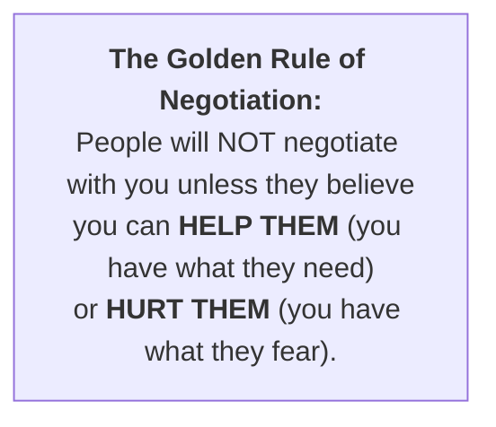
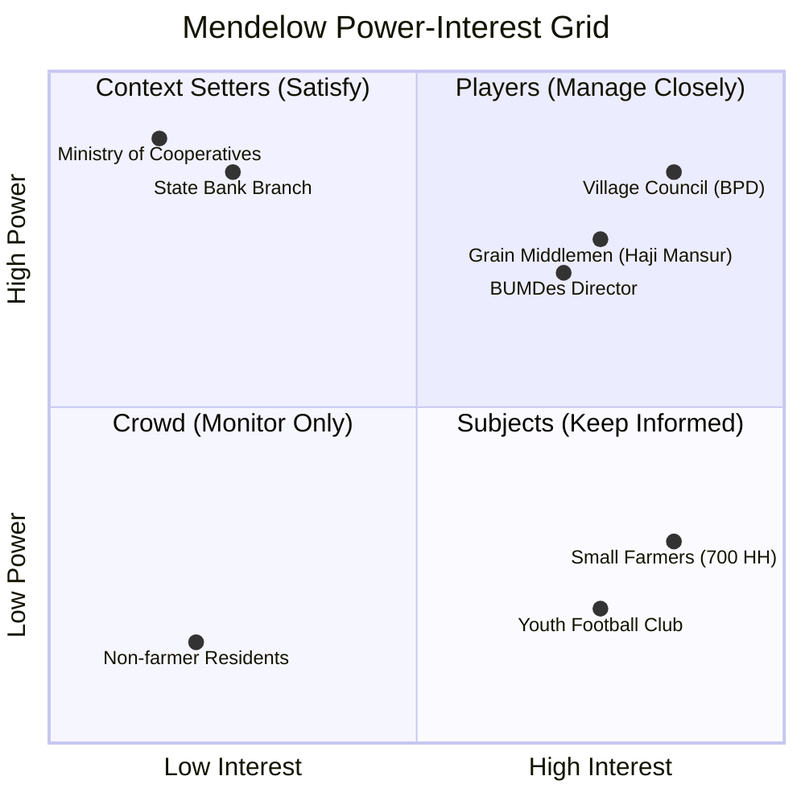
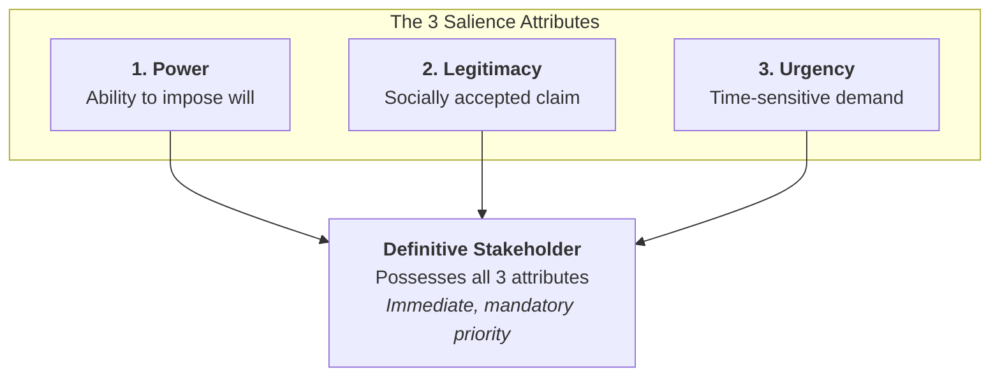
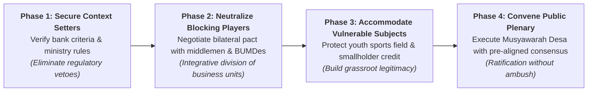

**Stakeholder Analysis in Negotiation** is the systematic methodology of identifying, mapping, and evaluating the individuals, groups, and institutions that have a stake in a negotiated decision, assessing their **power to influence** outcomes and their **level of interest** to determine engagement, sequencing, and coalition strategies.

---

## 1. Plain-English Intuition & Everyday Analogy

Imagine a family deciding whether to move to a new city for one parent's job promotion.

- The **working parent** and **spouse** have high power and high interest: they are the primary decision-makers who must negotiate collaboratively (**Players**).
- The **high-school teenager** cares intensely about their friends and school (high interest), but lacks legal or financial authority to block the move (**Subject**). However, if ignored, the teenager can rebel, refuse to pack, and sabotage family peace—transforming into a disruptive blocker.
- The **grandparents** have moral authority (power) but live independently and care primarily that the family stays safe (lower daily interest: **Context Setters**).
- The **extended cousins** have neither authority nor daily involvement (**Crowd**).

If the working parent simply announces the decision without understanding these dynamics, the move triggers severe domestic crisis. In complex enterprise and community negotiations, **ignoring the balance of power and interest guarantees deal collapse**.

---

## 2. Prerequisite & Jargon Decoder

| Negotiation Jargon              | Plain-English Executive Meaning                                                                                                                    |
| :------------------------------ | :------------------------------------------------------------------------------------------------------------------------------------------------- |
| **Power Level**                 | The structural, legal, resource, or political ability of a stakeholder to approve, veto, or cancel a proposed agreement.                           |
| **Interest Level**              | The degree to which the negotiated outcome directly affects a stakeholder's daily livelihood, revenue, public facilities, or emotional well-being. |
| **Mendelow Matrix**             | The canonical 2x2 grid dividing stakeholders into **Players**, **Context Setters**, **Subjects**, and the **Crowd**.                               |
| **Mitchell-Agle-Wood Salience** | Advanced stakeholder classification based on three dynamic attributes: **Power**, **Legitimacy**, and **Urgency**.                                 |
| **Coalition Building**          | The strategic alignment of multiple independent parties who pool their voting, political, or economic weight to achieve a shared outcome.          |
| **Negotiation Sequencing**      | The deliberate order in which bilateral discussions are conducted before entering a multi-party plenary (e.g., _Musyawarah Desa_).                 |

---

## 3. Structural Architecture: The Power-Interest Matrix

### The 4 Engagement Archetypes

| Quadrant            |         Power / Interest         | Governance Strategy              | Operational Imperative                                                                                              | Strategic Danger                                                                                          |
| :------------------ | :------------------------------: | :------------------------------- | :------------------------------------------------------------------------------------------------------------------ | :-------------------------------------------------------------------------------------------------------- |
| **Players**         | **High Power High Interest** | **Manage Closely & Collaborate** | Engage early in private bilateral negotiations; craft win-win trade-offs on profit-sharing and resource boundaries. | Open opposition in public plenary vetoes the initiative.                                                  |
| **Context Setters** | **High Power Low Interest**  | **Keep Satisfied**               | Ensure rigorous regulatory compliance, documentation completeness, and administrative reassurance.                  | Unnecessary friction triggers bureaucratic delays or funding freezes.                                     |
| **Subjects**        | **Low Power High Interest**  | **Keep Informed & Consult**      | Provide transparent communication, address emotional grievances, and offer non-financial accommodations.            | **Strategic Warning:** Subjects can organize mass protests and convert into aggressive, blocking Players. |
| **Crowd**           |  **Low Power Low Interest**  | **Monitor / Light-Touch**        | Public notice-board updates; avoid expending scarce political or managerial negotiation capital.                    | Over-investing negotiation energy where it yields zero leverage.                                          |

---

## 4. Mitchell, Agle & Wood Stakeholder Salience Model

Beyond the static 2x2 grid, modern stakeholder theory assesses **Salience**—the degree to which managers prioritize competing stakeholder claims based on three dynamic attributes:

1. **Latent Stakeholders (1 Attribute):**
   - _Dormant (Power only):_ Bank with loan disbursement authority.
   - _Discretionary (Legitimacy only):_ Village welfare recipients.
   - _Demanding (Urgency only):_ Vocal fringe protestors without authority.
2. **Expectant Stakeholders (2 Attributes):**
   - _Dominant (Power + Legitimacy):_ Elected Village Council (BPD).
   - _Dangerous (Power + Urgency):_ Displaced local traders threatening physical or supply boycotts.
   - _Dependent (Legitimacy + Urgency):_ Small tenant farmers lacking capital.
3. **Definitive Stakeholders (All 3 Attributes):**
   - Core decision-makers whose claims are urgent, legally legitimate, and backed by veto power.

---

## 5. Strategic Sequencing & Coalition Formation in Multi-Party Deals

In multi-stakeholder governance (such as Indonesian _Musyawarah Desa_ or corporate joint ventures), bringing everyone into a single room without pre-alignment guarantees chaos. Negotiators must execute **strategic sequencing**:

---

## 🔗 Related Portals

- Core Lecture: [[courses/mk5-decision-making-negotiation/week-10/index|Week 10: Rational Negotiation & Stakeholder Analysis]]
- Case Study: [[courses/mk5-decision-making-negotiation/week-10/case-koperasi-desa-merah-putih|Koperasi Desa Merah Putih Case Dossier]]
- Return to [[concepts/index|Concept Lattice Index]]
