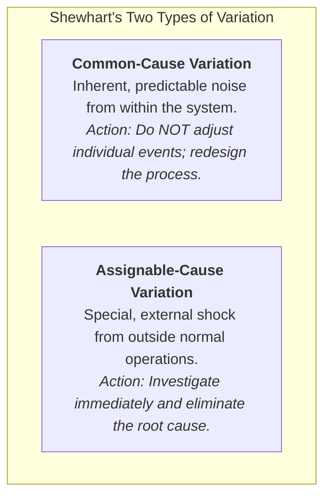
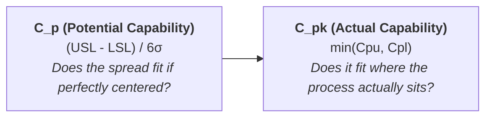

**Statistical Process Control (SPC)** is the application of statistical methods to measure, monitor, and regulate an operational process, distinguishing random **common-cause variation** from actionable **assignable-cause variation** to ensure consistent output quality.

---

## 1. Plain-English Intuition & Everyday Analogy

Imagine a commuter driving to work every morning. On typical days, the commute takes between 32 and 38 minutes depending on routine stoplights and minor traffic shifts. This 6-minute fluctuation is **common-cause variation**: it is inherent to the road system. If the driver angrily tries to "fix" a 37-minute commute by weaving aggressively across lanes, they cause accidents and actually _increase_ travel time variability (tampering).

One morning, however, the commute takes 85 minutes because a water main ruptured on the highway. This is an **assignable-cause variation**: a specific, external event outside normal operations that demands investigation and corrective response.

**A process in statistical control is simply predictable—it is not necessarily acceptable.** If the driver's employer demands arrival in 25 minutes, the driver's process is in statistical control (always 32–38 minutes), but **completely incapable of meeting the specification**.

---

## 2. Prerequisite & Jargon Decoder

| Quality Control Concept                 | Plain-English Operational Meaning                                                                                                                                                  |
| :-------------------------------------- | :--------------------------------------------------------------------------------------------------------------------------------------------------------------------------------- |
| **Control Limits (UCL / LCL)**          | Statistical boundaries calculated from process data (typically $\pm 3\sigma$) that define normal expected performance. Calculated by the statistician.                             |
| **Specification Limits (USL / LSL)**    | Operational thresholds defined by customer needs, engineering tolerances, or legal contracts. Set by the customer or designer.                                                     |
| **Attribute Data ($p, c$ charts)**      | Discrete, qualitative data counted as yes/no or pass/fail (e.g., train on-time vs. late, errors on a claim form).                                                                  |
| **Variable Data ($\bar{X}, R$ charts)** | Continuous quantitative physical measurements (e.g., train dwell time in seconds, bottle fill volume in mL, bolt diameter in mm).                                                  |
| **Process Capability ($C_p, C_{pk}$)**  | Mathematical index measuring whether the natural width of a stable process fits inside customer specification tolerances.                                                          |
| **The Rule of Runs**                    | Even if all points sit inside control limits, non-random patterns (e.g., 7–8 consecutive points on one side of the center line) signal that the process has fundamentally shifted. |

---

## 3. Structural Anatomy of the Mechanism

### 1. Attribute Charts: The $p$-Chart (Fraction Defective)

Used when tracking the proportion of nonconforming items in a fixed sample size $n$:

$$\text{Center Line: } \bar{p} = \frac{\text{Total Defects}}{\text{Total Inspected}}$$

$$\text{Sample Standard Deviation: } \sigma_p = \sqrt{\frac{\bar{p}(1 - \bar{p})}{n}}$$

$$\text{Upper Control Limit (UCL)} = \bar{p} + z \cdot \sigma_p$$

$$\text{Lower Control Limit (LCL)} = \max\left(0, \, \bar{p} - z \cdot \sigma_p\right)$$

_(Standard limits use $z = 3$ for $99.73\%$ confidence, or $z = 1.96$ for $95.00\%$ confidence)._

---

### 2. Variable Charts: The $\bar{X}$-Chart and $R$-Chart Pair

Variable data requires evaluating **process centering** ($\bar{X}$) and **process dispersion** ($R$) simultaneously. _Rule: Always interpret the $R$-chart first; if dispersion is unstable, $\bar{X}$ limits cannot be trusted._

$$\bar{X}\text{-Chart Limits: } \text{UCL}_{\bar{X}} = \bar{\bar{X}} + A_2 \bar{R}, \quad \text{LCL}_{\bar{X}} = \bar{\bar{X}} - A_2 \bar{R}$$

$$R\text{-Chart Limits: } \text{UCL}_R = D_4 \bar{R}, \quad \text{LCL}_R = D_3 \bar{R}$$

_(Factors $A_2, D_3, D_4$ are standard ASTM control factors calibrated to sample subgroup size $n$. For $n = 5$: $A_2 = 0.577, D_3 = 0, D_4 = 2.115$)._

---

### 3. Measuring Process Capability ($C_p$ vs. $C_{pk}$)

$$C_p = \frac{\text{USL} - \text{LSL}}{6\sigma}$$

$$C_{pk} = \min\left( \frac{\text{USL} - \mu}{3\sigma}, \, \frac{\mu - \text{LSL}}{3\sigma} \right)$$

Where process standard deviation is estimated from average range: $\sigma = \frac{\bar{R}}{d_2}$ (for $n = 5$, $d_2 = 2.326$).

- **$C_{pk} < 1.0$:** Process is incapable; will generate defects even when in statistical control.
- **$C_{pk} \ge 1.33$:** Capable (4-Sigma industrial benchmark).
- **$C_{pk} \ge 2.00$:** World-Class Six Sigma capability (3.4 defects per million opportunities).

---

## 4. Micro-Numerical Toy Example

A machined steel pin has a customer specification requirement of $10.00 \pm 0.30\text{ mm}$ ($\text{LSL} = 9.70\text{ mm}, \text{USL} = 10.30\text{ mm}$).
Quality control draws samples of $n = 5$ pins and finds:

- Process Mean: $\mu = 10.10\text{ mm}$ (process is off-center by $+0.10\text{ mm}$).
- Process Standard Deviation: $\sigma = 0.05\text{ mm}$.

### Step 1: Compute Potential Capability ($C_p$)

$$C_p = \frac{\text{USL} - \text{LSL}}{6\sigma} = \frac{10.30 - 9.70}{6(0.05)} = \frac{0.60}{0.30} = \mathbf{2.00}$$

_Interpretation:_ The process variability is exceptionally narrow. If centered at 10.00, it would achieve Six Sigma quality.

### Step 2: Compute Actual Capability ($C_{pk}$)

$$C_{pu} = \frac{\text{USL} - \mu}{3\sigma} = \frac{10.30 - 10.10}{3(0.05)} = \frac{0.20}{0.15} = 1.33$$

$$C_{pl} = \frac{\mu - \text{LSL}}{3\sigma} = \frac{10.10 - 9.70}{3(0.05)} = \frac{0.40}{0.15} = 2.67$$

$$C_{pk} = \min(1.33, \, 2.67) = \mathbf{1.33}$$

### Executive Takeaway:

Even though potential capability is $2.00$, the actual capability is penalized down to $1.33$ because the machine is cutting pins slightly too thick. Adjusting machine calibration will instantly elevate performance to world-class without purchasing new equipment.

---

## 🔗 Related Portals

- Core Lecture Hub: [[courses/mk4-operations-supply-chain-management/week-10/index|Week 10: Statistical Quality Control]]
- Case Study Dossier: [[courses/mk4-operations-supply-chain-management/week-10/case-kai-commuter-sqc|KAI Commuter: On-Time Performance Case]]
- Enterprise Profile: [[entities/pt-kereta-commuter-indonesia|PT Kereta Commuter Indonesia]]
- Return to [[concepts/index|Concept Lattice Index]]
