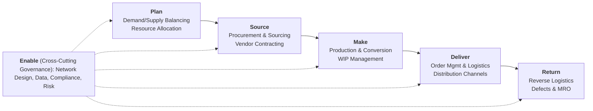
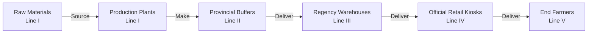

The **Supply Chain Operations Reference (SCOR)** model, developed by the Supply Chain Council (now part of the Association for Supply Chain Management - ASCM / APICS), is the standardized, cross-industry process reference framework for evaluating and optimizing enterprise supply chain performance.

SCOR links business processes, performance metrics, best practices, and organizational technology into an integrated structural architecture spanning suppliers' suppliers to customers' customers.

---

## 🏛️ The Six Core SCOR Processes

The SCOR framework organizes all supply chain activities into six foundational macro-processes:

| SCOR Process | Operational Mandate                                                                                                        | Key Managerial Decisions & Trade-Offs                                                                 |
| :----------- | :------------------------------------------------------------------------------------------------------------------------- | :---------------------------------------------------------------------------------------------------- |
| **Plan**     | Balance aggregate demand and supply to establish operational targets across sourcing, production, and distribution.        | Demand forecasting models, safety stock targets, inventory buffers, and resource capacity planning.   |
| **Source**   | Procure goods and services to meet planned or actual demand; vendor selection, order placement, receiving, and inspection. | Single vs. dual sourcing, supplier lead times, consignment inventory, and purchase order batching.    |
| **Make**     | Transform raw inputs into finished goods through production, assembly, testing, packaging, and staging.                    | Make-to-Stock (MTS) vs. Make-to-Order (MTO), batch sizing, changeover reduction, and cellular layout. |
| **Deliver**  | Route, transport, warehouse, and fulfill finished customer orders, including billing and payment collection.               | Fleet routing, distribution channel tiers (Line I–Line V), cross-docking, and last-mile logistics.    |
| **Return**   | Manage reverse product and container flows for defective returns, maintenance, repair, overhaul, or recycling.             | Warranty claims, reverse transport routes, circular economy reuse, and asset disposition.             |
| **Enable**   | Manage the operational rules, data flows, contracts, regulatory compliance, risk, and supplier facilities.                 | IT systems (ERP, TMS, WMS), master data governance, supplier relationship management (SRM).           |

---

## 📐 Level 1 Strategic Performance Metrics

SCOR evaluates supply chain effectiveness across **five strategic performance attributes**, divided into customer-facing and internal-facing dimensions:

### 1. Customer-Facing Dimensions

- **Reliability (Perfect Order Fulfillment)**: The percentage of orders delivered completely, on-time, damage-free, and with accurate documentation.
  $$\mathbf{\text{POF} = \frac{\text{Orders Delivered In-Full, On-Time, Defect-Free, Correct Documentation}}{\text{Total Orders Delivered}} \times 100\%}$$
- **Responsiveness (Order Fulfillment Cycle Time - OFCT)**: The total elapsed duration from customer order placement to physical receipt.
  $$\mathbf{\text{OFCT} = T_{\text{order receipt}} - T_{\text{order placement}}}$$
- **Agility**: The supply chain's flexibility and adaptability to respond to marketplace demand shocks without cost penalties (Upside Supply Chain Flexibility, Upside Supply Chain Adaptability, Downside Supply Chain Adaptability).

### 2. Internal-Facing Dimensions

- **Costs (Supply Chain Management Cost - SCMC)**: Total operational expenditures across Plan, Source, Make, Deliver, and Return.
  $$\mathbf{\text{SCMC} = \text{Cost of Goods Sold (COGS)} + \text{Distribution Costs} + \text{Planning/Procurement Overhead}}$$
- **Asset Management Efficiency (Cash-to-Cash Cycle Time - C2C)**: The duration required for capital invested in raw materials to return as cash collected from customer invoices.
  $$\mathbf{\text{C2C} = \text{Days Sales of Inventory (DSI)} + \text{Days Sales Outstanding (DSO)} - \text{Days Payables Outstanding (DPO)}}$$

---

## 🧭 Multi-Echelon Integration & Decoupling Points

In multi-tier enterprise systems—such as national agricultural distribution in [[entities/pt-pupuk-indonesia|PT Pupuk Indonesia]]—the SCOR framework maps where the [[concepts/customer-order-decoupling-point|Customer Order Decoupling Point (CODP)]] sits along the physical pipeline:

- When inventory is pushed down to Line IV kiosks ahead of demand (**Make-to-Stock**), responsiveness is instantaneous, but working capital and obsolescence risks rise.
- When production and replenishment are triggered by real-time farmer biometric redemptions via digital systems (**Pull / ATO**), bullwhip volatility is suppressed.

---

## 🔗 Cross-Curricular Connections

- **Operations Core**: Bridges with [[concepts/customer-order-decoupling-point|Customer Order Decoupling Point]] and [[concepts/toyota-production-system|Toyota Production System]].
- **Financial Integration**: Cash-to-Cash cycle links directly to [[concepts/sustainable-growth-rate|Sustainable Growth Rate (SGR)]] and Working Capital Management in MK2.
- **Course Anchor**: Applied directly in [[courses/mk4-operations-supply-chain-management/week-01/index|MK4 Week 01: Introduction to OSCM]] and [[courses/mk4-operations-supply-chain-management/week-01/case-pupuk-indonesia|Pupuk Indonesia Case Dossier]].
