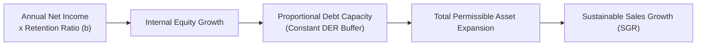

## 📐 Universal Mechanism & Strategic Architecture

The **Sustainable Growth Rate (SGR)** represents the maximum annual percentage increase in sales an enterprise can achieve **without issuing new external equity** and **without altering its financial leverage (Debt-to-Equity Ratio)**.

Formulated by Robert C. Higgins, the SGR answers a critical strategic dilemma: _How fast can the company grow using internally generated profits while maintaining a stable capital structure?_

---

## 🔢 Mathematical Formulation

$$\mathbf{\text{SGR} = \frac{\text{ROE} \times b}{1 - (\text{ROE} \times b)}}$$

Where:

- $\text{ROE}$: Return on Equity ($\text{Net Income} / \text{Equity}$).
- $b$: Retention ratio ($1 - \text{Dividend Payout Ratio}$).

Substituting the 3-Stage DuPont identity into the SGR formula reveals the four operational and financial levers of growth:

$$\mathbf{\text{SGR} = \frac{M \times \left(\frac{S}{A}\right) \times \left(\frac{A}{E}\right) \times b}{1 - \left[M \times \left(\frac{S}{A}\right) \times \left(\frac{A}{E}\right) \times b\right]}}$$

Where:

1. **$M$ (Profit Margin)**: Operating efficiency ($\text{Net Income} / \text{Sales}$).
2. **$S/A$ (Asset Turnover)**: Asset velocity and capital utilization.
3. **$A/E$ (Equity Multiplier)**: Financial leverage policy.
4. **$b$ (Retention Rate)**: Dividend policy.

### Comparison: Internal Growth Rate (IGR) vs SGR

- **Internal Growth Rate (IGR)**: Assumes zero external debt and zero external equity ($\text{IGR} = \frac{\text{ROA} \times b}{1 - (\text{ROA} \times b)}$). Leverage declines toward zero as equity grows.
- **Sustainable Growth Rate (SGR)**: Assumes debt expands proportionally with retained equity, keeping the Debt-to-Equity ratio constant.

---

## 🏢 The Four Executive Levers for Managing Growth Deficits

When an enterprise's target sales growth ($g$) exceeds its sustainable growth capacity ($g > \text{SGR}$), management faces an **External Financing Needed (EFN)** deficit. To resolve this imbalance without triggering growth-induced insolvency, leadership must execute one or more corrective actions:

| Strategic Lever                     | Mechanism                                                                                    | Managerial Friction / Trade-Off                                          |
| :---------------------------------- | :------------------------------------------------------------------------------------------- | :----------------------------------------------------------------------- |
| **1. Margin Expansion**             | Cut operating expenses, raise product prices, or alter product mix toward high-margin lines. | Price increases risk customer attrition in competitive markets.          |
| **2. Asset Velocity Acceleration**  | Shorten cash conversion cycle, reduce inventory holding days, or outsource manufacturing.    | Aggressive working capital reduction risks factory stockouts.            |
| **3. Financial Leverage Expansion** | Borrow additional bank credit or issue corporate bonds to raise the Equity Multiplier.       | Increases interest burden and insolvency probability during downturns.   |
| **4. Dividend Retention**           | Lower dividend payouts ($d$) and retain a greater share of annual earnings ($b$).            | May trigger shareholder dissatisfaction and depress equity share prices. |

---

## 🔗 Curricular Bridges

- Master Course Note: [[courses/mk2-financial-management-strategy/week-03/index|MK2 Week 03: Financial Statement Projections]]
- Practical Application: [[courses/mk2-financial-management-strategy/week-03/case-indofood-financial-projections|Indofood 5-Year Financial Forecast]]
- Foundational Concept: [[concepts/dupont-analysis|DuPont Analysis Framework]]
