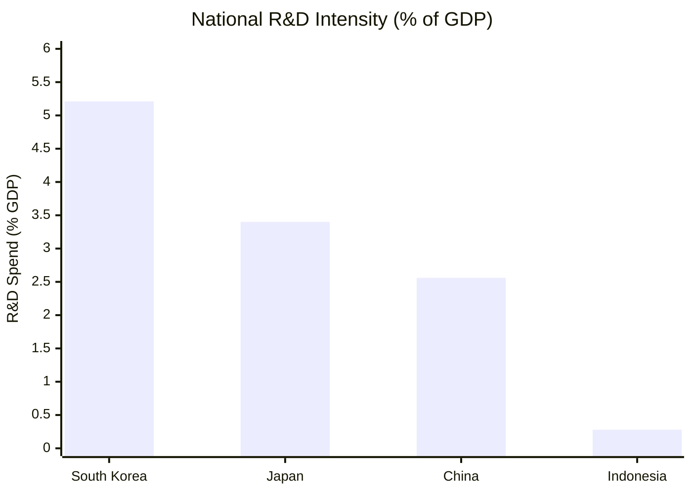
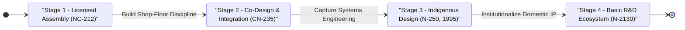

## 💡 First-Principles Intuition & Conceptual Core

Imagine a fast-growing restaurant chain that earns strong revenue by importing pre-cooked frozen gourmet meals from an overseas supplier and reheating them locally. The chain scales rapidly on paper, yet it owns zero proprietary recipes, employs zero master chefs, and faces instant margin collapse whenever the foreign supplier raises prices or restricts exports. True culinary independence requires building an end-to-end kitchen ecosystem—training chefs, testing prototypes, and owning the spice supply chain—even though building a test kitchen initially takes longer and risks burnt batches compared to buying ready-made food.

At the national industrial level, **Technology Sovereignty** captures this exact distinction between _consuming imported capability_ and _commanding domestic technological mastery_. As synthesized by **[[entities/tatacipta-dirgantara|Prof. Dr. Ir. Tatacipta Dirgantara]]** (Rector of ITB) in the **[[rabuan/2026-11-25-tatacipta-dirgantara-iptek-industri-strategis|Rabuan Plenary (25 November 2026)]]**, "transfer of technology" as a passive gift is an illusion: core industrial know-how is never handed over voluntarily. Bridging raw university discoveries across the **Innovation Valley of Death** requires deliberate **co-design, co-manufacturing, industrial offsets**, and courageous first-buyer adoption by state-owned enterprises (BUMN).

### 🔑 Prerequisite Concepts & Jargon Decoder

| Analytical Term                                      | Plain-English Definition                                                                                                                                | Strategic Relevance to Indonesian SOEs                                                                                  |
| :--------------------------------------------------- | :------------------------------------------------------------------------------------------------------------------------------------------------------ | :---------------------------------------------------------------------------------------------------------------------- |
| **Total Factor Productivity (TFP)**                  | The portion of economic output growth generated by innovation, superior process engineering, and organization—not merely adding more labor or machines. | Indonesia's TFP growth contribution sits near **0.1%** vs. China's **2.9%**, explaining middle-income stagnation.       |
| **R&D Intensity (% of GDP)**                         | National public and private research expenditure expressed as a percentage of Gross Domestic Product.                                                   | Indonesia invests **~0.28% of GDP** in R&D, trailing South Korea (**5.21%**), Japan (**3.40%**), and China (**2.56%**). |
| **TKT / TRL (Technology Readiness Level 1–9)**       | Standardized nine-step scale measuring maturity from basic laboratory discovery (TKT 1–4) to full commercial operation (TKT 9).                         | Universities stop around TKT 1–4 while industries demand TKT 9, creating an unbridged commercialization chasm.          |
| **Valley of Death (TKT 4–6)**                        | The funding, testing, and risk gap between promising lab prototypes and proven industrial-scale deployment.                                             | Example: ITB's **Katalis Merah Putih** succeeded in lab/autoclave synthesis yet stalled over refinery downtime risks.   |
| **Bridging Institutions**                            | Applied engineering intermediaries (e.g., Germany's Fraunhofer, Japan's RIKEN, Singapore's A\*STAR) that de-risk TKT 4–7 scale-up.                      | Convert academic science into certified, bankable industrial components before commercial procurement.                  |
| **Industrial Offset & Co-Design / Co-Manufacturing** | Procurement clauses mandating local engineering participation, domestic component shares, and IP co-ownership inside foreign capital purchases.         | Turns passive CapEx imports into permanent domestic capability (e.g., Malaysia CTRM Airbus offset; China hydro rules).  |

---

## 📐 Universal Mechanism & Mathematical Architecture

Macroeconomic take-off occurs when growth shifts from pure factor accumulation (buying more imported equipment and adding labor) to **Total Factor Productivity ($A$)** compounding:

$$Y = A \cdot K^{\alpha} L^{1-\alpha}$$

### ⚙️ Mechanics & Structural Anatomy:

- **Technology Multiplier ($A$)**: Unlike capital ($K$) or labor ($L$), which suffer diminishing marginal returns, technological mastery ($A$) raises the productivity of every unit of capital and labor simultaneously, enabling high-margin technology exports rather than raw commodity extraction.
- **Capital & Labor Drag ($K^{\alpha} L^{1-\alpha}$)**: Relying solely on imported turnkey machinery increases installed asset capacity ($K$) without elevating $A$, locking domestic firms into perpetual licensing fees and spare-parts dependency.

To evaluate whether a BUMN capital project builds sovereign capability or merely buys temporary output, executives must weigh the **Domestic Value-Capture Multiplier ($7\times\text{–}10\times$)** created when local component ecosystems participate:

$$\text{Total Domestic Economic Impact} = \text{Domestic Content Value} \times M_{\text{eco}}$$

- **Numerator Logic (Domestic Content Value)**: Capital retained inside national engineering teams, local suppliers, and domestic IP registries compounds across subsequent industrial cycles.
- **Ecosystem Multiplier ($M_{\text{eco}} \approx 7\text{–}10$)** vs. **Turnkey Leakage**: Imported equipment sends margins, R&D learning curves, and patent royalties offshore immediately upon settlement.

### 🧮 10-Second Micro-Numerical Toy Example

Suppose a state energy enterprise budgets **Rp1,000 billion** (Rp1T) to upgrade processing equipment:

1. **Option A — Turnkey Foreign Import ("Buy Fast")**: 90% of hardware and engineering is imported (Rp900B leaves the domestic value chain immediately; Rp100B covers local civil installation). Domestic learning retained = **Rp100B**, and future spare-part upgrades remain vendor-locked.
2. **Option B — Co-Manufacturing + 50% Domestic Offset**: The procurement contract mandates **50% domestic component co-manufacturing** (Rp500B local engineering/fabrication) with a conservative **$7\times$ domestic industrial multiplier** across Tier-2 suppliers, labs, and skilled wages. Domestic economic value generated = $\text{Rp500B} \times 7 = \text{Rp3,500B}$, while internal engineers acquire the capability to localize 75%–100% of the next plant.

### 🔄 The Habibie 4-Stage Reverse-Transformation Architecture

As documented in Indonesia's 21-year aerospace program (**NC-212** $\rightarrow$ **CN-235** $\rightarrow$ **N-250** fly-by-wire $\rightarrow$ **N-2130**), industrial leapfrogging works _backward_ from end-product integration down to basic research—remembering that the product is merely the vehicle (_wahana_), while human capability and institutions are the true asset:

---

## 🏛️ Multi-Disciplinary Lenses Across the MBA Curriculum

### 1. Financial Management & Capital Budgeting (MK 2)

- **The Annual KPI Myopia Trap**: Plant directors penalized for short-term refinery downtime refuse commercial-scale testing of domestic breakthroughs (such as **Katalis Merah Putih** at national refineries), forcing startups into the TKT 4–6 Valley of Death. True capital stewardship requires ring-fenced **innovation trial budgets** evaluated over 10–25 year real-option horizons rather than 12-month EBITDA variance alone.
- _Cross-Link_: [[courses/mk2-financial-management-strategy/index|MK 2: Financial Management & Strategy]] & [[concepts/weighted-average-cost-of-capital|WACC]].

### 2. Operations & Supply Chain Management (MK 4)

- **Qualification & Ecosystem Readiness**: Scaling domestic technology from 50 mL laboratory synthesis to 200 L pilot autoclaves and continuous industrial production demands supplier quality assurance, certification facilities, and bridging testbeds before full-line deployment.
- _Cross-Link_: [[courses/mk4-operations-supply-chain-management/index|MK 4: Operations & Supply Chain Management]] & [[concepts/manufacturing-value-added|Manufacturing Value Added (MVA)]].

### 3. Decision Making & Sovereign Procurement Negotiation (MK 5)

- **Negotiating Offsets & IP Ownership**: Every major BUMN procurement contract or foreign joint-venture lab is a high-stakes negotiation over IP rights. Without strict contractual offset and co-ownership terms, foreign partners can build local labs (e.g., Rp0.5T investment yielding **144 patents/year**) whose patents remain wholly owned offshore.
- _Cross-Link_: [[courses/mk5-decision-making-negotiation/index|MK 5: Decision Making & Negotiation]] & [[concepts/batna-and-zopa|BATNA & ZOPA]].

---

## ⚖️ Cross-Functional Boardroom Tensions

- **Procurement Speed vs. Sovereign Offset**: Operations and project sponsors often prefer turnkey foreign vendors ("beli saja biar cepat") to hit commissioning deadlines, clashing with national industrial policy goals demanding staged local labor quotas (25% $\rightarrow$ 50% $\rightarrow$ 75%) and co-manufacturing.
- **Academic Publishing vs. Commercial Bankability**: Universities optimize for journal papers and TKT 1–4 novelty, whereas BUMN boards demand TKT 9 warranty-backed reliability—making Triple Helix bridging mechanisms and shared risk facilities indispensable.

---

## 🚀 Action Learning Project (ALP) Application

> [!TIP] ALP Capstone Alignment
> When recommending technology upgrades, digital platforms, or industrial equipment for partner BUMN hosts, ALP syndicates should apply a mandatory **Three-Question Sovereignty Audit**: (1) Who owns the core intellectual property and source code? (2) What percentage of co-design or domestic component offset is built into the vendor contract? (3) Which Indonesian university or national research lab can co-validate TKT 4–7 pilot trials alongside our internal engineers?

---

## 🔗 Contributing Sessions & References

- **Originating Plenary**: [[rabuan/2026-11-25-tatacipta-dirgantara-iptek-industri-strategis|Rabuan 2026-11-25: Menuju Indonesia yang Mandiri — Penguasaan IPTEK & Industri Strategis 2045]]
- **Key Theorist & Leader**: [[entities/tatacipta-dirgantara|Prof. Dr. Ir. Tatacipta Dirgantara, M.T., IPU, ASEAN Eng.]]
- **Related Plenari & Concepts**:
  - [[rabuan/2026-08-19-agus-gumiwang-industrialisasi-nasional|Rabuan 2026-08-19: BUMN dan Industrialisasi Nasional]]
  - [[concepts/manufacturing-value-added|Manufacturing Value Added (MVA) & Structural Industrial Transformation]]
  - [[concepts/leadership-ambidexterity|Leadership Ambidexterity]]
- Return to **[[concepts/index|Knowledge Matrix]]**
