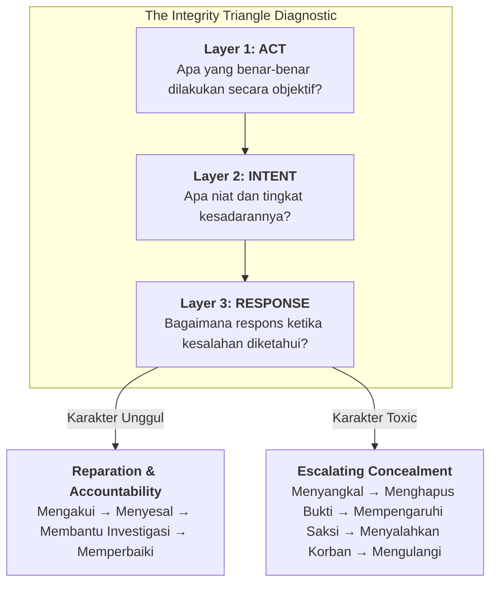

## 🎯 Executive Summary & The Core Dilemma

**The Integrity Triangle** (_Act – Intent – Response_) is a three-layered character diagnostic framework formulated in **[[rabuan/2026-11-12-operasi-integritas-soedirman|Operasi Integritas Soedirman (OIS P3MD 2026)]]** to evaluate ethical failures in leadership development and corporate governance.

Its central axiom overturns conventional disciplinary thinking:

> _"Dalam pendidikan calon pemimpin, **respons terhadap kegagalan lebih diagnostik daripada kegagalannya itu sendiri**."_  
> (In executive leadership formation, how a candidate responds to a mistake reveals far more about their true character than the mistake itself.)

Organizations routinely struggle to separate **recoverable developmental lapses** (human errors made in good faith or under pressure) from **systemic toxic character** (malicious abuse, active cover-up, and intimidation). Treating both identically—either through blanket leniency or indiscriminate expulsion—destroys either institutional accountability or organizational psychological safety. The Integrity Triangle resolves this dilemma by decoupling the **Act** from **Intent** and weighting **Response** as the decisive indicator of leadership fitness.

---

## 🧠 The 4-Layer Pedagogical Anatomy

### Layer 1: Plain-English Intuition & Everyday Analogy

Imagine two commercial pilots who both accidentally clip a taxiway light during a night landing.

- **Pilot A** immediately radios the tower, logs the incident in the maintenance book, cooperates fully with the safety board, and proposes a revised taxi checklist to prevent recurrence.
- **Pilot B** powers down the cockpit voice recorder, tells the co-pilot to stay silent, blames ground marshallers for poor lighting, and attempts to fly the next leg without inspection.

Both pilots committed the exact same **Act** (clipping a light). Yet Pilot A is safe to remain in the cockpit after retraining, while Pilot B poses an existential threat to passengers and the airline. The **Response** after discovery exposes whether the failure was an isolated operational error or a symptom of corrupt character.

### Layer 2: Prerequisite & Jargon Decoder

Before applying the framework, clarify three analytical dimensions and two governance risks:

- **Act (Tindakan Objektif)**: The verifiable physical or digital behavior that occurred, stripped of rumor, speculation, or emotional framing (e.g., forwarding a confidential file, missing a compliance deadline).
- **Intent (Niat & Kesadaran)**: The cognitive and moral state behind the act—distinguishing accidental oversight (_negligence_), peer-pressured compliance (_conformity_), and premeditated harm (_malice_ / _deliberate abuse_).
- **Response (Respons Pasca-Temuan)**: The sequence of actions taken once the violation surfaces—measuring honesty, ownership, respect for victims, and cooperation with due process.
- **Psychological Safety vs. Moral Hazard**: **[[concepts/psychological-safety|Psychological safety]]** protects candid admission of honest mistakes so systems can learn; **moral hazard** arises when impunity shields deliberate abuse and cover-ups.

### Layer 3: Structural Anatomy of the Mechanism

In institutional adjudication, character score $C$ is not a linear function of the act's initial severity $S_{\text{act}}$ alone. Rather, it is governed by the interaction between intent malignancy $M_{\text{intent}}$ and the polarity of the response vector $R$:

$$
\text{Risk}_{\text{character}} = f(S_{\text{act}}, M_{\text{intent}}) \times \Phi_{\text{response}}
$$

Where:

- **Positive Response Multiplier ($\Phi_{\text{response}} < 1$) — _Karakter Unggul_**:
  1. **Mengakui** (_Ownership_): Confesses the exact facts without distortion.
  2. **Menyesal** (_Remorse_): Recognizes the harm caused to victims or institutional trust.
  3. **Membantu Investigasi** (_Transparency_): Preserves evidence and clarifies roles without protecting toxic networks.
  4. **Memperbaiki** (_Restitution_): Accepts fair remediation and changes behavior permanently.
- **Toxic Response Multiplier ($\Phi_{\text{response}} \gg 1$) — _Karakter Toxic_**:
  1. **Menyangkal** (_Denial_): Refuses accountability despite verified evidence.
  2. **Menghapus Bukti** (_Evidence Tampering_): Deletes chat logs, alters metadata, or destroys audit trails.
  3. **Mempengaruhi Saksi** (_Witness Tampering_): Pressures peers into silence via misplaced solidarity (_budaya jangan lapor teman_).
  4. **Menyalahkan Korban** (_Victim Blaming_): Reframes exploitation or harassment as "just joking" (_bercanda_) or blames the harmed party.
  5. **Mengulangi** (_Recurrence_): Persists in the behavior once scrutiny fades.

Once an actor enters the **Evidence Tampering** or **Witness Tampering** stages, a minor Category A/B lapse escalates automatically into a **Category D Integrity Disqualifier** requiring separation/termination.

### Layer 4: Practical Governance Walkthrough (Scenario)

Consider a BUMN subsidiary procurement committee where two junior managers violate a vendor communication protocol during an active tender:

| Dimension              | Manager X (_Karakter Unggul_)                                                                                                                                   | Manager Y (_Karakter Toxic_)                                                                                                                                    |
| :--------------------- | :-------------------------------------------------------------------------------------------------------------------------------------------------------------- | :-------------------------------------------------------------------------------------------------------------------------------------------------------------- |
| **1. Act**             | Accidentally CC'd an external vendor on an internal pricing memo.                                                                                               | Accidentally CC'd an external vendor on an internal pricing memo.                                                                                               |
| **2. Intent**          | High time pressure, inadvertent email auto-complete error.                                                                                                      | High time pressure, inadvertent email auto-complete error.                                                                                                      |
| **3. Response**        | Immediately notifies Procurement Head within 10 minutes, recalls email, attaches full server logs, and recommends restarting the bid round to protect fairness. | Deletes sent-folder copy, instructs IT analyst to keep quiet, tells colleagues the memo "didn't matter," and claims the vendor already knew the numbers anyway. |
| **Diagnostic Verdict** | **Category A (Developmental Lapse)**: Retain, coach on email controls, commend integrity under pressure.                                                        | **Category D (Integrity Disqualifier)**: Active concealment and witness tampering destroy institutional trust; initiate formal separation.                      |

---

## 🔗 Integration in the P3MD & BUMN Curriculum

- **[[rabuan/2026-11-12-operasi-integritas-soedirman|Operasi Integritas Soedirman]]**: Primary operational deployment of the Integrity Triangle during P3MD Tahap II adjudication ($D+10$ to $D+21$).
- **[[concepts/best-mind-best-heart|Best Mind and Best Heart]]**: Operationalizes the _Best Heart_ requirement—proving character reliability when unwatched.
- **[[concepts/psychological-safety|Psychological Safety]]**: Explains why honest mistakes receive coaching while deliberate cover-ups face zero tolerance.
