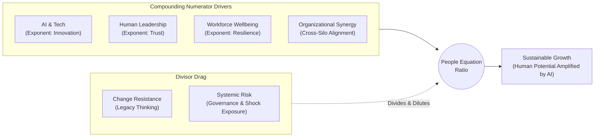

## 💡 First-Principles Intuition & Everyday Analogy

Imagine buying a commercial high-speed blender for a busy family kitchen. A traditionalist might argue that using a blender is "cheating" and demand that every spice paste still be crushed manually with a stone mortar and pestle (_cobek_). That refusal wastes hours of human energy on repetitive mechanical friction while missing the whole point of cooking: nourishing the people you love and spending meaningful time together. Yet, if you turn on that blender at maximum speed without a lid, safety guardrails, or a clear recipe, the kitchen ends up covered in mess—and someone gets hurt.

Artificial intelligence and autonomous software agents function identically in modern enterprises. In her [[rabuan/2026-09-16-nora-manaf-people-equation|Rabuan Plenary Masterclass]], [[entities/nora-manaf|Datuk (Dr.) Nora Manaf]] synthesized **The People Equation** to dismantle the false binary between _Human Workers_ and _Artificial Intelligence_. Pure technological speed without human leadership, trust, and psychological wellbeing produces an existential trap: organizations become faster and smarter, yet leave people isolated, anxious, and disenfranchised. Sustainable enterprise growth does not emerge from replacing humans with code; it emerges when human potential is exponentially amplified by AI tools while organizational resistance and systemic risk are actively contained.

---

## 🔑 Prerequisite Concepts & Mathematical Formulation

### Prerequisite & Jargon Decoder

Before examining the formal equation, clarify every operational variable inside the architecture:

- **AI & Emerging Technology**: Digital infrastructure, generative AI, autonomous agents, and automated workflows that democratize information and eliminate repetitive administrative tasks.
- **Innovation (Exponent)**: Creative problem-solving and willingness to challenge legacy assumptions—converting raw technical tools into new business models rather than automating broken legacy habits.
- **Human Leadership**: Executive stewardship anchored in humility, empathy, and _political intelligence_—setting moral and strategic direction rather than hoarding status.
- **Trust (Exponent)**: Psychological safety and transparency between executives and frontline teams; when trust collapses, employees hide errors and resist transformation.
- **Workforce Wellbeing**: Financial fairness (living compensation), mental resilience, and work-life dignity that prevent burnout.
- **Resilience (Exponent)**: Institutional and personal capacity to absorb shocks, unlearn obsolete habits, and bounce back from uncertainty.
- **Organizational Synergy**: Cross-functional collaboration across silos, unlocked when companies stop trapping talent inside rigid job descriptions.
- **Change Resistance**: Bureaucratic inertia, territorial politics, and legacy thinking (_"we have always done it this way"_) that stall transformation.
- **Systemic Risk**: Cascading operational, algorithmic, ethical, or geopolitical disruptions (such as cyber vulnerabilities or sudden macro-economic shocks) that amplify organizational fragility.

### The Master Equation {#mathematical-formulation}

$$\frac{\left[(\text{AI \& Emerging Technology})^{\text{Innovation}} \times \text{Human Leadership}^{\text{Trust}} \times \text{Workforce Wellbeing}^{\text{Resilience}} \times \text{Organizational Synergy}\right]}{(\text{Change Resistance} + \text{Systemic Risk})} = \text{Sustainable Growth}$$

### Structural Anatomy of the Mechanism

- **Multiplicative Numerator with Exponential Multipliers**: The four core drivers are multiplied, not added. Consequently, if any single driver drops to zero—such as zero workforce wellbeing during brutal layoffs—the entire numerator collapses regardless of how much capital a firm spends on AI servers. Furthermore, **Innovation**, **Trust**, and **Resilience** sit as _exponents_: modest gains in human trust or creative innovation scale enterprise value exponentially.
- **Additive Friction Denominator**: **Change Resistance** and **Systemic Risk** act as a direct divisor. When legacy politics and unmanaged operational risks swell, they divide and dilute every unit of technological and leadership investment in the numerator.

### 10-Second Micro-Numerical Toy Example

Compare two state-owned enterprises investing equally in AI technology (`AI = 4`):

- **Enterprise A (Tech-First, Low-Trust Bureaucracy)**: Heavy AI investment (`AI = 4`) applied merely to cut headcount (`Innovation = 1`), combined with autocratic management (`Leadership = 2`), zero trust (`Trust = 0`, collapsing $2^0 = 1$), and burned-out staff (`Wellbeing = 1`, `Resilience = 1`, `Synergy = 1`). Meanwhile, fear triggers high resistance and governance errors (`Resistance = 6`, `Risk = 4`, Denominator = `10`):
  $$\text{Growth}_A = \frac{4^1 \times 2^0 \times 1^1 \times 1}{6 + 4} = \frac{4 \times 1 \times 1 \times 1}{10} = \mathbf{0.40}$$
- **Enterprise B (Human-Amplified Organization)**: Same AI baseline (`AI = 4`) paired with business-model innovation (`Innovation = 2`), credible leadership (`Leadership = 3`) backed by high trust (`Trust = 2`), healthy staff (`Wellbeing = 2`, `Resilience = 2`), and cross-silo synergy (`Synergy = 2`). Clear guardrails and open communication halve friction (`Resistance = 2`, `Risk = 2`, Denominator = `4`):
  $$\text{Growth}_B = \frac{4^2 \times 3^2 \times 2^2 \times 2}{2 + 2} = \frac{16 \times 9 \times 4 \times 2}{4} = \mathbf{288.0}$$

Both enterprises spent identical funds on AI, yet **Enterprise B generates 720x higher sustainable growth** because exponential human multipliers compound while organizational friction shrinks.

---

## 🧭 Three-Column Strategic Architecture & Role Hierarchy

The People Equation visually maps a strategic choice across three trajectories:

| Strategic Horizon                | **A Future Without Humanity**                                | **The Leadership Shift Ahead**                                                                                                                                                          | **The Future We Choose to Build**                                                                                    |
| :------------------------------- | :----------------------------------------------------------- | :-------------------------------------------------------------------------------------------------------------------------------------------------------------------------------------- | :------------------------------------------------------------------------------------------------------------------- |
| **Core Trajectory**              | Unchecked automation, hyper-velocity agents, human isolation | Active transition bridging technology and human dignity                                                                                                                                 | Purposeful, inclusive, sustainable eco-enterprise                                                                    |
| **Strategic Levers / Pillars**   | Autonomous AI · Agents · Speed                               | 1. **Reimagine Work** (around human potential) 2. **Rebuild Capability** (adaptability, curiosity, AI fluency) 3. **Reinforce Trust** (transparency, inclusion, accountability) | • Growth with Purpose • Leadership with Humanity • Wellbeing with Prosperity • Transformation with Trust |
| **Governing Question / Mandate** | _"Faster. Smarter. But for whom?"_                           | **Three-Tier Role Hierarchy**                                                                                                                                                           | **Core Synthesis Doctrine**                                                                                          |

### Three-Tier Role Hierarchy {#three-tier-role-hierarchy}

To eliminate existential confusion inside AI-enabled enterprises, The People Equation establishes an explicit division of responsibility:

1. **AI will provide intelligence**: Rapid data synthesis, coding, pattern detection, and operational speed.
2. **Leadership will set direction**: Moral judgment, courage under uncertainty, stakeholder alignment, and ethical guardrails.
3. **People will create the value**: Empathy, trust-building, creative judgment, and turning insights into real human impact.

### Four Outcome Pillars {#four-outcome-pillars}

When the leadership shift succeeds, the resulting future anchors on four non-negotiable pillars (**The Future We Choose to Build**):

- **Growth with Purpose**: Financial expansion tied to societal uplift rather than pure extraction.
- **Leadership with Humanity**: Boldness balanced by humility and genuine care for livelihoods.
- **Wellbeing with Prosperity**: Fair living wages and psychological safety generating superior enterprise returns.
- **Transformation with Trust**: Adopting emerging tools transparently so teams embrace rather than fear change.

---

## 🛡️ Responsible Capitalism & Skills-Based Organization

### Responsible Capitalism {#responsible-capitalism}

Traditional short-term capitalism treats workforce downsizing (_PHK_) as the fastest lever to boost quarterly margins and share prices. Under The People Equation, suppressing wages or firing workers purely to inflate short-term cost-to-income ratios destroys long-term institutional trust and leaves potential unrealized. **Responsible Capitalism** insists on financial discipline (_"we cannot eat love—enterprises must generate profit"_) while refusing to build profit at the expense of human dignity, pride, and survival.

### Skills & Capability-Based Organization {#skills-based-organization}

Rigid job descriptions (_"you are just a driver"_ or _"you are just a coder"_) waste latent organizational wealth—frequently leaving up to 75% of employee capability untapped. Instead of periodically tearing down and rebuilding hierarchical org charts to fight **silo mentality**, modern leaders deploy AI skill inventories and micro-credentials to surface hidden employee talents across departments, matching capabilities dynamically to urgent projects.

---

## 🔗 Curriculum & Rabuan Bridges

- **Primary Source Plenary**: [[rabuan/2026-09-16-nora-manaf-people-equation|The Future of Work: The People Equation, Responsible Capitalism & Leadership with Humanity]]
- **Keynote Architect**: [[entities/nora-manaf|Datuk (Dr.) Nora Manaf]]
- **Related Quantitative Human Capital Model**: [[concepts/peoplemath-framework|PeopleMath Framework]] (Agus Dwi Handaya)
- **Systemic Risk Alignment**: [[rabuan/2026-09-30-meilano-systemic-risk|The Shifting Ground: Systemic Risk Governance]]
- **Core MBA Courses**: [[courses/mk1-organizational-behavior-managing-people/week-08/index|MK1 Week 08: Human Capital as Competitive Advantage]] & [[concepts/ulrich-hr-model|Ulrich HR Business Partner Model]]
- **Hub Directory**: [[concepts/index|Knowledge Matrix]]
