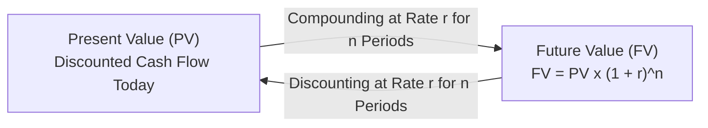
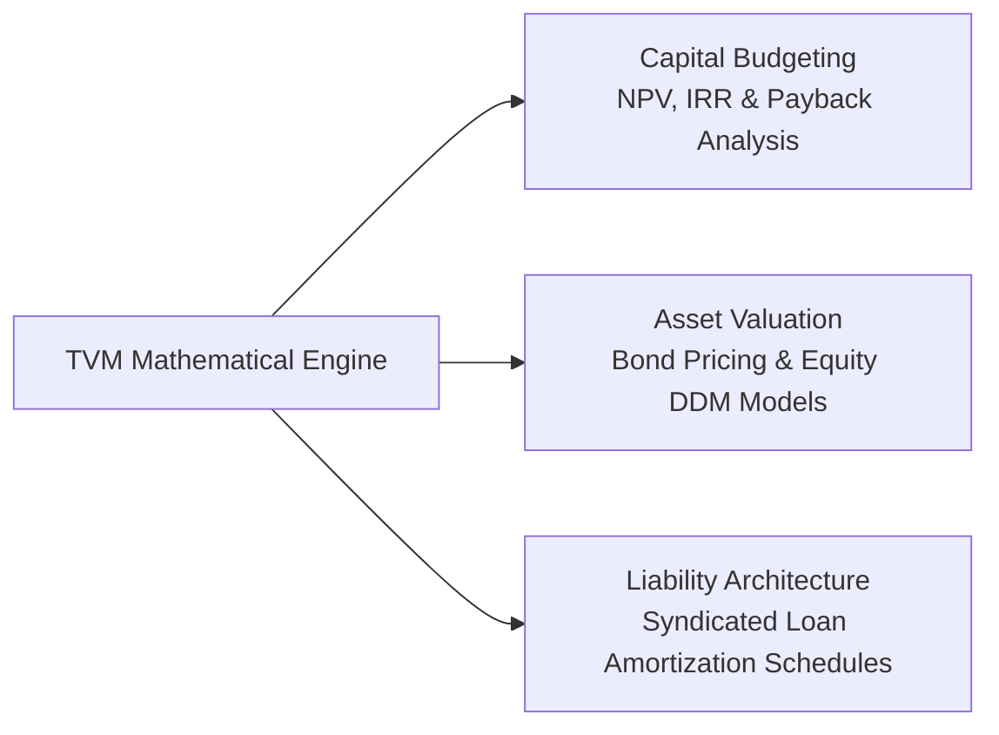

## 📐 Universal Mechanism & Theoretical Principle

The **Time Value of Money (TVM)** is the core mathematical engine of finance. It formalizes the principle that a specific nominal sum of money available today has greater economic value than the same nominal sum received at a future date.

This valuation asymmetry is driven by three universal economic forces:

1. **Productive Investment Opportunity**: Capital deployed today earns interest, dividends, or operational operating cash flows.
2. **Inflation Drag**: Future currency purchases fewer goods and services due to rising price levels.
3. **Credit and Uncertainty Risk**: Promised future cash receipts involve non-zero probability of counterparty default or macro disruption.

---

## 🔢 Mathematical Architecture

### 1. Single Cash Flows

$$\mathbf{\text{Future Value (FV)}} = \text{PV} \times (1 + r)^n \qquad \mathbf{\text{Present Value (PV)}} = \frac{\text{FV}}{(1 + r)^n} = \text{FV} \times (1 + r)^{-n}$$

### 2. Multi-Period Compounding & Effective Annual Rate (EAR)

When interest compounds $m$ times per year:

$$\mathbf{\text{FV}} = \text{PV} \times \left(1 + \frac{r_{\text{nom}}}{m}\right)^{n \times m} \qquad \mathbf{\text{EAR}} = \left(1 + \frac{r_{\text{nom}}}{m}\right)^m - 1$$

$$\mathbf{\text{Continuous Compounding}}: \quad \text{EAR} = e^{r_{\text{nom}}} - 1 \quad \text{and} \quad \text{FV} = \text{PV} \times e^{r \times n}$$

### 3. Uniform Annuity Streams

$$\mathbf{\text{Ordinary Annuity (End of Period)}}: \quad \text{PVA}_{\text{ord}} = \text{PMT} \times \left[\frac{1 - (1 + r)^{-n}}{r}\right]$$

$$\mathbf{\text{Annuity Due (Beginning of Period)}}: \quad \text{PVA}_{\text{due}} = \text{PVA}_{\text{ord}} \times (1 + r)$$

### 4. Perpetuities (Infinite Streams)

$$\mathbf{\text{Level Perpetuity}}: \quad \text{PV} = \frac{\text{PMT}}{r} \qquad \mathbf{\text{Growing Perpetuity}}: \quad \text{PV} = \frac{\text{PMT}_1}{r - g} \quad (\text{for } r > g)$$

---

## 🏢 Enterprise Applications across the MBA Curriculum

| Domain                | TVM Formula Application                                                                                        | Strategic Strategic Output                                               |
| :-------------------- | :------------------------------------------------------------------------------------------------------------- | :----------------------------------------------------------------------- |
| **Capital Budgeting** | $\text{NPV} = \sum_{t=1}^n \frac{\text{CF}_t}{(1 + \text{WACC})^t} - \text{Initial Capex}$                     | Accept investment projects that generate positive net present value.     |
| **Fixed Income**      | $\text{Price} = \sum_{t=1}^n \frac{\text{Coupon}}{(1 + \text{YTM})^t} + \frac{\text{Par}}{(1 + \text{YTM})^n}$ | Price corporate debt securities and measure interest rate duration risk. |
| **Equity Valuation**  | $P_0 = \sum_{t=1}^{\infty} \frac{D_t}{(1 + r_e)^t} = \frac{D_1}{r_e - g}$                                      | Derive the intrinsic value of company common equity shares.              |

---

## 🔗 Curricular Bridges

- Master Course Note: [[courses/mk2-financial-management-strategy/week-06/index|MK2 Week 06: Time Value of Money & Annuities]]
- Practical Modeling Case: [[courses/mk2-financial-management-strategy/week-06/case-tvm-wealth-and-annuities|TVM Cases I & II (Retirement & Amortization)]]
- Advanced Asset Valuation: [[courses/mk2-financial-management-strategy/week-07/index|MK2 Week 07: Bond & Stock Valuation]]
