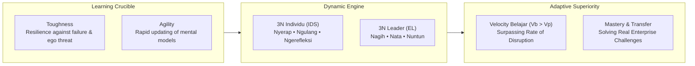
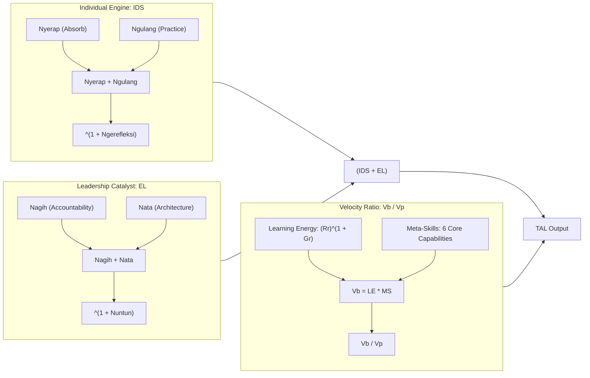
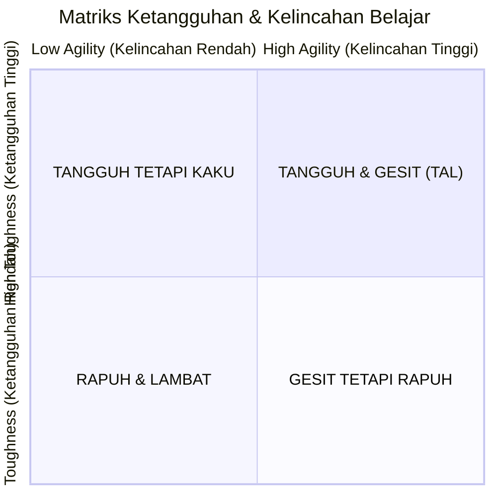

## 💡 First-Principles Intuition & Conceptual Core

The World Economic Forum projects that over **39% of core workforce skills will be disrupted or transformed by 2030**. In an environment of accelerating technological and organizational shift, the traditional ideal of the _lifelong learner_ is no longer sufficient. Being eager to learn is pointless if one learns obsolete tools slowly or collapses at the first sign of friction.

Formulated by [[entities/agus-dwi-handaya|Agus Dwi Handaya]] in the P3MD curriculum, a **Tough & Agile Learner (TAL)** represents a dynamic dual-capability:

1. **Tough (Tangguh)**: Psychological endurance to withstand learning friction—ambiguity, awkwardness during early practice, harsh feedback, failed experiments, and slow initial gains—without abandoning the pursuit.
2. **Agile (Gesit)**: Cognitive flexibility to detect emerging signals, update mental models, unlearn outmoded habits, and transfer principles rapidly into unfamiliar business contexts.

- **Toughness without Agility**: Produces stubborn devotion to obsolete practices, where professionals defend declining legacy models out of misplaced pride.
- **Agility without Toughness**: Produces superficial dabbling without true mastery, where individuals hop across trends without developing executable capability.

---

## 📐 Universal Mechanism & Mathematical Architecture

### 1. The TAL Master Formula

The macro formulation establishes that adaptive capability is the product of human developmental foundation ($IDS + EL$) multiplied by the learning velocity ratio ($Vb/Vp$):

$$\mathbf{TAL = (IDS + EL) \times \left( \frac{Vb}{Vp} \right)}$$

The velocity ratio serves as an existential scaling factor: if environmental market change ($Vp$) outpaces internal acquisition speed ($Vb$), the fraction drops below $1.0$, eroding organizational readiness despite high baseline effort. To operationalize $Vb$ into concrete executive levers, Agus Dwi Handaya decomposes the numerator into Learning Energy ($LE$) and Meta-Skills ($MS$):

$$\mathbf{TAL = (IDS + EL) \times \left( \frac{LE \times MS}{Vp} \right), \quad \text{where } Vb = LE \times MS}$$

### ⚙️ Mechanics & Structural Anatomy

- **Summed Engines ($(IDS + EL)$)**: Growth has two distinct entry gates: internal learner agency ($IDS$) and external leadership catalysis ($EL$). They are additive because a proactive individual can still grow under an imperfect leader, while an exceptional leader can ignite a dormant individual. Neither party is excused from ownership.
- **Velocity Ratio Multiplier ($\frac{Vb}{Vp}$)**: Learning capability is meaningful only when delivered on time. If personal learning speed ($Vb$) lags behind the rate of skill obsolescence ($Vp$), the professional falls behind despite working hard.
- **Mental-Math Micro-Example**:
  When learning velocity lags behind industry obsolescence, net capability degrades even with maximum developmental effort:
  $$\text{Scenario A (High Effort, Lagging Velocity)}: (10 + 10) \times \left(\frac{5}{10}\right) = 20 \times 0.5 = 10$$
  When deliberate meta-skills and intrinsic motivation accelerate acquisition beyond the market pace, output triples under identical effort:
  $$\text{Scenario B (High Effort, Accelerated Velocity)}: (10 + 10) \times \left(\frac{15}{10}\right) = 20 \times 1.5 = 30$$

---

### 2. Deconstruction of the Sub-Equations

#### Individual Development Strategy (IDS — 3N Individu)

$$\mathbf{IDS = (\text{Nyerap} + \text{Ngulang})^{(1 + \text{Ngerefleksi})}}$$

- **Nyerap (Absorb)**: Active environmental scanning and critical curation of high-value signals rather than passive consumption of content.
- **Ngulang (Practice)**: Deliberate practice, spaced retrieval, and iterative testing in real work scenarios.
- **Ngerefleksi (Reflect)**: Exponential accelerator through structured After-Action Reviews (AAR) answering five causal questions: What was targeted? What happened? Why? What to sustain/stop? What one change to execute next?

#### Effective Leader (EL — 3N Leader)

$$\mathbf{EL = (\text{Nagih} + \text{Nata})^{(1 + \text{Nuntun})}, \quad \text{where } N3 = (Ch + Tk)^{(1 + Tr)}}$$

- **Nagih (Accountability)**: Demanding verifiable workplace application rather than mere classroom attendance.
- **Nata (Architecture)**: Removing bureaucratic friction, structuring stretch assignments, and prioritizing cognitive loads.
- **Nuntun (Guidance)**: Exponential multiplier synthesizing challenging stretch assignments ($Ch$), tacit wisdom transfer ($Tk$), and dignified human treatment ($Tr$) that builds psychological safety.

#### Learning Energy (LE) & Motivation Dynamics

$$\mathbf{LE = (\text{Receiving Factors})^{(1 + \text{Giving Factors})} = (Rr)^{(1 + Gr)}}$$

- **Receiving Factors ($Rr$)**: Essential extrinsic baseline (fair compensation, tools, schedule allocation, psychological safety).
- **Giving Factors ($Gr$)**: Exponential intrinsic driver (purpose, societal contribution, service to family, nation, and calling).

#### The Six Core Meta-Skills (MS)

Meta-skills function as the learning operating system:

1. _Self-Awareness_: Identifying competence boundaries, emotional triggers, and cognitive blind spots.
2. _Metacognition_: Planning, monitoring, and evaluating the efficacy of one's own learning techniques.
3. _Critical Thinking & Problem Framing_: Discerning signal from noise and framing root problems before solving.
4. _Self-Regulation_: Disciplining attention, emotional state, energy rhythms, and focus.
5. _Transfer & Adaptive Application_: Abstracting principles from one domain and applying them to another.
6. _Unlearning & Relearning_: Consciously letting go of obsolete frameworks and mental models.

#### Compressing the 5 Learning Friction Times

Maximizing $Vb$ requires systematically shrinking five operational delays:

1. **Signal-to-Priority Time**: Lag between market shift detection and skill prioritization.
2. **Priority-to-First-Practice Time**: Lag between setting priorities and initiating the first real-world trial.
3. **Practice-to-Feedback Time**: Lag between trial execution and receiving objective critique.
4. **Feedback-to-Adjustment Time**: Lag between receiving feedback and updating operational strategy.
5. **Adjustment-to-Performance Time**: Time required for corrected behaviors to stabilize into reliable execution.

---

### 3. The Four-Quadrant Toughness & Agility Matrix

| Quadrant Profile          | Defining Behaviors                                                     | Enterprise Risk                                       | Prescribed Intervention                                         |
| :------------------------ | :--------------------------------------------------------------------- | :---------------------------------------------------- | :-------------------------------------------------------------- |
| **Rapuh & Lambat**        | Avoids challenge; passive compliance; defensive when corrected         | Severe capability obsolescence; blames the system     | Establish psychological safety; small achievable milestones     |
| **Tangguh tetapi Kaku**   | Highly disciplined and tireless; stubbornly loyal to legacy habits     | Enormous effort wasted mastering obsolete methods     | Scanning exercises; unlearning routines; multi-angle feedback   |
| **Gesit tetapi Rapuh**    | Enthusiastic about novel trends; abandons tasks at first major failure | Chronic dabbling without achieving depth or transfer  | Deliberate practice cadence; commit to single skill mastery     |
| **Tangguh & Gesit (TAL)** | Welcomes new challenges; absorbs feedback; iterates rapidly            | Potential burnout if recovery intervals are neglected | Safeguard purpose; enforce physical recovery; deploy as mentors |

---

## 🏛️ Multi-Disciplinary Lenses Across the MBA Curriculum

### 1. Operations & Process Excellence (MK 4)

- **Primary Mechanism**: Reducing cycle time across learning iterations is mathematically identical to lead time reduction in Lean operations.
- **Core Insight**: Compressing the 5 Friction Times eliminates waste (_muda_) in human capital transformation.
- _Discussed in_: [[courses/mk4-operations-supply-chain-management/week-06/index|MK 4 Week 06: Process Design & Little's Law]].

### 2. Decision Making & Problem Solving (MK 5)

- **Primary Mechanism**: Cognitive unlearning, avoiding the sunk-cost fallacy, and structured problem framing.
- **Core Insight**: Tough & Agile learners treat failed experiments as valuable data points rather than personal defeats.
- _Discussed in_: [[courses/mk5-decision-making-negotiation/week-02/index|MK 5 Week 02: Kepner-Tregoe Problem Analysis]].

### 3. Organizational Behavior & Talent Strategy (MK 1)

- **Primary Mechanism**: Self-regulation, adult learning theories, and peer coaching dynamics.
- **Core Insight**: Collective TAL emergence (as demonstrated by The Golden Thirteen) proves that psychological safety and peer teaching produce higher cohort performance than internal zero-sum ranking.
- _Discussed in_: [[courses/mk1-organizational-behavior-managing-people/week-03/index|MK 1 Week 03]].

---

## 🚀 Action Learning Project (ALP) Application

> [!TIP] BUMN Execution Cadence
> In the Action Learning Project, apply the **30-Day TAL Operating Rhythm** to syndicate deliverables:
>
> - **Days 1–3**: Scan business problem and isolate the single most critical capability gap.
> - **Days 4–7**: Targeted absorption—review maximum 3 top industry benchmarks and interview 1 sector practitioner.
> - **Week 2**: Rapid practice—execute 2 to 3 micro-interventions in field data gathering.
> - **Weeks 2–3**: Tight feedback loops—solicit critique from BUMN Mentors immediately after milestone reviews.
> - **End of Week**: Conduct 15-minute After-Action Reviews to lock in one concrete behavioral change for the next cycle.

---

## 🔗 Contributing Sessions & References

- **Master Plenary Session**: [[rabuan/2026-09-02-adh-peoplemath|Rabuan 01: PeopleMath — Produktivitas Berkualitas, Kebahagiaan Tanpa Batas & Strategi Tough & Agile Learner]]
- **Featured Theorist & Leader**: [[entities/agus-dwi-handaya|Agus Dwi Handaya]]
- **Parent Framework**: [[concepts/peoplemath-framework|PeopleMath Framework]]
- **Primary Institution**: [[entities/danantara|PT Danantara Asset Management]]
- **Knowledge Matrix Hub**: [[concepts/index|Knowledge Matrix]]
