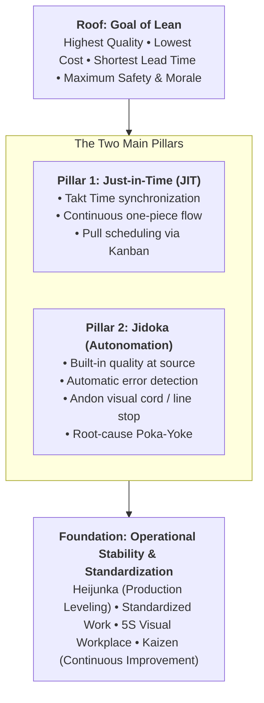

The **Toyota Production System (TPS)**, pioneered by Taiichi Ohno and Eiji Toyoda at the Toyota Motor Corporation, is the socio-technical management philosophy that forms the bedrock of modern **Lean Operations**.

TPS seeks to maximize customer value by systematically eliminating all non-value-added waste (**Muda**), unevenness (**Mura**), and overburden (**Muri**) through continuous flow, pull scheduling, and frontline problem-solving.

---

## 🏛️ The House of Lean / TPS Architecture

The TPS philosophy is visualized as an integrated architectural structure where every component relies upon the integrity of the others:

| TPS Pillar                | Core Principle                                                                                                                         | Operational Toolkits & Mechanisms                                                                                                                               |
| :------------------------ | :------------------------------------------------------------------------------------------------------------------------------------- | :-------------------------------------------------------------------------------------------------------------------------------------------------------------- |
| **Just-in-Time (JIT)**    | Produce and deliver only what is needed, when it is needed, and in the exact quantity needed by the downstream customer.               | **Takt Time** ($\text{Net Available Work Time} / \text{Customer Demand}$), Pull-replenishment **Kanban**, Quick Changeovers (**SMED**), cellular manufacturing. |
| **Jidoka (Autonomation)** | Intelligent automation that stops the line immediately when an abnormality occurs, preventing defective units from passing downstream. | **Andon boards** (visual cord stops), fail-safe mechanisms (**Poka-Yoke**), root-cause analysis (5 Whys), separation of human work from machine cycles.         |
| **Standardized Work**     | The current best-known, safest, and most efficient method to execute an operational cycle; the prerequisite for any improvement.       | Takt time charts, standard work combination sheets, visual boundary markings.                                                                                   |
| **Kaizen**                | Relentless, bottom-up incremental improvement involving every employee from factory floor to executive suite.                          | Quality Control (QC) circles, Gemba walks, Plan-Do-Check-Act (PDCA) cycles.                                                                                     |

---

## 🗑️ The Seven Operational Wastes (_Muda_) + 1

Taiichi Ohno classified operational waste into seven definitive forms, later augmented with an eighth managerial waste:

```mermaid
flowchart LR
    subgraph PhysicalWastes["Physical & Material Wastes"]
        direction TB
        W1["<b>1. Overproduction</b><br/>(Mother of all wastes; hidden WIP)"]
        W2["<b>2. Inventory</b><br/>(Excess raw, WIP, and finished stock)"]
        W3["<b>3. Transportation</b><br/>(Unnecessary movement of materials)"]
        W4["<b>4. Defects / Rework</b><br/>(Scrap, repairs, inspection overhead)"]
    end

    subgraph MotionWastes["Time & Human Wastes"]
        direction TB
        W5["<b>5. Waiting</b><br/>(Operator or machine idle delay)"]
        W6["<b>6. Motion</b><br/>(Excess human bending, reaching, walking)"]
        W7["<b>7. Overprocessing</b><br/>(Work that adds no customer value)"]
        W8["<b>8. Unused Talent</b><br/>(Underutilizing worker creativity & insight)"]
    end

    PhysicalWastes <--> MotionWastes
```

1. **Overproduction**: Producing goods before they are ordered or in larger quantities than needed. _Ohno considered this the most severe waste because it conceals all other operational defects._
2. **Inventory**: Capital tied up in raw materials, work-in-process (WIP), and finished goods, occupying space and incurring holding costs.
3. **Transportation**: Moving products, pallets, or materials between warehouses and workstations without altering their physical state.
4. **Defects & Rework**: Defective units requiring inspection, scrap, disassembly, or customer warranty remediation.
5. **Waiting**: Workers standing idle waiting for machine cycles, parts deliveries, inspection clearances, or upstream bottlenecks.
6. **Motion**: Ergonomically inefficient worker movements (reaching, bending, searching for misplaced tools).
7. **Overprocessing**: Performing extra finishing steps, redundant checks, or features that the customer does not value or pay for.
8. **Unused Human Potential**: Failing to engage frontline workers in continuous process improvement, ideas, and problem-solving.

---

## 🗺️ Value Stream Mapping (VSM)

Value Stream Mapping is the diagnostic tool used to visualize material and information flows from supplier to customer:

$$\mathbf{\text{Process Cycle Efficiency (PCE)} = \frac{\text{Value-Added Time (VAT)}}{\text{Total Lead Time (TLT)}} \times 100\%}$$

In typical non-lean operations, Value-Added Time represents **less than 5%** of Total Lead Time; Lean operations focus relentlessly on compressing the 95% non-value-added waiting and transit time.

---

## 🔗 Cross-Curricular Connections

- **Process Foundations**: Links directly to [[concepts/littles-law|Little's Law: $WIP = \text{Throughput} \times \text{Flow Time}$]] (cutting WIP forces lead times to plunge).
- **Service Application**: Service poka-yokes intersect with [[concepts/service-blueprinting|Service Blueprinting]].
- **Course Anchor**: Applied in [[courses/mk4-operations-supply-chain-management/week-08/index|MK4 Week 08: Lean Operations & Supply Chain]] and the [[courses/mk4-operations-supply-chain-management/week-08/case-kai-logistik-lean|KAI Logistik Lean Operations Case Dossier]].
