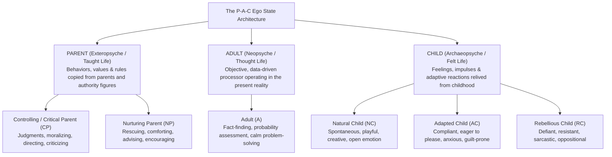
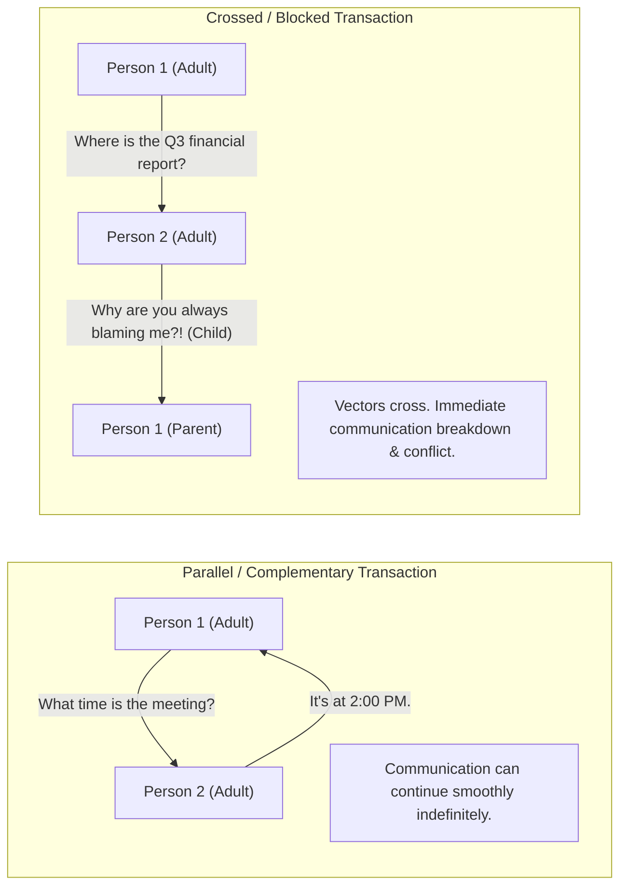

## 📐 Universal Definition & Conceptual Core

Developed in the late 1950s by Canadian-American psychiatrist **Eric Berne** (1961, 1964 _Games People Play_), **Transactional Analysis (TA)** is a psychodynamic theory of personality and systematic methodology for improving interpersonal communication.

Berne observed that an individual’s internal psychic state shifts dynamically depending on environmental triggers. Every human personality contains three coherent, observable systems of thoughts, feelings, and behaviors termed **Ego States (The P-A-C Model)**:

---

## 🏛️ The Three Ego States Detailed

| Ego State      | Sub-Category              | Voice & Physical Manifestation                                | Linguistic Indicators                                                                | Workplace Role & Hazard                                                                                      |
| :------------- | :------------------------ | :------------------------------------------------------------ | :----------------------------------------------------------------------------------- | :----------------------------------------------------------------------------------------------------------- |
| **Parent (P)** | **Critical Parent (CP)**  | Pointing finger, furrowed brow, stern posture, sighing.       | _"You should always...", "You must never...", "How many times have I told you?"_     | Enforces standards, quality control; **Hazard**: Demoralizes subordinates, triggers rebellious sabotage.     |
|                | **Nurturing Parent (NP)** | Open arms, soft tone, protective pat on back.                 | _"Don't worry, let me handle that for you", "You tried your best."_                  | Provides emotional support; **Hazard**: Smothers autonomy, creates learned helplessness.                     |
| **Adult (A)**  | **Objective Adult**       | Attentive, level gaze, calm, even pitch, neutral posture.     | _"What does the data show?", "What are our alternatives?", "How can we solve this?"_ | **The gold standard for business decision-making**: Objective, un-emotional, collaborative problem-solving.  |
| **Child (C)**  | **Natural Child (NC)**    | High energy, smiling, unrestrained laughter, excitement.      | _"Wow, that's awesome!", "Let's try something crazy!"_                               | Engine of entrepreneurship and creative brainstorming; **Hazard**: Impulsive, ignores commercial boundaries. |
|                | **Adapted Child (AC)**    | Slumping shoulders, downcast eyes, quiet or apologetic voice. | _"Sorry, yes sir, whatever you say", "I hope this is okay."_                         | Cooperates with team norms; **Hazard**: Passive compliance, hides bad news (_Asal Bapak Senang_).            |
|                | **Rebellious Child (RC)** | Crossed arms, rolled eyes, sarcastic sneer, foot tapping.     | _"Why do I have to do this?", "That won't work anyway."_                             | Challenges outdated dogma; **Hazard**: Toxic obstructionism, passive-aggressive delay.                       |

---

## 🔄 The Three Types of Interpersonal Transactions

A **transaction** is an exchange between two individuals consisting of a **stimulus** and a **response**. Communication quality depends on the alignment of the ego state vectors:

### 1. Parallel (Complementary) Transactions

Vectors are parallel. The response comes from the exact ego state addressed (e.g. Adult $\longleftrightarrow$ Adult, or Parent $\longleftrightarrow$ Child). Communication proceeds smoothly, though Parent $\longleftrightarrow$ Child loops can entrench paternalistic dependencies.

### 2. Crossed Transactions

The respondent reacts from a different ego state than intended, crossing the vectors.

- _Example_: Manager (Adult) asks: _"Do you know what caused the production delay?"_ $\longrightarrow$ Subordinate (Rebellious Child) snaps: _"Why are you always micromanaging my team?!"_
- _Resolution_: The leader must refuse the emotional bait (avoid reacting from Critical Parent), pause, and calmly re-anchor the dialogue in the **Adult ego state**: _"I am not assigning blame. I need the timeline data so we can update the customer together."_

### 3. Ulterior (Hidden) Transactions

Two levels of communication occur simultaneously: an overt social message and a covert psychological subtext (sarcasm, backhanded compliments, political maneuvering).

---

## 🏛️ Multi-Disciplinary Lenses Across the MBA Curriculum

### 1. High-Performing Teams & Conflict De-escalation (MK 1 Week 05)

- In [[courses/mk1-organizational-behavior-managing-people/week-05/index|MK 1 Week 05]], Transactional Analysis provides the tactical conversational machinery to build **[[concepts/psychological-safety|Psychological Safety]]**. Leaders de-escalate emotional friction by consciously operating from the **Adult** state rather than defaulting to the authoritarian **Critical Parent**.

### 2. Indonesian BUMN Governance & Paternalism

- In high-power-distance Indonesian corporate settings, _Bapakisme_ frequently triggers an automatic **Critical Parent $\longleftrightarrow$ Adapted Child** dynamic (_"Asal Bapak Senang"_). Breaking through organizational inertia requires leaders to invite subordinates into **Adult-to-Adult** accountability partnerships.

---

## 🔗 Contributing Sessions & References

- Master Lecture: [[courses/mk1-organizational-behavior-managing-people/week-05/index|MK 1 Week 05: High-Performing Teams, Group Dynamics & Transactional Analysis]]
- Related Concepts:
  - [[concepts/psychological-safety|Psychological Safety in Teams]]
  - [[concepts/emotional-intelligence|Emotional Intelligence in Executive Leadership]]
  - [[concepts/self-awareness|The Self-Awareness Triad]]
- Directory: [[concepts/index|Knowledge Matrix]]
