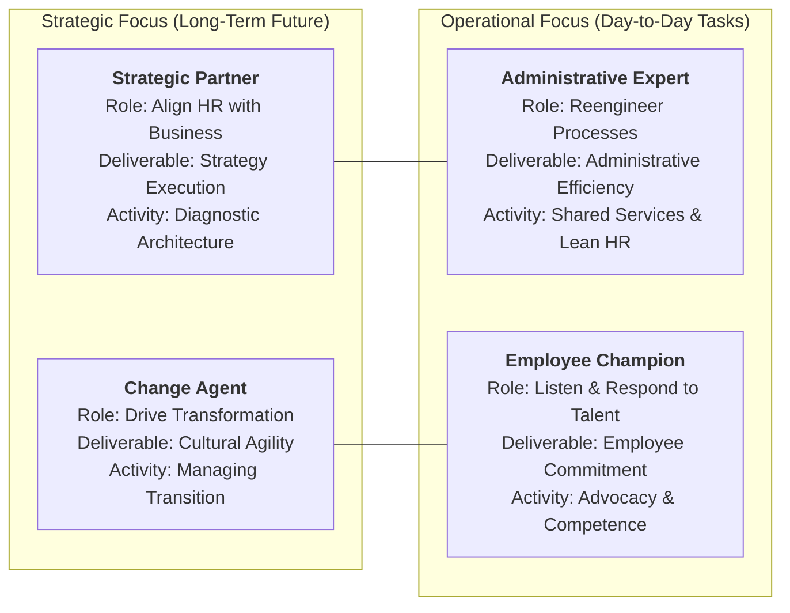

The **Dave Ulrich HR Model**, introduced by Professor Dave Ulrich (University of Michigan Ross School of Business) in his 1998 Harvard Business Review article _"A New Mandate for Human Resources"_, redefines the organizational purpose of human resources. Rather than viewing HR as a transactional personnel department that polices attendance, manages payroll, and plans corporate picnics, Ulrich constructs a 2×2 functional architecture where HR delivers measurable business value to investors, customers, line executives, and employees.

---

## 💡 1. Intuition & Everyday Analogy

Imagine a high-performance Formula 1 racing team.

- A **traditional personnel clerk** acts like a clerk logging parking permits for the pit crew: tracking timesheets, ordering fire suits, and issuing disciplinary letters when mechanics arrive late. The car does not go one millisecond faster.
- In contrast, the **Ulrich HR Architecture** treats human resource leaders as integral members of the engineering and telemetry team:
  - Designing pit stop coordination routines (**Administrative Expert**).
  - Co-designing vehicle aerodynamics and tire strategy with the chief engineer (**Strategic Partner**).
  - Monitoring driver biometric fatigue and morale during high-G turns (**Employee Champion**).
  - Retraining mechanics when transitioning from internal combustion to hybrid electric power units (**Change Agent**).

Without this transformation, HR remains what Ulrich famously termed "value-sapping"—a bureau that costs overhead but produces zero sustainable competitive advantage.

---

## 🔍 2. Prerequisite & Jargon Decoder

| Term                               | Definitional Meaning in Enterprise Architecture                                                                                                         | Real-World Failure Mode                                                                               |
| :--------------------------------- | :------------------------------------------------------------------------------------------------------------------------------------------------------ | :---------------------------------------------------------------------------------------------------- |
| **Human Capital Management (HCM)** | Viewing employees as appreciating assets that generate future returns when developed, rather than as operational costs to be minimized.                 | Treating headcount solely as a line-item budget cut during quarterly earnings pressure.               |
| **VRIO Framework**                 | Barney's resource-based view: resources must be **V**aluable, **R**are, **I**nimitable, and **O**rganized to deliver sustainable competitive advantage. | Assuming generic software or market-clearing salaries alone create a talent moat.                     |
| **Strategic Alignment**            | The tight coupling between enterprise strategic imperatives (e.g. digital transformation, EV transition) and workforce skill allocation.                | Developing leadership training programs completely decoupled from the corporate 5-year business plan. |
| **Organizational Capabilities**    | What an enterprise can do collectively (speed, innovation, learning capacity, agility) rather than individual employee skills.                          | Hiring elite individual talent that fails to collaborate due to toxic political silos.                |

---

## 🏛️ 3. Structural Anatomy of the 2×2 Matrix

Ulrich categorizes HR deliverables across two orthogonal axes:

1. **Focus Axis**: **Strategic / Long-Term Future** vs. **Operational / Day-to-Day Operational**.
2. **Target Axis**: **Processes & Systems** vs. **People & Relationships**.

### The 4 Core Roles Dissected

| Role                      | Focus & Orientation            | Core Deliverable           | Strategic Activity                                                                           | Primary Metric                                                    |
| :------------------------ | :----------------------------- | :------------------------- | :------------------------------------------------------------------------------------------- | :---------------------------------------------------------------- |
| **Strategic Partner**     | Strategic $\times$ Processes   | **Strategy Execution**     | Aligning HR practices with corporate growth strategies; organizational diagnosis.            | Revenue per FTE; Strategic initiative time-to-market.             |
| **Administrative Expert** | Operational $\times$ Processes | **Operational Efficiency** | Reengineering administrative workflows; building digital self-service shared centers.        | HR cost per employee; SLA transaction turnaround time.            |
| **Employee Champion**     | Operational $\times$ People    | **Employee Commitment**    | Voicing employee concerns; maintaining trust; coaching talent; psychological safety.         | Net Promoter Score (eNPS); Retention of top-tier talent.          |
| **Change Agent**          | Strategic $\times$ People      | **Organizational Agility** | Leading cultural transformation; dismantling bureaucratic silos; institutionalizing agility. | Adoption rate of transformation initiatives; Culture audit score. |

---

## 🔢 4. Micro-Numerical Toy Example & Line Accountability

### The Quantitative Tradeoff Formula

An enterprise allocates an annual HR capacity pool $H = 10{,}000$ hours.

In a **traditional personnel department**:

$$
H_{\text{admin}} = 8{,}000\text{ hrs (80\%)}, \quad H_{\text{strategic}} = 1{,}000\text{ hrs (10\%)}, \quad H_{\text{change}} = 1{,}000\text{ hrs (10\%)}
$$

Result: Routine operational administration consumes executive bandwidth while organizational capability stagnates.

Under an **Ulrich Digital Transformation**:
Automating routine queries via HR Shared Services (HRSS) reduces administrative friction:

$$
H_{\text{admin}} = 2{,}000\text{ hrs (20\%)}, \quad H_{\text{partner}} = 4{,}000\text{ hrs (40\%)}, \quad H_{\text{change}} = 2{,}500\text{ hrs (25\%)}, \quad H_{\text{champion}} = 1{,}500\text{ hrs (15\%)}
$$

### Line Executive Accountability Mandate

Ulrich stresses that **HR cannot execute this transformation alone**. Responsibility for building organizational capability rests with **CEOs and line business executives**, who must:

1. Treat human capital and organizational culture as core business priorities on par with capex and financial liquidity.
2. Demand quantitative, business-anchored ROI from HR interventions rather than vanity satisfaction surveys.
3. Actively sponsor and participate in talent development, cultural unlearning, and structural redesign.

---

## 🔗 Related Knowledge Bridges

- Master Curricular Hub: [[courses/mk1-organizational-behavior-managing-people/week-08/index|MK1 Week 08: People & Strategy: Human Capital as Competitive Advantage]]
- Corporate Case Dossier: [[courses/mk1-organizational-behavior-managing-people/week-08/case-general-motors-mary-barra-ev|General Motors: Mary Barra's Leadership in the EV Era]]
- Strategy Execution Architecture: [[concepts/organizational-dna-framework|Organizational DNA Framework]]
- Return to [[concepts/index|Knowledge Matrix (Concepts Hub)]]
