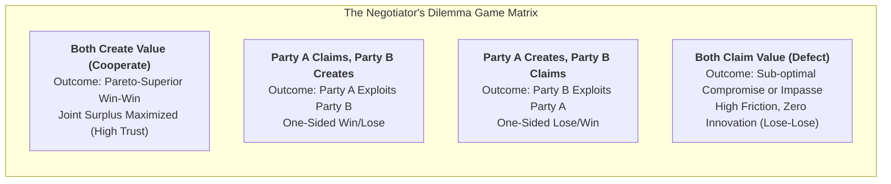

The **Value Creation vs. Value Claiming** framework, formalized by David A. Lax and James K. Sebenius in their seminal treatise _The Manager as Negotiator_ (1986), articulates the central strategic paradox of all human and corporate deal-making: **The Negotiator's Dilemma**. While negotiators must cooperate to discover joint gains and "expand the pie" (**Value Creation**), they must simultaneously compete to secure their own allocation of that surplus (**Value Claiming**). Tactics that maximize value claiming (bluffing, extreme anchoring, information secrecy) directly destroy the trust and information transparency required for value creation.

---

## 💡 1. Intuition & Everyday Analogy

Imagine two chefs in a professional kitchen competing for a single crate of rare oranges.

- In a **naive, purely distributive (value claiming)** negotiation, each chef views the deal as a zero-sum fight: _"I need 100% of the crate; if you take an orange, I lose an orange."_ They compromise by slicing every orange strictly in half. Both walk away with a mediocre $50\%$ outcome.
- In an **expert, integrative (value creating)** negotiation, the chefs share information regarding their underlying interests: Chef A is baking orange-infused pastries and needs exclusively the **orange peel (zest)**; Chef B is operating a juice bar and needs exclusively the **orange pulp and juice**.

By unbundling the asset based on divergent preferences, the chefs create value out of thin air: both achieve a **$100\%$ optimal outcome** without sacrificing a single slice. Only after the pie is expanded does value claiming take place.

---

## 🔍 2. Prerequisite & Jargon Decoder

| Term                                               | Definitional Meaning in Strategic Bargaining                                                                                                    | Common Executive Pitfall                                                                        |
| :------------------------------------------------- | :---------------------------------------------------------------------------------------------------------------------------------------------- | :---------------------------------------------------------------------------------------------- |
| **Distributive Bargaining**                        | A zero-sum negotiation over a fixed resource (e.g. single-issue cash price) where one party's gain is mathematically equal to the other's loss. | Assuming every complex multi-issue B2B contract is purely distributive ("fixed-pie bias").      |
| **Integrative Bargaining**                         | A cooperative negotiation process that seeks win-win solutions by discovering complementary interests, expanding joint surplus.                 | Being so cooperative and transparent that an aggressive counterparty exploits the disclosures.  |
| **Pareto Optimal Frontier**                        | An agreement where no party can be made better off without making the other party worse off. Joint surplus is fully extracted.                  | Settling on an "equal split" compromise that leaves substantial unharvested value on the table. |
| **Logrolling**                                     | The practice of trading off issues of low importance to oneself in exchange for concessions on issues of high importance to oneself.            | Treating every clause in a contract with equal emotional weight and digging in defensively.     |
| **MESO (Multiple Equivalent Simultaneous Offers)** | Presenting 3 alternative package deals of equal value to oneself, inviting the counterparty to choose their preference.                         | Making take-it-or-leave-it single offers that provoke defensive resistance.                     |

---

## 🏛️ 3. Structural Anatomy of The Negotiator's Dilemma

Lax and Sebenius map the strategic interaction of two negotiators as a classic **$2\times 2$ Game Theory Matrix**:

| Player A Strategy $\downarrow$ / Player B Strategy $\rightarrow$ | Player B Creates (Open Information)                                             | Player B Claims (Aggressive Posturing)                                                     |
| :--------------------------------------------------------------- | :------------------------------------------------------------------------------ | :----------------------------------------------------------------------------------------- |
| **Player A Creates (Open Information)**                          | **Pareto Optimal Win-Win** (+10, +10) Expanded pie; joint value harvested   | **Player A Exploited** ($-5$, $+15$) A reveals bottom line; B anchors aggressively     |
| **Player A Claims (Aggressive Posturing)**                       | **Player A Exploits** ($+15$, $-5$) A captures the surplus; B feels cheated | **Sub-Optimal Impasse** ($0$, $0$ or $+2$, $+2$) Bargaining breakdown; value destroyed |

### Why Compromise is Often Sub-Optimal

Negotiators often default to "meeting in the middle." However, midway compromise along a single axis fails to exploit differences in:

1. **Time Preferences**: One party values immediate cash; the other values steady long-term royalties.
2. **Risk Tolerances**: One party is risk-averse; the other is willing to take on market upside via contingent earn-outs.
3. **Capability Differences**: One party manufactures at lower cost; the other possesses superior marketing distribution.

---

## 🔢 4. Micro-Numerical Toy Example & Logrolling Math

### The Commercial Supplier Dispute

A mining conglomerate (Buyer) negotiates a heavy equipment maintenance contract with an engineering vendor (Supplier). Two issues are on the table:

- **Issue 1: Hourly Labor Rate** ($\$100/\text{hr}$ vs $\$150/\text{hr}$)
- **Issue 2: Emergency Response SLA** ($2\text{ hours}$ vs $12\text{ hours}$)

#### Party Utility Schedules (Value Points out of 100):

| Issue State                                                                    | Buyer Utility Points | Supplier Utility Points | Combined Joint Utility |
| :----------------------------------------------------------------------------- | :------------------: | :---------------------: | :--------------------: |
| **Option A (Midway Compromise)**: $\$125/\text{hr}$ + $7\text{-hour SLA}$      |   $50\text{ pts}$    |     $50\text{ pts}$     |  **$100\text{ pts}$**  |
| **Option B (Distributive Win/Lose)**: $\$100/\text{hr}$ + $2\text{-hour SLA}$  |   $100\text{ pts}$   |     $0\text{ pts}$      |  **$100\text{ pts}$**  |
| **Option C (Integrative Logrolling)**: $\$150/\text{hr}$ + $2\text{-hour SLA}$ |   $85\text{ pts}$    |     $80\text{ pts}$     |  **$165\text{ pts}$**  |

#### Why Logrolling Creates Value

- For the **Buyer**, mining downtime costs $\$50{,}000/\text{hr}$; a $2\text{-hour SLA}$ is worth far more than saving $\$25$ on hourly labor.
- For the **Supplier**, staffing emergency crews is cheap because they already operate a base nearby, but higher hourly rates protect cash margins.
- Under **Option C**, the supplier grants the rapid $2\text{-hour SLA}$ in exchange for the premium $\$150/\text{hr}$ rate. Total joint surplus expands from **$100$ points to $165$ points ($+65\%$)**.

---

## 🔗 Related Knowledge Bridges

- Master Curricular Hub: [[courses/mk5-decision-making-negotiation/week-09/index|MK5 Week 09: The Negotiation Dilemma: Value Creating vs. Value Claiming]]
- Foundational Framework: [[concepts/batna-and-zopa|BATNA and ZOPA Architecture]]
- Prior Module: [[courses/mk5-decision-making-negotiation/week-08/index|Week 08: Negotiation Foundations: Architecture, BATNA & ZOPA]]
- Return to [[concepts/index|Knowledge Matrix (Concepts Hub)]]
