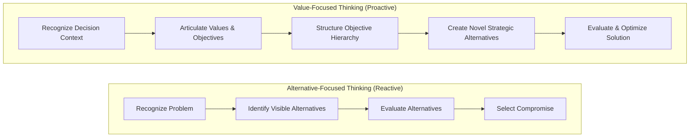
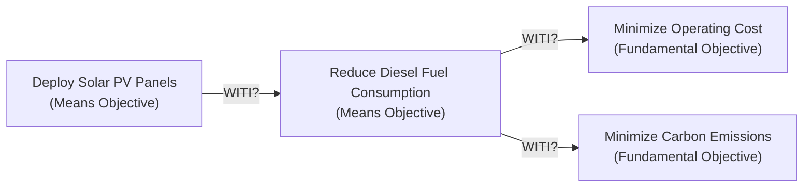
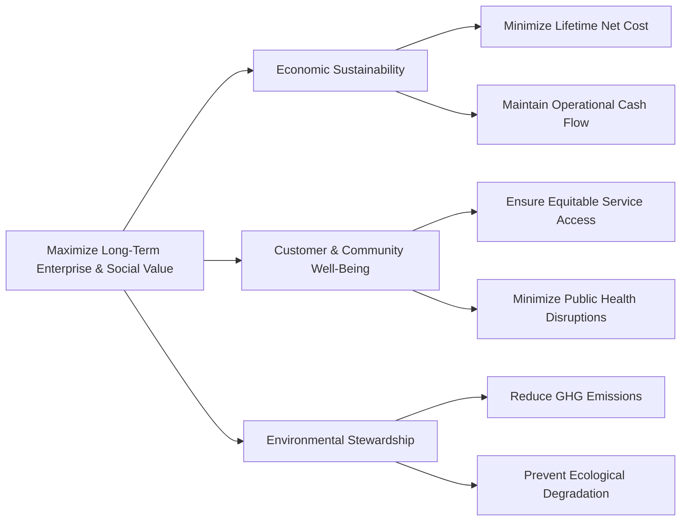

## 🧭 Executive Overview

**Value-Focused Thinking (VFT)** is a decision-framing philosophy and analytical framework pioneered by decision theorist **Ralph L. Keeney** in _Value-Focused Thinking: A Path to Creative Decisionmaking_ (Harvard University Press, 1992).

Keeney identified a pervasive pathology in corporate governance: **Alternative-Focused Thinking (AFT)**. Under AFT, decision makers react to visible, pre-existing alternatives (e.g., _"Should we choose Supplier A, B, or C?"_), prematurely constraining innovation and anchoring debates to sub-optimal compromises. In contrast, VFT posits that **values are what we care about; alternatives are merely means to achieve those values**. By articulating and structuring values first, organizations discover hidden decision opportunities, expand the design space, and construct superior, novel alternatives.

---

## 🏗️ Fundamental Objectives vs. Means Objectives

The central analytical discipline of VFT is distinguishing between **fundamental objectives** (ends) and **means objectives** (mechanisms).

| Objective Type            | Core Definitional Test                                                                            | Guiding Diagnostic Question                                                                                                                        | Strategic Role in Analysis                                                                     |
| :------------------------ | :------------------------------------------------------------------------------------------------ | :------------------------------------------------------------------------------------------------------------------------------------------------- | :--------------------------------------------------------------------------------------------- |
| **Fundamental Objective** | Essential reason for interest; represents the ultimate end consequence in the decision context.   | _"Why is this objective important in its own right?"_ $\rightarrow$ Answer: _"Because it is an inherent goal; it needs no further justification."_ | Forms the evaluation criteria for comparing and ranking all alternative solutions.             |
| **Means Objective**       | Contributory pathway; important primarily because of its influence on achieving other objectives. | _"Why is this objective important?"_ $\rightarrow$ Answer: _"Because it directly drives objective X."_                                             | Serves as a creative springboard for designing new alternative options and operational levers. |

### The "Why Is That Important?" (WITI) Technique

To separate means from ends, analysts apply Keeney's **WITI Protocol**:

1. When a stakeholder proposes an objective, ask: _"Why is that important?"_
2. If the answer is _"Because it helps accomplish Y"_, the proposed item is a **means objective**.
3. If the answer is _"It is fundamentally important to the enterprise / community and cannot be derived from a higher-level goal within this context"_, it is a **fundamental objective**.

---

## 🌳 Structuring Value Models

Values are organized into two distinct graphic architectures to facilitate rigorous decision analysis:

### 1. Fundamental Objectives Hierarchy

A top-down tree decomposing the strategic mandate into progressively measurable sub-objectives. The highest tier reflects the overall strategic purpose, which branches into mutually exclusive, collectively exhaustive sub-criteria.

### 2. Means-Ends Objectives Network

A causal lattice illustrating how various operational, regulatory, and technological means objectives drive fundamental objectives. Arrows indicate qualitative influence rather than structural hierarchy, highlighting interdependencies and leverage points.

---

## 🎨 Creative Alternative Generation via Strategy Tables

Once values are structured, alternatives are created systematically rather than stumbled upon. Decision makers build a **Strategy Generation Table** where key decision areas (columns) contain viable tactical choices (rows). A comprehensive strategy is formed by linking compatible choices across columns to address specific fundamental objectives.

$$\text{Strategy } S_k = \left( d_{1,j_1}, d_{2,j_2}, \dots, d_{m,j_m} \right) \quad \text{s.t.} \quad \text{Feasibility}(S_k) = \text{True}$$

| Strategic Theme                     | Generation Technology ($D_1$)        | Grid & Distribution Architecture ($D_2$) | Tariff & Commercial Model ($D_3$) | Community Engagement ($D_4$)       |
| :---------------------------------- | :----------------------------------- | :--------------------------------------- | :-------------------------------- | :--------------------------------- |
| **Option A (Baseline)**             | Centralized Heavy Fuel Diesel        | Traditional Overhead Feeder              | Flat Subsidized Rate              | Formal Village Notice              |
| **Option B (Green Transition)**     | Hybrid Solar PV + Battery Storage    | Smart Microgrid + Pre-paid Meter         | Tiered Productive Use Tariff      | Customary Land-Use Agreement       |
| **Option C (Regional Integration)** | High-Voltage Submarine Cable         | Ring Main Inter-Island Grid              | Industrial Commercial Tariff      | Multi-Stakeholder Governance Board |
| **Option D (Phased Modular)**       | Phased Modular Solar + Diesel Backup | Microgrid for Essential Facilities       | Hybrid Micro-Utility Subscription | Cooperative Community Ownership    |

---

## 💼 Cross-Curricular Application & Strategic Bridges

- **[[courses/mk5-decision-making-negotiation/week-04/index|MK5 Week 04 (Value-Focused Thinking)]]**: Applied to **PT EKN (Energi Kepulauan Nusantara)** in the **Menerangi Gugus Pulau Nuka Raya** case, resolving multi-stakeholder tensions between financial deficits, remote island health access, and indigenous customary rights.
- **[[concepts/simple-multi-attribute-rating-technique|SMART]] & [[concepts/analytic-hierarchy-process|AHP]]**: VFT provides the rigorously vetted criteria hierarchy required as inputs for quantitative multi-criteria decision analysis.
- **[[concepts/order-winners-and-qualifiers|Order Winners and Qualifiers]]**: Linking customer value dimensions to operational process design.
- **[[concepts/batna-and-zopa|BATNA and ZOPA]]**: In integrative negotiation, uncovering counterparts' fundamental objectives unlocks trade-offs and value creation beyond zero-sum positional bargaining.
