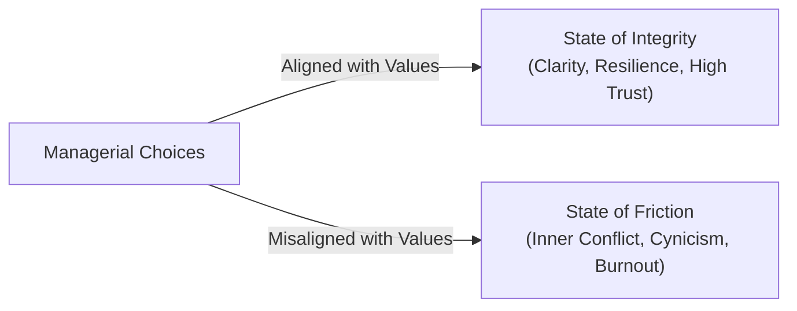

## 📐 Universal Mechanism: Integrity vs. Friction

**Values Congruence** is the degree of behavioral and structural harmony between an individual's authentic internal values, their observable daily resource allocation, and the operating culture of the host enterprise.

$$\mathbf{CONGRUENCE} = \text{Stated Personal Values} \;\iff\; \text{Observable Daily Behavior} \;\iff\; \text{Organizational Reward System}$$

### The Decision-Making Filter & Dual States

Values are the non-negotiable principles you refuse to compromise. They define how you live, not just what you do. Most people inherit values; few consciously choose them.

> [!NOTE] Friction as an Analytical Signal
> Misalignment between stated and lived values is the primary root driver of executive burnout and inner conflict. **Friction is not a nuisance to suppress—it is a diagnostic signal worth heeding.**

### The 3-Step Values Extraction & Testing Protocol

Values are chosen through quiet reflection, but they are tested in hard choices:

1. **Reflect on Proudest Moments**: What core values were you honoring during your peak experiences of fulfillment and accomplishment?
2. **Recall Angriest Moments**: What values were being violated? **Anger is a precise signal of what matters most to you.** When you feel intense indignation at a corporate maneuver or interpersonal interaction, identify the exact boundary that was breached.
3. **Narrow to Your Top 5 Non-Negotiables**: Distill your list into absolute anchors for every storm (e.g., _Integrity, Freedom, Growth, Connection, Courage, Service_).

> [!IMPORTANT] The Daily Executive Audit
> Ask yourself at the close of every business day:
> _"Did my actions today reflect what I say I believe?"_

---

## 🏛️ Multi-Disciplinary Lenses Across the MBA Curriculum

### 1. Organizational Culture & Human Capital Lens (MK 1)

- **Primary Source**: SBM ITB Module 1 & Jennifer Nash (HBR).
- **Core Mechanism**: Values act as an executive decision-making filter. True values are tested exclusively under pressure and resource constraints, not during comfortable quarterly earnings.
- _Discussed in_: [[courses/mk1-organizational-behavior-managing-people/week-01/index|MK 1 Week 01 (Strategizing Your Life)]].

### 2. Supply Chain Governance & Vendor Ethics Lens (MK 4)

- **Primary Mechanism**: Supplier Code of Conduct & Procurement Integrity.
- **Core Insight**: Enterprise values congruence is severely stress-tested in supplier selection. Sacrificing environmental or labor standards to achieve quarterly margin targets creates enterprise-threatening reputational risk.

### 3. State-Owned Enterprise Stewardship (Rabuan Plenary)

- **Indonesian BUMN Context**: Aligning the national **AKHLAK** standard (_Amanah, Kompeten, Harmonis, Loyal, Adaptif, Kolaboratif_) with daily operational KPIs. Without values congruence, top talent migrates away from public sector enterprises into agile private corporations.

---

## 🚀 Action Learning Project (ALP) Application

> [!TIP] BUMN Cultural Diagnosis
> During **ALP Stage 3 (Solution Design)**, audit whether the client BUMN's operational failure stems from technical deficits or a **values misalignment** (e.g. promoting safety and quality on posters while rewarding speed and volume on incentive grids).

---

## 🔗 Contributing Sessions & References

- **MK 1 Lecture**: [[courses/mk1-organizational-behavior-managing-people/week-01/index|MK 1 Week 01: Strategizing Your Life]]
- **Related Tool**: [[concepts/wheel-of-life|The Wheel of Life Diagnostic]]
- **Theorist Profile**: [[entities/jennifer-nash|Jennifer Nash]]
- **Hub**: [[concepts/index|Knowledge Matrix]]
