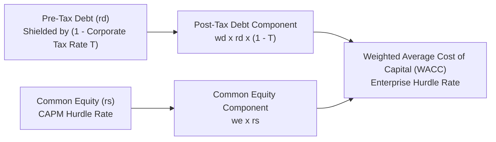

## 📐 Universal Mechanism & Corporate Role

The **Weighted Average Cost of Capital (WACC)** is the aggregate rate of return an enterprise must generate across its total operational asset base to satisfy the return demands of all capital providers (creditors, bondholders, preferred shareholders, and common equity investors).

In corporate financial strategy, WACC functions as the universal **Investment Hurdle Rate**:

- Projects earning a **Return on Invested Capital (ROIC) > WACC** generate **Positive Economic Value Added ($\text{EVA} > 0$)**, expanding intrinsic shareholder wealth.
- Projects earning a **Return on Invested Capital (ROIC) < WACC** destroy shareholder wealth, even if accounting net income appears positive.

---

## 🔢 Mathematical Formulation

$$\mathbf{\text{WACC} = \left[w_d \times r_d \times (1 - T)\right] + \left[w_p \times r_p\right] + \left[w_e \times r_s\right]}$$

Where:

- $w_d, w_p, w_e$: Target capital structure proportions ($w_d + w_p + w_e = 1.0$), computed using **market values** rather than accounting book values.
- $r_d$: Pre-tax yield to maturity on new debt issuance.
- $T$: Statutory corporate income tax rate ($22\%$ in Indonesia), reflecting the **interest tax shield**.
- $r_p$: Cost of preferred stock ($D_p / P_p$).
- $r_s$: Required rate of return on common equity (derived via CAPM: $r_{\text{RF}} + \beta \times \text{MRP}$).

---

## 🏢 Strategic Capital Allocation & Executive Governance

| Strategic Principle                  | Executive Hazard                                                                                  | Governance Prescriptive Rule                                                                                  |
| :----------------------------------- | :------------------------------------------------------------------------------------------------ | :------------------------------------------------------------------------------------------------------------ |
| **Market Value Gearing**             | Using historical book values of equity understates equity weighting and artificially lowers WACC. | Always calibrate capital structure weights ($w_d, w_e$) to secondary capital market prices.                   |
| **Project-Specific Risk Adjustment** | Using a single corporate-wide WACC penalizes safe core projects and rewards speculative bets.     | Adjust WACC upwards for high-beta divisions and downwards for low-risk operational efficiency.                |
| **The Tax Shield Balance**           | Expanding debt lowers WACC via tax deduction, but excessive debt triggers distress risk.          | Optimize capital structure at the inflection point where marginal tax benefits equal marginal distress costs. |

---

## 🔗 Curricular Bridges

- Master Course Note: [[courses/mk2-financial-management-strategy/week-08/index|MK2 Week 08: Risk, Return & Cost of Capital]]
- Empirical Problem Set: [[courses/mk2-financial-management-strategy/week-08/assignment-risk-return-wacc|Estimating Sovereign Risk, Beta & Enterprise WACC]]
- Core Input: [[concepts/capital-asset-pricing-model|Capital Asset Pricing Model (CAPM)]]
