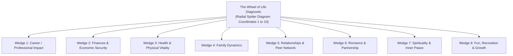

## 📐 Universal Mechanism & Diagnostic Architecture

Originally developed by **Paul J. Meyer** (founder of the Success Motivation Institute, Inc.) and adapted in executive leadership research by **Dr. Jennifer Nash (HBR 2020)**, the **Wheel of Life** is an analytical visual diagnostic designed to evaluate an individual's personal resource allocation and domain satisfaction.

### The Eight Operational Wedges:

1. **Career / Professional Impact**: Sense of achievement, intellectual challenge, autonomy, and contribution to enterprise mission.
2. **Finances**: Wealth preservation, liquidity, freedom from acute debt anxiety, and capital resilience.
3. **Health & Physical Vitality**: Sleep hygiene, stamina, nutrition, cardiovascular health, and stress tolerance.
4. **Family**: Depth and quality of active emotional presence with immediate family and dependents.
5. **Relationships / Friends**: Close, trusting social bonds outside professional hierarchies (the "shore team").
6. **Romance / Partnership**: Intimate partnership, vulnerability, and aligned future vision.
7. **Spirituality / Inner Peace**: Ethical grounding, transcendent purpose, and mental stillness.
8. **Fun, Recreation & Personal Growth**: Unstructured play, hobbies, cognitive decompression, and creative renewal.

---

## 🛠️ Step-by-Step Diagnostic Protocol

1. **Radial Calibration (Scale 1 to 10)**:
   - On each of the eight axes, score your current lived experience from **1 (Severe Dissatisfaction / Neglect)** to **10 (Peak Fulfillment & Thriving)**.
2. **Spider Diagram Mapping**:
   - Connect the plotted coordinates across adjacent axes. A well-integrated life creates a smooth, rounded circle; a compromised life yields an erratic, jagged polygon.
3. **The 3-Micro-Action Restorative Rule**:
   - Identify the 1 to 2 wedges with the lowest satisfaction scores.
   - Formulate and commit to **three concrete micro-actions** executable within 48 hours to restore baseline equilibrium (e.g. scheduling a doctor's checkup, blocking a non-negotiable family dinner, or setting an email-free focus window).

---

## 🏛️ Strategic Lenses Across the MBA Curriculum

### 1. Personal Strategy & Executive Well-Being Lens (MK 1)

- **Primary Source**: [[entities/jennifer-nash|Dr. Jennifer Nash (HBR)]] & SBM ITB Module 1.
- **Strategic Principle**: As in corporate capital rationing, personal cognitive bandwidth and time are strictly finite. Neglecting foundational wedges (Health, Family) creates sudden catastrophic enterprise risks (executive breakdown, cognitive impairment, and non-financial leadership failure).
- _Discussed in_: [[courses/mk1-organizational-behavior-managing-people/week-01/index|MK 1 Week 01 (Strategizing Your Life)]].

### 2. Sustainable Leadership in BUMNs (Rabuan Plenary)

- **Executive Heuristic**: BUMN directorships demand grueling 24/7 operational oversight. The Wheel of Life serves as a quarterly calibration instrument for leaders to prevent burnout while executing high-stakes national strategic mandates.

---

## 🚀 Action Learning Project (ALP) Application

> [!TIP] Team Health & Sustainable Velocity
> Use the **Wheel of Life** as a norming diagnostic during **ALP Phase 1 (Team Chartering)**: Have consulting team members share their personal bandwidth constraints to establish mutual respect for health and family boundaries during intensive client sprints.

---

## 🔗 Contributing Sessions & References

- **Master Lecture Hub**: [[courses/mk1-organizational-behavior-managing-people/week-01/index|MK 1 Week 01: Strategizing Your Life]]
- **Exhaustive Reading Deep-Dive**: [[courses/mk1-organizational-behavior-managing-people/week-01/reading-what-are-your-personal-values|Dr. Jennifer Nash: What Are Your Personal Values? Study Note]]
- **Related Mechanism**: [[concepts/values-congruence|Values Congruence & Executive Friction]]
- **Theorist Profile**: [[entities/jennifer-nash|Dr. Jennifer Nash]]
- **Knowledge Matrix**: [[concepts/index|Core Business Concepts]]
