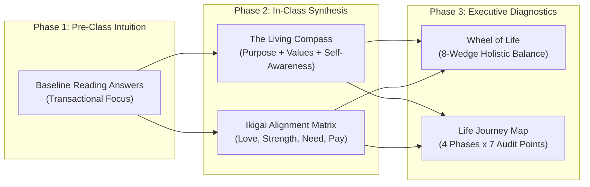
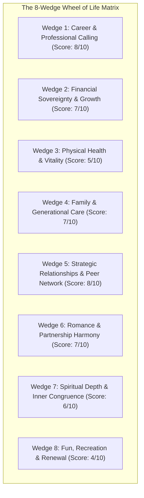
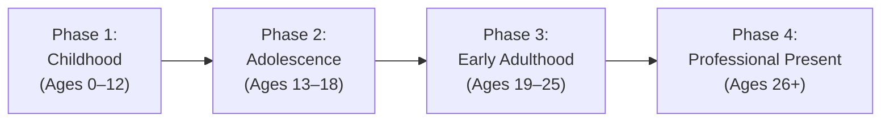

> [!NOTE] Assignment Context & Attribution
>
> - **Course:** MK1 Organizational Behaviour & Managing People — Week 01
> - **Source Prompt:** `archive/courses/mk1/week-01/Group 9 - Post Assignment Week 1.docx`
> - **Reference Attribution:** Group synthesis contributed by **F9 (Class F / Syndicate 9)**; diagnostic toolkits synthesized by **the Portal Maintainer**
> - **Parent Lecture:** [[courses/mk1-organizational-behavior-managing-people/week-01/index|Week 01 Master Lecture Hub]]
> - **Pre-Assignment Reference:** [[courses/mk1-organizational-behavior-managing-people/week-01/assignment-pre-strategizing-life|W01 Pre-Assignment: Core Readings Discussion]]

---

## 📋 Part 1: Official Assignment Prompt & Skim Map

- **Executive Objective:** Deepen individual and syndicate leadership insight by systematically revisiting baseline reading responses using in-class analytical frameworks (The Living Compass, Ikigai, Internal vs. External Self-Awareness), followed by executing the quantitative **Wheel of Life** and chronological **Life Journey Map** diagnostics.
- **Target Deliverable:** Tripartite analytical post-assignment memo: (1) Systematic side-by-side reconstruction of reading answers (Original vs. Revised + "What changed and why"), (2) Executed Wheel of Life scoring and spider analysis, and (3) Complete 4-Phase Life Journey Map audit.

---

## 💡 Part 2: Reference Solution & Framework Revisions

### Reading 1: Annie McKee — "Being Happy at Work Matters"

#### Original Answer (Pre-Assignment Baseline)

> We believe that a sense of purpose is the hardest element for an organization to deliver without it feeling manufactured. McKee argues that employees want to feel that their work matters and that their contributions help achieve something important, not merely organizational or financial targets. In practice, however, employees may understand what they are paid to do without necessarily understanding why their work matters beyond the transaction itself. This can be seen in large organizations such as state-owned enterprises. Messages such as _"contributing to Indonesia"_ may sound meaningful at the corporate level, but they do not automatically create a sense of purpose for every employee. If employees cannot see a clear connection between their daily work and the wider impact on customers, communities, or national development, the purpose can feel like a slogan rather than something personally meaningful. Therefore, the challenge is not simply to communicate the organization’s purpose, but to help employees experience how their own contribution is connected to it.

#### Revised Answer (Using In-Class Frameworks)

> We still believe that a sense of purpose is the hardest element for an organization to create without it feeling manufactured, because purpose cannot simply be communicated from the top; it needs to be personally understood and internalized by employees.
>
> Utilizing the **Purpose, Values, and Self-Awareness Framework (The Living Compass)**:
>
> 1. **Purpose** helps employees understand why the enterprise exists and why their labor matters beyond short-term EBITDA or budget targets.
> 2. **Values** determine how that purpose is lived through everyday decisions, resource allocations, and interpersonal behaviors, ensuring that corporate purpose is authenticated by operational choices rather than decorative PR slogans.
> 3. **Self-Awareness** allows employees to understand their own internal motivations, signature strengths, and sources of personal meaning, identifying an authentic psychological connection with the organization’s overarching mandate.
>
> Without this tripartite alignment, an institutional statement such as _"contributing to Indonesia"_ remains an abstract corporate talking point rather than a lived emotional reality.

#### What Changed, and Why?

- **What Changed:** The core conclusion was maintained, but the explanatory mechanism was upgraded from narrative observation to the formal **Purpose–Values–Self-Awareness** framework.
- **Why:** The revision articulates that authentic engagement requires a multi-level linkage: employees must not only comprehend enterprise goals cognitively, but must witness those values enacted in daily micro-decisions and possess sufficient self-awareness to align their personal values with the firm’s broader mission.

---

### Reading 2: Nick Craig & Scott Snook — "From Purpose to Impact"

#### Original Answer (Pre-Assignment Baseline)

> Craig and Snook argue that discovering purpose is difficult to do alone because purpose is often found in recurring patterns across our strengths, values, passions, and crucible moments. Since we are too close to our own experiences, we may fail to recognize these patterns objectively. Trusted friends and colleagues can therefore act as “mirrors,” helping us see qualities and motivations that may be clearer to others than to ourselves. This matches our experience because when thinking about career direction alone, we tend to focus on positions or achievements, while feedback from others can help reveal the type of contribution we consistently want to make. Therefore, others do not determine our purpose, but help us recognize and articulate it more clearly.

#### Revised Answer (Using In-Class Frameworks)

> Craig and Snook emphasize that external social expectations, legacy momentum, and unexamined blind spots in our autobiographical narrative make purpose almost impossible to discover alone.
>
> Integrating in-class frameworks:
>
> 1. **Internal vs. External Self-Awareness (The Dual Mirror)**: While internal reflection clarifies personal passions, trusted peers provide external self-awareness—revealing how others actually experience our leadership and identifying recurring strengths that we take for granted.
> 2. **The Ikigai Diagnostic**: Trusted external mirrors help test our leadership direction against the four converging zones: what we love, what we are good at, what the world needs, and what we can sustainably be paid for.
> 3. **The Actionable Purpose Statement**: Synthesizing these insights allows leaders to move beyond generic clichés (_"help people succeed"_) toward a precise, actionable formula:
>    $$\mathbf{\text{"I exist to } [\text{action}] \text{ so that } [\text{impact}].\text{"}}$$
>
> Committing to test this statement through an immediate, concrete micro-action converts abstract self-reflection into measurable organizational impact.

#### What Changed, and Why?

- **What Changed:** The revised analysis differentiates internal introspection from external feedback loops, integrates the Ikigai convergence criteria, and introduces the operational purpose formula.
- **Why:** Solitary introspection often devolves into vanity or role-based fixation (desiring titles or salary grades). Grounding purpose in the dual-mirror dynamic and the Ikigai formula ensures that purpose is both personally authentic and economically and socially grounded.

---

### Reading 3: Alex Liu — "Ikigai Leadership Transformation"

#### Original Answer (Pre-Assignment Baseline)

> Leaders are expected not only to ensure that company targets are achieved, but also to make sure that those achievements remain aligned with the organization’s purpose and create a positive impact on society and other stakeholders. This shows that the definition of good leadership is shifting from purely financial performance toward a broader focus on values, culture, social responsibility, and trust. The article describes this as a move from authority-based leadership to a more values-based leadership model, where authenticity and accountability are demonstrated through actions. Therefore, leadership success should be measured in a balanced way, not only by profit or business results, but also by whether the organization’s purpose is genuinely carried out. If leaders focus only on the numbers, the company may perform well financially while its culture, employee engagement, and stakeholder trust quietly deteriorate.

#### Revised Answer (Using In-Class Frameworks)

> Kearney’s empirical finding—a **4.75x surge in non-financial CEO ousters**—demonstrates that enterprise leadership has permanently transitioned from an authority-and-numbers model to a holistic stakeholder-and-values model.
>
> Analyzed through the **Ikigai Enterprise Architecture**:
>
> - Sustainable corporate stewardship exists only at the precise intersection of **economic viability** (what you can be paid for), **distinct organizational competence** (what you are good at), **employee passion and resonance** (what you love), and **stakeholder legitimacy** (what the world needs).
> - When an executive team over-indexes exclusively on the _"Paid For"_ quadrant (relentless quarterly EBITDA extraction, aggressive financial engineering) while ignoring the _"World Needs"_ and _"Love/Resonance"_ quadrants, the enterprise accumulates severe cultural and ethical debt.
> - Toxic workplace norms, suppressed employee voice, and environmental/social neglect inevitably trigger catastrophic whistleblower crises, talent exoduses, and regulatory intervention. Delivering the numbers is a prerequisite, but running the numbers while ignoring cultural and social resonance is now recognized as fiduciary negligence.

#### What Changed, and Why?

- **What Changed:** The reasoning was anchored directly into the four quadrants of the Ikigai framework, demonstrating how structural imbalance across the quadrants creates corporate vulnerability.
- **Why:** The Ikigai model provides an analytical architecture showing that financial profitability without ethical and social alignment is unsustainable; neglecting any quadrant destabilizes the enterprise system.

---

### Reading 4: Jennifer Nash — "What Are Your Personal Values?"

#### Original Answer (Pre-Assignment Baseline)

> Organic life experiences can reveal our personal values more deeply because they show how we actually respond to important events, not just what we say matters to us. In the Journey Map, Nash asks us to compare what we felt and believed at the time of an event with what we feel and believe now. This before-and-after reflection helps us identify how certain experiences have shaped our decisions, priorities, and ways of thinking over time. Values that emerge from lived experiences are often more organic because they are revealed through moments of fulfillment, frustration, pride, disappointment, or difficulty. These emotional and behavioral patterns can show what truly matters to us. In contrast, a values checklist may lead us to choose words based on what sounds desirable, who we want to become, or how we want others to see us. Therefore, the Journey Map can help distinguish between aspirational values and lived values, making it a more authentic way to understand our actual personal values.

#### Revised Answer (Using In-Class Frameworks)

> Nash’s Journey Map reveals authentic personal values because it operationalizes **Internal Self-Awareness** through retrospective empirical evidence rather than aspirational self-reporting.
>
> Integrating in-class methodology:
>
> 1. **Temporal Emotional Dissonance**: By contrasting beliefs and emotions _at the moment of a crucible event_ with beliefs and emotions _today_, leaders detect underlying cognitive scripts and moral boundaries.
> 2. **Proudest vs. Angriest Moments**: Peak moments of professional fulfillment and pride reveal values being actively honored; conversely, moments of acute fury, burnout, or betrayal expose non-negotiable boundaries being violated.
> 3. **Transition to [[concepts/identity-based-living|Identity-Based Living]]**: Instead of asking _"What achievements do I want to accumulate?"_, the Journey Map forces the deeper executive question: _"Who do I want to become?"_
> 4. **Connecting Values to Purpose**: Once lived non-negotiables are proven from personal crucibles, they feed directly into the Ikigai compass and the canonical purpose formulation:
>    $$\mathbf{\text{"I exist to } [\text{action}] \text{ so that } [\text{impact}].\text{"}}$$

#### What Changed, and Why?

- **What Changed:** The revision links the Journey Map protocol directly to internal self-awareness, emotional diagnostic markers (pride vs. anger), identity-based living, and the Living Compass purpose engine.
- **Why:** Identifying values is not an isolated academic checklist exercise; it is the foundational data set that determines how an executive navigates crises, allocates time, and leads organizations.

---

## 🛠️ Part 3: Reconstructed Executive Diagnostic Toolkits

### Toolkit 1: The Wheel of Life Diagnostic (Paul J. Meyer & Jennifer Nash)

The Wheel of Life provides a 360-degree audit of personal and professional balance across eight interdependent life dimensions. Each wedge is evaluated on an integer scale from **1 (Severe Deficit / Critical Crisis)** to **10 (Peak Fulfillment / Exemplary Mastery)**.

#### Diagnostic Scoring Ledger & Gap Analysis

| Wedge Dimension         | Self-Score (1–10) | Current Operating Reality                                                                                                       | Desired 12-Month Target | Immediate 48-Hour Micro-Action                                                            |
| :---------------------- | :---------------: | :------------------------------------------------------------------------------------------------------------------------------ | :---------------------: | :---------------------------------------------------------------------------------------- |
| **1. Career & Calling** |    **8 / 10**     | High strategic engagement in MBA curriculum and institutional leadership; strong alignment with long-term aspirations.          |       **9 / 10**        | Schedule monthly mentorship cadence with senior executive sponsor.                        |
| **2. Finances**         |    **7 / 10**     | Stable enterprise income; disciplined savings, but capital allocation across diversified equity/fixed income needs rebalancing. |       **8 / 10**        | Automate monthly index fund allocation and build emergency liquidity buffer.              |
| **3. Physical Health**  |    **5 / 10**     | Chronic sleep deprivation (under 6 hours/night); irregular cardiovascular exercise due to travel and coursework load.           |       **8 / 10**        | Lock in 30-minute morning cardio sessions 3x/week and enforce 11:00 PM digital curfew.    |
| **4. Family**           |    **7 / 10**     | Meaningful emotional bond; however, physical presence during high-intensity project weeks is compromised.                       |       **8 / 10**        | Block Sunday mornings as protected, phone-free family time.                               |
| **5. Relationships**    |    **8 / 10**     | Highly supportive MBA cohort network (F9 syndicate); deep peer-mirroring and professional trust.                                |       **9 / 10**        | Organize quarterly syndicate peer-coaching debrief outside classroom.                     |
| **6. Romance**          |    **7 / 10**     | Mutual respect and emotional partnership; occasional strain from dual-career scheduling friction.                               |       **8 / 10**        | Plan dedicated bi-weekly date night with zero work discussion.                            |
| **7. Spirituality**     |    **6 / 10**     | Baseline reflective practice; lacks structured daily contemplation or mindfulness routine.                                      |       **8 / 10**        | Commit to 10 minutes of daily morning reflective journaling.                              |
| **8. Fun & Renewal**    |    **4 / 10**     | **Critical Deficit:** Guilt-driven leisure; constant work encroachment into personal downtime leading to cognitive fatigue.     |       **7 / 10**        | Schedule one full guilt-free recreational day per month with complete work disconnection. |

> [!TIP] Analytical Interpretation
> A wheel with uneven scores (e.g., 8s in Career and Network paired with a 4 in Renewal and 5 in Health) creates a **jagged, bumpy ride**. Long-term executive performance collapses when physical vitality and psychological renewal are cannibalized to subsidize professional throughput.

---

### Toolkit 2: The 4-Phase Life Journey Map

The Life Journey Map audits pivotal autobiographical crucibles across four developmental phases, analyzing how emotional interpretations evolve and uncovering unconscious cognitive limiting beliefs.

#### Longitudinal Crucible Audit Matrix

| Life Phase & Age                           | Event / Crucible Name                        | Salience & Narrative Context                                                                                                                                  | Belief Formed Then                                                                                   | Emotion Experienced Then                          | Emotion Experienced Now                                                                                         | Re-framed Belief Today                                                                                                     |
| :----------------------------------------- | :------------------------------------------- | :------------------------------------------------------------------------------------------------------------------------------------------------------------ | :--------------------------------------------------------------------------------------------------- | :------------------------------------------------ | :-------------------------------------------------------------------------------------------------------------- | :------------------------------------------------------------------------------------------------------------------------- |
| **Phase 1: Childhood** _(Age 10)_       | **Family Business Downturn**                 | Witnessed parents navigate acute cash-flow insolvency during regional economic crisis; family retail store struggled against modern supermarkets.             | _"Financial instability is terrifying; I must achieve total economic control and self-reliance."_    | Anxiety, helplessness, fear of scarcity.          | Deep gratitude for parents' resilience and sacrifice; empathy for working-class struggles.                      | **Financial discipline is a vehicle for family security and social service, not an obsession driven by fear.**             |
| **Phase 2: Adolescence** _(Age 16)_     | **National Academic Competition Defeat**     | Prepared for six months for a national science olympiad; made a critical arithmetic error in final round and missed the podium.                               | _"My worth is strictly tied to flawless public performance; second place is total failure."_         | Crushing shame, embarrassment, social withdrawal. | Amusement and healthy perspective on teenage ego; recognition of grit developed through preparation.            | **Excellence is a continuous habit of learning, not a fragile identity dependent on singular external validation.**        |
| **Phase 3: Early Adulthood** _(Age 22)_ | **Undergraduate Capstone Leadership Crisis** | Led a multi-disciplinary engineering project where two team members abandoned deliverable 48 hours before deadline; executed solo marathon to complete build. | _"If I want something done correctly, I cannot trust others; I must do it myself."_                  | Intense anger, betrayal, physical exhaustion.     | Mature appreciation for team dynamics; realization that poor delegation and vague boundaries caused the crisis. | **True leadership is building psychological safety and clear mutual accountability, not martyrdom or micromanagement.**    |
| **Phase 4: Present** _(Age 29)_         | **Cross-Functional BUMN Strategic Pivot**    | Assigned to lead an ambiguous digitalization task force facing entrenched bureaucratic resistance from senior departmental heads.                             | _"Bureaucracies are unchangeable; my youth and lack of formal title render my voice insignificant."_ | Frustration, cynicism, cognitive friction.        | Professional composure, strategic patience, and curiosity about organizational politics.                        | **Transformational change occurs through coalition-building, emotional intelligence, and proving small operational wins.** |

---

## 🔬 Part 4: Methodological Rigor & Classroom Cold-Call Strategy

| Pedagogical Dimension     | Surface Execution                                                                        | Rigorous Executive Mastery (F9 Standard)                                                                                                            |
| :------------------------ | :--------------------------------------------------------------------------------------- | :-------------------------------------------------------------------------------------------------------------------------------------------------- |
| **Wheel of Life Scoring** | Assigning arbitrary subjective scores without behavioral evidence or action commitments. | Benchmarking scores against concrete calendar audits and tying each deficit to an immediate 48-hour micro-behavior.                                 |
| **Journey Map Analysis**  | Treating past crucibles as a nostalgic chronological diary.                              | Decoding cognitive limiting beliefs (_"I must do it alone"_) and actively reframing them to unlock resonant team leadership.                        |
| **Identity vs. Strategy** | Viewing career strategy as a list of corporate milestones (titles, salary bands).        | Operating from **Identity-Based Living**: defining the non-negotiable character traits required so that strategic success is the natural byproduct. |

- **Faculty Angle (Classroom Cold-Call Defense):**
  - _"How does dissecting childhood or academic vulnerabilities make someone a more effective corporate director or plant manager in an Indonesian enterprise?"_
  - **Recitation Defense Script:**
    > "Executive failure rarely stems from technical incompetence; it stems from unexamined behavioral triggers and unmanaged ego defenses. When a leader does not understand their formative crucibles, childhood scarcity triggers or past betrayals manifest in the boardroom as micromanagement, risk aversion, or defensive authoritarianism. As Craig, Snook, and Nash demonstrate, understanding one's own autobiographical narrative builds the internal self-awareness necessary to lead with psychological safety, authentic empathy, and calm executive presence."

---

## 🔗 Knowledge Graph & Curriculum Bridges

- Return to **[[courses/mk1-organizational-behavior-managing-people/week-01/index|Week 01 Master Lecture Hub]]**
- Antecedent Assignment: **[[courses/mk1-organizational-behavior-managing-people/week-01/assignment-pre-strategizing-life|W01 Pre-Assignment: Core Readings Discussion]]**
- Linked Diagnostic Concepts:
  - [[concepts/wheel-of-life|The Wheel of Life Diagnostic Matrix]]
  - [[concepts/self-awareness|Internal vs. External Self-Awareness (The Dual Mirror)]]
  - [[concepts/identity-based-living|Identity-Based Living (Who to Become)]]
  - [[concepts/ikigai|The Ikigai Alignment Model]]
