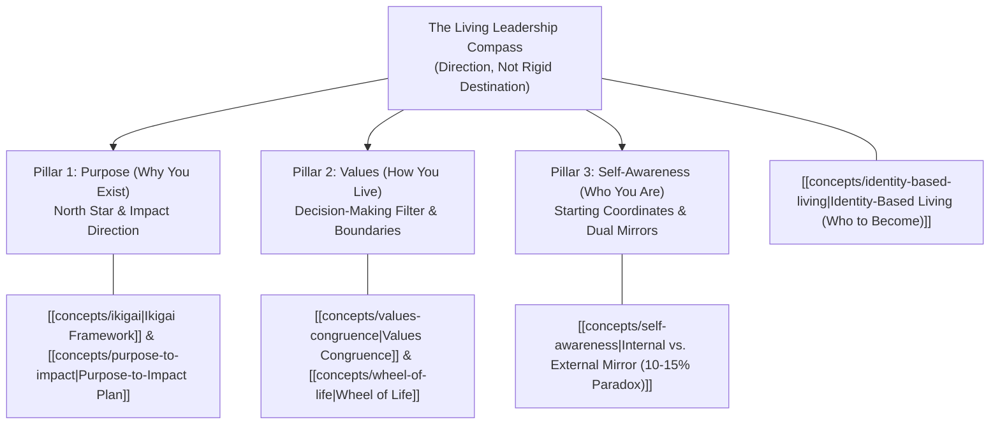
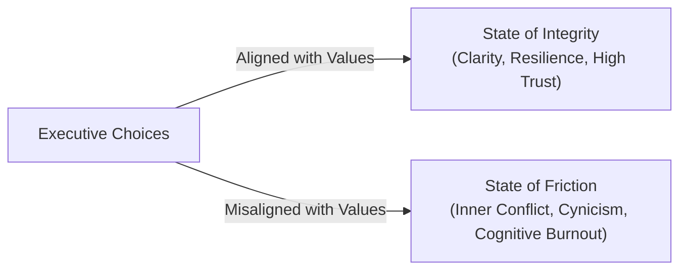
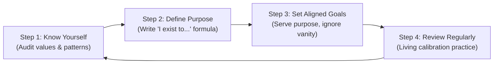

## 🎯 Act 1: The Executive Dilemma — The Autopilot Trap

We meticulously architect multi-billion rupiah capital expenditure budgets. We map complex corporate supply chains down to the hour. We spend weeks planning overseas vacations and project milestones with obsessive precision.

Yet when it comes to our actual lives, we routinely default to chance. We rarely stop to ask what we actually want, resulting in a career and life lived on autopilot—shaped almost entirely by others' expectations, organizational inertia, and legacy momentum.

| The Planning Paradox                                                                                                           | The Lived Reality                                                                                                                                                                  |
| :----------------------------------------------------------------------------------------------------------------------------- | :--------------------------------------------------------------------------------------------------------------------------------------------------------------------------------- |
| **Obsessive Enterprise Control**: We heavily plan careers, vacations, budgets, and operational targets with extreme precision. | **Unexamined Default Drift**: We leave our lives to default. We fail to define our own criteria for success, waking up to find we climbed a ladder leaning against the wrong wall. |

> [!CAUTION] The Executive Cost of Unexamined Drift
> Research by **Kearney** reveals that between 2011–2016 and 2016–2021, involuntary **CEO departures triggered by non-financial failures** (such as toxic workplace cultures, ethical blindness, and social irresponsibility) **rose 4.75 times over**.
> Leaders who excel purely at running the numbers while their internal compass silently collapses are more vulnerable than ever before.

Intentional living starts with one courageous decision: **to stop living by default and start living by design.** In high-stakes enterprise environments—particularly across Indonesian state-owned enterprises (BUMN) and national conglomerates—leadership effectiveness does not begin with structural authority or title power. It begins with **executive self-governance**.

---

## 🧭 Act 2: Theoretical Mechanism — The Living Compass

Life strategy isn’t a rigid map, but a **living compass** you continuously calibrate. It is a direction, not a fixed destination.

$$\mathbf{[\text{Purpose (Why)}] + [\text{Values (How)}] + [\text{Self-Awareness (Who)}] = \text{A Life Lived on Your Own Terms}}$$

### Pillar 1: Discovering Purpose — The North Star (Why You Exist)

Purpose is the definitive "why" behind everything you do—the fundamental reason you get out of bed in the morning. It transcends external approval, title promotion, income, or superficial achievement.

> [!NOTE] Scientifically Proven Resilience
> Epidemiological and psychological research proves that individuals with a clear sense of purpose live longer, report higher baseline happiness, and recover significantly faster from professional and personal setbacks.

1. **The [[concepts/ikigai|Ikigai Framework]]**:
   Originating from Japan's Heian period, _Ikigai_ ("reason for being") maps executive purpose to the exact convergence of four zones:
   - What you genuinely **love** (activities that energize and excite you)
   - What you are naturally **good at** (natural strengths and skills)
   - What the world desperately **needs** (problems you are drawn to solve)
   - What you can sustainably get **paid for** (where passion meets economic viability)
   - _Your reason for being lives exclusively where all four zones overlap._

2. **The [[concepts/purpose-to-impact|Purpose-to-Impact]] Engine ([[entities/nick-craig-scott-snook|Nick Craig & Scott Snook, HBR]])**:
   - Fewer than **20% of leaders** possess a distilled, actionable sense of individual purpose. When asked, most fall back on generic platitudes: _"Empower my people"_ or _"Ensure success"_.
   - Authentic purpose must be simple, personal, and actionable:
     $$\mathbf{\text{"I exist to } [\text{action}] \text{ so that } [\text{impact}].\text{"}}$$
   - _Example_: _"I exist to inspire others so that they believe in their own potential."_ Write yours today; don’t wait for perfection—start with what feels true right now.

---

### Pillar 2: Defining Core Values — The Decision-Making Filter (How You Live)

Values are the non-negotiable principles you refuse to compromise. They define **how you live**, not just what you do. Most people inherit values unthinkingly; few consciously choose and calibrate them.

> [!IMPORTANT] Friction as an Analytical Diagnostic
> Misalignment between stated and lived values is the root of most inner conflict. When you feel executive friction, do not suppress it—**friction is a signal worth heeding.**

#### The 3-Step Values Extraction & Testing Protocol

Values are chosen through reflection, but they are tested in hard choices:

1. **01 | Reflect on Proudest Moments**: What core values were you honoring during your peak life experiences of fulfillment and accomplishment?
2. **02 | Recall Angriest Moments**: What values were being violated? **Anger is a precise signal of what matters most to you.**
3. **03 | Narrow to Your Top 5 Non-Negotiables**: Distill your list into absolute anchors for every storm (e.g., _Freedom, Growth, Integrity, Connection, Courage, Service_).

- **The Daily Calibration**: Ask yourself at the close of every business day: _"Did my actions today reflect what I say I believe?"_

#### Diagnostic Instruments:

- **The [[concepts/wheel-of-life|Wheel of Life]] (Paul J. Meyer & [[entities/jennifer-nash|Jennifer Nash, HBR]])**:
  Dividing life into 8 core segments (_Career, Finances, Health, Family, Relationships, Spirituality, Fun, Romance_) and scoring each from 1 to 10 on a spider diagram to expose severe imbalances.
- **The Life Journey Map**:
  Auditing key crucible decisions across 4 developmental phases (_Childhood, Adolescence, Early Adulthood, Present_) across 7 emotional and cognitive data points to uncover limiting beliefs (_"I must control everything"_ $\rightarrow$ micromanagement).

---

### Pillar 3: Cultivating Self-Awareness — The Foundation (Who You Are)

You cannot strategize a life or lead an enterprise you do not accurately understand. Self-awareness is the foundation of everything—it begins with ruthless honesty about who you actually are, your recurring patterns, your triggers, and the stories you tell yourself, not who you wish you were.

> [!IMPORTANT] The 10–15% Self-Awareness Paradox
> While **85–90% of people lack genuine self-awareness despite firmly believing they possess it**, empirical research reveals that **only 10% to 15% have developed real self-awareness** through active reflection and objective feedback loops.

#### The Two Mirrors of Self-Awareness

True self-awareness requires looking into two very different mirrors:

1. **The Inner Mirror (Internal Self-Awareness)**:
   - How clearly do you see your own thoughts, emotions, and motivations? This mirror is honest, unfiltered, and deeply revealing.
2. **The Outer Mirror (External Self-Awareness)**:
   - How accurately do you understand how others actually experience your leadership? This mirror is often surprising, sometimes uncomfortable, and always useful.

- _Closing the gap between these two mirrors is where real executive growth lives._

#### The Active Toolkit for Deepening Self-Awareness

1. **Discovery Journaling**: Write to _discover what you think_—not just to record what happened.
2. **Proactive Feedback Loops**: Ask trusted peers and mentors: _"What do you see in me that I might not see?"_
3. **Personality Frameworks as Mirrors**: Use instruments like MBTI, Enneagram, or CliftonStrengths as _mirrors for reflection_, not as fixed labels.
4. **Mindfulness & The Stimulus-Response Gap**: Practice pausing before reacting. Train yourself to observe and expand the brief gap between a stimulus and your managerial response.

---

### 🔄 The Blueprint: Integrating the Three Pillars

Integrating Purpose, Values, and Self-Awareness creates an enduring 4-step life strategy lifecycle:

1. **Step 1 — Know Yourself**: Audit your values, strengths, and behavioral patterns with radical honesty.
2. **Step 2 — Define Your Purpose**: Write a simple, specific, and deeply personal purpose statement (`I exist to [action] so that [impact]`).
3. **Step 3 — Set Aligned Goals**: Establish goals that honor your values and serve your purpose—not society's or peers' expectations.
4. **Step 4 — Review Regularly**: Treat your strategy as a living practice, not a one-time event. Return and calibrate often.

---

### 🦋 [[concepts/identity-based-living|Identity-Based Living]]: Beyond the Glorified To-Do List

> [!CAUTION] The Limits of Goal-Setting
> **Strategy without identity is just a glorified to-do list.**

The question that changes everything is not: _"What do I want to achieve?"_
It is:
$$\mathbf{\text{"Who do I want to become?"}}$$

This is **[[concepts/identity-based-living|Identity-Based Living]]**. In enterprise leadership, you must become the person for whom strategic excellence, ethical fortitude, and resonant collaboration are the natural, inevitable outcome.

---

### Pillar 4: Organizational Well-Being & Resonant Leadership ([[entities/annie-mckee|Annie McKee, HBR]])

For decades, traditional management dogma claimed that _"work is not personal"_ and emotions have no place in corporate strategy. Neuroscience and organizational data decisively debunk this myth:

- **Gallup Engagement Realities**: Only **30% of employees are actively engaged**; 20% are actively disengaged (sabotaging projects and infecting colleagues).
- **The Three Pillars of Resonant Engagement**:
  1. **A Meaningful Vision of the Future**: Employees must clearly see how their personal aspirations link to the enterprise roadmap.
  2. **A Sense of Purpose**: Except for a tiny minority at the very top, pure "shareholder value" fails to inspire sustained discretionary effort.
  3. **Resonant Workplace Relationships**: People join organizations, but they leave dissonant, toxic managers. Thought drives emotion, and emotion dictates cognitive throughput.

---

## 🏢 Act 3: Managerial Crucible — Indonesian BUMN & Enterprise Context

Translating these frameworks into the Indonesian corporate landscape requires navigating distinct structural challenges:

1. **High Power-Distance Dynamics**:
   In traditional Indonesian corporate hierarchies (_Bapakisme_), subordinates frequently hesitate to deliver critical feedback upward. Executives without deliberate external self-awareness mechanisms risk operating in echo chambers, mistaking deferential silence for operational alignment.
2. **AKHLAK Values Integration**:
   BUMN leaders are mandated to operationalize _Amanah, Kompeten, Harmonis, Loyal, Adaptif, dan Kolaboratif_. When leaders treat these as marketing slogans rather than daily decision filters, workforce cynicism escalates. Real leadership values are revealed in budget tradeoffs, promotion decisions, and crisis management.
3. **The Executive Identity Shift**:
   Transitioning from tactical management (_"What goals must I hit this quarter?"_) to strategic stewardship (_"Who do I need to become so that our organizational objectives are the inevitable outcome?"_).

---

## 📝 Act 4: Group Discussion Debrief & Pre-Assignment Synthesis

During this module's seminar, study groups examine four foundational readings:

### Reading 1: "Being Happy at Work Matters" ([[entities/annie-mckee|Annie McKee]], HBR 2014)

> 📖 **Deep-Dive Study Note**: [[courses/mk1-organizational-behavior-managing-people/week-01/reading-being-happy-at-work-matters|Annie McKee on Affective Neuroscience & Resonant Leadership]]

- **Discussion Prompt**: McKee argues engagement requires vision, purpose, and resonant relationships. Which is hardest for a modern enterprise to deliver without feeling manufactured?
- **Debrief Rationale**: Relationships are hardest to manufacture. Corporate HR can publish visionary slide decks and mission statements, but authentic, psychological safety in direct reporting relationships cannot be mandated through top-down policy.

### Reading 2: "From Purpose to Impact" ([[entities/nick-craig-scott-snook|Nick Craig & Scott Snook]], HBR 2014)

> 📖 **Deep-Dive Study Note**: [[courses/mk1-organizational-behavior-managing-people/week-01/reading-from-purpose-to-impact|Craig & Snook on Purpose-to-Impact Architecture & Executive Crucibles]]

- **Discussion Prompt**: Why is it nearly impossible to uncover your purpose alone?
- **Debrief Rationale**: Human beings are blind to their own signature strengths and recurring patterns. Trusted peers serve as external mirrors, highlighting the underlying themes in our life stories that we dismiss as ordinary.

### Reading 3: "Ikigai Can Transform Leadership" (Alex Liu, WEF / Kearney)

> 📖 **Deep-Dive Study Note**: [[courses/mk1-organizational-behavior-managing-people/week-01/reading-ikigai-leadership-transformation|Alex Liu on Kearney's 4.75x CEO Non-Financial Ouster Study & Enterprise Ikigai]]

- **Discussion Prompt**: What is the leadership risk of running the financial numbers brilliantly while non-financial factors quietly deteriorate?
- **Debrief Rationale**: The 4.75x surge in non-financial CEO ousters demonstrates that stakeholders, boards, and younger workforces now evaluate culture, governance ethics, and social responsibility as existential enterprise risks.

### Reading 4: "What Are Your Personal Values?" ([[entities/jennifer-nash|Jennifer Nash]], HBR 2020)

> 📖 **Deep-Dive Study Note**: [[courses/mk1-organizational-behavior-managing-people/week-01/reading-what-are-your-personal-values|Dr. Jennifer Nash on the 8-Wedge Wheel of Life & Life Journey Map Protocol]]

- **Discussion Prompt**: Why does the Life Journey Map reveal more about values than circling words on an HR checklist?
- **Debrief Rationale**: Checklists reflect aspirational ideals (who we wish we were). A chronological journey map audits actual crucible choices made under stress, exposing real priorities and limiting beliefs.

---

### 📖 The Concluding Leadership Provocation

Strategizing your life is not a finite destination; it is a daily discipline of showing up as your most intentional self. No perfect plan is required—only a clear direction and the courage to begin.

> [!TIP] The Executive Life Audit
> _"If your life were a published corporate biography, would you be proud of the chapter you are writing right now?"_

---

## 📚 Required Academic Readings & In-Depth Satellites

To preserve complete academic depth, each foundational reading has been ingested as an exhaustive standalone study note with complete worksheets, case studies, and exhibits:

| Document Title                                          | Author / Institution                                                   | Core Methodological Contribution                                                                                                                             | In-Depth Study Note                                                                                                                 |
| :------------------------------------------------------ | :--------------------------------------------------------------------- | :----------------------------------------------------------------------------------------------------------------------------------------------------------- | :---------------------------------------------------------------------------------------------------------------------------------- |
| **From Purpose to Impact**                              | **Nick Craig & Scott Snook** _Authentic Leadership Institute & HBS_ | 7-stage Purpose-to-Impact architecture; Richard's sailing procurement case; Heineken USA & Unilever executive crucibles; Bad-to-Good purpose table.          | [[courses/mk1-organizational-behavior-managing-people/week-01/reading-from-purpose-to-impact\|Open Craig & Snook Deep-Dive]]        |
| **What Are Your Personal Values?**                      | **Dr. Jennifer Nash** _Deloitte & Fortune 50 Coach_                 | Complete 8-wedge Wheel of Life scoring diagnostic; 4-phase Life Journey Map with 7 mandatory audit points; cognitive limiting beliefs reprogramming.         | [[courses/mk1-organizational-behavior-managing-people/week-01/reading-what-are-your-personal-values\|Open Jennifer Nash Deep-Dive]] |
| **Being Happy at Work Matters**                         | **Dr. Annie McKee** _PennCLO & Teleos Institute_                    | Neuroscience of emotional contagion (Davidson, Ramachandran); Gallup 30% engagement bell curve; 3 universal pillars of resonant leadership.                  | [[courses/mk1-organizational-behavior-managing-people/week-01/reading-being-happy-at-work-matters\|Open Annie McKee Deep-Dive]]     |
| **What is Ikigai and How Can It Transform Leadership?** | **Alex Liu** _Chairman Emeritus, Kearney (WEF)_                     | Kearney study showing 4.75x surge in non-financial CEO ousters; enterprise Purpose Gap; reconfiguring supply chains and treating people as renewable energy. | [[courses/mk1-organizational-behavior-managing-people/week-01/reading-ikigai-leadership-transformation\|Open Alex Liu Deep-Dive]]   |

---

## 📂 Primary Source Media & Digital Archives

Access the official course assets and high-resolution masterclass materials:

| Material Title                                          |      Media Type       | Direct Cloud Repository                                                                                                    |
| :------------------------------------------------------ | :-------------------: | :------------------------------------------------------------------------------------------------------------------------- |
| **Week 1 In-Class Masterclass: Strategizing Your Life** | Presentation (`.pdf`) | `raw/courses/mk1/week-01/Week 1 Strategizing Your Life.pdf` (Danantara / Kementerian BUMN / SBM ITB)                       |
| **Week 1 Explainer Video: Strategizing Your Life**      |    Video (`.mp4`)     | [Stream / Download Video](https://drive.google.com/file/d/1geGKvItJJ_WeYx9bE1N3ReyvMDM7v5MS/view?usp=sharing)              |
| **Week 1 Masterclass Slide Deck**                       |    Slides (`.pdf`)    | [Download Official Slides](https://drive.google.com/file/d/1XR6mQi-kQyL2UzLLAHk0J0IlYVR6O06B/view?usp=sharing)             |
| **Being Happy at Work Matters** (Annie McKee)           |      HBR Article      | [View HBR Reading](https://drive.google.com/file/d/1ogMdK091xE1pzUtN6pXilIhE_R20eFjr/view?usp=classroom_web&authuser=0)    |
| **From Purpose to Impact** (Craig & Snook)              |      HBR Article      | [View HBR Reading](https://drive.google.com/file/d/1T-soCmXGzg7lhGkF-upGrPrlssDx57L4/view?usp=classroom_web&authuser=0)    |
| **Ikigai Leadership Transformation** (Alex Liu)         |      WEF Article      | [View WEF Reading](https://drive.google.com/file/d/1rGY1hsvSgbCPD67BLnHVft1VLc4b8JaB/view?usp=classroom_web&authuser=0)    |
| **What Are Your Personal Values?** (Jennifer Nash)      |      HBR Article      | [View HBR Reading](https://drive.google.com/file/d/1ey4PoDrc8w1xYJJvKaWj_L_aE5CL_EzT/view?usp=classroom_web&authuser=0)    |
| **Pre-Assignment Discussion Guide**                     |     SBM ITB Brief     | [View Pre-Assignment](https://drive.google.com/file/d/1U-LD2ZjtbiF6RmafHQepRJcuxhQNJwyW/view?usp=classroom_web&authuser=0) |
| **The Wheel of Life Diagnostic Diagram**                |   Diagram (`.jpeg`)   | [View Wheel of Life](https://drive.google.com/file/d/1clZVeWuOxm7aMrlW7x2tU73CgnfEofjK/view?usp=classroom_web&authuser=0)  |
| **Life Journey Map Framework**                          |   Diagram (`.jpeg`)   | [View Journey Map](https://drive.google.com/file/d/1-06QzQ9zvta8cV8iMtdV_FY6sXme3yX5/view?usp=classroom_web&authuser=0)    |

---

## 🔗 Knowledge Graph & Curriculum Bridges

- **Dedicated In-Depth Reading Satellites**:
  - [[courses/mk1-organizational-behavior-managing-people/week-01/reading-from-purpose-to-impact|Craig & Snook: From Purpose to Impact]]
  - [[courses/mk1-organizational-behavior-managing-people/week-01/reading-what-are-your-personal-values|Dr. Jennifer Nash: What Are Your Personal Values?]]
  - [[courses/mk1-organizational-behavior-managing-people/week-01/reading-being-happy-at-work-matters|Dr. Annie McKee: Being Happy at Work Matters]]
  - [[courses/mk1-organizational-behavior-managing-people/week-01/reading-ikigai-leadership-transformation|Alex Liu: What is Ikigai and How Can It Transform Leadership?]]
- **Featured Frameworks in Knowledge Matrix**:
  - [[concepts/ikigai|Ikigai Framework (Reason for Being)]]
  - [[concepts/self-awareness|The Self-Awareness Triad (Internal vs. External Mirrors)]]
  - [[concepts/values-congruence|Values Congruence & Executive Friction]]
  - [[concepts/identity-based-living|Identity-Based Living & Strategy (Who to Become)]]
  - [[concepts/wheel-of-life|The Wheel of Life Diagnostic]]
  - [[concepts/purpose-to-impact|Purpose-to-Impact Action Planning]]
- **Theorist & Author Profiles**:
  - [[entities/annie-mckee|Annie McKee]]
  - [[entities/nick-craig-scott-snook|Nick Craig & Scott Snook]]
  - [[entities/jennifer-nash|Jennifer Nash]]
- **Next Curricular Module**: Week 02: Who Am I at Work? Identity, Personality & Individual Differences _(Scheduled / Ingestion Pending)_
- Return to **[[courses/mk1-organizational-behavior-managing-people/index|MK 1 Course Overview]]**
