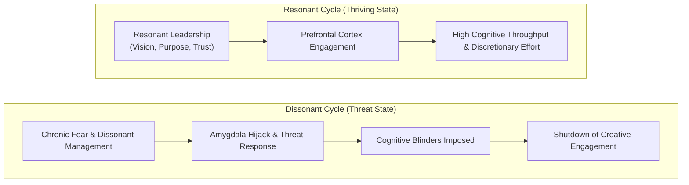
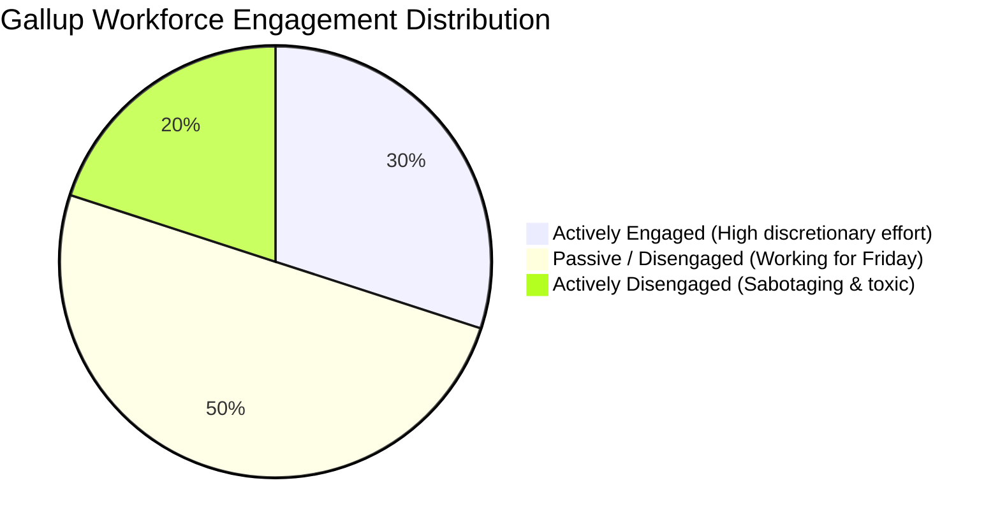

## 📄 Executive Synopsis & Context

- **Full Academic Citation**: McKee, A. (2014). _Being Happy at Work Matters: Just trying to get through the day isn’t enough_. Harvard Business Review, Digital Article, Managing People. Reprint H012CE.
- **Author Background**:
  - **[[entities/annie-mckee|Dr. Annie McKee]]**: Senior Fellow at the University of Pennsylvania Graduate School of Education; Director of the PennCLO Executive Doctoral Program; co-founder of the Teleos Leadership Institute; co-author of _Becoming a Resonant Leader_ (with Richard Boyatzis) and author of _How to Be Happy at Work_.
- **Core Thesis**: Traditional management orthodoxy claimed that _"work is not personal"_ and emotions have no place in enterprise strategy. Modern affective neuroscience and organizational empirical data decisively shatter this myth: **how employees feel directly dictates cognitive throughput, creative problem solving, and discretionary effort.** To achieve sustained high performance, leaders must cultivate three universal organizational conditions: a meaningful vision of the future, an authentic sense of purpose, and resonant workplace relationships.

---

## 🧠 Complete Conceptual Architecture

### 1. The Neuroscience of Emotional Contagion

McKee synthesizes findings from leading neuroscientists and psychologists—including **Richard Davidson** (affective neuroscience), **V.S. Ramachandran** (neural circuitry and mirror neurons), and **Shawn Achor** (positive psychology):

- **Cognitive-Affective Interdependence**: Thought influences emotion, and emotion dictates cognitive capacity.
- **The Neurological Blinders of Negative Emotions**:
  - Pervasive stress, chronic anxiety, and managerial fear trigger the amygdala, placing psychological blinders on employees.
  - Under chronic friction, people focus exclusively on the source of pain or self-protection.
  - The prefrontal cortex shuts down creative divergence, risk tolerance, and nuanced decision-making. Disengagement is a natural biological defense mechanism against a hostile environment.
- **The Pitfall of Manufactured Euphoria**:
  - McKee warns that artificially induced positive extremes (such as corporate pep rallies or forced cheerfulness) do not solve the problem; manic euphoria impairs risk evaluation and breeds cynicism. What high performance requires is **calm, grounded emotional resonance**.

---

## 📊 Empirical Realities: The 2013 Gallup Engagement Bell Curve

McKee highlights baseline findings from Gallup’s landmark workforce study, which remain remarkably consistent across economic cycles:

1. **The 30% Engaged Minority**:
   - Only 30% of employees are emotionally and intellectually committed to their organization. They work harder, smarter, and drive virtually all enterprise innovation.
2. **The 50% "Hump Day" Middle**:
   - Half the workforce treats Wednesday as "hump day" and exists merely to reach Friday. They deliver basic compliance but zero discretionary effort.
3. **The 20% Actively Disengaged Counter-Force**:
   - One out of five employees is actively disengaged: actively backstabbing colleagues, undermining projects, and infecting the cultural ecosystem.
4. **The Leadership Contagion Multiplier**:
   - Because emotions flow downward through hierarchical power structures (_emotional contagion_), a disengaged or toxic senior executive infects an entire business unit far faster than a junior staffer can.

---

## 🏛️ The Three Pillars of Resonant Engagement

Drawing on research conducted across dozens of global enterprises by the **Teleos Leadership Institute**, McKee reveals three universal requirements that transcend cultural and industry boundaries:

| Resonant Pillar                          | Theoretical Mechanism                                                                                                                           | The Executive Breakdown Point                                                                                                              |
| :--------------------------------------- | :---------------------------------------------------------------------------------------------------------------------------------------------- | :----------------------------------------------------------------------------------------------------------------------------------------- |
| **1. A Meaningful Vision of the Future** | Based on Richard Boyatzis' **Intentional Change Theory**, individuals change only when their personal vision connects to the enterprise vision. | Leaders fail to communicate a compelling picture of the future, leaving employees unable to see where they fit.                            |
| **2. A Shared Sense of Purpose**         | Human beings must believe their work contributes to something significant beyond balance-sheet metrics.                                         | Executives assume pure _"shareholder value creation"_ motivates employees; outside the C-suite, pure financial maximization breeds apathy. |
| **3. Resonant Relationships**            | People join organizations but leave dissonant managers. Close, trusting workplace relationships buffer against corporate stress.                | Executives mistake cordial professional detachment for psychological safety, breeding isolated echo chambers.                              |

---

## 💬 Classroom Cold-Call & Discussion Strategy

### Pre-Assignment Question 1:

> _"McKee argues that full engagement comes down to three things: a meaningful vision of the future, a sense of purpose, and strong relationships. Which of the three is hardest for an organization to deliver without it feeling manufactured? Pull in something from your own work experience, or a company you've watched closely, to make your case."_

#### Cold-Call Response Blueprint:

1. **The Core Strategic Argument**:
   - **Strong Relationships are the Hardest to Deliver Without Feeling Manufactured**:
     - A corporate headquarters can commission glossy slide decks to communicate a **Vision**.
     - An enterprise can hire branding consultancies to articulate a social **Purpose** or ESG mission.
     - But **Relationships** cannot be engineered or mandated top-down through HR policy.
   - Relationships occur exclusively in micro-moments between individual managers and direct reports: how a boss reacts when an operational mistake is made, whether constructive dissent is rewarded or punished, and whether authentic empathy exists during personal crises.
2. **The Danger of Manufactured Connection**:
   - Mandatory team-building exercises, corporate retreats, and forced social mixers frequently backfire, creating what McKee describes as cynical compliance rather than authentic trust.
3. **Application to Indonesian BUMNs**:
   - In hierarchical Indonesian enterprises with strong _Bapakisme_ cultures, subordinates often display deferential politeness (_Sungkan_). A leader may mistake this polite deference for a "strong relationship," when in reality, the psychological safety necessary to surface operational risks is completely absent.

---

## 🔗 Knowledge Graph & Bridges

- **Master Lecture Hub**: [[courses/mk1-organizational-behavior-managing-people/week-01/index|MK 1 Week 01: Strategizing Your Life]]
- **Living Entity Profile**: [[entities/annie-mckee|Dr. Annie McKee]]
- **Related Concepts**:
  - [[concepts/self-awareness|The Self-Awareness Triad (Internal vs. External Mirror)]]
  - [[concepts/purpose-to-impact|Purpose-to-Impact Planning]]
  - [[concepts/values-congruence|Values Congruence & Executive Friction]]
- **Knowledge Matrix**: [[concepts/index|Core Business Concepts]]
