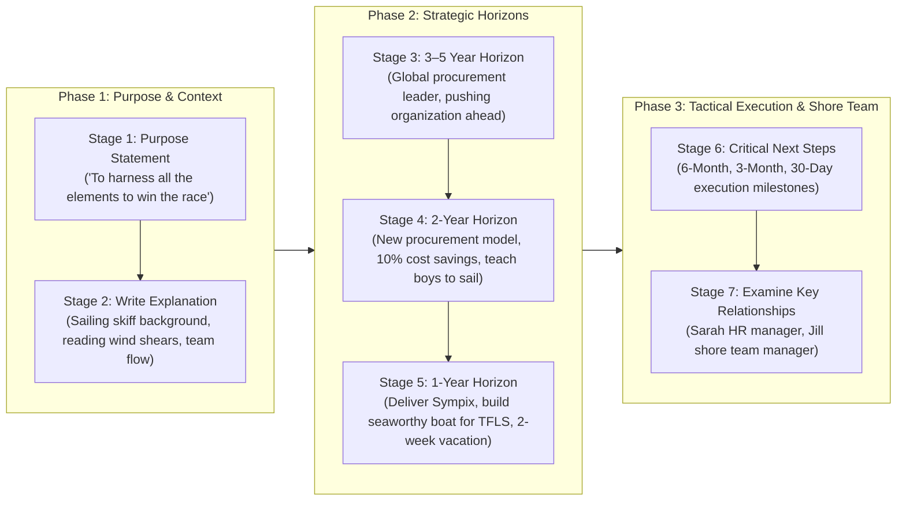

## 📄 Executive Synopsis & Context

- **Full Academic Citation**: Craig, N., & Snook, S. (2014). _From Purpose to Impact: Figure out your passion and put it to work_. Harvard Business Review, 92(5), 104–111. Reprint R1405H.
- **Author Pedigree**:
  - **[[entities/nick-craig-scott-snook|Nick Craig]]**: President of the Authentic Leadership Institute; executive coach who has guided over 1,000 global enterprise leaders through purpose architecture.
  - **[[entities/nick-craig-scott-snook|Scott Snook]]**: MBA Class of 1958 Senior Lecturer of Business Administration at Harvard Business School; retired U.S. Army Colonel with an MBA and PhD from Harvard.
- **Core Thesis**: While executive interest in purpose-driven leadership has exploded, **fewer than 20% of leaders possess a clear, individual purpose statement**, and even fewer have an actionable operational plan to execute it. Most default to generic HR platitudes. Authentic leadership requires mining personal crucibles to articulate an individual purpose and backward-chaining it into a rigorous **Purpose-to-Impact Plan** spanning 3–5 year horizons down to 30-day next steps.

> [!NOTE] Mark Twain's Axiom
> _"The two most important days in your life are the day you are born and the day you find out why."_

---

## 🧠 Complete Conceptual Architecture

### 1. The 20% Purpose Paradox & The Cost of Generic Platitudes

Despite extensive research demonstrating that purpose-driven executives navigate volatile, ambiguous environments better, recover faster from illness and setbacks, and achieve superior enterprise performance:

- **Under 20%** of enterprise leaders can state their individual purpose.
- When pressed, leaders routinely substitute company slogans (_"To organize the world's information"_) or nebulous corporate jargon:
  - _"Help others excel"_
  - _"Ensure business success"_
  - _"Empower my people"_
- **The Core Fallacy**: Purpose is neither a job description, an aspirational charity cause (_"Save the whales"_), nor an HR checklist. Purpose is your **signature operating brand**—what you can't help being, how you do what you do, and the unique magic that would be missed if you were gone.

### 2. The Identity Foundation of Purpose

- Purpose is distinct from your education, title, or professional role:
  - Scott Snook: Being a retired Army Colonel with a PhD and MBA is his background; his purpose is **"To help others live more 'meaning-full' lives."**
  - Nick Craig: Being President of the Authentic Leadership Institute is his job; his purpose is **"To wake you up and have you find that you are home."**
- Purpose may not even sound flattering or traditional: an executive might define their purpose as **"Be the thorn in people's side that keeps them moving."**

### 3. The 3-Prompt Life-Story Mining Protocol

Craig and Snook emphasize that purpose cannot be discovered through cerebral analysis alone; leaders must mine their lived life stories for recurring emotional threads:

1. **Childhood Passions**: _What did you especially love doing as a child, before the world told you what you should or shouldn't like or do?_ (Reveals untamed natural instincts).
2. **Crucible Moments**: _Tell us about two of your most challenging life experiences. How did you navigate them, and how did they shape you?_ (Reveals non-negotiable core strengths).
3. **Flow State**: _What do you enjoy doing in your life right now that helps you "sing your song"?_ (Reveals sustainable energy engines).

> [!IMPORTANT] The Social Mirror Requirement
> **You cannot find your purpose alone.** Human beings have cognitive blind spots regarding their own signature strengths. Leaders must vocalize these stories in small groups of trusted peers who act as **mirrors**, reflecting back the core themes the leader takes for granted.

---

## 🏢 Real-World Executive Case Vignettes

The authors document real enterprise executives who transformed their operational trajectory through clarified purpose:

### 1. Dolf van den Brink (President & CEO, Heineken USA)

- **Purpose Statement**: _"To be the wuxia master who saves the kingdom."_
- **Crucible Background**: Deeply inspired by wise, martial-arts warriors in Chinese kung fu films who step into perilous chaos. Van den Brink drew upon this exact archetype during severe civil unrest in the Democratic Republic of the Congo, barricading the brewery he managed to protect hundreds of local employees and prevent looting.
- **Enterprise Execution**: Stepping into the embattled leadership of Heineken USA, he rallied his team around four battle cries: _"Be brave," "Decide and do," "Hunt as a pack,"_ and _"Take it personally,"_ successfully executing aggressive market restructuring.

### 2. Kathi Snook (Retired Army Colonel & Educator)

- **Purpose Statement**: _"To be the gentle, behind-the-scenes, kick-in-the-ass reason for success."_
- **Crucible Background**: A former West Point gymnastics captain and mathematics professor who spent years as a stay-at-home mother, struggling to re-enter professional life.
- **Enterprise Execution**: Realizing she had always led as a forceful backstage catalyst, she ran for a hotly contested school board seat, winning decisively and driving systemic educational reform.

### 3. Egyptian Manufacturing Director

- **Purpose Statement**: _"Create families that excel."_
- **Crucible Execution**: During the 2012 Egyptian political revolution, militants and protesters took to the streets. By invoking the enterprise as an authentic family unit rather than an abstract capitalist asset, he persuaded his workforce to protect their manufacturing plant and sustain operations throughout national turmoil.

### 4. Retail Operations Senior VP

- **Purpose Statement**: _"Compelled to make things better, whomever, wherever, however."_
- **Crucible Execution**: Faced with brutal global e-commerce and retail competition, he stopped avoiding uncomfortable conflicts and made the _"hard, cage-rattling changes"_ required to turnaround store unit economics.

### 5. Jostein Solheim (CEO, Ben & Jerry's / Unilever)

- **Purpose Statement**: _"To be part of a global movement that makes changing the world seem fun and achievable."_
- **Crucible Execution**: Clarifying his purpose revealed that his true fulfillment lay in steering mission-driven cultural capitalism at Ben & Jerry's rather than pursuing conventional upward corporate ladder climbing inside Unilever corporate headquarters.

---

## 📊 Comparative Framework Exhibits

### Exhibit 1: Purpose Statements — From Bad to Good

| Conventional / Ineffective Purpose (Bad)                                                                                  | Clarified / Actionable Purpose (Good)                                  | Why It Works                                                                    |
| :------------------------------------------------------------------------------------------------------------------------ | :--------------------------------------------------------------------- | :------------------------------------------------------------------------------ |
| _"Lead new markets department to achieve exceptional business results"_                                                   | **"Eliminate 'chaos'"**                                                | Replaces generic corporate objectives with personal instinctive drive.          |
| _"Be a driver in the infrastructure business that allows each person to achieve outcomes while mastering new drivers..."_ | **"Bring water and power to the 2 billion people who do not have it"** | Replaces bureaucratic run-on text with profound moral urgency and clarity.      |
| _"Continually and consistently develop and facilitate the growth and development of myself and others..."_                | **"With tenacity, create brilliance"**                                 | Transforms safe HR checklist phrasing into a sharp, declarative call to action. |

---

### Exhibit 2: Traditional Development Planning vs. Purpose-to-Impact Planning

| Dimension            | Traditional Development Planning                  | Purpose-to-Impact Planning                                 |
| :------------------- | :------------------------------------------------ | :--------------------------------------------------------- |
| **Language**         | Standard business and HR jargon                   | Uniquely meaningful, purpose-infused language              |
| **Primary Focus**    | Fixing weaknesses to address subpar performance   | Mobilizing signature strengths to achieve bold aspirations |
| **Orientation**      | Present-focused, working forward incrementally    | **Future-focused, working backward from impact vision**    |
| **Target Statement** | States a business- or career-driven goal          | Elicits an individual leadership purpose statement         |
| **Metrics**          | Tied exclusively to corporate KPIs and firm goals | Incremental milestones tied to living your purpose         |
| **Scope**            | Ignores family, community, and personal life      | **Holistic: integrates career, family, and shore team**    |

---

## 🛠️ Complete Diagnostic Toolkit: The Purpose-to-Impact Plan

The following model demonstrates the complete 7-stage architecture using the article's comprehensive composite case study: **"Richard"**, a senior procurement executive whose passion is competitive ocean skiff sailing.

### Stage 1: Create Purpose Statement

- **Richard's Statement**: _"To harness all the elements to win the race."_

### Stage 2: Write Explanation

- _Richard's Context_: Raced high-performance three-man skiffs in his teens and 20s, nearly making the Olympic trials. Sailing demands acute discipline, balance, and real-time coordination with dynamic natural forces. Winning depends on reading subtle wind shears and synchronizing team flow under volatile conditions.

### Stage 3: Three- to Five-Year Goals

- **Strategic Aspiration**: Be recognized for building and training elite procurement teams that win high-stakes enterprise contracts.
- **How Will I Do It?**:
  - Unify cross-functional departments into a single crew.
  - Anticipate market shifts and supplier bottlenecks before competitors.
  - Maintain executive composure during losses; dissect debriefs to win the next cycle.
  - **Shore Team Commitment**: Establish a non-negotiable family bonding tradition.

### Stage 4: Two-Year Goals

- **Operational Reality**: Implement an innovative supplier partnership model delivering a sustainable **10% cost reduction** across enterprise procurement.
- **How Will I Do It?**:
  - Directly confront supplier resistance with pragmatic, data-backed solutions.
  - Assemble, train, and sponsor top-tier procurement talent.
  - **Personal Commitment**: Teach his sons how to sail skiffs.

### Stage 5: One-Year Goals

- **Near-Term Targets**:
  - Deliver the critical **Sympix project** ahead of executive expectations.
  - _"Build a seaworthy boat"_: Stabilize the foundational TFLS procurement process within tight cash-flow parameters.
- **How Will I Do It?**:
  - Accelerate organizational restructuring of the procurement unit.
  - Secure formal board and executive committee buy-in.
  - **Family Commitment**: Take a two-week unplugged vacation with zero corporate email.

### Stage 6: Map Out Critical Next Steps (The Execution Waterfall)

- **Six Months**:
  - Finalize talent succession architecture for direct reports.
  - Establish hard delivery timelines for the Sympix deployment.
- **Three Months**:
  - Recruit an elite external replacement for key manager Jim.
  - Block weekly 2-hour _"action windows"_ in the calendar for deep work with no email.
- **30 Days**:
  - Onboard Alex in Shanghai to lead Asian supplier relationships.
  - Align executive committee on agreed TFLS metrics.
  - Host a 1-day alignment offsite with the Sympix steering team.
  - Re-establish daily evening presence at home with Jill and the children.

### Stage 7: Examine Key Relationships ("The Shore Team")

- **Sarah (HR Business Partner)**: Key internal navigator to reconfigure talent and manage organizational friction.
- **Jill (Spouse & Shore Team Manager)**: Personal foundation ensuring accountability to life values outside the corporate office.

---

## 💬 Classroom Cold-Call & Debate Strategy

### Pre-Assignment Question 2:

> _"The authors insist it's nearly impossible to find your own purpose alone: you need other people in the room with you. What reasoning do they give for that? Does it match what's happened when you've tried, on your own, to figure out what you actually want from your career or your life?"_

#### Cold-Call Response Blueprint:

1. **The Core Analytical Reasoning**:
   - **Perceptual Blind Spots**: Individuals do not perceive their greatest strengths because those strengths feel effortless and ordinary to them (_"the fish doesn't know it's in water"_).
   - **Social Mirror Function**: Other people in the room act as objective mirrors. When you recount your childhood stories and crucible moments, peers hear the emotional resonance, vocal inflection, and recurring motifs that you unconsciously gloss over.
   - **Filter Against Cerebral Over-Engineering**: When leaders try to discover purpose in isolation, they inevitably write an aspirational resume of what they think a CEO _should_ sound like, rather than uncovering who they fundamentally _are_.
2. **Classroom Counter-Argument / Tension**:
   - While peer feedback is mandatory to mirror patterns, relying too heavily on external validation risks falling back into the **Autopilot Trap**—adopting what peers and mentors expect of you rather than owning your authentic voice. The group serves to **mirror**, but the executive must **declare**.

---

## 🔗 Knowledge Graph & Bridges

- **Master Lecture Hub**: [[courses/mk1-organizational-behavior-managing-people/week-01/index|MK 1 Week 01: Strategizing Your Life]]
- **Associated Concept Note**: [[concepts/purpose-to-impact|Purpose-to-Impact Planning]]
- **Living Entity Profile**: [[entities/nick-craig-scott-snook|Nick Craig & Scott Snook]]
- **Related Framework**: [[concepts/ikigai|Ikigai Framework]]
- **Knowledge Matrix**: [[concepts/index|Core Business Concepts]]
