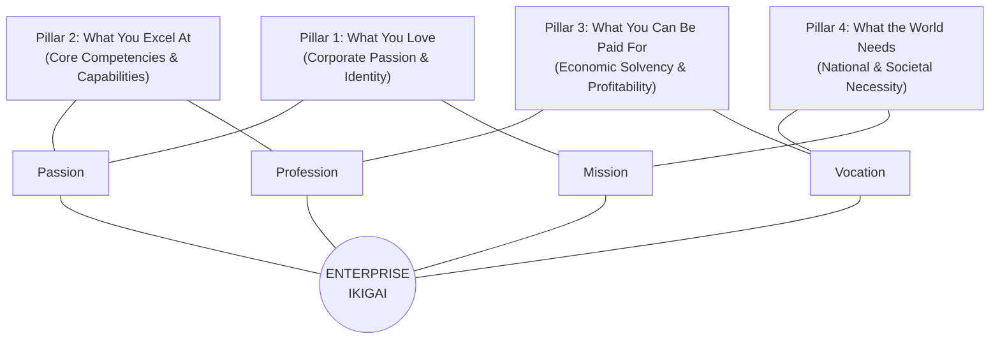

## 📄 Executive Synopsis & Context

- **Full Academic Citation**: Liu, A. (2022). _What is ikigai and how can it transform your leadership and business for good?_ World Economic Forum, Davos Agenda, Forum in Focus. Published January 17, 2022.
- **Author Background**:
  - **Alex Liu**: Chairman Emeritus and Senior Partner at **Kearney**; global business strategist advising Fortune 500 boards and C-suites on organizational transformation, culture, and stakeholder capitalism.
- **Core Thesis**: The historical, authority-based executive model—where leaders commanded automatic loyalty through title power while focusing exclusively on financial metrics—has been permanently dismantled. Today’s workforce and capital markets demand radical authenticity. Drawing on landmark empirical research by Kearney, Liu demonstrates that **non-financial CEO dismissals surged 4.75x**, proving that running the numbers well while tolerating cultural toxicity is an existential corporate risk. Leaders can operationalize the Japanese framework of **Ikigai** to bridge the _"Purpose Gap"_ and transform human capital into an organization's ultimate renewable energy source.

---

## 📊 The Empirical Crucible: The 4.75x Non-Financial CEO Ouster Surge

Kearney conducted an exhaustive longitudinal analysis tracking CEO departures across 200 global companies across two comparative five-year windows: **2011–2016** versus **2016–2021**.

```mermaid
xychart-beta
    title "Involuntary CEO Departures by Root Cause (Kearney Study)"
    x-axis ["2011–2016", "2016–2021"]
    y-axis "Involuntary Departures" 0 --> 40
    bar [37, 33]
    bar [4, 19]
```

### Key Statistical Breakdown:

- **Total Leadership Transitions**: Remained steady across both periods (**150** vs. **155**), with total involuntary ousters rising from **41 to 52 (+27%)**.
- **Financial Performance Dismissals**: Fell slightly from **37** (2011–2016) to **33** (2016–2021).
- **Non-Financial Dismissals**: Surged from **4** to **19**—an unprecedented **4.75-fold (nearly 500%) increase**.

> [!CAUTION] The Non-Financial Failure Trap
> Boards of directors and institutional investors no longer tolerate leaders who deliver strong quarterly earnings while cultivating toxic workplace environments, ignoring harassment, or behaving in a socially irresponsible manner. Non-financial risk has become **existential valuation risk**.

---

## 🧠 Complete Conceptual Architecture

### 1. From Authority-Based to Values-Based Leadership

The corporate pendulum has swung permanently away from legacy command-and-control hierarchies:

| Dimension              | Legacy Authority-Based Model                             | Emerging Values-Based Model (Ikigai)                                    |
| :--------------------- | :------------------------------------------------------- | :---------------------------------------------------------------------- |
| **Source of Respect**  | Automatically accorded by corporate title and hierarchy  | Earned continuously through vulnerability and accountability            |
| **Communication Flow** | Top-down broadcast; one-way directive speech             | Two-way dialogue; active listening and collaborative synthesis          |
| **Tenure Dynamics**    | Long, entrenched executive tenures regardless of culture | Swift stakeholder removal upon ethical or cultural failure              |
| **Stakeholder Radar**  | Tuned exclusively to short-term shareholder EPS          | Balances employees, ESG impact, supply chain circularity, and investors |

### 2. The Organizational Purpose Gap

Liu identifies the fundamental disease infecting modern enterprises:
$$\mathbf{\text{The Purpose Gap} = \text{What Leadership Declares in PR} \;-\; \text{What Stakeholders Actually Experience}}$$

- Many organizations craft inspirational mission statements, but few translate them into daily operational trade-offs.
- Younger employees can detect inauthenticity immediately. When a disconnect exists between stated corporate purpose and executive compensation or operational behavior, cynicism spreads throughout middle management.

### 3. The Enterprise Ikigai Blueprint

Originating from Japan’s classical **Heian period (794–1185)**, _Ikigai_ is formed from _iki_ ("alive" or "life") and _gai_ ("worth" or "benefit"). In an enterprise context, it maps where organizational capabilities converge with societal necessity:

#### The Cost of Incomplete Quadrants:

- **Love + Skill, but No Pay**: Creative energy and high morale, but financially bankrupt.
- **Skill + Pay, but No Love**: Robust quarterly cash flows, but stagnant innovation and rampant employee cynicism.
- **Pay + World Need, but No Skill**: Noble developmental intent, but catastrophic operational execution.
- **Love + World Need, but No Pay**: Philanthropic idealism that cannot sustain enterprise scale.

---

## 🏢 Managerial Application: People Power as Renewable Energy

Liu argues that deploying Ikigai across an enterprise yields concrete strategic advantages:

1. **Engaging the Middle of the Organization**:
   - The middle management tier typically stands to lose the most during strategic pivots. Engaging them through personal and enterprise purpose turns an administrative bottleneck into an innovation engine.
2. **The Elasticity of Sustainability**:
   - Enterprise purpose extends to global supply chain circularity. Reconfiguring operations for climate-positive products enables companies to tap into price elasticity—where institutional investors and consumers willingly pay a premium for verified sustainability.
3. **People Power as a Renewable Asset**:
   - Unlike capital expenditures, data centers, or raw inventory, which depreciate under use, human energy when aligned with purpose **compounds and renews itself**.

---

## 💬 Classroom Cold-Call & Debate Strategy

### Pre-Assignment Question 3:

> _"Kearney's research, cited in the piece, found that CEO departures driven by non-financial reasons, things like a toxic culture or turning a blind eye to socially irresponsible behavior, rose 4.75 times over between 2011 to 2016 and 2016 to 2021. If you're headed toward a leadership role, what does a number like that tell you about how 'good leadership' is being redefined right now? What's the risk of running the numbers well while everything else quietly falls apart?"_

#### Cold-Call Response Blueprint:

1. **Redefining Good Leadership**:
   - **The Asymmetry of Leadership Risk**: Historically, hitting EBITDA targets provided an executive with an impenetrable shield against firing. Today, financial performance is merely a **table stake**; ethical culture, psychological safety, and societal legitimacy have become **veto criteria**.
   - **Hyper-Transparency & Social Accountability**: Smartphone transparency, internal whistleblowing channels, and professional networks mean executive transgressions that were once concealed behind boardroom doors are now surfaced directly to boards and regulators.
2. **The Risk of 'Running the Numbers Well While Everything Else Collapses'**:
   - When leaders drive financial numbers through fear, excessive pressure, or by cutting cultural corners, they are effectively **borrowing against the organization's social equity**.
   - The short-term earnings gains are quickly wiped out by employee turnover, whistleblower lawsuits, reputational collapse, and board intervention.
3. **Application to Indonesian BUMNs & Danantara**:
   - For Indonesian state-owned enterprises, this balance is paramount. A BUMN executive cannot focus exclusively on commercial profitability while neglecting governance integrity (_Amanah_) or public developmental mandates. Failure in governance destroys enterprise credibility faster than a single quarter of missed revenue.

---

## 🔗 Knowledge Graph & Bridges

- **Master Lecture Hub**: [[courses/mk1-organizational-behavior-managing-people/week-01/index|MK 1 Week 01: Strategizing Your Life]]
- **Associated Concept Note**: [[concepts/ikigai|Ikigai Framework]]
- **Related Concept**: [[concepts/values-congruence|Values Congruence & Executive Friction]]
- **Related Reading**: [[courses/mk1-organizational-behavior-managing-people/week-01/reading-being-happy-at-work-matters|Annie McKee on Engagement & Neuroscience]]
- **Knowledge Matrix**: [[concepts/index|Core Business Concepts]]
