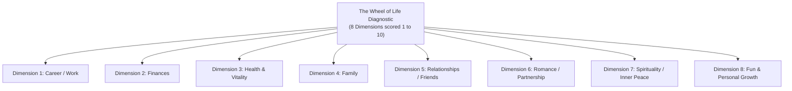
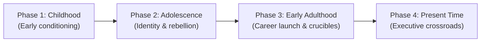
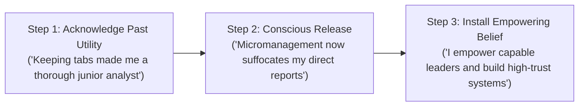

## 📄 Executive Synopsis & Context

- **Full Academic Citation**: Nash, J. (2020). _What Are Your Personal Values? Three exercises to help you get to know yourself better_. Harvard Business Review, Digital Article, Decision Making and Problem Solving. Reprint H060YO.
- **Author Background**:
  - **[[entities/jennifer-nash|Dr. Jennifer Nash]]**: Executive coach to senior leaders across Fortune 50 organizations (including Google, ExxonMobil, JPMorgan Chase, Boeing, and Verizon); former senior executive at Deloitte Consulting; CEO of Jennifer Nash Coaching & Consulting; PhD in human capital and organizational leadership.
- **Core Thesis**: When professionals start careers or transition into high-stakes executive leadership, identifying core values is notoriously difficult. Standard corporate values checklists only capture _aspirational ideals_ (who leaders think they ought to be). To discover _actual operational values_, executives must engage in diagnostic reflection that surfaces subconscious emotional drivers, developmental crucible patterns, and self-limiting beliefs.

---

## 🧠 The Vulnerability Crucible: The Workshop Breakdown

Dr. Nash introduces the framework through her own vulnerable executive crucible:

- Despite boasting a freshly minted PhD from a top research university, years of corporate success, and launching a promising startup, Nash attended a 3-week executive well-being workshop where she was handed a blank circle divided into eight life segments.
- Upon auditing her satisfaction levels—scoring **4 for fun, 2 for family, and 1 for finances**—she experienced an acute existential crisis.
- In front of 20 international strangers, she was forced to shed her corporate "game face" (the armor of vigilance and emotional detachment cultivated during years in consulting) and openly share her inner conflict.
- **The Core Insight**: Revealing emotional vulnerability was not a sign of operational incompetence; it was the essential prerequisite to dismantling the obsessive desire to control uncertainty, enabling true executive presence and the willingness to delegate.

---

## 🛠️ Complete Diagnostic Worksheets & Toolkits

Nash outlines three structured, step-by-step diagnostic exercises designed to extract lived values rather than abstract rhetoric.

### Exercise 1: The Wheel of Life (Paul J. Meyer Model)

Originally conceptualized by Paul J. Meyer (founder of the Success Motivation Institute), the Wheel of Life maps holistic life satisfaction across a radial spider diagram to expose severe structural imbalances.

#### Step-by-Step Execution Protocol:

1. **Divide the Canvas**: Draw a circle and divide it into eight equal radial wedges:
   - _Career / Work_
   - _Finances_
   - _Health_
   - _Family_
   - _Relationships_
   - _Romance_
   - _Spirituality_
   - _Fun & Recreation_
2. **Calibrate 10 Satisfaction Coordinates**: On each radial axis, mark 10 discrete intervals where:
   - Coordinate 1 (at the inner center) represents **complete dissatisfaction / acute crisis**.
   - Coordinate 10 (at the outer perimeter) represents **total fulfillment and thriving**.
3. **Plot and Connect (Spider Diagram)**: Highlight your current lived satisfaction dot on each of the eight spokes and connect the dots. A balanced life creates an even circle; a severely compromised life produces an erratic, jagged polygon that reveals where cognitive burnout is silently brewing.
4. **Three Immediate Micro-Actions**: For the lowest-scoring wedges, identify and write down **three concrete micro-actions** that can be executed within 48 hours to initiate restorative momentum.

---

### Exercise 2: The Life Journey Map

The Life Journey Map audits developmental crucible choices across four distinct chronological eras to expose the behavioral patterns and values that actually guided past decisions under stress.

#### The Seven Mandatory Audit Data Points:

For every major milestone, transition, or crucible event identified in each of the four phases, record seven explicit data points:

|   #   | Diagnostic Audit Question                                                     | Analytical Purpose                                        |
| :---: | :---------------------------------------------------------------------------- | :-------------------------------------------------------- |
| **1** | **Age**: What was your chronological age at the time?                         | Locates developmental stage and peer maturity.            |
| **2** | **Event Name**: What is the specific name of the decision or crisis?          | Anchors the reflection in concrete historical reality.    |
| **3** | **Salience**: Why did this specific event stand out above all others?         | Isolates underlying emotional stakes and triggers.        |
| **4** | **Belief at the Time**: What did you believe to be true about life/work then? | Captures historical assumptions and inherited dogmas.     |
| **5** | **Primary Emotion at the Time**: What dominant emotion did you feel then?     | Diagnoses vulnerability, fear, triumph, or resentment.    |
| **6** | **Current Emotion**: Which emotion do you feel _now_ looking back?            | Measures emotional resolution and developmental distance. |
| **7** | **Current Belief**: What do you believe to be true _now_ about that event?    | Exposes how your operating values have evolved.           |

#### Pattern Synthesis:

- Where were you happiest and most fulfilled? (Highlights your true values).
- Where did you feel most stuck, cynical, or depleted? (Exposes situations where your core values were violated).
- Formulate **three new intentional behaviors** based on these recurring patterns.

---

### Exercise 3: Cognitive Reprogramming & Limiting Beliefs

Unexamined values frequently manifest as subconscious **limiting beliefs**—mental programs inherited from corporate cultures, parents, or past failures that masquerade as prudent business rules.

#### Linguistic Markers of Limiting Beliefs:

Listen to your internal executive monologue for restrictive markers:

- _"I can't..."_
- _"I don't..."_
- _"I won't..."_
- _"I'm not [smart / connected / experienced] enough..."_
- _"I have to do everything myself because others will drop the ball..."_

#### The 3-Step Reprogramming Protocol:

1. **Acknowledge the Historical Benefit**: Recognize that the limiting belief originally served a protective purpose (e.g., _"I need to monitor every detail"_ helped you survive as a junior analyst).
2. **Release the Obsolescence**: Acknowledge that the belief is now toxic in an executive role (e.g., translating directly into suffocating micromanagement).
3. **Install the Replacement Program**: Formulate and write down the replacement operating belief (e.g., _"I hire elite leaders, give clear context, and unleash their autonomy"_).

---

## 💬 Classroom Cold-Call & Discussion Strategy

### Pre-Assignment Question 4:

> _"Nash's 'Journey Map' exercise has you compare how you felt about a past event at the time with how you feel about it now, and what you believed then against what you believe now. Why might that before-and-after comparison reveal more about your actual values than simply circling words on a values checklist?"_

#### Cold-Call Response Blueprint:

1. **The Core Analytical Insight**:
   - **Checklist Bias (Aspirational Signaling)**: Circling words on an HR checklist (_Integrity, Innovation, Collaboration, Excellence_) merely tests a leader's ability to recognize corporate virtues. It measures who you _wish_ you were or what you think your organization rewards.
   - **Chronological Crucible Evidence**: The Journey Map tracks _actual historical decisions made under stress, resource scarcity, and emotional pressure_. Values are not intellectual concepts; they are the implicit rules that governed what you sacrificed, what made you angry, and what you fought for.
   - **The Delta as a Diagnostic Tool**: Comparing what you believed _then_ versus what you believe _now_ reveals your true developmental trajectory. The emotional delta (e.g., feeling terror then vs. gratitude now) highlights what truly matters to you when stripped of superficial status anxieties.

2. **Classroom Nuance / Executive Takeaway**:
   - In Indonesian BUMN leadership, executives frequently inherit values checklists (such as AKHLAK). Unless an executive maps their own life crucibles against those institutional pillars, AKHLAK remains an external compliance checklist rather than an internal operating compass.

---

## 🔗 Knowledge Graph & Bridges

- **Master Lecture Hub**: [[courses/mk1-organizational-behavior-managing-people/week-01/index|MK 1 Week 01: Strategizing Your Life]]
- **Associated Concept Notes**:
  - [[concepts/wheel-of-life|The Wheel of Life Diagnostic]]
  - [[concepts/values-congruence|Values Congruence & Executive Friction]]
  - [[concepts/self-awareness|The Self-Awareness Triad]]
- **Living Entity Profile**: [[entities/jennifer-nash|Dr. Jennifer Nash]]
- **Knowledge Matrix**: [[concepts/index|Core Business Concepts]]
