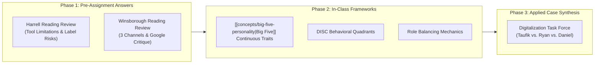
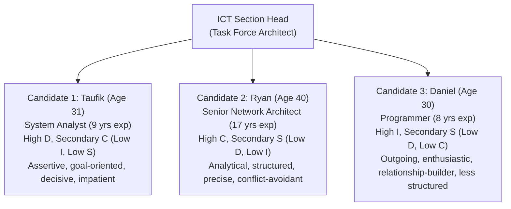

> [!NOTE] Assignment Context & Attribution
>
> - **Course:** MK1 Organizational Behaviour & Managing People — Week 02
> - **Source Prompt:** `archive/courses/mk1/week-02/Syndicate 9 - Post Assignment Week 2.docx` & Week 02 In-Class Case Study
> - **Reference Attribution:** Analytical synthesis contributed by **F9 (Class F / Syndicate 9)** & **the Portal Maintainer**
> - **Parent Lecture:** [[courses/mk1-organizational-behavior-managing-people/week-02/index|Week 02 Master Lecture Hub]]
> - **Pre-Assignment Reference:** [[courses/mk1-organizational-behavior-managing-people/week-02/assignment-pre-personality-identity|W02 Pre-Assignment: Personality, Identity & Individual Differences]]

---

## 📋 Part 1: Official Assignment Prompt & Skim Map

- **Executive Objective:** Re-examine baseline pre-assignment answers through the lens of in-class seminar discussions on psychometric validity ([[concepts/big-five-personality|Big Five]] vs. MBTI vs. DISC) and synthesize the in-class **DISC Digitalization Task Force Case Study**.
- **Target Deliverable:** Post-class debrief memo containing: (1) Unchanged baseline vs. revised answers with explicit "What changed and why" reflections, and (2) Full managerial evaluation and role-allocation matrix for the ICT Digitalization Task Force.

---

## 💡 Part 2: Reference Solution & Framework Revisions

### Reading 1: Eben Harrell — "A Brief History of Personality Tests"

#### Original Answer (Pre-Assignment Baseline)

> In leadership, personality tests should be used as a helpful conversation starter, not as a final label or the sole basis for managing people. As a part of self-awareness, they offer useful clues about how team members prefer to communicate, make decisions, and handle stress. However, leaders must know each tool's limits. While tests like MBTI or DISC are great for team discussions, research shows MBTI categories cannot reliably predict job performance, and over half of people get a different result when retested. In contrast, models like the [[concepts/big-five-personality|Big Five]] have stronger scientific backing for understanding workplace compatibility, though test data should always be balanced with real-world observation, actual performance, and open dialogue.
>
> Potential benefits of using personality tests include:
>
> - **Adaptive Communication**: Understanding behavioral tendencies helps leaders tailor their style (e.g., direct, goal-focused feedback to a Dominant style; detailed data and review time for a Compliant style).
> - **Better Team Dynamics**: Provides a shared vocabulary that helps coworkers understand work habits and reduces interpersonal friction.
> - **Strengths-Based Roles**: Tools like StrengthsFinder help design roles that boost engagement and morale.
>
> Meanwhile, the risks of relying too heavily on personality tests include:
>
> - **Pigeonholing Employees**: Labeling someone creates bias, ignores behavioral adaptability, and blocks people from stretch assignments.
> - **Dodging Managerial Responsibility**: Blaming personality types lets managers off the hook for failing to build clear processes.
> - **Unfair or Illegal Decisions**: The Myers-Briggs Foundation warns against using its test for hiring, and improper screening has led to discrimination lawsuits.

#### Revised Answer (Using In-Class Frameworks)

> After participating in the class seminar, our core stance is strongly reinforced: personality tests are valuable diagnostic instruments for cultivating self-awareness and establishing communication norms, but should never be used as rigid selection gates or determinative performance metrics.
>
> The seminar deepened this analysis through the **Psychometric Governance Boundary**:
>
> 1. **Differentiating Trait vs. Behavioral Style**: The Five-Factor Model ([[concepts/big-five-personality|Big Five]]) measures stable, enduring personality traits that remain relatively consistent across the adult lifespan. Conversely, DISC and MBTI capture self-reported behavioral preferences and communication styles that fluctuate depending on the operational environment. Treating DISC quadrants as unchangeable traits leads to fatalistic labeling.
> 2. **Managerial Process vs. Personality Excuse**: In high-performance organizations, conflict is rarely resolved by telling employees to "accept each other's types." Instead, leaders must establish clear operating procedures, transparent performance metrics, and explicit behavioral expectations that bridge stylistic divides.
> 3. **Mitigating the Self-Fulfilling Label Trap**: When leaders label team members (_"Taufik is High D, so he's naturally insensitive"_ or _"Ryan is High C, so don't ask him to innovate"_), they license bad behavior and stifle personal development. Effective leaders coach individuals to develop behavioral agility outside their default comfort zone.

#### What Changed, and Why?

- **What Changed:** The fundamental conclusion did not change; rather, it was deepened by formally distinguishing between stable psychometric traits ([[concepts/big-five-personality|Big Five]]) and contextual behavioral styles (DISC).
- **Why:** In-class faculty debriefs emphasized that while instruments like DISC are immensely popular in executive workshops, their legitimate utility is strictly confined to communication adaptation. Confusing behavioral preferences with fixed character traits damages talent development.

---

### Reading 2: Dave Winsborough & Tomas Chamorro-Premuzic — "Great Teams Are About Personalities, Not Just Skills"

#### Original Answer (Pre-Assignment Baseline)

> Google found that emotional intelligence and communication mattered more than who was on the team, but Dave Winsborough and Tomas Chamorro-Premuzic argue this finding does not apply to every workplace. Google heavily pre-screens candidates for "Googliness", a shared cultural and personality fit. Because their workforce already starts with baseline psychological similarity, personality clashes are naturally minimized. In typical organizations without such rigorous pre-filtering, teams feature far wider personality divides, making team composition and personality balance far more critical to performance.
>
> Personality drives team effectiveness through three core channels:
>
> - **Psychological Team Roles**: Skills determine what a person can do, but personality shapes what role they naturally play—such as being results-driven, relationship-focused, process-oriented, innovative, or pragmatic.
> - **Interpersonal Dynamics**: Personality governs how members communicate, share knowledge, handle conflict, cooperate, and build mutual trust.
> - **Values Alignment**: Shared core beliefs create cultural cohesion and smoother teamwork, whereas mismatched underlying values trigger friction and fragmentation.
>
> While communication and emotional intelligence are essential, team composition still matters. Building high-performing teams requires more than technical skill; it demands the right balance of complementary personalities, behaviors, and values to help members collaborate effectively.

#### Revised Answer (Using In-Class Frameworks)

> Class discussions validated our pushback against Google’s Project Aristotle findings, demonstrating that Google's conclusions reflect an acute **selection effect** rather than a universal law of organizational behavior.
>
> In-class analysis expanded the three channels into a concrete operational blueprint:
>
> 1. **Psychological Roles vs. The Apollo Syndrome**: Replicating Belbin’s research, the seminar illustrated that stacking a team with identical high-competence individualists produces collective failure. High-performing teams require complementary distribution across the 5 core roles: Results Drivers, Relationship Builders, Process Guardians, Innovation Catalysts, and Pragmatic Anchors.
> 2. **Interpersonal Pacing & Conflict Management**: Personality mismatches manifest in mismatched operational tempos. A high-Dominance leader demands rapid, decisive closure; a high-Compliance specialist demands exhaustive data validation. Without proactive managerial structuring, this tension deteriorates into mutual contempt (perceived recklessness vs. perceived obstructionism).
> 3. **Deep-Level Values as Cultural Foundation**: While demographic and behavioral diversity accelerates innovation, diversity in core values (e.g., integrity, fairness, customer stewardship) destabilizes team cohesion. High-performing teams intentionally cultivate behavioral diversity anchored to rock-solid values consensus.

#### What Changed, and Why?

- **What Changed:** The revised analysis connected the 3 channels directly to Belbin’s Apollo Syndrome, operational tempo friction, and the structural tension between behavioral diversity and values consensus.
- **Why:** The seminar demonstrated that team failure in Indonesian enterprises rarely stems from technical skill deficits; it stems from unmanaged operational friction between competing psychological roles.

---

## 🛠️ Part 3: In-Class DISC Case Study — Digitalization Task Force

### Case Background & Leadership Dilemma

As an **ICT Section Head**, you must form an agile task force to lead a high-stakes business digitalization initiative alongside a demanding external management consultant. You have three internal candidates:

---

### Comprehensive Role Allocation & Mitigation Matrix

#### 1. Project Coordinator Appointment: Taufik (High D / Secondary C)

- **Selection Rationale:**
  - A digitalization task force facing an aggressive timeline and an external consultant requires high drive, decisiveness, and goal focus.
  - Taufik’s **High Dominance (D)** ensures he takes charge, drives project milestones, confronts bottlenecks directly, and prevents the initiative from stalling in endless debate.
  - His **Secondary Conscientiousness (C)** provides sufficient analytical grounding to maintain technical standards and scrutinize deliverables.

#### 2. Conflict Dynamics & Mitigation Strategy:

- **Potential Conflict with Ryan (High C / S):**
  - _Friction Point:_ Taufik’s impatience, abrupt communication, and aggressive pace will trigger severe anxiety and withdrawal in Ryan. Ryan needs time to analyze data and prefers structured stability; he will perceive Taufik as reckless and dismissive of architectural integrity.
  - _Mitigation:_ The Section Head must establish clear swimlanes. Taufik must be coached to provide Ryan with advance notice for deliverables, submit written requests with clear specifications, and avoid confronting Ryan in public team meetings.
- **Potential Conflict with Daniel (High I / S):**
  - _Friction Point:_ Taufik’s task-obsessed, low-empathy demeanor will alienate Daniel, who is energized by informal collaboration, creative brainstorming, and positive affirmation. Taufik will view Daniel as undisciplined, talkative, and careless with details.
  - _Mitigation:_ Taufik must allow time for social check-ins and recognize Daniel’s contribution to team morale. The Section Head must institute a structured project management dashboard (Jira/Asana) to keep Daniel accountable without Taufik having to micromanage him.

#### 3. Primary Counterpart to External Consultant: Daniel (High I / Secondary S)

- **Selection Rationale:**
  - External consultants often operate with high technical jargon and demanding expectations that can trigger defensive territorialism among internal IT staff.
  - Daniel’s **High Influence (I)** and **Secondary Steadiness (S)** make him naturally communicative, persuasive, and relationship-focused. He excels at translating internal user needs, building rapport, smoothing political friction, and facilitating workshops between external advisors and internal stakeholders.
  - _Governance Guardrail:_ Daniel must be paired with Ryan for technical sign-offs to ensure consultants do not over-promise unfeasible technical architectures.

#### 4. Database Management & Technical Architecture: Ryan (High C / Secondary S)

- **Selection Rationale:**
  - Database schema design, cybersecurity protocols, and enterprise network architecture require zero-tolerance for errors, deep structural discipline, and meticulous attention to detail.
  - Ryan’s **High Conscientiousness (C)** and **17 years of deep architectural experience** ensure robust data integrity, compliance with enterprise governance, and flawless system stability.
  - His **Secondary Steadiness (S)** provides patient, persistent follow-through on complex technical migrations where hasty shortcuts would compromise enterprise operations.

---

### Task Force Governance Matrix

| Task Force Member     | DISC Profile       | Assigned Project Role                | Primary Deliverable                                                   | Managerial Communication Protocol                                                                           |
| :-------------------- | :----------------- | :----------------------------------- | :-------------------------------------------------------------------- | :---------------------------------------------------------------------------------------------------------- |
| **Taufik** _(Age 31)_ | **High D / Sec C** | **Project Coordinator**              | Milestone execution, timeline enforcement, issue escalation.          | Brief, direct, results-focused. Highlight logical bottom-line impact. Avoid micromanaging his methods.      |
| **Ryan** _(Age 40)_   | **High C / Sec S** | **Lead Architect & Data Custodian**  | System architecture, database schema, security & compliance audit.    | Detailed written briefs, advance notice, data-driven rationale. Provide quiet time to evaluate options.     |
| **Daniel** _(Age 30)_ | **High I / Sec S** | **Consultant & Stakeholder Liaison** | Workshop facilitation, user adoption, vendor relationship management. | Informal check-ins, verbal recognition, public praise. Provide clear deadlines with milestone check-points. |

---

## 🔬 Part 4: Methodological Rigor & Classroom Cold-Call Strategy

| Analytical Dimension       | Superficial Solution                                                                   | Rigorous Methodological Synthesis (F9 Standard)                                                                                                      |
| :------------------------- | :------------------------------------------------------------------------------------- | :--------------------------------------------------------------------------------------------------------------------------------------------------- |
| **Task Force Selection**   | Appoints the most senior person (Ryan) automatically as coordinator due to age/tenure. | Appoints Taufik based on psychological role alignment (high D execution), while protecting Ryan's deep technical contribution (high C architecture). |
| **Conflict Management**    | Tells members to "get along" or forces them through generic team-building games.       | Diagnoses behavioral pacing friction (D speed vs. C precision) and designs concrete operational interfaces (written briefs, advance notice).         |
| **Consultant Integration** | Assigns the most aggressive person to fight the consultant for control.                | Leverages High-I diplomacy (Daniel) to build collaborative trust, supported by High-C rigor (Ryan) to verify technical feasibility.                  |

- **Faculty Angle (Classroom Defense Script):**
  - _"Why not make Ryan the Coordinator since he has 17 years of experience and is 40 years old, respecting Indonesian cultural seniority?"_
  - **Recitation Defense:**
    > "In Indonesian corporate culture, defaulting to seniority often places high-expertise, risk-averse specialists (High C/S) into project coordination roles that require aggressive confrontation and rapid decision-making. Ryan’s DISC profile indicates high conflict-avoidance and perfectionism; under high-pressure consultant timelines, he would become a severe operational bottleneck. By appointing Taufik as Coordinator, the team secures execution velocity, while Ryan’s dignity and expertise are preserved by appointing him Lead Technical Architect with full veto power over system integrity. This honors both cultural respect and operational reality."

---

## 🔗 Knowledge Graph & Curriculum Bridges

- Return to **[[courses/mk1-organizational-behavior-managing-people/week-02/index|Week 02 Masterclass Hub]]**
- Pre-Assignment Antecedent: **[[courses/mk1-organizational-behavior-managing-people/week-02/assignment-pre-personality-identity|W02 Pre-Assignment: Personality, Identity & Individual Differences]]**
- Linked Theoretical Satellites:
  - [[courses/mk1-organizational-behavior-managing-people/week-02/reading-the-great-divide|Reading: Great Teams Are About Personalities, Not Just Skills]]
- Relevant Core Concepts:
  - [[concepts/self-awareness|Internal vs. External Self-Awareness]]
  - [[concepts/identity-based-living|Identity-Based Living & Behavioral Adaptability]]
