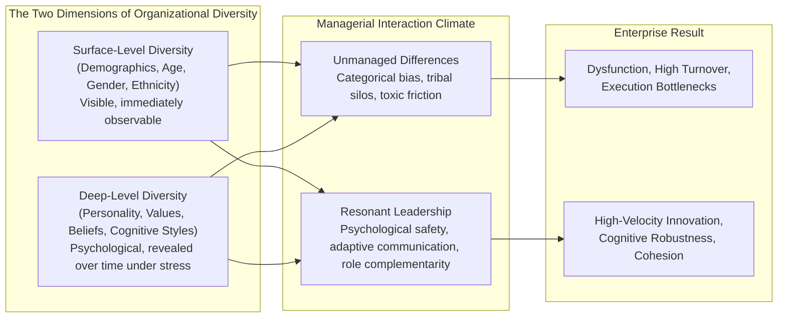
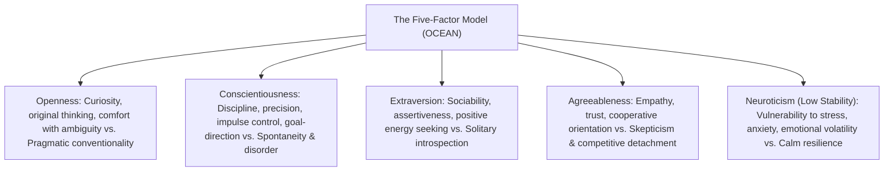
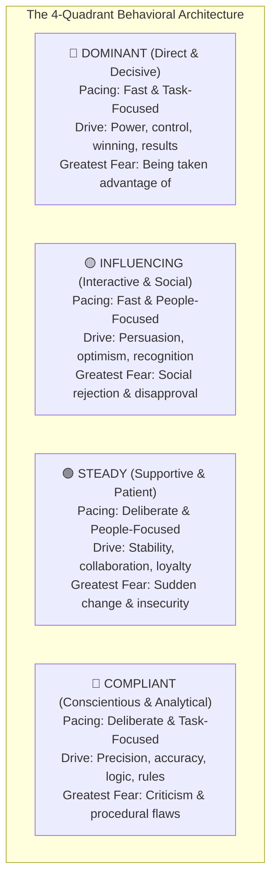
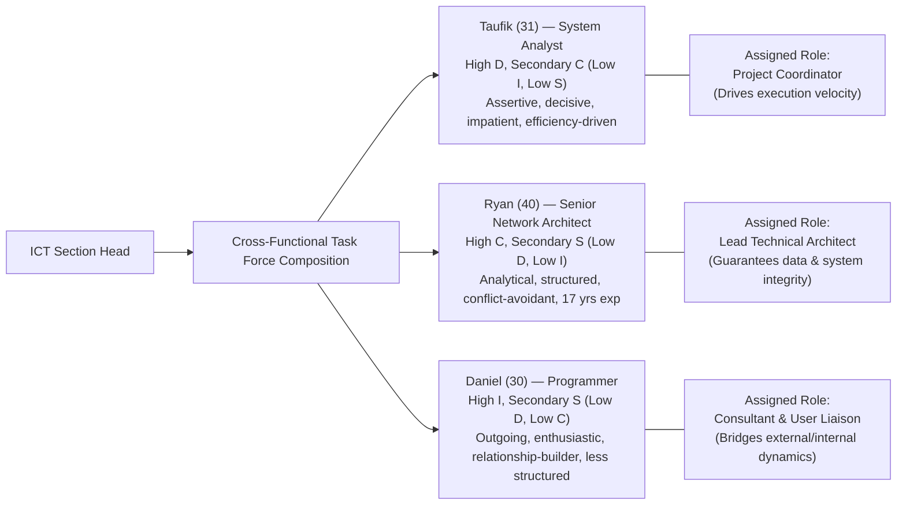
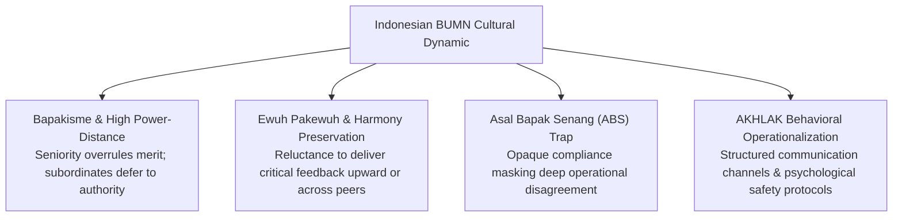
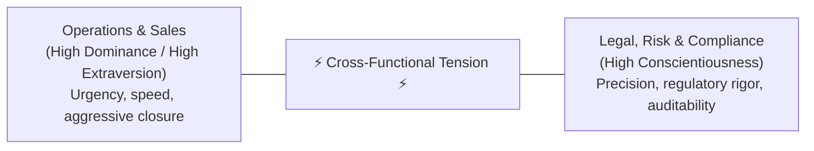

> [!NOTE] Curricular & Faculty Metadata
>
> - **Course:** MK1 Organizational Behaviour & Managing People — Week 02
> - **Teaching Team:** Muhammad Yorga Permana, Ph.D., Widhyawan Prawiraatmadja, Ph.D., Dr. Ir. Madju Yuni Ros Bangun, Yudo Anggoro, Ph.D.
> - **Primary Curricular Spine:** Week 2 - Identity, Personality, Behavior & Individual Differences (25 Slides)
> - **Direct Satellites & Problem Sets:**
>   - [[courses/mk1-organizational-behavior-managing-people/week-02/assignment-pre-personality-identity|Pre-Assignment: Personality & Identity Discussion]]
>   - [[courses/mk1-organizational-behavior-managing-people/week-02/assignment-post-personality-team|Post-Assignment: Personality & Team Dynamics Debrief]]
>   - [[courses/mk1-organizational-behavior-managing-people/week-02/reading-the-great-divide|Reading: Great Teams Are About Personalities, Not Just Skills]]

---

## 1. Executive Overview & Foundations of Personality and Diversity at Work

Every executive has witnessed the baffling paradox of corporate talent: two individuals with identical Ivy League credentials, identical years of technical experience, and identical cognitive IQ enter the same department. Within six months, one thrives as an inspirational cross-functional catalyst, while the other generates toxic friction, alienates key stakeholders, or retreats into passive-aggressive disengagement.

The difference does not lie in **functional capability (what they can do)**, but in **personality and behavioral dynamics (who they are and how they interact)**.

### The Business Case for Deep-Level Diversity

In modern enterprise governance, **Diversity, Equity & Inclusion (DEI)** is frequently reduced to surface-level compliance metrics. However, industrial-organizational psychology proves that **surface-level diversity** (demographics, race, gender) serves only as the threshold:

- Surface differences are immediately observable but have diminishing influence on long-term team collaboration as members work together over time.
- **Deep-level diversity**—differences in personality traits, risk tolerance, communication pacing, and foundational ethical values—compounds over time. When unmanaged, deep-level differences create destructive interpersonal friction; when strategically orchestrated, they protect the executive suite against groupthink and operational blindness.

---

## 2. Theoretical Architecture & Core Frameworks

Personality is the enduring pattern of psychological characteristics that shapes an individual's behavioral tendencies across diverse environmental contexts.

### 1. The Five-Factor Model ([[concepts/big-five-personality|Big Five]] / OCEAN)

Developed by Costa, McCrae, and Goldberg through decades of cross-cultural lexical analysis, the **[[concepts/big-five-personality|Big Five]]** represents the empirical gold standard of personality psychology:

$$\mathbf{P}_{\text{individual}} = \begin{bmatrix} \text{Openness to Experience (O)} \\ \text{Conscientiousness (C)} \\ \text{Extraversion (E)} \\ \text{Agreeableness (A)} \\ \text{Neuroticism / Emotional Stability (N)} \end{bmatrix}$$

#### Empirical Workplace Validity:

- **Conscientiousness** is the single most consistent psychometric predictor of individual job performance across virtually all occupational categories ($r \approx 0.22\text{ to }0.31, p < 0.001$). Highly conscientious individuals set higher goals, demonstrate disciplined effort, and persist through setbacks.
- **Emotional Stability (Low Neuroticism)** predicts performance in high-stress, volatile operational environments (e.g., trading desks, emergency plant shutdowns, M&A restructuring).
- **Extraversion** strongly correlates with leadership emergence and sales velocity, but extreme extraversion paired with low agreeableness produces domineering, dismissive executive behavior.
- **Openness to Experience** is vital for strategic innovation, corporate entrepreneurship, and adaptation during major organizational transformation.
- **Agreeableness** drives interpersonal citizenship behavior and team trust, but excessively high agreeableness can undermine executive decision-making when difficult restructuring or personnel termination is required.

---

### 2. Myers-Briggs Type Indicator (MBTI) vs. [[concepts/big-five-personality|Big Five]]: The Psychometric Divide

| Analytical Dimension        | Myers-Briggs Type Indicator (MBTI)                                                                  | [[concepts/big-five-personality                                                             | Big Five Model]] (Five-Factor Model) |
| :-------------------------- | :-------------------------------------------------------------------------------------------------- | :------------------------------------------------------------------------------------------ | ------------------------------------ |
| **Foundational Theory**     | Carl Jung's theoretical psychological types (1921).                                                 | Empirical factor analysis of human language and behavior.                                   |
| **Scoring Architecture**    | Bimodal forced-choice dichotomy (16 discrete types: e.g., ENTJ, ISFP).                              | Continuous dimensional spectrums (percentiles from 0 to 100).                               |
| **Statistical Reality**     | Assumes human personality is bimodal. In reality, human traits follow a normal Gaussian bell curve. | Reflects true population variance; most people cluster in the middle (ambiverts).           |
| **Test-Retest Reliability** | **Poor**: Over 50% of respondents receive a different type when retested after 5 weeks.             | **High**: Test-retest correlation coefficients consistently exceed $r = 0.80$ over decades. |
| **Predictive Job Validity** | Very low to negligible correlation with objective job performance metrics.                          | Strong, replicated predictive validity for performance, turnover, and leadership emergence. |
| **Executive Application**   | Excellent icebreaker for workshops, self-reflection, and conversational framing.                    | Legitimate instrument for talent benchmarking, team composition audits, and coaching.       |
| **Institutional Risk**      | **Legal & Selection Hazard**: The Myers & Briggs Foundation explicitly warns against hiring use.    | Misinterpreted as unchangeable genetic destiny if dynamic development is ignored.           |

---

### 3. The DISC Behavioral Framework

While the [[concepts/big-five-personality|Big Five]] evaluates stable internal personality traits, **DISC** (originated by William Moulton Marston) assesses observable behavioral preferences and interpersonal pacing in specific operational environments.

#### Detailed Behavioral Archetypes & Managerial Protocols

1. **🔴 Dominant (D) — The Driver**:
   - _Behavioral Profile:_ Assertive, ambitious, strong-willed, impatient, and performance-oriented. Moves with active, forceful energy in antagonistic environments.
   - _How to Deal with High D:_ Be brief, direct, and to the point. Focus strictly on business outcomes and bottom-line impact. Highlight logical benefits. Agree or disagree with facts, never with their personal authority.
   - _What NOT to do:_ Do not repeat yourself, engage in excessive small talk, or make vague generalities.
2. **🟡 Influencing (I) — The Communicator**:
   - _Behavioral Profile:_ Talkative, enthusiastic, creative, optimistic, spontaneous, and inspiring. Seeks attention and thrives on social energy.
   - _How to Deal with High I:_ Build a warm, favorable environment. Let them talk about their ideas and institution. Share testimonials and allow time for informal socializing. Put agreements in writing, but do not bog them down in administrative minutiae.
   - _What NOT to do:_ Do not eliminate social connection, do all the talking, or dismiss their creative ideas.
3. **🟢 Steady (S) — The Anchor**:
   - _Behavioral Profile:_ Patient, composed, loyal, discreet, supportive, and dependable. Highly reluctant to embrace rapid, unvetted change.
   - _How to Deal with High S:_ Show genuine personal interest. Patiently draw out their goals and provide ample time to adjust to new procedures. Clearly define roles, responsibilities, and step-by-step roadmaps. Assure personal follow-up.
   - _What NOT to do:_ Do not be pushy, aggressive, cold, or demand sudden pivots without transition periods.
4. **🔵 Compliant (C) — The Analyzer**:
   - _Behavioral Profile:_ Conscientious, systematic, objective, structured, and perfectionistic. Questions assumptions and demands exhaustive data validation.
   - _How to Deal with High C:_ Prepare your case in advance. Delineate pros and cons with accurate, structured documentation. Provide clear, logical explanations. When agreeing or disagreeing, cite verifiable evidence.
   - _What NOT to do:_ Do not refuse to explain details, answer questions vaguely, or appeal to emotional rhetoric.

---

### 4. Applied Case Study: The ICT Digitalization Task Force

During the module's seminar, executives analyze an operational assignment facing an **ICT Section Head** tasked with assembling an agile digitalization team alongside an external management consultant:

#### Key Managerial Resolutions:

- **Project Coordinator Appointment**: Appointing **Taufik (High D/C)** ensures project velocity, milestone enforcement, and proactive confrontation of operational bottlenecks.
- **Managing Taufik vs. Ryan Friction**: Taufik's aggressive pace threatens to alienate Ryan (High C/S). The Section Head mitigates this by requiring Taufik to submit advance written briefs and giving Ryan protected time to evaluate architectural trade-offs without public confrontation.
- **Consultant Liaison**: **Daniel (High I/S)** is appointed primary counterpart to the external consultant, leveraging his natural charisma and diplomacy to prevent adversarial territorialism between external advisors and internal IT teams.
- **Architectural Custodian**: **Ryan (High C/S)** is given full ownership and veto authority over system architecture and database design, ensuring enterprise security and technical compliance.

---

## 3. Managerial Crucible: Indonesian Enterprise & BUMN Context

Translating personality and team-role frameworks into Indonesian corporate realities requires navigating deeply entrenched cultural dynamics:

1. **The _Ewuh Pakewuh_ Communication Barrier**:
   In Javanese cultural tradition, maintaining social harmony (_rukun_) and showing deference to seniors often supersedes operational transparency. A junior engineer with a High-Conscientiousness profile (C) who detects critical flaws in an enterprise software rollout may remain completely silent rather than publicly embarrass a High-Dominance (D) senior director. Leaders must proactively establish **asynchronous, structured feedback mechanisms** (anonymous pre-mortems, written risk registers) that permit rigorous scrutiny without violating cultural politeness.
2. **The _Asal Bapak Senang_ (ABS) Syndrome**:
   When high-power leaders manage purely through dominance and intimidation, team members retreat into passive compliance. Operational reports show glowing green dashboards while customer service, supply chain reliability, and frontline morale silently disintegrate. Overcoming ABS requires leaders to display vulnerability, reward contrarian evidence, and explicitly ask: _"What are we pretending not to see?"_
3. **Operationalizing AKHLAK Values**:
   The Ministry of BUMN’s **AKHLAK** framework (_Amanah, Kompeten, Harmonis, Loyal, Adaptif, Kolaboratif_) cannot be mandated through slogans. True _Kolaboratif_ requires designing teams with complementary psychological roles (Winsborough 5-Role Model); true _Adaptif_ requires coaching High-Steady (S) and High-Compliant (C) personnel through structured change transitions; and true _Harmonis_ means managing interpersonal friction through transparent dialogue rather than toxic suppression.

---

## 4. Cross-Functional Implementation & Strategic Trade-offs

Operationalizing personality diversity across corporate functions creates immediate strategic friction:

1. **The Velocity vs. Compliance Trade-off**:
   - Commercial, sales, and transformation divisions are dominated by High-D and High-I profiles who prioritize market capture and rapid iteration.
   - Legal, risk management, and internal audit are dominated by High-C profiles who view rapid iteration as regulatory recklessness.
   - Executive leadership must design formal **governance arbitration interfaces** rather than letting functional battles become personalized character assassinations.
2. **The Trap of Personality Pigeonholing**:
   - Using personality assessments as an excuse for poor performance (_"I'm an extreme P, so I can't meet deadlines"_ or _"I'm High D, so you must tolerate my rudeness"_) destroys organizational accountability.
   - Executives must enforce the principle of **Behavioral Adaptability**: while natural preferences exist, professional leadership requires learning to flex outside one's primary quadrant when the task demands it.
3. **Legal & Ethical Guardrails**:
   - Administering unvalidated psychometrics (like MBTI) for hiring or promotional gating violates professional standards and exposes the firm to severe legal liability. Personality instruments belong in team development, leadership coaching, and communication calibration.

---

## 📚 Required Readings & In-Depth Satellites

| Document Title                                           | Author / Institution                                                               | Core Methodological Contribution                                                                                                    | Study Note / Guide                                                                                                           |
| :------------------------------------------------------- | :--------------------------------------------------------------------------------- | :---------------------------------------------------------------------------------------------------------------------------------- | :--------------------------------------------------------------------------------------------------------------------------- | --------------------------------------------------------------------------------------------------------------------- |
| **Great Teams Are About Personalities, Not Just Skills** | **Dave Winsborough & Tomas Chamorro-Premuzic** _Harvard Business Review (2017)_ | The 3 transmission channels of personality; critique of Google's Project Aristotle selection bias; 5 core team psychological roles. | [[courses/mk1-organizational-behavior-managing-people/week-02/reading-the-great-divide\|Open Winsborough Deep-Dive Note]]    |
| **A Brief History of Personality Tests**                 | **Eben Harrell** _Harvard Business Review (2017)_                               | Historical psychometric lineage (Woodworth to MBTI to [[concepts/big-five-personality                                               | Big Five]]); critique of bimodal typologies; legal risks in hiring.                                                          | [[courses/mk1-organizational-behavior-managing-people/week-02/reading-the-great-divide\|Open Harrell Deep-Dive Note]] |
| **W02 Pre-Assignment Guide**                             | **F9 Syndicate & Maintainer** _SBM ITB MBA_                                     | Post-class debrief analyzing personality tests in executive leadership and the Google Project Aristotle pushback.                   | [[courses/mk1-organizational-behavior-managing-people/week-02/assignment-pre-personality-identity\|Open W02 Pre-Assignment]] |
| **W02 Post-Assignment Guide**                            | **F9 Syndicate & Maintainer** _SBM ITB MBA_                                     | Framework revisions and full analytical solution to the ICT Digitalization Task Force case (Taufik vs. Ryan vs. Daniel).            | [[courses/mk1-organizational-behavior-managing-people/week-02/assignment-post-personality-team\|Open W02 Post-Assignment]]   |

---

## 📂 Primary Source Media & Digital Archives

| Material Title                                                                   |       Media Type        | Direct Repository Reference                                                                                 |
| :------------------------------------------------------------------------------- | :---------------------: | :---------------------------------------------------------------------------------------------------------- |
| **Week 2 Masterclass: Identity, Personality, Behavior & Individual Differences** |  Presentation (`.pdf`)  | `raw/courses/mk1/week-02/Week 2 - Identity, Personality,Behavior  & Individual Differences.pdf` (25 Slides) |
| **Great Teams Are About Personalities, Not Just Skills**                         |  HBR Article (`.pdf`)   | `raw/courses/mk1/week-02/Great Teams Are About Personalities, Not Just Skills.pdf`                          |
| **A Brief History of Personality Tests**                                         |  HBR Article (`.pdf`)   | `raw/courses/mk1/week-02/A Brief History of Personality Tests.pdf`                                          |
| **Week 2 Pre-Assignment Brief**                                                  | SBM ITB Brief (`.pdf`)  | `raw/courses/mk1/week-02/Pre Assignment Week 2.pdf`                                                         |
| **Syndicate 9 Pre-Assignment Submission**                                        | Word Document (`.docx`) | `raw/courses/mk1/week-02/Syndicate 9 - Pre Assignment Week 2.docx`                                          |
| **Syndicate 9 Post-Assignment Submission**                                       | Word Document (`.docx`) | `raw/courses/mk1/week-02/Syndicate 9 - Post Assignment Week 2.docx`                                         |

---

## 🔗 Knowledge Graph & Curriculum Bridges

- **Cohort Assignment Problem Sets**:
  - [[courses/mk1-organizational-behavior-managing-people/week-02/assignment-pre-personality-identity|Pre-Assignment: Personality & Identity Discussion]]
  - [[courses/mk1-organizational-behavior-managing-people/week-02/assignment-post-personality-team|Post-Assignment: Personality & Team Dynamics Debrief]]
- **Dedicated Academic Reading Satellites**:
  - [[courses/mk1-organizational-behavior-managing-people/week-02/reading-the-great-divide|Reading: Great Teams Are About Personalities, Not Just Skills (Winsborough & Chamorro-Premuzic)]]
- **Featured Theorists & Thought Leaders**:
  - Dr. Tomas Chamorro-Premuzic
  - Dave Winsborough
  - Eben Harrell
- **Antecedent Curricular Module**: Week 01: [[courses/mk1-organizational-behavior-managing-people/week-01/index|Strategizing Your Life — Self-Awareness, Values & Executive Purpose]]
- **Next Curricular Module**: Week 03: [[courses/mk1-organizational-behavior-managing-people/week-03/index|Motivation at Work — How to Get the Best Out of People]]
- Return to **[[courses/mk1-organizational-behavior-managing-people/index|MK 1 Course Overview]]**
