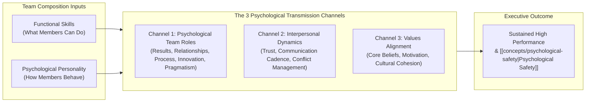
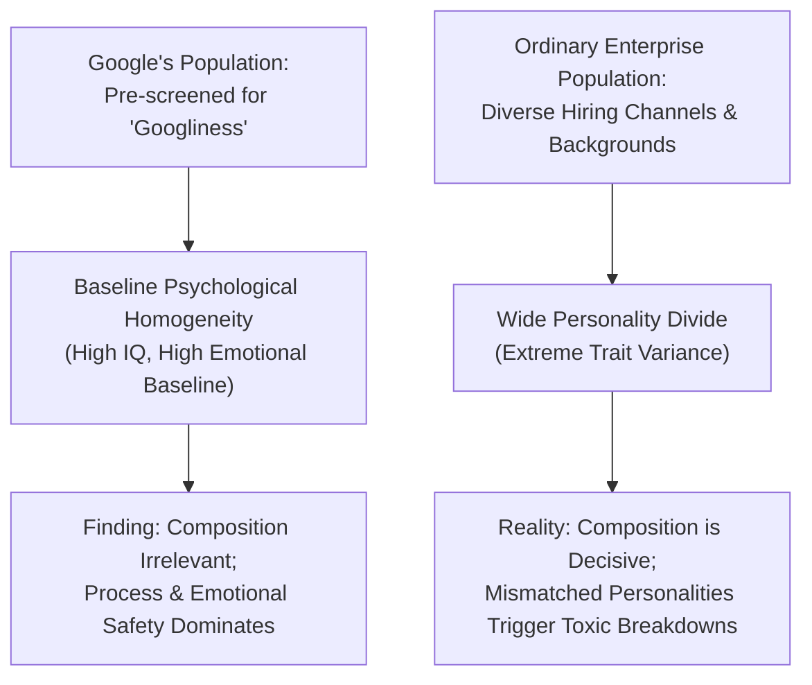
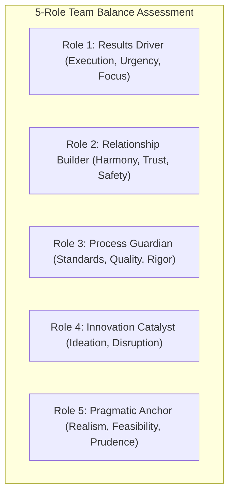

## 📄 Executive Synopsis & Context

- **Source Reference**: Dave Winsborough & Tomas Chamorro-Premuzic, _"Great Teams Are About Personalities, Not Just Skills"_, **Harvard Business Review** (January 2017); accompanied by Eben Harrell, _"A Brief History of Personality Tests"_, **Harvard Business Review** (March–April 2017).
- **Author Background**:
  - **Dave Winsborough**: Vice President of Innovation at Hogan Assessment Systems and founder of Winsborough Ltd.
  - **Dr. Tomas Chamorro-Premuzic**: Professor of Business Psychology at University College London (UCL) and Columbia University, Chief Innovation Officer at ManpowerGroup, and former CEO of Hogan Assessment Systems.
  - **Eben Harrell**: Senior Editor at Harvard Business Review.
- **Core Thesis**: When constructing high-performing teams, organizations fixate almost exclusively on **functional skills, technical credentials, and past experience**. However, while hard skills determine what an individual _can_ do, **personality dictates what they _will_ do and how the team _interacts_**.

  In 2016, Google published findings from _Project Aristotle_ claiming that team composition does not matter—that group emotional intelligence and conversational turn-taking alone predict team success. Winsborough and Chamorro-Premuzic mount an empirical critique against this finding: Google’s sample suffered from severe **pre-selection homogeneity ("Googliness")**. Because Google filters out misfits before hiring, their employees start with an artificial baseline of cognitive and emotional compatibility. In ordinary corporate organizations lacking such extreme selection filters, teams face a wide **"personality divide"**. Building high-performing teams requires deliberately balancing complementary **psychological roles**, managing **interpersonal dynamics**, and securing **values alignment**.

---

## 🧠 Complete Conceptual Architecture

### 1. Functional Roles vs. Psychological Roles

Traditional management treats team design as a linear puzzle of functional capabilities:

$$\mathbf{\text{Traditional Team Design} = \sum \text{Functional Capabilities (Engineering, Finance, Marketing)}}$$

Winsborough and Chamorro-Premuzic demonstrate that every team member simultaneously occupies two distinct roles:

1. **The Functional Role**: Defined by job title, technical specialization, and formal responsibilities.
2. **The Psychological Role**: Defined by personality traits and natural behavioral tendencies that emerge during unstructured group interaction.

A team staffed entirely with brilliant software engineers or elite CFA charterholders routinely implodes if all members occupy identical psychological roles (e.g., all aggressive results-drivers or all introverted, conflict-avoidant process analyzers).

---

### 2. The Three Channels of Personality Transmission

The authors argue that personality impacts team effectiveness through three distinct organizational channels:

#### Channel 1: Psychological Team Roles

Personality dictates the natural role an individual gravitates toward within a collaborative project:

- **Results-Oriented**: High assertiveness, competitiveness, and drive for closure. Pushes the group toward deadlines and deliverables.
- **Relationship-Focused**: High empathy, diplomacy, and interpersonal sensitivity. Monitors [[concepts/psychological-safety|psychological safety]], resolves tension, and builds trust.
- **Process & Rule-Oriented**: High conscientiousness, orderliness, and risk aversion. Enforces operational standards, compliance, and meticulous execution.
- **Innovative & Disruptive**: High openness to experience and unconventional thinking. Challenges groupthink, generates creative alternatives, and drives transformation.
- **Pragmatic & Grounded**: Hardheaded realism, prudence, and skepticism. Serves as a reality filter against speculative optimism.

#### Channel 2: Interpersonal Dynamics

Personality governs the frequency, tone, and friction of day-to-day team communication:

- Teams with high average emotional stability (low Neuroticism) maintain composure under operational stress and deadline crises.
- Teams with high Agreeableness experience smoother social collaboration, but risk succumbing to superficial politeness and conformity ("barbed courtesy").
- Diverse personality compositions require conscious communication protocols; an assertive "Dominant" style will intimidate a cautious "Steady" or "Compliant" member unless explicit ground rules are established.

#### Channel 3: Values Alignment

While behavioral diversity (how we work) fuels creative problem-solving, **values diversity (what we fundamentally believe)** can tear a team apart:

- Shared foundational values (e.g., customer commitment, ethical integrity, equity) create a unifying cultural anchor.
- When team members hold conflicting fundamental motivations (e.g., pure individual financial bonus extraction vs. long-term customer welfare), cynicism and factionalism emerge.

---

### 3. The Pushback on Google’s Project Aristotle

Google’s multi-year study of 180 teams concluded that _who_ is on a team matters far less than _how_ the team operates ([[concepts/psychological-safety|psychological safety]], dependability, structure, meaning, impact).

Winsborough and Chamorro-Premuzic identify the fatal methodological flaw in extrapolating this finding to ordinary corporations:

- **The Google Selection Bias**: Google rejects over 99% of job applicants, heavily filtering candidates through intensive behavioral interviews designed to assess "Googliness" (intellectual humility, conscientiousness, comfort with ambiguity, and collaborative orientation).
- **The Homogeneity Illusion**: Because Google employees already share a narrow band of psychological traits, Google's internal teams experience minimal baseline personality conflict.
- **The Enterprise Reality**: In typical state-owned enterprises, multinational branch plants, and legacy conglomerates, teams are assembled from diverse generational cohorts, educational backgrounds, and temperaments without pre-filtered psychological similarity. In this environment, failing to engineer complementary personality roles leads directly to toxic friction, passive aggression, or paralysis.

---

### 4. Historical Evolution & Critical Limits of Personality Tests (Eben Harrell)

To utilize personality frameworks responsibly, executive leaders must understand the psychometric lineage and limitations outlined by Eben Harrell:

1. **The Origins (WWI & Woodworth Personal Data Sheet)**:
   - Developed in 1917 to screen military recruits susceptible to "shell shock" (PTSD). Marked the transition of personality testing from academic laboratories to large-scale institutional screening.
2. **The Jungian Typology & The MBTI (Katherine Briggs & Isabel Myers)**:
   - Formulated during WWII to match civilian women to war-industry jobs. Based on Carl Jung's theoretical archetypes (Extraversion/Introversion, Sensing/Intuition, Thinking/Feeling, Judging/Perceiving).
   - **Critical Flaws**:
     - _Dichotomy Fallacy_: Bimodal categorization assumes human traits are discrete buckets (you are either an Introvert or an Extravert). In reality, human personality follows a bell curve (normal Gaussian distribution); most individuals are ambiverts clustered in the middle.
     - _Test-Retest Unreliability_: Over **50% of test-takers receive a different four-letter type** when retested just five weeks later.
     - _Lack of Predictive Validity_: Studies fail to demonstrate significant correlation between MBTI profiles and objective job performance.
3. **The Five-Factor Model ([[concepts/big-five-personality|Big Five]] / OCEAN)**:
   - Synthesized by Costa, McCrae, and Goldberg through lexical factor analysis across multiple cultures and languages.
   - Measures continuous traits: **Openness, Conscientiousness, Extraversion, Agreeableness, Neuroticism (Emotional Stability)**.
   - Recognized by modern industrial-organizational psychologists as the gold standard for empirical validity and test-retest reliability.

---

## 🏢 Real-World Executive Case Vignettes

### Case Vignette 1: Google Project Aristotle vs. Ordinary Corporate Reality

- **Context**: A global telecommunications enterprise attempted to copy Google’s Project Aristotle guidelines by mandating "conversational turn-taking" workshops across 40 software engineering squads.
- **The Breakdown**: Performance failed to improve, and interpersonal complaints surged. Post-mortem psychometric auditing revealed that the lowest-performing teams were staffed entirely by individuals scoring in the 95th percentile of Extraversion and Dominance (high D), resulting in perpetual territorial debates where no one executed documentation, or conversely, staffed entirely by extreme Introverts (high C) who refused to challenge erroneous architectural assumptions.
- **Resolution**: Rebalancing teams according to Winsborough’s 5 psychological roles restored delivery velocity and decreased turnover.

### Case Vignette 2: The Belbin Apollo Syndrome

- **Context**: Management researcher Meredith Belbin assembled teams of "superstars"—individuals with elite cognitive abilities, high analytical scores, and stellar individual track records.
- **The Result**: These teams consistently finished last in simulated business competitions. Members spent excessive time engaged in destructive intellectual debates, attempted to outsmart colleagues, demonstrated hyper-critical evaluations of peers' ideas, and neglected mundane execution details.
- **Key Takeaway**: High technical competence cannot compensate for destructive psychological role duplication.

---

## 🛠️ Complete Diagnostic Worksheets & Toolkits

### Toolkit: The 5-Role Team Personality Balance Audit

Audit your project team or syndicate across the five psychological roles to identify dangerous talent surpluses or critical blind spots:

#### Diagnostic Scoring Ledger

| Team Role                   | Key Behavioral Indicators                                          | Ideal Balance (5-Person Team) | Deficit Symptom (0 Members)                                        | Surplus Symptom (3+ Members)                                               |
| :-------------------------- | :----------------------------------------------------------------- | :---------------------------: | :----------------------------------------------------------------- | :------------------------------------------------------------------------- | ----------------------------------------------------------------------------- |
| **1. Results Driver**       | Focuses on bottom line, pushes for decisions, enforces milestones. |           **1 – 2**           | Drifting timelines, endless polite deliberation, missed deadlines. | Aggressive interpersonal friction, burnout, intimidation of junior staff.  |
| **2. Relationship Builder** | Empathizes, mediates disputes, ensures all voices are heard.       |             **1**             | Cliques, low [[concepts/psychological-safety                       | psychological safety]], lingering covert resentment.                       | Avoidance of difficult feedback, consensus paralysis, tolerating poor output. |
| **3. Process Guardian**     | Details matter, audits compliance, checks documentation.           |             **1**             | Careless errors, regulatory exposure, sloppy handoffs.             | Bureaucratic inertia, risk aversion, resistance to necessary agile pivots. |
| **4. Innovation Catalyst**  | Generates novel concepts, challenges existing methods.             |             **1**             | Stagnant solutions, inability to solve novel problems.             | Chronic strategy pivoting, lack of execution follow-through, confusion.    |
| **5. Pragmatic Anchor**     | Tests feasibility, stress-tests financial assumptions.             |             **1**             | Chasing unrealistic fantasies, over-promising to clients.          | Cynicism, premature killing of promising ideas, defeatism.                 |

---

## 📊 Comparative Exhibits & Framework Tables

### Exhibit 1: Psychometric Frameworks Comparison Matrix

| Dimension                 | Myers-Briggs Type Indicator (MBTI)                                                     | [[concepts/big-five-personality                                         | Big Five Model]] (OCEAN)                                                      | DISC Framework |
| :------------------------ | :------------------------------------------------------------------------------------- | :---------------------------------------------------------------------- | :---------------------------------------------------------------------------- | -------------- |
| **Theoretical Origin**    | Carl Jung (1921); Briggs & Myers (1940s).                                              | Lexical Hypothesis; Costa & McCrae (1980s).                             | William Moulton Marston (1928); Walter Clarke (1950s).                        |
| **Measurement Structure** | 16 discrete types (forced dichotomy: E/I, S/N, T/F, J/P).                              | 5 continuous dimensional spectrums (0–100 percentile).                  | 4 behavioral quadrants (Dominance, Influence, Steadiness, Conscientiousness). |
| **Empirical Validity**    | Low to moderate; poor predictive validity for job performance.                         | High; robust peer-reviewed psychometric validity.                       | Moderate; primarily behavioral and situational, not trait-level.              |
| **Test-Retest Stability** | Low (50%+ switch categories within 5–12 weeks).                                        | High (traits remain stable across adult lifespan).                      | Moderate to High in stable work contexts.                                     |
| **Best Executive Use**    | Team conversation starter, icebreaker, personal reflection.                            | Formal candidate assessment, talent mapping, team composition audit.    | Communication calibration, managerial feedback adaptation, conflict coaching. |
| **Major HR Risk**         | **Illegal/unethical selection**: Myers Foundation explicitly warns against hiring use. | Can breed fatalistic assumptions if scores are treated as unchangeable. | Pigeonholing employees into rigid colors; excusing poor behavior.             |

---

## 💬 Classroom Cold-Call & Discussion Strategy

### Discussion Question 1: "To what extent should an executive use personality tests to manage team members?"

- **Crisp Cold-Call Answer:**
  > "Personality assessments should be used strictly as diagnostic conversation starters and communication calibrators—never as selection gates or permanent behavioral labels."
- **Underlying Mechanism:** As Eben Harrell proves, tools like MBTI lack predictive validity and stability. Misusing them for hiring or promotion exposes the organization to legal liability and creates self-fulfilling pigeonholing. However, models like the [[concepts/big-five-personality|Big Five]] and DISC provide valuable common vocabularies for adaptive leadership.

### Discussion Question 2: "Why might Google's Project Aristotle findings fail in a typical Indonesian BUMN?"

- **Crisp Cold-Call Answer:**
  > "Google's findings suffer from survivorship and selection bias. Google pre-screens candidates for 'Googliness', eliminating extreme personality divergence before hiring. In an Indonesian BUMN without pre-filtered compatibility, teams face wide personality divides. [[concepts/psychological-safety|Psychological safety]] cannot emerge spontaneously unless complementary psychological roles are intentionally balanced."

---

## 🔗 Knowledge Graph & Bridges

- Master Lecture Note: [[courses/mk1-organizational-behavior-managing-people/week-02/index|Week 02 Masterclass Hub]]
- Related Assignments:
  - [[courses/mk1-organizational-behavior-managing-people/week-02/assignment-pre-personality-identity|W02 Pre-Assignment: Personality, Identity & Individual Differences]]
  - [[courses/mk1-organizational-behavior-managing-people/week-02/assignment-post-personality-team|W02 Post-Assignment: Personality & Team Dynamics Debrief]]
- Foundational Theorists & Authors:
  - Dr. Tomas Chamorro-Premuzic
  - Dave Winsborough
  - Eben Harrell
