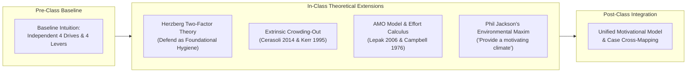
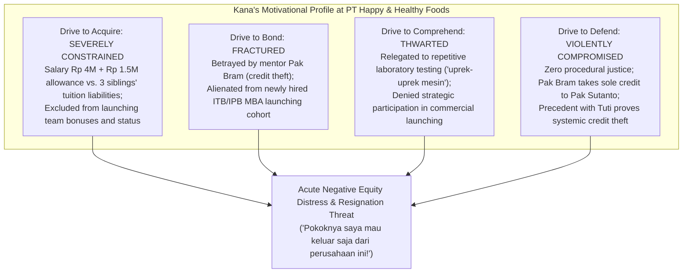

> [!NOTE] Assignment Context & Attribution
>
> - **Course:** MK1 Organizational Behaviour & Managing People — Week 03
> - **Source Prompt:** `archive/courses/mk1/week-03/Syndicate 9 - Post Assignment Week 3.docx`
> - **Reference Attribution:** Analytical synthesis contributed by **F9 (Class F / Syndicate 9)** & **the Portal Maintainer**
> - **Parent Lecture:** [[courses/mk1-organizational-behavior-managing-people/week-03/index|Week 03 Master Lecture Hub]]
> - **Pre-Assignment Reference:** [[courses/mk1-organizational-behavior-managing-people/week-03/assignment-pre-employee-motivation|W03 Pre-Assignment: Employee Motivation & Managerial Levers]]
> - **Target Case Dossier:** [[courses/mk1-organizational-behavior-managing-people/week-03/case-rudi-dan-kana|Case Study: Rudi dan Kana]]

---

## 📋 Part 1: Official Assignment Prompt & Skim Map

- **Executive Objective:** Deepen baseline motivation answers through in-class theoretical synthesis, integrating **Herzberg’s Two-Factor Theory**, **Campbell & Pritchard’s Effort Calculus**, **Lepak et al.’s AMO Model**, and the **Extrinsic Crowding-Out Effect (Cerasoli et al., 2014)**.
- **Target Deliverable:** Post-class debrief memo containing: (1) Unchanged baseline answers versus revised theoretical answers, (2) Explicit "What changed and why" reflections, and (3) Cross-application of the [[concepts/four-drive-model|Four-Drive Model]] to the _Rudi dan Kana_ case study.

---

## 💡 Part 2: Reference Solution & Framework Revisions

### Question 1: The Four Drives and Their Organizational Levers

#### Original Answer (Pre-Assignment Baseline)

> - **The Drive to Acquire**: The human need to obtain scarce goods, which includes physical items like money and intangibles like social status or promotions. The authors state this is best met by an organization's Reward System, specifically one that sharply differentiates good performers and ties rewards clearly to performance.
> - **The Drive to Bond**: The innate desire to form connections, mutual reliance, and friendships with individuals or larger collectives. This drive is best met by the organization's Culture, particularly one that values collaboration, teamwork, and sharing best practices.
> - **The Drive to Comprehend**: The desire to satisfy curiosity, make sense of the world, and make a meaningful contribution. This is best addressed through Job Design, ensuring roles are distinct, important, challenging, and meaningful to the organization.
> - **The Drive to Defend**: The instinct to protect oneself, one's accomplishments, and promote justice against external threats. This drive is best met by fair, transparent, and trustworthy Performance-Management and Resource-Allocation Processes.

#### Revised Answer (Using In-Class Frameworks)

> - **The Drive to Acquire**: The innate human impulse to obtain scarce resources, encompassing physical goods (compensation) as well as intangible social assets like status, authority, and public recognition. Class discussions emphasize that this drive is inherently **relative** rather than absolute: employees constantly benchmark their rewards against peer cohorts and external market indices. The primary organizational lever is the **Reward System**, which must sharply differentiate top performers, establish clear pay-for-performance linkages, and maintain external competitiveness by paying as well as market rivals.
> - **The Drive to Bond**: The evolutionary desire to develop attachments, mutual reliance, and meaningful social connections with colleagues and broader teams. While this drive fosters camaraderie and belonging, class analysis highlights that **unmanaged bonding can inadvertently generate tribalism and functional silos**. The primary organizational lever is **Culture**, which must foster mutual reliance and friendship, promote cross-boundary collaboration, and actively encourage the enterprise-wide sharing of best practices to break down insular departmental barriers.
> - **The Drive to Comprehend**: The urge to master challenges, satisfy curiosity, explore unknown operational domains, and make a meaningful contribution to the collective mission. This drive directly **anchors intrinsic motivation, job satisfaction, and personal growth**. The primary organizational lever is **Job Design**, ensuring that individual roles are distinct, vital to the organization, cognitively challenging, and structured so employees experience a direct line-of-sight to customer and societal impact.
> - **The Drive to Defend**: The foundational protective instinct to shield oneself, one's ideas, status, and accomplishments from external threats, while promoting equity and justice. When unaddressed, this drive triggers **acute psychological insecurity and entrenched resistance to change**. The primary organizational lever is **Performance-Management and Resource-Allocation Processes**, which must establish complete transparency, reinforce procedural fairness, and build trust through the open, equitable distribution of rewards, assignments, and recognition.

#### What Changed, and Why?

- **What Changed:**
  1. Incorporated the insight that Acquire is relative and status-driven, broadening the Reward System lever to include external market benchmarking.
  2. Enriched the Drive to Bond by identifying its organizational vulnerability: close in-group bonding causes insular departmental silos unless Culture explicitly incentivizes cross-functional knowledge sharing.
  3. Grounded the Drive to Comprehend in the architecture of **intrinsic motivation** and task significance.
  4. Deepened the Drive to Defend by linking it to behavioral resistance to change and procedural equity in assignments.
- **Why:** The pre-assignment provided static textbook definitions. The revision integrates core organizational behavior dynamics discussed in seminar—recognizing that drives operate through social comparison, can produce structural distortions (silos), and govern employee receptiveness or resistance to corporate change.

---

### Question 2: Bob Nardelli at Home Depot — Why One Drive Cannot Offset Others

#### Original Answer (Pre-Assignment Baseline)

> According to the authors, the four drives are independent; they cannot be ordered hierarchically or substituted for one another. Bob Nardelli failed because he relentlessly focused on the drive to acquire (by heavily emphasizing individual and store performance metrics) at the direct expense of the other three drives. His approach squelched camaraderie among coworkers (neglecting the drive to bond) and diminished dedication to technical expertise (neglecting the drive to comprehend). Furthermore, he created a hostile environment where employees felt they were not treated justly, which directly thwarted their drive to defend. Because all four drives must be satisfied in concert, his neglect of three drives severely damaged overall employee motivation.

#### Revised Answer (Using In-Class Frameworks)

> Bob Nardelli’s tenure at Home Depot illustrates the catastrophic failure of attempting to substitute one motivational drive for another within an interdependent, non-compensatory system.
>
> In-class theoretical synthesis uncovers three core explanatory mechanisms:
>
> 1. **The Extrinsic Crowding-Out Effect (Cerasoli et al., 2014; Kerr, 1995)**:
>    Nardelli relied almost exclusively on high-powered extrinsic incentives and rigid metric tracking, targeting only the Drive to Acquire. As established by Cerasoli et al. and Kerr’s _"Fouling the Nest"_ critique, excessive reliance on direct extrinsic incentives produces a severe crowding-out effect: it dampens intrinsic motivation, undermines creative problem-solving, and damages consultative service quality. Home Depot’s retail advantage relied on expert, relationship-driven customer advice. By replacing seasoned full-time tradespeople with low-cost part-time labor and standardizing store operations, Nardelli degraded job design and stripped employees of meaningful task contribution, thwarting their **Drive to Comprehend**.
> 2. **Breaching Foundational Hygiene Factors (Herzberg, 1959)**:
>    Through Herzberg’s Two-Factor Theory, Nardelli’s aggressive cost-cutting breached fundamental hygiene factors (fair supervision, job security, transparent working conditions), creating widespread job dissatisfaction that no amount of acquisition-based bonuses could remediate. Concurrently, hyper-competitive inter-store metrics destroyed camaraderie and mutual reliance, thwarting the **Drive to Bond**.
> 3. **The Collapse of the AMO Climate (Lepak et al., 2006)**:
>    Under Lepak et al.’s AMO (Ability, Motivation, Opportunity) model, Nardelli damaged both employee capability (Ability) and the collaborative psychological climate (Opportunity), preventing individual effort from translating into sustained organizational performance. Finally, his top-down, authoritarian intimidation triggered acute psychological insecurity, directly thwarting the **Drive to Defend**.
>
> Because an organization’s motivational throughput is a joint multiplicative function of all four drives, over-indexing on Acquire while crushing Bond, Comprehend, and Defend culminated in collapsed store morale, customer defection, and Nardelli’s board dismissal in 2007.

#### What Changed, and Why?

- **What Changed:** Integrated Cerasoli et al.’s **extrinsic crowding-out effect**, Herzberg’s **hygiene factor collapse**, and Lepak et al.’s **AMO framework**.
- **Why:** The baseline answer was narrative and descriptive. The revision grounds Nardelli's failure in formal psychological and human resource architecture, explaining exactly why direct financial metrics backfire when intrinsic craftsmanship and organizational hygiene are gutted.

---

### Question 3: The Financial Services Manager — Procedural Justice & Managerial Discretion

#### Original Answer (Pre-Assignment Baseline)

> The manager's team was less engaged because he failed to meet their drive to defend, falling below the company average on that specific metric. Even though he outperformed his peers on the drives to acquire, bond, and comprehend, a poor showing on just one drive is enough to substantially diminish the positive impact of the others, damaging the group's overall motivational profile.
>
> The case also shows that managers have some influence but not complete control. They cannot easily change major organisational systems such as the overall reward system, company culture, job design, or management policies. However, they do have some freedom in how they apply those systems. For example, managers can give recognition, encourage teamwork, make work more meaningful, and make decisions more transparent and fair within their area of responsibility.
>
> Overall, the case suggests that a manager cannot change everything in an organisation, but they still have an important role in creating a motivating environment for their own team. Even within organisational limitations, employees expect their managers to make an effort to address all four drives.

#### Revised Answer (Using In-Class Frameworks)

> The financial services manager achieved superior ratings on Acquire, Bond, and Comprehend, yet led an underperforming, disengaged unit because his score on the Drive to Defend fell below the corporate average. Because Nohria et al.’s model operates as a non-compensatory system, a failure in even one drive creates an **operational bottleneck** that neutralizes the motivational gains of the remaining three.
>
> Integrating in-class theoretical models:
>
> 1. **Defend as the Primary Hygiene Bottleneck (Herzberg, 1959)**:
>    The Drive to Defend serves as the foundational psychological hygiene factor. While the manager provided motivators like competitive bonuses, social camaraderie, and engaging client assignments, his failure to ensure fairness and transparency in account distribution and performance reviews created acute psychological insecurity.
> 2. **Campbell & Pritchard’s (1976) Effort Calculus**:
>    Campbell and Pritchard establish that motivation is a rational cognitive decision regarding Direction, Intensity, and Persistence:
>    $$\text{Motivation Decision} = \text{Assessment}\Big(\text{"Is it worth my time and energy? What will I gain if I put in more effort?"}\Big)$$
>    When procedural justice is compromised, employees perceive rewards and promotions as arbitrary or politically rigged. Consequently, their willingness to expend discretionary effort drops precipitously, regardless of formal bonus sizes.
> 3. **The Duality of Managerial Discretion (Lepak et al. & Phil Jackson)**:
>    - **What a Manager Cannot Change (Macro Architecture):** Corporate salary bands, firm-wide benefits, formal corporate culture, structural job architectures, or corporate resource pools (the macro HR systems in Lepak et al.’s AMO model).
>    - **What a Manager Directly Shapes (Micro Psychological Climate):** As reflected in Phil Jackson’s coaching philosophy discussed in seminar:
>      > _"You cannot motivate someone; all you can do is provide a motivating environment and the players will motivate themselves."_
>    - Managers govern local operational execution: translating metrics transparently, assigning client accounts equitably, giving credit fairly, protecting psychological safety, and providing meaningful context for daily tasks.
>
> The financial services manager failed because he neglected the very lever under his direct operational control: **procedural justice and transparency in local daily governance.**

#### What Changed, and Why?

- **What Changed:**
  1. Applied Herzberg’s Two-Factor Theory and Campbell & Pritchard’s effort calculus to explain why an unmet Drive to Defend halts discretionary effort.
  2. Applied Lepak et al.’s AMO framework to delineate macro corporate systems from the local psychological climate.
  3. Integrated Phil Jackson’s environmental leadership philosophy to specify the exact operational mechanisms of frontline managerial influence.
- **Why:** The revision elevates the analysis from broad managerial observations to formal decision theory, demonstrating that procedural unfairness directly disrupts an employee's calculation of effort.

---

## 🔬 Part 3: Applied Case Synthesis — Cross-Mapping to _Rudi dan Kana_

Applying the [[concepts/four-drive-model|Four-Drive Model]] to the Week 03 business case (_Rudi dan Kana_, Dr. Yuni Ros Bangun, SBM ITB 2016) provides an empirical demonstration of motivational collapse:

### The Analytical Diagnosis:

- Kana's explosive anger is not irrational emotional volatility; it is the **simultaneous collapse of all four motivational drives**.
- In particular, Pak Bram’s credit theft on project _Kiddy Meal_ shattered her **Drive to Defend**. Under Campbell & Pritchard’s calculus, Kana concluded that her extra discretionary effort (Ramadhan overtime baking in factory ovens) yields zero return, prompting her to "leave the field" (Adams' Equity Theory).
- Rudi’s managerial mistake was attempting to appeal to the Drive to Bond (_"dulu Bram atasan yang baik"_) without addressing the total breach of the Drive to Defend and her financial obligations (Drive to Acquire).

---

## 🎙️ Part 4: Classroom Cold-Call & Faculty Debrief Strategy

- **Faculty Angle (SBM ITB Panel):** _"If you inherit a demoralized team in an Indonesian BUMN where salaries are rigid and firing poor performers is legally prohibited, what is your 30-day action plan under the [[concepts/four-drive-model|Four-Drive Model]]?"_
- **High-Signal 30-Second Recitation Script:**
  > "I would immediately stabilize the two drives under my direct operational control: **Defend** and **Comprehend**. First, I satisfy the Drive to Defend by publishing transparent project assignment rubrics, ensuring shift scheduling is scrupulously fair, and instituting strict zero-tolerance for credit theft. Second, I satisfy the Drive to Comprehend through job crafting: eliminating redundant administrative bureaucracy and rotating employees into strategic cross-functional problem-solving. By creating procedural justice and task meaningfulness, I restore employee effort calculations without needing to alter corporate civil-service pay bands."

---

## 🔗 Knowledge Graph & Curriculum Bridges

- Return to **[[courses/mk1-organizational-behavior-managing-people/week-03/index|Week 03 Masterclass Hub]]**
- Associated Business Case Dossier:
  - [[courses/mk1-organizational-behavior-managing-people/week-03/case-rudi-dan-kana|Case Study: Rudi dan Kana (Dr. Yuni Ros Bangun, SBM ITB)]]
- Theoretical Reading Satellite:
  - [[courses/mk1-organizational-behavior-managing-people/week-03/reading-employee-motivation-powerful-new-model|Reading: Employee Motivation — A Powerful New Model (Nohria et al.)]]
- Core Curricular Concepts:
  - [[concepts/four-drive-model|The [[concepts/four-drive-model|Four-Drive Model of Employee Motivation]]]]
  - [[concepts/self-awareness|The Self-Awareness Triad & Executive Presence]]
